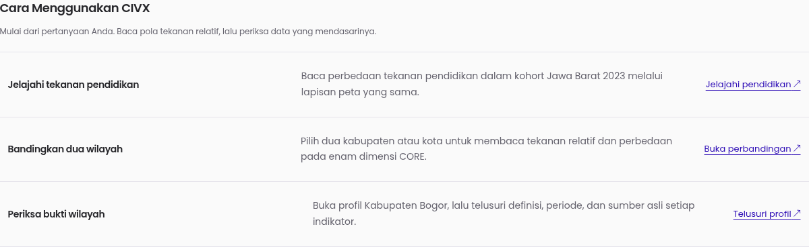

# CIVX — Explore regional pressure, inspect the evidence

CIVX (Civic Index) helps researchers, journalists, civic organizations, public-sector stakeholders, and students explore **relative regional pressure in Jawa Barat** and inspect the evidence behind it.

**Problem:** regional statistics are scattered across publications and government portals, with different units, dates, definitions, and coverage. **Solution:** CIVX connects a fixed **2023 cohort of 27 kabupaten/kota**, an interactive map, six CORE dimension profiles, two-region comparison, and original source references in one Indonesian-language interface.

Use CIVX as an inspectable starting point for further investigation—not an automatic policy decision.

## What judges can explore

| Feature | What it provides |
| --- | --- |
| Home `/` | Coverage summaries, an interactive regional pressure map, and three practical ways to start. |
| Explore `/explore` | Search across 27 kabupaten/kota, filter by region type, inspect overall or six dimension layers, and share the current search/type/layer URL. |
| Region detail `/regions/[id]` | Overall pressure, six dimensions, up to three similar profiles with direct Compare actions, 18 indicator disclosures, original source references, controlled insights, and separately dated context. |
| Compare `/compare?a=3201&b=3273` | Two-region selection and the direct-pressure comparison contract described below. |
| Methodology `/methodology` | Scoring direction, normalization, weighting, limitations, and export restrictions. |
| Sources `/sources` | Searchable evidence for all CORE indicators and CONTEXT datasets, including publishers, periods, units, coverage, and limitations. |

The interface includes light/dark/system themes, responsive layouts, keyboard controls, visible focus, and reduced-motion support. These features are not a claim of formal accessibility certification.

**Review status, not public approval:** current screens display unreleased model values and insights for frontend review. No verified public demo URL is provided here. Use the restricted local review instructions below; do not treat a working screen as release authorization.

## Quick product walkthrough

Use the [local setup](#run-locally) below for restricted review. No public demo is authorized.

1. **Start at Home `/`.** Read the coverage and reference year, then inspect a region on the map. Higher values mean higher relative pressure, not better performance.
2. **Explore `/explore?layer=education`.** Start on the Education map layer, search for a region, or filter kabupaten/kota. Share the URL or use Back/Forward to revisit filter states. Filters never recalibrate the fixed cohort scale.
3. **Compare `/compare?a=3201&b=3273`.** Inspect the overall pressure and six dimensions side by side. Differences describe the model, not causes or policy priorities.
4. **Inspect `/regions/3273`.** Compare a similar six-dimension profile, then open an indicator to check its value, period, definition, denominator, uncertainty, and original source. Similarity describes pressure patterns, not shared causes or future outcomes. CONTEXT remains separate from CORE.
5. **Check evidence and limits.** Search `/sources` and read `/methodology#status-model`. CSV and regional A4 reports contain identities and references only, not unreleased analytical values.

Stack and commands are in [Run locally](#run-locally); detailed methodological and technical audits remain in [Technical and audit reading](#technical-and-audit-reading).



Actual browser capture of the navigation scenarios, not a mockup. This image contains no unreleased analytical values; numerical review captures remain local. The [similar-profile derivation and restrictions](docs/PRODUCT-INTEGRATION-2023.md#derived-similar-regional-profiles) are documented separately.

## How to read CIVX

The reviewed model covers **27 kabupaten/kota in Jawa Barat**, with a **2023 reference vintage**, **18 CORE indicators**, and **six equally weighted dimensions**:

- Socioeconomic
- Education
- Basic Services
- Public Health
- Disaster Pressure
- Environment

Each dimension contributes exactly **1/6** of the overall score. Indicators share their own dimension's weight equally; the 18 indicators do not all have equal overall weight. Direction-aware min–max normalization uses the same fixed 27-region cohort.

**Higher score means higher relative pressure, not better performance.** A score is not regional quality, a public ranking, a winner/loser judgment, or a policy priority. Zero does not mean no pressure; 100 does not mean the maximum possible harm. Changing a search filter does not recalibrate the scale.

Only this complete CORE vintage is available. CIVX does not establish trends, causal effects, predictions, or confidence in an overall regional score. Published source uncertainty is retained where available; absent uncertainty does not establish certainty.

### Comparison contract

The Phase 4 comparison cutover uses **direct overall pressure and all six CORE dimensions**, with the engine's full-precision A-minus-B differences. It removes inverted `100 − pressure` scores, the inverted provincial mean, and unsupported quality/priority badges. It does not add a provincial benchmark, rank, or recommended action.

Independently rounded display values may not subtract to the displayed difference. CONTEXT is not scored or numerically compared. Phase 4 browser evidence and automated checks are recorded in [TASKS.md §32](docs/TASKS.md#32-phase-4-final-integration-and-submission-review).

## Sources, dates, and separate context

The audited source catalogue includes:

- **BPS** regional statistics, household surveys, education measures, commuter statistics, and Podes publications.
- **Dinas Kesehatan Provinsi Jawa Barat** for the exact population denominator in the health profile, and **BKPK Kementerian Kesehatan RI** for SKI nutrition estimates.
- **BNPB** for the official 2023 disaster-risk index (IRBI).
- **Dinas Lingkungan Hidup Jawa Barat**, through **Galura / Open Data**, for district IKLH.
- **Pemerintah Kota Bandung / Dinas Perhubungan** for selected road observations, and **KLH/BPLH** for dated station ISPU readings. The air audit also cites the KLHK-era ISPU regulation; it does not relabel those readings as a 2023 KLHK regional panel.

See the [frozen indicator/source catalogue](docs/FINAL-INDICATOR-FREEZE-2023.md#3-exact-source-and-denominator-contract) and [contextual source audit](docs/CONTEXTUAL-DATA-AUDIT-2023.md) for original URLs, table/page locators, definitions, source receipts, and rights limitations. A source published or retrieved in 2024–2026 is not automatically an observation from that year.

**Seven CONTEXT datasets stay separate and never change CIVX:** selected Bandung road speed and volume/capacity observations, Type C terminal inventory, commuter share, Podes theft-occurrence counts, overall station ISPU, and its PM2.5 component.

Their dates and coverage differ:

- Terminals use the **2023** inventory; commuter data use the **October 2023** survey and its stated recall window.
- Bandung road observations come from the **2024** report; exact survey dates are unspecified.
- Podes theft-occurrence counts refer to the **year preceding May 2024 enumeration**, not a verified calendar-2023 crime rate.
- Air observations retain **29 October 2026, 16:00 source-local time**. They are station index snapshots, not 2023 regional exposure, annual averages, or PM2.5 mass concentrations.

Missing values are not zero. Commuter coverage includes only five regions. Terminal cells remain missing for Kabupaten Cirebon and Kabupaten Subang, while Kota Banjar's explicit zero remains zero. Road and air observations stay site-level; CIVX does not invent city averages. See [availability and missingness](docs/PRODUCT-INTEGRATION-2023.md#availability-and-missingness).

Maps use approximate **2020 geoBoundaries ADM2 geometry**, not certified 2023 boundaries or a scoring input. Attribution: BPS, WFP, and OCHA ROAP via [geoBoundaries](https://www.geoboundaries.org/api/current/gbOpen/IDN/ADM2/), adapted under [CC BY 3.0 IGO](https://creativecommons.org/licenses/by/3.0/igo/). See [geometry provenance](docs/DATA.md#9-geographic-display-geometry-separate-from-scoring).

## Governance and safe review

There is an explicit governance contradiction to resolve: the frontend currently shows model values and descriptive insights, while the frozen records remain **`SCORED_NOT_RELEASED`**, **`INSIGHTS_NOT_RELEASED`**, and **`productionIntegrationAuthorized: false`**. Frontend review does not clear those restrictions or authorize public redistribution.

Keep the features available for **restricted local review**. **Do not deploy publicly** until source reuse rights and model/insight release signoff are documented. Independent method review, effective-boundary certification, and formal accessibility review remain separate gates. This README claims no approval, deployment, or newly verified release.

### CSV and A4 reports

- Explore's **Unduh CSV identitas** exports **all filtered regional identities and references**, not only the current table page. Map-layer selection does not change the export. No scores, indicator values, or CONTEXT observations are exported.
- CSV uses comma-delimited RFC 4180 records, CRLF, a **UTF-8 BOM**, and spreadsheet-formula protection, including formula-like text after leading whitespace/control/format characters.
- Region detail's **Cetak identitas / PDF** opens the browser print dialog. Select A4 and a printer or Save as PDF. The identity/reference report includes source and methodology references, **no numerical model or observation values**, and no insights.

On-screen display is not numerical export approval. Public numerical CSV/PDF requires a documented rights/release decision and a reviewed contract change, not a browser flag. Details appear at `/methodology#ekspor-dan-laporan` and in [product integration](docs/PRODUCT-INTEGRATION-2023.md).

The regional report restriction is not a browser-wide data-loss control: other pages can still be copied or printed with their on-screen numbers. The shared preview notice discloses release status; it does not restrict access. Keep review local or access-controlled until a documented release decision resolves this gap.

### Restricted local analytical reports

Numerical reporting is implemented **offline for restricted review**, not as a public website export. This distinction does not make metadata-only reporting a complete numerical export.

```sh
node scripts/prepare-analytical-report-2023.ts --region 3273 --q Bandung --type kota
```

The command creates a full-precision analytical CSV for every filtered region and a standalone A4 HTML report for the selected region. Both read the authoritative facade: overall pressure, six dimensions, 18 CORE indicators/units, original periods, definitions/denominators, uncertainty, and source references. Open the returned `file://` HTML and activate **Cetak / Simpan PDF lokal** to save a numerical PDF locally.

Files stay in a random private temporary directory outside the repository, with POSIX directory/file modes `0700`/`0600`. No web route, client toggle, public download, new dependency, or publication approval is added. Save the browser-generated PDF in the same controlled directory; browser save locations/permissions remain the operator's responsibility. See the [complete analytical reporting contract and authorization checklist](docs/ANALYTICAL-REPORTING-2023.md).

## Run locally

Stack: **Next.js 16.4.2**, **React 19.3.0**, and **TypeScript with strict mode**, using CSS modules and semantic CSS tokens. The frozen local dataset needs no database, API server, credentials, or external map service.

Use **Node.js 26.12.0 and npm 12.2.1**, the versions exercised for this submission review. From the repository root:

```sh
npm ci
npm run dev
```

Open **http://localhost:3000** for restricted review. The existing `next/font` Poppins setup downloads fonts at build time and self-hosts them afterward.

### Verification commands

```sh
npm test
npm run lint
npm run build
npm start
```

`npm start` serves the completed production build locally; it is not deployment authorization. The reporting candidate passed **369 tests**, lint, and the strict TypeScript production build (**36 generated pages**). Reporting evidence and remaining approval gates live in [TASKS.md §38](docs/TASKS.md#38-complete-reporting-contract-with-offline-numerical-review); the previous product review remains in §37.

**Bundler precision:** development and builds intentionally use webpack. Next 16.4.2 Turbopack can reserialize imported JSON numbers—for example, `3.7037037037037037` becomes `3.703703703703704`—and fail exact contextual coverage validation. Keep reviewed data and validation intact rather than weakening them for the bundler.

## Technical and audit reading

- [Product integration](docs/PRODUCT-INTEGRATION-2023.md) and [data access](docs/DATA-ACCESS-LAYER-2023.md): immutable product boundary, source traceability, missingness, and site-context semantics.
- [Normalization](docs/NORMALIZATION-DESIGN-2023.md), [weighting](docs/WEIGHTING-DESIGN-2023.md), [scoring](docs/SCORING-ENGINE-2023.md), [comparison](docs/COMPARISON-ENGINE-2023.md), and [insights](docs/INSIGHT-ENGINE-2023.md): exact mathematical and release contracts.
- [Context audit](docs/CONTEXTUAL-DATA-AUDIT-2023.md), [freshness audit](docs/FRESHNESS-AUDIT-2024-2026.md), and [data provenance](docs/DATA.md): original evidence, dates, limitations, and reuse constraints.
- [Architecture](docs/ARCHITECTURE.md) and [verification history](docs/TASKS.md): implementation and recorded checks.

Authoritative frontend reads use `src/lib/civx/product-2023.ts`; React does not normalize, rescore, reweight, or regenerate insights. `similar-regions-2023.ts` derives Euclidean peer distances separately from the same six CORE scores. Full precision is retained; pressure displays use one decimal and derived distances up to two decimals with Indonesian number formatting.

Historical documents, including [METHODOLOGY.md](docs/METHODOLOGY.md), [METHODOLOGY-V2.md](docs/METHODOLOGY-V2.md), and [METHODOLOGY-CURRENT.md](docs/METHODOLOGY-CURRENT.md), remain audit history. Their earlier four/eight-input contracts do not define this frontend's 18-indicator model. Do not regenerate historical releases to run the website.
