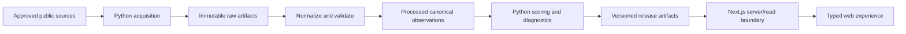

# CIVX Architecture

**Status:** 2023 Jawa Barat four-indicator release covers 27 complete records; geographic display and same-release comparison available; boundary crosswalk review and later periods deferred

## 1. Application baseline

The current application is a Next.js App Router interface over a validated, versioned 2023 release:

- Next `16.4.2`;
- React `19.3.0` and React DOM `19.3.0`;
- TypeScript with `strict: true`, `noEmit: true`, and the `@/*` path alias to `src/*`;
- Tailwind CSS and ESLint already present;
- server-rendered Home, regional detail, comparison and evidence content;
- small client boundaries for Explore interaction, active navigation, theme preference and contextual dialog lifecycle;
- versioned raw transcription, fixed methodology, processed release and separately licensed display geometry.

No packages were added for the product-quality pass. The Python and storage sections below describe future expansion, not additional services required by this release.

## 2. Architectural decisions

1. **Next.js is the web application boundary.** It owns routes, rendering, interaction, loading/error states, and presentation of released results.
2. **TypeScript is strict at the web boundary.** Data contracts should be typed and validated at ingress; UI code must not recalculate index rules.
3. **Python is a future data-processing boundary.** It owns acquisition, normalization, validation, scoring, release manifests, and reproducible batch outputs. It is not installed or implemented in this phase.
4. **The published data release is the source of truth for scores.** The web layer reads versioned derived artifacts or an API backed by them.
5. **Raw, processed, and published data remain distinct.** Each derived value retains provenance to its input artifact, configuration, methodology, and computation version.
6. **The pipeline is release-oriented before it is scheduled.** Manual, reviewable releases are acceptable before automated refresh is designed.

## 3. Target data flow



A result must be traceable through this chain: region and period → source observation → processed observation → normalization/scoring configuration → methodology version → published release.

## 4. Next.js and TypeScript responsibilities

### Frontend responsibilities

- render release, region, period, dimension, indicator, source, confidence, and limitation information;
- provide filters and navigation only over comparable released results;
- show unavailable, partial, low-confidence, revised, and non-comparable states explicitly;
- provide accessible loading, error, empty, and data-quality states;
- keep presentational and interaction components reusable;
- consume typed result contracts from the server/read boundary;
- avoid embedding indicator weights, normalization formulas, or source-specific parsing.

### Server/read boundary responsibilities

- select the requested approved release and methodology version;
- enforce allowed region/period/release combinations;
- return aggregate results together with components, provenance, confidence, and warnings;
- prevent accidental mixing of incompatible releases;
- keep secrets and source credentials out of client code, if credentials are ever needed.

The web application should not fetch arbitrary source files at render time or recalculate a score in a React component.

## 5. Python/data-processing responsibilities

A future Python package or job boundary should own:

- source acquisition and raw artifact preservation;
- source adapters and metadata extraction;
- region, indicator, and period normalization;
- schema, range, duplicate, coverage, and comparability validation;
- normalization, weighting, aggregation, confidence, and sensitivity calculations;
- release manifests, checksums, exclusion reports, and reproducibility metadata;
- deterministic generation of derived result artifacts.

Python is a planned responsibility, not a current dependency. Its package choice, environment, storage, and execution platform require a separate decision before implementation.

## 6. Pipeline stages

1. **Discover and approve:** register candidate sources, definitions, licensing, and owners.
2. **Acquire:** fetch approved sources and preserve raw files/responses with retrieval metadata.
3. **Normalize:** map source observations to official `kabupaten/kota`, indicator, unit, and period identifiers.
4. **Validate:** reject or flag invalid, incomplete, revised, or non-comparable observations.
5. **Score:** apply the approved methodology configuration and produce components, aggregate, confidence, and diagnostics.
6. **Review:** inspect validation results, exclusions, sensitivity, and source attribution.
7. **Publish:** create an immutable versioned release manifest and derived artifacts.
8. **Serve:** expose the approved release to Next.js through a stable typed boundary.

No failed acquisition may be silently replaced with a fabricated or stale value.

## 7. Proposed folder structure

The actual release uses versioned raw transcription and methodology files, a locally acquired BPS PDF artifact, a reproducible processing script, and the `src/lib/civx/` typed data/scoring boundary. The directory plan below remains a future expansion guide.
```text
docs/
  PRODUCT.md
  DATA.md
  METHODOLOGY.md
  ARCHITECTURE.md
  TASKS.md

src/
  app/                    # Next.js routes and layouts
  components/             # reusable presentation components
  features/               # product features: overview, region, compare, map
  lib/                    # typed read clients and pure UI utilities
  types/                  # shared web-facing contracts

python/
  civx_data/
    sources/              # source adapters
    normalize/            # canonicalization and geography mapping
    validate/             # data-quality rules
    score/                # methodology implementation
    releases/             # manifests and publication helpers
  scripts/                # explicit pipeline entrypoints

data/                     # location to be decided; raw/processed/release artifacts
  raw/                     # immutable acquired inputs
  processed/              # canonical observations and validation outputs
  releases/               # approved derived artifacts and manifests

tests/                    # contract, data-quality, and methodology tests
```

The current release stores its versioned JSON in this repository. Future production storage, object storage and database decisions remain open; expansion must preserve one authoritative source of truth.

## 8. Future scalability

Start with versioned files and a small number of regions if that satisfies the first release. Scale only when evidence requires it:

- separate ingestion jobs from web deployment;
- move raw artifacts to object storage with checksums and retention policy;
- use a database for indexed release queries when file-based reads become insufficient;
- add caching for immutable release responses;
- partition processing by source, period, or region while preserving deterministic release manifests;
- add scheduled refreshes, monitoring, and failure alerts after manual release review is reliable;
- introduce API versioning when multiple consumers need stable contracts.

Scalability must not weaken provenance, reproducibility, or release review.

## 9. Security and operations

- Treat downloaded source content as untrusted input.
- Keep credentials and secrets outside source control and client bundles.
- Bound resource use during acquisition and validate file formats.
- Record failures with enough context to rerun without exposing secrets.
- Define retention, backup, disaster recovery, licensing, and attribution before production dependence.
- Do not publish raw data that has usage restrictions without a licensing decision.

## 10. Decisions requiring approval

- Location and ownership of raw, processed, and release artifacts.
- Python environment, package policy, execution platform, and repository boundary.
- Storage engine: versioned files, database, or a combination.
- API/read contract and release endpoint versioning.
- Manual versus scheduled publication workflow.
- Deployment target, caching, observability, and retention policy.
- Exact folder split between the Next.js repository and data pipeline.

## 11. Current 2023 release

- `data/raw/civx-jabar-2023.json` holds 27 kabupaten/kota's four official 2023 BPS table values, per-table attribution, and a PDF checksum/size manifest. The full book remains in an ignored local path and is not redistributed.
- `data/methodology/civx-jabar-2023.json` fixes the all-27 2023 reference extrema, directions, and four equal weights. Expanding coverage did not change this policy.
- `scripts/build-civic-release.mjs` checks artifact integrity, all 27 BPS geographic identities, source linkage, units, periods, and complete observations; it applies the shared scorer and writes `data/processed/civx-jabar-2023.json` with publication and exclusion counts.
- `src/lib/civx/types.ts` defines release, source, observation, policy, component, and result contracts; `src/lib/civx/scoring.ts` handles normalization, missingness, provenance, and aggregation; `src/lib/civx/data.ts` validates the read boundary. `src/lib/civx/coverage.ts` describes published score ordering and median without refitting score ranges. UI components never calculate scores.
- `/explore` filters and sorts published records alongside an accessible SVG map using a separately licensed, simplified 2020 ADM2 display subset; `/compare` restricts pairs to compatible published results; `/regions/[id]` exposes the source-backed Civic Index, components, relative position and published median. `/methodology` and `/sources` retain scoring and source context. Map geometry is not an analytical input, and its year mismatch is explicit in `docs/DATA.md` §9.

All 27 have complete released scores; no exclusion is recorded for this dataset. External transcription/methodology review and permission assessment remain pending before a formal public release.

## 12. Presentation system and contextual routing

`src/app/globals.css` owns semantic theme roles for page/elevated/panel/hover surfaces, three text tiers, borders, CIVX blue accent states, pressure categories, success/warning, shadows, map states and backdrop. Spacing, radii, 44px control height, 140/200/300ms motion durations and a shared easing curve are also centralized. Existing brand-role variable names resolve to these tokens rather than defining separate palettes. `PressureBadge` is the small shared categorical primitive; the application does not introduce a general component library.

The root layout runs a fixed synchronous theme bootstrap before visible content and suppresses hydration differences only on `<html>`, whose theme attributes the bootstrap owns. `ThemeToggle` uses `useSyncExternalStore` with a stable server snapshot; the local preference store handles local storage, denied storage, cross-tab updates and OS color-scheme changes. The server-rendered header isolates `usePathname` in a navigation island behind Suspense, which is required for fallback dynamic parameters with Cache Components.

The Explore layout renders `children` beside its `@detail` slot. `src/app/explore/@detail/(..)regions/[id]/page.tsx` intercepts only soft navigation within Explore; `default.tsx` and the slot's null `page.tsx` cover inactive and return navigation. `/regions/[id]` stays the canonical standalone URL. Both routes render `src/components/regions/region-detail.tsx` on the server, using the same validated record and provenance.

`RegionOverlay` owns only interaction: native `showModal`, focus cycling, origin restoration, scroll locking, backdrop/Escape/button dismissal and CSS exit completion before explicit `router.back()`. Browser Back remains immediate; Forward reactivates the same route. Next.js may retain routes through React Activity, so activation clears closing state, pending close completion is scoped to an activation, and regional label IDs distinguish cached records. The backdrop uses a 60% scrim; entry uses 16px translation and 0.97 scale, without blur or animation dependencies. Reduced motion removes travel and exit waiting.

Explore retains its local filters, map inspection and selection while detail is open. Map SVG links keep real hrefs and modified-click behavior while ordinary activation uses the Next router. The selector and list remain equivalent non-map navigation. Approximate 2020 geoBoundaries geometry, credit, adaptation and CC BY 3.0 IGO licensing remain separate from the 2023 analytical release.

Comparison remains server-rendered and uses the existing compatibility guard. Its presentation formats pairwise differences from the displayed released values, preserves units and source periods, and scales contribution bars from published weights. It does not normalize observations or calculate new Civic Index scores. Methodology and Sources add reading anchors without changing the method, source manifest or version.

