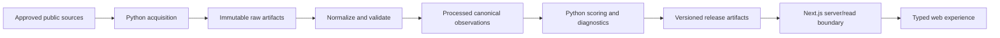

# CIVX Architecture

**Status:** The Figma frontend integration in §14 now powers all canonical routes through `product-2023.ts`. It supersedes older `current.ts` and intercepted-dialog presentation architecture below without changing domain artifacts.

## 1. Application baseline

The current application is a Next.js App Router interface over a validated, versioned 2023 release:

- Next `16.4.2`;
- React `19.3.0` and React DOM `19.3.0`;
- TypeScript with `strict: true`, `noEmit: true`, and the `@/*` path alias to `src/*`;
- Tailwind CSS and ESLint already present;
- server-rendered Home, regional detail, comparison and evidence content;
- small client boundaries for Explore interaction, active navigation, theme preference and contextual dialog lifecycle;
- versioned raw transcription, fixed methodology, processed release and separately licensed display geometry.

No packages were added for the product-quality pass. The Python and storage sections below describe future expansion, not additional services required by this release.

## 2. Architectural decisions

1. **Next.js is the web application boundary.** It owns routes, rendering, interaction, loading/error states, and presentation of released results.
2. **TypeScript is strict at the web boundary.** Data contracts should be typed and validated at ingress; UI code must not recalculate index rules.
3. **Python is a future data-processing boundary.** It owns acquisition, normalization, validation, scoring, release manifests, and reproducible batch outputs. It is not installed or implemented in this phase.
4. **The published data release is the source of truth for scores.** The web layer reads versioned derived artifacts or an API backed by them.
5. **Raw, processed, and published data remain distinct.** Each derived value retains provenance to its input artifact, configuration, methodology, and computation version.
6. **The pipeline is release-oriented before it is scheduled.** Manual, reviewable releases are acceptable before automated refresh is designed.

## 3. Target data flow



A result must be traceable through this chain: region and period → source observation → processed observation → normalization/scoring configuration → methodology version → published release.

## 4. Next.js and TypeScript responsibilities

### Frontend responsibilities

- render release, region, period, dimension, indicator, source, confidence, and limitation information;
- provide filters and navigation only over comparable released results;
- show unavailable, partial, low-confidence, revised, and non-comparable states explicitly;
- provide accessible loading, error, empty, and data-quality states;
- keep presentational and interaction components reusable;
- consume typed result contracts from the server/read boundary;
- avoid embedding indicator weights, normalization formulas, or source-specific parsing.

### Server/read boundary responsibilities

- select the requested approved release and methodology version;
- enforce allowed region/period/release combinations;
- return aggregate results together with components, provenance, confidence, and warnings;
- prevent accidental mixing of incompatible releases;
- keep secrets and source credentials out of client code, if credentials are ever needed.

The web application should not fetch arbitrary source files at render time or recalculate a score in a React component.

## 5. Python/data-processing responsibilities

A future Python package or job boundary should own:

- source acquisition and raw artifact preservation;
- source adapters and metadata extraction;
- region, indicator, and period normalization;
- schema, range, duplicate, coverage, and comparability validation;
- normalization, weighting, aggregation, confidence, and sensitivity calculations;
- release manifests, checksums, exclusion reports, and reproducibility metadata;
- deterministic generation of derived result artifacts.

Python is a planned responsibility, not a current dependency. Its package choice, environment, storage, and execution platform require a separate decision before implementation.

## 6. Pipeline stages

1. **Discover and approve:** register candidate sources, definitions, licensing, and owners.
2. **Acquire:** fetch approved sources and preserve raw files/responses with retrieval metadata.
3. **Normalize:** map source observations to official `kabupaten/kota`, indicator, unit, and period identifiers.
4. **Validate:** reject or flag invalid, incomplete, revised, or non-comparable observations.
5. **Score:** apply the approved methodology configuration and produce components, aggregate, confidence, and diagnostics.
6. **Review:** inspect validation results, exclusions, sensitivity, and source attribution.
7. **Publish:** create an immutable versioned release manifest and derived artifacts.
8. **Serve:** expose the approved release to Next.js through a stable typed boundary.

No failed acquisition may be silently replaced with a fabricated or stale value.

## 7. Proposed folder structure

The actual release uses versioned raw transcription and methodology files, a locally acquired BPS PDF artifact, a reproducible processing script, and the `src/lib/civx/` typed data/scoring boundary. The directory plan below remains a future expansion guide.
```text
docs/
  PRODUCT.md
  DATA.md
  METHODOLOGY.md
  ARCHITECTURE.md
  TASKS.md

src/
  app/                    # Next.js routes and layouts
  components/             # reusable presentation components
  features/               # product features: overview, region, compare, map
  lib/                    # typed read clients and pure UI utilities
  types/                  # shared web-facing contracts

python/
  civx_data/
    sources/              # source adapters
    normalize/            # canonicalization and geography mapping
    validate/             # data-quality rules
    score/                # methodology implementation
    releases/             # manifests and publication helpers
  scripts/                # explicit pipeline entrypoints

data/                     # location to be decided; raw/processed/release artifacts
  raw/                     # immutable acquired inputs
  processed/              # canonical observations and validation outputs
  releases/               # approved derived artifacts and manifests

tests/                    # contract, data-quality, and methodology tests
```

The current release stores its versioned JSON in this repository. Future production storage, object storage and database decisions remain open; expansion must preserve one authoritative source of truth.

## 8. Future scalability

Start with versioned files and a small number of regions if that satisfies the first release. Scale only when evidence requires it:

- separate ingestion jobs from web deployment;
- move raw artifacts to object storage with checksums and retention policy;
- use a database for indexed release queries when file-based reads become insufficient;
- add caching for immutable release responses;
- partition processing by source, period, or region while preserving deterministic release manifests;
- add scheduled refreshes, monitoring, and failure alerts after manual release review is reliable;
- introduce API versioning when multiple consumers need stable contracts.

Scalability must not weaken provenance, reproducibility, or release review.

## 9. Security and operations

- Treat downloaded source content as untrusted input.
- Keep credentials and secrets outside source control and client bundles.
- Bound resource use during acquisition and validate file formats.
- Record failures with enough context to rerun without exposing secrets.
- Define retention, backup, disaster recovery, licensing, and attribution before production dependence.
- Do not publish raw data that has usage restrictions without a licensing decision.

## 10. Decisions requiring approval

- Location and ownership of raw, processed, and release artifacts.
- Python environment, package policy, execution platform, and repository boundary.
- Storage engine: versioned files, database, or a combination.
- API/read contract and release endpoint versioning.
- Manual versus scheduled publication workflow.
- Deployment target, caching, observability, and retention policy.
- Exact folder split between the Next.js repository and data pipeline.

## 11. Current 2023 release

- `data/raw/civx-jabar-2023.json` holds 27 kabupaten/kota's four official 2023 BPS table values, per-table attribution, and a PDF checksum/size manifest. The full book remains in an ignored local path and is not redistributed.
- `data/methodology/civx-jabar-2023.json` fixes the all-27 2023 reference extrema, directions, and four equal weights. Expanding coverage did not change this policy.
- `scripts/build-civic-release.mjs` checks artifact integrity, all 27 BPS geographic identities, source linkage, units, periods, and complete observations; it applies the shared scorer and writes `data/processed/civx-jabar-2023.json` with publication and exclusion counts.
- `src/lib/civx/types.ts` defines release, source, observation, policy, component, and result contracts; `src/lib/civx/scoring.ts` handles normalization, missingness, provenance, and aggregation; `src/lib/civx/data.ts` validates the read boundary. `src/lib/civx/coverage.ts` describes published score ordering and median without refitting score ranges. UI components never calculate scores.
- `/explore` filters and sorts published records alongside an accessible SVG map using a separately licensed, simplified 2020 ADM2 display subset; `/compare` restricts pairs to compatible published results; `/regions/[id]` exposes the source-backed Civic Index, components, relative position and published median. `/methodology` and `/sources` retain scoring and source context. Map geometry is not an analytical input, and its year mismatch is explicit in `docs/DATA.md` §9.

All 27 have complete released scores; no exclusion is recorded for this dataset. External transcription/methodology review and permission assessment remain pending before a formal public release.

## 12. Presentation system and contextual routing

`src/app/globals.css` owns semantic theme roles for page/elevated/panel/hover surfaces, three text tiers, borders, CIVX blue accent states, pressure categories, success/warning, shadows, map states and backdrop. Spacing, radii, 44px control height, 140/200/300ms motion durations and a shared easing curve are also centralized. Existing brand-role variable names resolve to these tokens rather than defining separate palettes. `PressureBadge` is the small shared categorical primitive; the application does not introduce a general component library.

The root layout runs a fixed synchronous theme bootstrap before visible content and suppresses hydration differences only on `<html>`, whose theme attributes the bootstrap owns. `ThemeToggle` uses `useSyncExternalStore` with a stable server snapshot; the local preference store handles local storage, denied storage, cross-tab updates and OS color-scheme changes. The server-rendered header isolates `usePathname` in a navigation island behind Suspense, which is required for fallback dynamic parameters with Cache Components.

The Explore layout renders `children` beside its `@detail` slot. `src/app/explore/@detail/(..)regions/[id]/page.tsx` intercepts only soft navigation within Explore; `default.tsx` and the slot's null `page.tsx` cover inactive and return navigation. `/regions/[id]` stays the canonical standalone URL. Both routes render `src/components/regions/region-detail.tsx` on the server, using the same validated record and provenance.

`RegionOverlay` owns only interaction: native `showModal`, focus cycling, origin restoration, scroll locking, backdrop/Escape/button dismissal and CSS exit completion before explicit `router.back()`. Browser Back remains immediate; Forward reactivates the same route. Next.js may retain routes through React Activity, so activation clears closing state, pending close completion is scoped to an activation, and regional label IDs distinguish cached records. The backdrop uses a 60% scrim; entry uses 16px translation and 0.97 scale, without blur or animation dependencies. Reduced motion removes travel and exit waiting.

Explore retains its local filters, map inspection and selection while detail is open. Map SVG links keep real hrefs and modified-click behavior while ordinary activation uses the Next router. The selector and list remain equivalent non-map navigation. Approximate 2020 geoBoundaries geometry, credit, adaptation and CC BY 3.0 IGO licensing remain separate from the 2023 analytical release.

Comparison remains server-rendered and uses the existing compatibility guard. Its presentation formats pairwise differences from the displayed released values, preserves units and source periods, and scales contribution bars from published weights. It does not normalize observations or calculate new Civic Index scores. Methodology and Sources add reading anchors without changing the method, source manifest or version.


## 13. Unified current release boundary

`src/lib/civx/current.ts` is the sole production read entry point. It validates `data/processed/civx-jabar-2023-current.json`, exports the current regions and methodology-derived indicators/dimensions, and indexes regional identity. Existing `v2` contract/type names remain internal implementation identifiers; they do not define a second user-facing product.

The data flow remains **raw artifacts → validated observations → versioned methodology → processed release → UI**. The current builder generates Puskesmas availability from explicit facility totals and exact 2023 population, preserving both source references, original facility subcategory symbols, numerator, denominator and formula. Published DBD incidence remains an official rate, not a recomputed replacement. BNPB disaster risk is distinct from disaster impact.

All 27 regions share the same complete core indicator IDs, units, year, geography convention, reference endpoints and weights. Dimension weights and every dimension's internal weights sum to one. Missing, invalid or incompatible core evidence withholds the whole result; no silent imputation, clipping or per-region reweighting occurs. Full precision precedes independent publication rounding. Context and advantages never enter the aggregate.

`CandidateAudit` retains institution/URL, years, coverage, classification, status, definition, reason, limitations and evidence. Observations retain analytical kind, identity, geographic level/reference, actual period, unit/value, coverage/comparability, verification, missingness, provenance and derivation. Advantages additionally require presence and assignment reason. Sources/artifacts preserve revision, retrieval, checksum and rights information.

Home, Explore, canonical/intercepted region detail, Compare, Methodology and Sources consume this boundary. Counts, pressure explanations and selectable map layers derive from current configuration. Only complete validated pressure layers appear; an unsupported infrastructure dimension has no map layer or zero score. Compare displays explicit score, dimension and indicator differences from the same release, without rescoring in React.

The old product switch and competing versioned routes are removed. Internal release/version metadata remains in provenance and release history. Four-input raw/policy/output/document hashes remain pinned by `data/releases/civx-v1-integrity.json`; the five-input release and its builder remain archived. Current weights, sensitivity and eligibility decisions are in [METHODOLOGY-CURRENT.md](METHODOLOGY-CURRENT.md).

No dependencies were added. Normal web builds consume committed processed JSON without downloading restricted books. Data regeneration verifies the original artifacts separately. Approximate 2020 display boundaries remain separate from 2023 scoring, with license attribution and effective-boundary caveats intact.

## 14. Figma frontend and reviewed product facade

Routes remain `/`, `/explore`, `/regions/[id]`, `/compare`, `/methodology`, and `/sources`. Server components read `src/lib/civx/product-2023.ts`; serializable presentation data crosses into client islands for region search, Explore filtering/table pagination, source-catalog browsing, SVG-map inspection, active/mobile navigation, and theme preference. Sources passes lightweight search metadata and server-rendered cards rather than importing the facade into the client graph. GET forms keep comparison selection shareable without an API server.

`components/product/` owns shared display formatters, headings/notices/scores/bars, source evidence, indicator disclosures, and separate context disclosures. Each main surface keeps local CSS modules. `app/globals.css` defines semantic light/dark tokens, the shared shell, responsive layouts, focus states, and reduced-motion handling. Poppins loads through `next/font`; no package was added.

The old intercepted/parallel detail route and obsolete `current.ts` frontend consumers are removed. Both map and list navigation now open the canonical standalone detail page. Old domain/data modules remain available for historical reproducibility.

Region pages display unchanged controlled insights, six dimension scores, and 18 raw/normalized indicator disclosures. Comparison uses the reviewed comparison facade's differences, relations, and highlight selections; React never rescales, weights, scores, or recalculates a delta. Sources derives its directory from product evidence rather than creating a separate catalog.

All seven contextual dataset slots retain their availability discriminants and source metadata. Shared disclosures never coerce null to zero, aggregate site observations, or compute context differences.

The existing BPS-mapped SVG geometry stays display-only and credited as approximate 2020 geoBoundaries ADM2 boundaries. Home and Explore share `WestJavaMap` and default to overall CIVX pressure; Explore also owns a selected CORE dimension ID. The empty dimension ID selects the overall score, not a neutral mode. The six dimension choices still derive from the product summaries. Full-precision facade scores drive the fixed 0–100 CSS color scale without normalization or scoring in React. Semantic `--map-*` roles derive from existing theme accents, with stronger pressure represented by stronger intensity in both themes. Gray excludes filtered regions; hatching identifies unavailable scores. Layer switches retain SVG paths and inspected region, updating labels immediately while fill transitions run for 300 ms. Non-map selectors, the canonical region list, provenance, and reduced-motion handling remain intact.

Explore uses nine-row table pages in canonical BPS order. Its map always receives the complete search/type-filter result. Regional identity silhouettes reuse the selected existing geometry path, derive tight bounds from its absolute polygon vertices, and remain decorative/display-only. Native context disclosures prioritize available values and site observations, with unavailable datasets grouped compactly and their reasons retained. Rendered product disclosures omit internal artifact paths, hashes, engine flags, and debug objects; those records remain unchanged for engineering traceability.

Both development and builds explicitly use webpack to preserve imported JSON floating-point values. The installed Turbopack reserializes some numbers, failing the unchanged exact domain validator. The unused Tailwind import and Turbopack-only stylesheet rule were removed; this cutover adds no dependency, credential, service, or model mutation.

Phase 2.1 adds `SectionReveals`, a client enhancement around server-rendered Home/Explore children. One observer per page triggers existing targets once; CSS owns 520 ms opacity/transform entrances and small stagger delays. No pending-hidden state exists. Focus/pointer interaction settles the containing entrance, and enabling reduced motion settles all observed targets. No scoring code crosses this boundary.

`ThemeToggle` uses a small scoped radio menu rather than relying on OS-dependent native option styling. Opaque semantic surfaces, checked indicators, keyboard focus management, outside dismissal, and native button activation provide deterministic contrast without a library. The pre-paint theme bootstrap and external preference store remain unchanged.

Explore reuses its existing route-loading component for the search-parameter Suspense boundary. A scoped minimum height of one small viewport keeps the footer outside the initial loading viewport while the longer map/table content streams. The loading state remains explicitly busy and does not substitute or fabricate analytical data.

## 15. Governance-limited reporting

`src/lib/civx/export-2023.ts` serializes CSV and shared Indonesian reporting disclosures. `createExploreCsv2023()` accepts only regional identity headers plus public reference URLs; explicit field projection excludes arbitrary extra payloads. No method, query parameter, release-flag override, or UI switch enables numerical export. `encodeCsv2023()` handles RFC 4180 escaping, UTF-8 BOM, CRLF, finite full-precision numbers, zero/missing distinctions, and spreadsheet-formula text defense.

Explore passes the full filtered header set to the small client `CsvDownload` action before table pagination. Browser Blob/object URLs provide downloads without dependencies or an API server. Failed preparation and empty selections have accessible feedback; successful dispatch does not claim that the user saved a file.

`RegionalPrintReport` projects only identity, dimension/indicator names, bibliography/locators, and model definitions from the same facade. It never reads score/observation/insight/CONTEXT values. Source URLs are deduplicated while retaining table locators and numerator/denominator provenance. `PrintReportButton` invokes `window.print()`; a named A4 page and report-scoped print rules hide the screen detail and shell, preserve table rows/summary blocks, and use high-contrast print typography. The same safe scope applies to keyboard/menu printing without modifying disclosure open states.

Next.js Activity retains prior route DOM with `display: none` on ancestors. Print-shell selectors exclude reports under hidden/display-none ancestors, rather than testing report existence alone. This prevents cached region pages from applying regional print chrome to Compare or other active routes; Back restores the report's scope without JavaScript print-state mutation.

The new methodology anchor documents both actions and the public-release prerequisite. Home keeps the existing layout/reveal/map contracts while replacing unsupported quality/priority summaries with facade-derived model counts. No scoring module, data artifact, dependency, global theme token, or animation implementation changes.


## 16. Phase 4 presentation stabilization

Compare consumes all six existing comparison-facade dimensions and unchanged overall pressure directly. It removes inverse-index, provincial-average, sorting, and quality/priority-badge calculations. Engine-provided absolute distances and signed overall deltas remain distinct. No scoring or contextual aggregation moves into React.

The root server layout reuses `Notice` and existing semantic styling to disclose preview/unreleased status on every route. Regional print rules hide this shell notice with other chrome. The notice is not authentication, authorization, or a numerical-copy/print control. Methodology explicitly records that limitation; no release flag or export bypass is added.

Critical comparison contrast uses existing semantic roles: `--muted` for the second region's small score text, `--comparison-b` for its bars, and foreground/accent-soft roles for the reading label. Branding, layout, motion, and global theme values are unchanged.


## 17. Phase 4.5 frontend consistency

The existing Poppins family, light palette, dark palette, choropleth scale, and route structure remain authoritative. Global semantic typography roles define 12px captions, 13px compact text, 14px body text, 18px section titles, and a shared fluid page title. Cards reuse the existing 8px radius; controls reuse the 6px radius and 44px minimum height. Home reference cards align with their coverage card without a separate shadow or oversized action treatment. Compare uses native themed selects rather than a dark-text SVG arrow.

`SectionReveals` now serves all six primary pages, with optional semantic root selection for the regional article. Existing 520ms entrances, 16px travel, 70ms stagger, and the shared easing curve are semantic tokens. Targets remain visible before enhancement; interactive targets stay opaque, focus/pointer interaction settles motion, and completion marks an entrance done. A scoped child-list observer registers newly mounted content groups after source filtering and releases removed targets. No paragraph-by-paragraph, table-row, route-blocking, or continuous animation is introduced.

Reduced motion disables nonessential transitions and entrances; enabling it during a session settles registered targets. Print disables animation and transitions globally and overrides the root color scheme, including an explicit dark preference, so PDF page margins remain white. Regional reports remain outside reveal targets, retaining their existing active/cached-route print scope and metadata-only A4 contract.

The mobile navigation shell now remains outside the pathname-dependent Suspense boundary. Only active-link rendering suspends, so the fallback no longer replaces compact mobile controls with the full link list. At 761–900px, global search occupies its own full row; active-link widths no longer change the tablet header arrangement. Compare reuses its route-loading component in the request-time Suspense boundary, with one small viewport of minimum height, matching Explore's convention and keeping the footer below the initial loading viewport. These fixes address observed cold-load layout shifts without delaying navigation.

Shared control, link, table, disclosure-toggle, and pagination feedback uses the existing 140–200ms motion roles. Global 3px keyboard focus remains authoritative; local weaker overrides were removed where unnecessary. Horizontal tables retain their real structure and named keyboard-focusable scroll regions. No data, scoring, export, release-governance, dependency, or public-deployment contract changes.

No-JavaScript visibility has a separate framework limit: Home, Methodology, and Sources render their content without enhancement, while Explore, Region Detail, and Compare can remain on streamed Suspense fallbacks with JavaScript disabled. Their server-rendered targets are staged under React's hidden transport containers, not hidden by reveal CSS. This polish does not redesign the route rendering/cache architecture or claim full no-JavaScript support.
