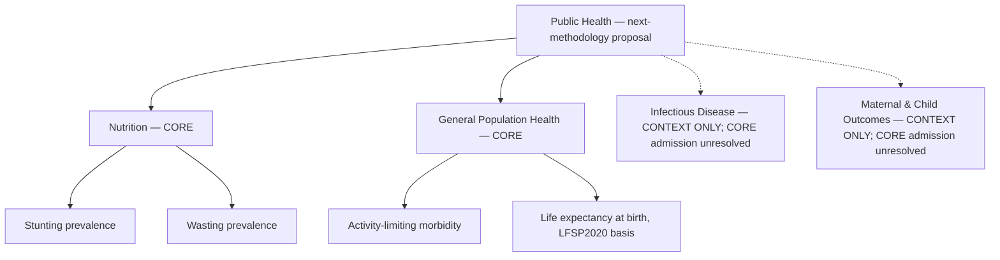

# CIVX Public Health data and methodology audit — Jawa Barat 2023

**Access date:** 29 October 2026. **Scope:** all 27 kabupaten/kota: 18 kabupaten and nine kota, matched through canonical BPS identifiers. **Status:** research, dataset-quality analysis and next-methodology recommendation, not a scoring cutover.

**Decision:** recommend four CORE outcomes: SKI stunting, SKI wasting, BPS activity-limiting morbidity and BPS life expectancy at birth on the LFSP2020 basis. Recommend **REVIEW** for the current published DBD indicator and **CONTEXT ONLY pending reconciliation** in the next model. Keep DBD unchanged in production. Do not introduce new production indicators, alter weights, modify the UI or recommendation engine, or change the current public release.

Life expectancy is conditional on the earlier audit's **HDI-free next methodology**. Production still contains IPM: this audit does not authorize adding an IPM component alongside its parent aggregate.

## Recovery and evidence boundary

This continues the same audit and worktree. The completed InfectiousAudit, NutritionAudit, MaternalChildAudit and NcdAudit source investigations were recovered from their retained transcripts, original local PDFs, API captures and saved reader artifacts. Their per-slice repository JSON files had not yet been serialized when the provider interrupted the session. No completed research was restarted. The recovery manifest distinguishes original browser response text, reader-decoded JSON and reconstructed exact source-value transcriptions; none is falsely labelled original HTTP wire bytes.

The health-profile share timed out or returned HTTP502. Its PPID-linked alternative returned404. These failures were not rerun during recovery. The profile's historical fingerprint remains documented, but no fresh full-profile byte verification is claimed. Independent BPS population evidence and preserved Dinkes API cases establish the DBD inconsistency without inventing a replacement denominator.

Evidence files:

- [DBD](../data/raw/public-health-audit-2023/dbd.json).
- [Infectious disease](../data/raw/public-health-audit-2023/infectious.json).
- [Nutrition](../data/raw/public-health-audit-2023/nutrition.json).
- [Maternal, child, reproductive health and immunization](../data/raw/public-health-audit-2023/maternal-child.json).
- [NCDs](../data/raw/public-health-audit-2023/ncd.json).
- [General health](../data/raw/public-health-audit-2023/general-health.json).
- [Recovery, twelve admission gates, statistical protocol and protected production fingerprints](../data/raw/public-health-audit-2023/recovery.json).
- [Processed observations](../data/processed/public-health-audit-2023-observations.json), [complete statistics and correlations](../data/processed/public-health-audit-2023-statistics.json), and [full fifteen-column candidate register](../data/processed/public-health-audit-2023-candidate-register.csv).

The dataset contains source editions, denominators, supporting counts and rejected diagnostics, not an invitation to score every series.

| Audit evidence measure | Count |
| --- | --- |
| sourceArtifacts | 106 |
| acquiredPanels | 70 |
| regionalRecords | 1890 |
| numericObservations | 1858 |
| missingObservations | 32 |
| completePanels | 64 |
| investigatedWithoutAdmittedPanel | 30 |
| correlationPairs | 210 |
| redundancyFlags | 5 |
| recommendedCore | 4 |

### Admission framework

CORE requires all twelve gates: official/reliable source; 2023 reference; 27 usable regions; comparable definition; comparable unit; compatible geography; defensible pressure direction; no unresolved missing cells; meaningful regional variation; no severe unnecessary redundancy; epidemiologically meaningful numerator/denominator; and explicitly acceptable detection bias. Passing basic data gates is necessary, not an obligation to add every available outcome. The selected set also reflects parsimony and concept coverage.

The machine-readable admission section records all twelve positive decisions for each CORE outcome. Non-CORE gate states can remain unresolved rather than manufacture a pass or a precise failure mechanism. Their source-specific recommendation, numerator, denominator, missingness and caveats state the reason for exclusion. No unavailable value becomes zero, no district is interpolated, and no 2022/2024 observation substitutes for 2023.

## A. Current DBD audit

**Decision: REVIEW. Next-model classification: CONTEXT ONLY until the case/population bases reconcile. Production action: none.**

- **Publisher/table:** BPS Provinsi Jawa Barat, originating Dinas Kesehatan Provinsi Jawa Barat, *Provinsi Jawa Barat Dalam Angka 2024*, table4.2.6, *Kasus Penyakit Menurut Kabupaten/Kota dan Jenis Penyakit di Provinsi Jawa Barat, 2023*. DBD is column(7), printed234 / PDF310.
- **Direct official source:** [BPS publication](https://jabar.bps.go.id/id/publication/2024/02/28/35ffe2d35104b39feb577e8f/provinsi-jawa-barat-dalam-angka-2024.html). Original PDF SHA-256: `500e82ecd02b081be83d884add8408fccc8fb1d57665f5b3e62a17ebc9f55f81`; originally acquired26October2026, locally inspected for this audit29October2026. Publication2024 is not the observation year.
- **Reference/coverage/unit:** annual2023;27/27 actual numeric district/city observations; cases per100,000 population; zero missing cells. This is the publisher's **reported DBD incidence**, not a raw case count, case fatality ratio or prevalence of all dengue infection.
- **Numerator:** reported DBD cases underlying the published rate. Its exactly matched edition is not identified. The independently preserved [Dinkes case dataset](https://galura.jabarprov.go.id/dataset/jumlah-kasus-penyakit-demam-berdarah-dengue-dbd-berdasarkan-kabupatenkota-di-jawa-barat), dataset18509, publishes19,328 cases for2023. Its [direct data response](https://galura.jabarprov.go.id/api/bigdata/jumlah-kasus-penyakit-demam-berdarah-dengue-dbd-berdasarkan-kabupatenkota-di-jawa-barat?per_page=1000&page=1) and metadata are preserved.
- **Denominator:** the incidence column says population, but does not identify its exact population vintage. BPS table3.1.3, printed117 / PDF193, independently supplies49,860,330 exact2023 residents across the same27 codes. It corroborates the earlier profile appendix population but does not prove it underlies the official DBD rates.
- **Published versus derived:** existing CIVX stores the published integer rate. This audit separately computes `Dinkes reported cases / BPS2023 resident population ×100000` **only as a diagnostic reporting rate**. It is not a corrected incidence series and is not substituted into production.
- **Conflict:** Kabupaten Bogor has1,881 cases and5,627,021 residents:33.4279896947 per100,000, not the published31. Province-level arithmetic gives38.7642841513, not38. Under nearest-integer comparison,22 of27 district values differ. This is a diagnostic comparison, not an assertion about an undocumented publisher rounding rule. Numerator revision, population vintage and geographic attribution remain possible explanations; the audit does not guess which one applies.
- **Direction:** higher reported incidence defensibly means more **recorded DBD pressure**, conditional on diagnosis, care-seeking, hospital reporting and surveillance. It does not prove worse governance or more underlying infections. Low observed incidence does not prove low infection risk.
- **Variation/outliers:** the distribution is nonconstant and right-skewed. Kota Bogor and Kota Sukabumi cross the Tukey upper fence. They remain observations, not deletions or winsorized replacements. Full descriptive statistics appear inF.
- **Limitations:** integer rounding, annual outbreak/climate volatility, undetected infections, reporting differences and unresolved matched case/population bases. Even a fully reconciled DBD series would cover only one mosquito-borne disease, not public health as a whole.

The official-rate label passes source, year, coverage and declared-unit checks. It does not automatically pass the matched-numerator/denominator comparability gate. This is why the existing production decision is not simply copied into the next-methodology recommendation.

## B. Candidate register

The following register includes all acquired source panels and supporting inputs. Every row has the requested fifteen fields. A count panel or source edition is not a separate proposed health concept. Exact original rows, numeric numerators/denominators, uncertainty and source-body hashes remain in linked JSON; the CSV preserves longer machine-readable fields.

### Dbd

| Indicator | Health concept | Official source | Year | Coverage | Unit | Raw/Derived | Numerator | Denominator | Direction | Detection-bias risk | Variation | Redundancy risk | Recommendation | Reason |
| --- | --- | --- | --- | --- | --- | --- | --- | --- | --- | --- | --- | --- | --- | --- |
| Published DBD incidence per 100,000 (`dbd_published_incidence`) | Reported dengue haemorrhagic fever (DBD), not all dengue infections. | [BPS Jawa Barat; originating Dinas Kesehatan; 4.2.6 column(7), printed234][S1] | 2023 | 27/27; missing0 | cases per 100,000 population | published_rate | Annual reported DBD cases underlying official rate; exact matched series not identified. Alternative Dinkes2023 cases retained separately. | Publisher-labelled population per100000; underlying population vintage is unidentified. BPS2023 exact population does not reconstruct most rates. | Higher published reported incidence means more recorded DBD pressure, conditional on ascertainment; not worse government performance. | Diagnosis, care-seeking, hospital reporting and surveillance vary. Less screening-driven than asymptomatic HIV/TB, but not detection-free. | 24 unique; range 4–132 | dbd_reported_case_rate_diagnostic | CONTEXT ONLY | REVIEW current indicator. CONTEXT ONLY for next model until numerator/population vintage and case attribution reconcile. Official common-rate label and full coverage do not resolve conflicting bases. |
| BPS exact 2023 resident population (`population_2023_exact`) | Resident population projection, both sexes. | [BPS Provinsi Jawa Barat; 3.1.3, printed117][S1] | 2023 | 27/27; missing0 | persons | published_count | Resident population projection, both sexes. | Not established | Recorded count or service output has no unqualified health-pressure direction. | Population projection uncertainty; same official2023 vintage and BPS codes across27. | 27 unique; range 207510–5627021 | No high tested coefficient; concept review still required | CONTEXT ONLY | Supporting denominator only; never a health-pressure indicator. |
| DBD recorded cases (`dbd_cases_2023`) | Reported DBD cases in2023, not all dengue infections. | [Dinas Kesehatan Provinsi Jawa Barat; API id18509, select tahun2023][S2] | 2023 | 27/27; missing0 | reported cases | published_count | Reported DBD cases in2023, not all dengue infections. | Not established | Recorded count or service output has no unqualified health-pressure direction. | Administrative detection, attendance, referral, diagnostic and reporting intensity may change values independently of population burden. | 26 unique; range 53–1881 | No high tested coefficient; concept review still required | CONTEXT ONLY | Raw counts cannot compare differently sized districts. Can derive reported-case rate using consistent2023 population, but cannot relabel as official published incidence or resolve its vintage. |
| DBD cases / BPS2023 population (diagnostic, not replacement) (`dbd_reported_case_rate_diagnostic`) | Reported case intensity from two explicit official2023 inputs. | [Dinas Kesehatan Provinsi Jawa Barat; API id18509, select tahun2023][S2] | 2023 | 27/27; missing0 | reported cases per 100,000 population | derived_rate | Dinkes2023 reported DBD cases | BPS2023 both-sex resident population projection | Higher means greater reported-case intensity, not necessarily true infection incidence. | Administrative detection, attendance, referral, diagnostic and reporting intensity may change values independently of population burden. | 27 unique; range 4.0323–137.6645 | dbd_published_incidence | CONTEXT ONLY | CONTEXT ONLY. Epidemiologically population-scaled reported-case rate, but source-edition/attribution conflicts block replacement of published DBD series. |

### General Health

| Indicator | Health concept | Official source | Year | Coverage | Unit | Raw/Derived | Numerator | Denominator | Direction | Detection-bias risk | Variation | Redundancy risk | Recommendation | Reason |
| --- | --- | --- | --- | --- | --- | --- | --- | --- | --- | --- | --- | --- | --- | --- |
| Life expectancy at birth (LFSP2020 basis) (`life_expectancy_lfsp2020`) | Expected years of life under official mortality schedule, not IPM aggregate. | [BPS Provinsi Jawa Barat; Appendix2: Usia Harapan Hidup (UHH) Menurut Kabupaten/Kota Tahun2020–2023,2023 column, printed72][S3] | 2023 | 27/27; missing0 | years | Published estimate | Not a simple case numerator. Official life-table mortality schedule/model; no new CIVX calculation. | Not general-population division. Synthetic life-table cohort at birth; LFSP2020-based BPS method. | Higher years imply lower broad mortality-related health pressure. | Official demographic estimate, not healthcare screening/notification intensity. Modeling, mortality-data quality and limited short-term responsiveness remain. | 24 unique; range 73.87–75.86 | No high tested coefficient; concept review still required | CORE | Broad long-run health outcome,27 complete2023 estimates. Use standalone only in proposed HDI-free next methodology; do not add beside production IPM. |
| Activity-limiting morbidity in previous month (`morbidity_activity_limiting`) | Residents with self-reported health complaints disrupting work, school or daily activities; March2023 Susenas reference month. | [BPS Provinsi Jawa Barat; 4.2, both-sex column(4), printed66; precision9.7 printed170][S4] | 2023 | 27/27; missing0 | percent of residents | published_rate | Survey-weighted residents reporting complaints that interfered with usual activities during month before interview. | All survey-weighted residents represented by Susenas March2023, not only clinic users or complainants. | Higher means more reported activity-limiting illness in survey reference month. | Self/proxy reporting, symptom awareness, age structure and recall differ; not chiefly screening intensity. This limitation is explicitly accepted for the literal functional outcome. | 27 unique; range 6.75–19.84 | health_complaints_month | CORE | Comparable population survey outcome, not service-use count;27/27 numeric values with published district precision. Distinct short-term functional morbidity beside long-run survival. |
| Any health complaint in previous month (`health_complaints_month`) | Self-reported health/psychiatric complaint without required activity limitation. | [BPS Provinsi Jawa Barat; 4.1,both-sex column(4),printed65][S4] | 2023 | 27/27; missing0 | percent of residents | published_rate | Survey-weighted residents reporting any health complaint in previous month. | All survey-weighted residents represented by Susenas March2023, not only clinic users or complainants. | Higher means more reported complaints, not necessarily more objectively diagnosed disease. | Self-report, awareness, age and recall; not a facility detection count. | 27 unique; range 16.51–41.48 | morbidity_activity_limiting | CONTEXT ONLY | CONTEXT ONLY. Broader nested symptom construct from same survey; prefer activity-limiting morbidity rather than score both. |

### Infectious

| Indicator | Health concept | Official source | Year | Coverage | Unit | Raw/Derived | Numerator | Denominator | Direction | Detection-bias risk | Variation | Redundancy risk | Recommendation | Reason |
| --- | --- | --- | --- | --- | --- | --- | --- | --- | --- | --- | --- | --- | --- | --- |
| Tuberkulosis: all cases found and reported, revised API edition (`infectious_tb_notifications_api`) | All tuberculosis cases found and reported during 2023; not modeled true incidence. | [Dinas Kesehatan Provinsi Jawa Barat via Galura Data / Open Data Jabar; API data, select tahun=2023][S5] | 2023 | 27/27; missing0 | reported persons/cases | published_count | All tuberculosis cases found and reported during 2023; not modeled true incidence. | Not established | Higher means more reports/detections/treatment contacts, not necessarily more true infection. | Case finding, access, laboratory/testing intensity, referral and reporting completeness can increase recorded counts independently of underlying disease. | 27 unique; range 954–27690 | No high tested coefficient; concept review still required | CONTEXT ONLY | Raw count scales with population and detection. Residence/catchment comparability and limited detection bias not established; do not use as burden score. |
| Pneumonia: reported under-five detections, all severity (`infectious_pneumonia_total_api`) | Generic-title pneumonia panel; 2023 values equal nonsevere + severe under-five detections in every region. | [Dinas Kesehatan Provinsi Jawa Barat via Galura Data / Open Data Jabar; API data, select tahun=2023][S6] | 2023 | 27/27; missing0 | reported persons/cases | published_count | Generic-title pneumonia panel; 2023 values equal nonsevere + severe under-five detections in every region. | Not established | Higher means more reports/detections/treatment contacts, not necessarily more true infection. | Case finding, access, laboratory/testing intensity, referral and reporting completeness can increase recorded counts independently of underlying disease. | 27 unique; range 410–8378 | No high tested coefficient; concept review still required | CONTEXT ONLY | Raw count scales with population and detection. Residence/catchment comparability and limited detection bias not established; do not use as burden score. |
| Pneumonia under five: published detections excluding separately tabulated severe cases (`infectious_pneumonia_under5_nonsevere`) | Pneumonia found in children under five, summed over sex; severe cases reported separately. | [Dinas Kesehatan Provinsi Jawa Barat via Galura Data / Open Data Jabar; API data, select tahun=2023][S7] | 2023 | 27/27; missing0 | reported cases, male + female | published_count | Pneumonia found in children under five, summed over sex; severe cases reported separately. | Not established | Higher means more reports/detections/treatment contacts, not necessarily more true infection. | Case finding, access, laboratory/testing intensity, referral and reporting completeness can increase recorded counts independently of underlying disease. | 27 unique; range 308–7773 | No high tested coefficient; concept review still required | CONTEXT ONLY | Raw count scales with population and detection. Residence/catchment comparability and limited detection bias not established; do not use as burden score. |
| Severe pneumonia under five: published detections (`infectious_pneumonia_under5_severe`) | Severe pneumonia found in children under five, summed over sex. | [Dinas Kesehatan Provinsi Jawa Barat via Galura Data / Open Data Jabar; API data, select tahun=2023][S8] | 2023 | 27/27; missing0 | reported cases, male + female | published_count | Severe pneumonia found in children under five, summed over sex. | Not established | Higher means more reports/detections/treatment contacts, not necessarily more true infection. | Case finding, access, laboratory/testing intensity, referral and reporting completeness can increase recorded counts independently of underlying disease. | 24 unique; range 1–1463 | No high tested coefficient; concept review still required | CONTEXT ONLY | Raw count scales with population and detection. Residence/catchment comparability and limited detection bias not established; do not use as burden score. |
| HIV: newly found/reported cases (`infectious_hiv_new_reports`) | New cases in puskesmas work areas including cases found at hospitals, per explicit source metadata. | [Dinas Kesehatan Provinsi Jawa Barat via Galura Data / Open Data Jabar; API data, select tahun=2023][S9] | 2023 | 27/27; missing0 | reported persons/cases | published_count | New cases in puskesmas work areas including cases found at hospitals, per explicit source metadata. | Not established | Higher means more reports/detections/treatment contacts, not necessarily more true infection. | Case finding, access, laboratory/testing intensity, referral and reporting completeness can increase recorded counts independently of underlying disease. | 26 unique; range 54–1059 | No high tested coefficient; concept review still required | CONTEXT ONLY | Raw count scales with population and detection. Residence/catchment comparability and limited detection bias not established; do not use as burden score. |
| Diare: generic-title counts consistent with fixed population planning target (`infectious_diarrhea_generic_planning_counts`) | Published generic cases; numeric evidence shows each2023 cell equals population*0.027 rounded to whole person. | [Dinas Kesehatan Provinsi Jawa Barat via Galura Data / Open Data Jabar; API data, select tahun=2023][S10] | 2023 | 27/27; missing0 | reported persons/cases | published_count | Published generic cases; numeric evidence shows each2023 cell equals population*0.027 rounded to whole person. | Not established | Higher means more reports/detections/treatment contacts, not necessarily more true infection. | Case finding, access, laboratory/testing intensity, referral and reporting completeness can increase recorded counts independently of underlying disease. | 27 unique; range 5603–151930 | No high tested coefficient; concept review still required | REJECTED | REJECT as outcome. Counts reproduce fixed2.7% population coefficient; resulting rate would be nearly constant manufactured estimate, not observed disease. |
| Diare: cases served by health services (`infectious_diarrhea_served`) | Cases of diarrhea served, not all community episodes, unique resident incidence, or population prevalence. | [Dinas Kesehatan Provinsi Jawa Barat via Galura Data / Open Data Jabar; API data, select tahun=2023][S11] | 2023 | 27/27; missing0 | reported persons/cases | published_count | Cases of diarrhea served, not all community episodes, unique resident incidence, or population prevalence. | Not established | Higher means more reports/detections/treatment contacts, not necessarily more true infection. | Case finding, access, laboratory/testing intensity, referral and reporting completeness can increase recorded counts independently of underlying disease. | 27 unique; range 3655–67750 | No high tested coefficient; concept review still required | CONTEXT ONLY | Raw count scales with population and detection. Residence/catchment comparability and limited detection bias not established; do not use as burden score. |
| Kusta: new detected cases (`infectious_leprosy_new_cases_api`) | New leprosy cases detected on a person; metadata explicitly identifies detection. | [Dinas Kesehatan Provinsi Jawa Barat via Galura Data / Open Data Jabar; API data, select tahun=2023][S12] | 2023 | 27/27; missing0 | reported persons/cases | published_count | New leprosy cases detected on a person; metadata explicitly identifies detection. | Not established | Higher means more reports/detections/treatment contacts, not necessarily more true infection. | Case finding, access, laboratory/testing intensity, referral and reporting completeness can increase recorded counts independently of underlying disease. | 24 unique; range 0–333 | No high tested coefficient; concept review still required | CONTEXT ONLY | Raw count scales with population and detection. Residence/catchment comparability and limited detection bias not established; do not use as burden score. |
| Kusta: generic registered-case title, duplicate 2023 panel (`infectious_leprosy_generic_duplicate`) | Generic cases panel, numerically identical to new-case panel in all27 regions. | [Dinas Kesehatan Provinsi Jawa Barat via Galura Data / Open Data Jabar; API data, select tahun=2023][S13] | 2023 | 27/27; missing0 | reported persons/cases | published_count | Generic cases panel, numerically identical to new-case panel in all27 regions. | Not established | Higher means more reports/detections/treatment contacts, not necessarily more true infection. | Case finding, access, laboratory/testing intensity, referral and reporting completeness can increase recorded counts independently of underlying disease. | 24 unique; range 0–333 | No high tested coefficient; concept review still required | REJECTED | REJECT separate indicator: exact duplicate of new-case detection panel, no acquired point-prevalence/date definition. |
| Malaria: reported cases (`infectious_malaria_reported_cases_api`) | Reported malaria cases; acquired API does not separate imported vs indigenous transmission. | [Dinas Kesehatan Provinsi Jawa Barat via Galura Data / Open Data Jabar; API data, select tahun=2023][S14] | 2023 | 27/27; missing0 | reported persons/cases | published_count | Reported malaria cases; acquired API does not separate imported vs indigenous transmission. | Not established | Higher means more reports/detections/treatment contacts, not necessarily more true infection. | Case finding, access, laboratory/testing intensity, referral and reporting completeness can increase recorded counts independently of underlying disease. | 18 unique; range 0–157 | No high tested coefficient; concept review still required | CONTEXT ONLY | Raw count scales with population and detection. Residence/catchment comparability and limited detection bias not established; do not use as burden score. |
| Campak: reported cases, confirmation status unresolved (`infectious_measles_reports_api`) | Cases labeled campak in API; suspected versus laboratory-confirmed classification not specified. | [Dinas Kesehatan Provinsi Jawa Barat via Galura Data / Open Data Jabar; API data, select tahun=2023][S15] | 2023 | 27/27; missing0 | reported persons/cases | published_count | Cases labeled campak in API; suspected versus laboratory-confirmed classification not specified. | Not established | Higher means more reports/detections/treatment contacts, not necessarily more true infection. | Case finding, access, laboratory/testing intensity, referral and reporting completeness can increase recorded counts independently of underlying disease. | 24 unique; range 15–1093 | No high tested coefficient; concept review still required | CONTEXT ONLY | Raw count scales with population and detection. Residence/catchment comparability and limited detection bias not established; do not use as burden score. |
| BPS TBC case-detection column: numeric counts, not rate (`infectious_tb_bps_count`) | Official2023 disease publication edition, kept separate from revised API. | [BPS Provinsi Jawa Barat; originating Dinas Kesehatan; 4.2.6,printed233–234][S1] | 2023 | 27/27; missing0 | reported cases | published_count | Official2023 disease publication edition, kept separate from revised API. | Not established | Recorded count or service output has no unqualified health-pressure direction. | Administrative detection, attendance, referral, diagnostic and reporting intensity may change values independently of population burden. | 27 unique; range 924–26912 | No high tested coefficient; concept review still required | CONTEXT ONLY | English case-detection-rate heading conflicts with integer counts totaling203226. Preserve values as count evidence, not a rate. |
| New AIDS reported cases, BPS2024 edition (`infectious_aids_bps_count`) | Official2023 disease publication edition, kept separate from revised API. | [BPS Provinsi Jawa Barat; originating Dinas Kesehatan; 4.2.6,printed233–234][S1] | 2023 | 27/27; missing0 | reported cases | published_count | Official2023 disease publication edition, kept separate from revised API. | Not established | Recorded count or service output has no unqualified health-pressure direction. | Administrative detection, attendance, referral, diagnostic and reporting intensity may change values independently of population burden. | 25 unique; range 7–250 | No high tested coefficient; concept review still required | CONTEXT ONLY | AIDS diagnosis/reporting is not HIV infection incidence. No matched screening or residence/catchment assurance. |
| Published leprosy new-case detection rate (`infectious_leprosy_bps_nc_detection`) | Official2023 disease publication edition, kept separate from revised API. | [BPS Provinsi Jawa Barat; originating Dinas Kesehatan; 4.2.6,printed233–234][S1] | 2023 | 27/27; missing0 | new detected cases per100000 population | published_rate | Official2023 disease publication edition, kept separate from revised API. | Publisher-labelled population; actual vintage not identified. | Recorded count or service output has no unqualified health-pressure direction. | Administrative detection, attendance, referral, diagnostic and reporting intensity may change values independently of population burden. | 27 unique; range 0–13.04 | infectious_leprosy_new_cases_api_per100k | CONTEXT ONLY | Detection/latency/stigma bias; current API cases do not reproduce all BPS rates. Not point prevalence. |
| Published malaria annual parasite incidence (`infectious_malaria_bps_api`) | Official2023 disease publication edition, kept separate from revised API. | [BPS Provinsi Jawa Barat; originating Dinas Kesehatan; 4.2.6,printed233–234][S1] | 2023 | 25/27; missing2 | reported infections per1000 population | published_rate | Official2023 disease publication edition, kept separate from revised API. | Publisher-labelled population; actual vintage not identified. | Recorded count or service output has no unqualified health-pressure direction. | Administrative detection, attendance, referral, diagnostic and reporting intensity may change values independently of population burden. | 15 unique; range 0.0002–0.083 | No high tested coefficient; concept review still required | CONTEXT ONLY | Two published dashes unresolved and narrow near-zero imported/local transmission mix. No dash-to-zero recoding. |
| Tuberkulosis: all cases found and reported, revised API edition per100000 residents (reporting diagnostic) (`infectious_tb_notifications_api_per100k`) | All tuberculosis cases found and reported during 2023; not modeled true incidence. | [Dinas Kesehatan Provinsi Jawa Barat via Galura Data / Open Data Jabar; API data, select tahun=2023][S5] | 2023 | 27/27; missing0 | reported cases per100000 residents | derived_rate | All tuberculosis cases found and reported during 2023; not modeled true incidence. | BPS exact2023 both-sex resident population projection | Higher means more recorded reports per resident; cannot assert higher underlying burden. | Case finding, access, laboratory/testing intensity, referral and reporting completeness can increase recorded counts independently of underlying disease. | 27 unique; range 184.9983–1206.7957 | infectious_hiv_new_reports_per100k | CONTEXT ONLY | Population standardization is mathematically valid for the literal reporting construct, but does not remove detection bias, case-attribution ambiguity or edition conflicts. CONTEXT ONLY. |
| New AIDS reported cases, BPS2024 edition per100000 residents (reporting diagnostic) (`infectious_aids_bps_count_per100k`) | Official2023 disease publication edition, kept separate from revised API. | [BPS Provinsi Jawa Barat; originating Dinas Kesehatan; 4.2.6,printed233–234][S1] | 2023 | 27/27; missing0 | reported cases per100000 residents | derived_rate | Official2023 disease publication edition, kept separate from revised API. | BPS exact2023 both-sex resident population projection | Higher means more recorded reports per resident; cannot assert higher underlying burden. | Administrative detection, attendance, referral, diagnostic and reporting intensity may change values independently of population burden. | 27 unique; range 1.2093–21.3463 | infectious_hiv_new_reports_per100k | CONTEXT ONLY | Population standardization is mathematically valid for the literal reporting construct, but does not remove detection bias, case-attribution ambiguity or edition conflicts. CONTEXT ONLY. |
| HIV: newly found/reported cases per100000 residents (reporting diagnostic) (`infectious_hiv_new_reports_per100k`) | New cases in puskesmas work areas including cases found at hospitals, per explicit source metadata. | [Dinas Kesehatan Provinsi Jawa Barat via Galura Data / Open Data Jabar; API data, select tahun=2023][S9] | 2023 | 27/27; missing0 | reported cases per100000 residents | derived_rate | New cases in puskesmas work areas including cases found at hospitals, per explicit source metadata. | BPS exact2023 both-sex resident population projection | Higher means more recorded reports per resident; cannot assert higher underlying burden. | Case finding, access, laboratory/testing intensity, referral and reporting completeness can increase recorded counts independently of underlying disease. | 27 unique; range 4.6669–91.2334 | infectious_tb_notifications_api_per100k; infectious_aids_bps_count_per100k | CONTEXT ONLY | Population standardization is mathematically valid for the literal reporting construct, but does not remove detection bias, case-attribution ambiguity or edition conflicts. CONTEXT ONLY. |
| Kusta: new detected cases per100000 residents (reporting diagnostic) (`infectious_leprosy_new_cases_api_per100k`) | New leprosy cases detected on a person; metadata explicitly identifies detection. | [Dinas Kesehatan Provinsi Jawa Barat via Galura Data / Open Data Jabar; API data, select tahun=2023][S12] | 2023 | 27/27; missing0 | reported cases per100000 residents | derived_rate | New leprosy cases detected on a person; metadata explicitly identifies detection. | BPS exact2023 both-sex resident population projection | Higher means more recorded reports per resident; cannot assert higher underlying burden. | Case finding, access, laboratory/testing intensity, referral and reporting completeness can increase recorded counts independently of underlying disease. | 27 unique; range 0–12.0887 | infectious_leprosy_bps_nc_detection | CONTEXT ONLY | Population standardization is mathematically valid for the literal reporting construct, but does not remove detection bias, case-attribution ambiguity or edition conflicts. CONTEXT ONLY. |
| Malaria: reported cases per100000 residents (reporting diagnostic) (`infectious_malaria_reported_cases_api_per100k`) | Reported malaria cases; acquired API does not separate imported vs indigenous transmission. | [Dinas Kesehatan Provinsi Jawa Barat via Galura Data / Open Data Jabar; API data, select tahun=2023][S14] | 2023 | 27/27; missing0 | reported cases per100000 residents | derived_rate | Reported malaria cases; acquired API does not separate imported vs indigenous transmission. | BPS exact2023 both-sex resident population projection | Higher means more recorded reports per resident; cannot assert higher underlying burden. | Case finding, access, laboratory/testing intensity, referral and reporting completeness can increase recorded counts independently of underlying disease. | 26 unique; range 0–8.6326 | No high tested coefficient; concept review still required | CONTEXT ONLY | Population standardization is mathematically valid for the literal reporting construct, but does not remove detection bias, case-attribution ambiguity or edition conflicts. CONTEXT ONLY. |
| Campak: reported cases, confirmation status unresolved per100000 residents (reporting diagnostic) (`infectious_measles_reports_api_per100k`) | Cases labeled campak in API; suspected versus laboratory-confirmed classification not specified. | [Dinas Kesehatan Provinsi Jawa Barat via Galura Data / Open Data Jabar; API data, select tahun=2023][S15] | 2023 | 27/27; missing0 | reported cases per100000 residents | derived_rate | Cases labeled campak in API; suspected versus laboratory-confirmed classification not specified. | BPS exact2023 both-sex resident population projection | Higher means more recorded reports per resident; cannot assert higher underlying burden. | Case finding, access, laboratory/testing intensity, referral and reporting completeness can increase recorded counts independently of underlying disease. | 27 unique; range 5.2455–97.6032 | No high tested coefficient; concept review still required | CONTEXT ONLY | Population standardization is mathematically valid for the literal reporting construct, but does not remove detection bias, case-attribution ambiguity or edition conflicts. CONTEXT ONLY. |

### Nutrition

| Indicator | Health concept | Official source | Year | Coverage | Unit | Raw/Derived | Numerator | Denominator | Direction | Detection-bias risk | Variation | Redundancy risk | Recommendation | Reason |
| --- | --- | --- | --- | --- | --- | --- | --- | --- | --- | --- | --- | --- | --- | --- |
| SKI2023 child stunting prevalence (`nutrition_ski2023_stunting`) | Height-for-age z-score below -2 including severe below -3; ages0–59 months. | [BKPK Kementerian Kesehatan RI; 15.12,printed914; definitions14.9][S16] | 2023 | 27/27; missing0 | percent of measured children0–59 months | published_rate | Survey-weighted measured children meeting specified anthropometric cutoff; numeric district case counts not published. | Survey-weighted children0–59 months measured for relevant index; published N tertimbang retained, not unweighted sample size. | Higher means greater estimated prevalence of the literal anthropometric outcome. | Household probability survey, not conditional on Posyandu attendance. Measurement, nonresponse, recall of age and complex-survey errors remain. | 26 unique; range 10.3–29.2 | No high tested coefficient; concept review still required | CORE | Distinct chronic growth deficit; probability-sample prevalence, full2023 panel, published95% CIs and no suppressed district estimate. |
| SKI2023 child wasting prevalence (`nutrition_ski2023_wasting`) | Weight-for-length/height z-score below -2 including severe below -3; ages0–59 months. | [BKPK Kementerian Kesehatan RI; 15.12,printed914; definitions14.9][S16] | 2023 | 27/27; missing0 | percent of measured children0–59 months | published_rate | Survey-weighted measured children meeting specified anthropometric cutoff; numeric district case counts not published. | Survey-weighted children0–59 months measured for relevant index; published N tertimbang retained, not unweighted sample size. | Higher means greater estimated prevalence of the literal anthropometric outcome. | Household probability survey, not conditional on Posyandu attendance. Measurement, nonresponse, recall of age and complex-survey errors remain. | 23 unique; range 3.1–10.7 | No high tested coefficient; concept review still required | CORE | Distinct acute anthropometric deficit alongside stunting. Do not add moderate/severe subclass weights or treat correlated underweight as a third automatic input. |
| SKI2023 child underweight prevalence (`nutrition_ski2023_underweight`) | Weight-for-age z-score below -2 including severe below -3; ages0–59 months. | [BKPK Kementerian Kesehatan RI; 15.12,printed914; definitions14.9][S16] | 2023 | 27/27; missing0 | percent of measured children0–59 months | published_rate | Survey-weighted measured children meeting specified anthropometric cutoff; numeric district case counts not published. | Survey-weighted children0–59 months measured for relevant index; published N tertimbang retained, not unweighted sample size. | Higher means greater estimated prevalence of the literal anthropometric outcome. | Household probability survey, not conditional on Posyandu attendance. Measurement, nonresponse, recall of age and complex-survey errors remain. | 24 unique; range 7–20.2 | Conceptual nesting/alternative; seeF | CONTEXT ONLY | Mixes low weight associated with short stature and thinness; operational overlap with stunting+wasting. Keep diagnostic, not automatic third nutrition input. |
| SKI2023 child overweight prevalence (`nutrition_ski2023_overweight`) | Weight-for-length/height z-score above +2, overweight and obesity combined; ages0–59 months. | [BKPK Kementerian Kesehatan RI; 15.12,printed914; definitions14.9][S16] | 2023 | 27/27; missing0 | percent of measured children0–59 months | published_rate | Survey-weighted measured children meeting specified anthropometric cutoff; numeric district case counts not published. | Survey-weighted children0–59 months measured for relevant index; published N tertimbang retained, not unweighted sample size. | Higher means greater estimated prevalence of the literal anthropometric outcome. | Household probability survey, not conditional on Posyandu attendance. Measurement, nonresponse, recall of age and complex-survey errors remain. | 25 unique; range 2–6 | Conceptual nesting/alternative; seeF | CONTEXT ONLY | Distinct double-burden concept but limited precision: CiamisRSE>25%. Not automatic addition to a minimum representative set. |
| jumlah-balita-kurang-gizi-dengan-indeks-bbu-berdasarkan-kabupatenkota-di-jawa-barat (`nutrition_admin_bbu_count`) | BB/U-labelled undernutrition count | [Dinas Kesehatan Provinsi Jawa Barat; 2023 API rows recovered as original code/value tuples][S17] | 2023 | 27/27; missing0 | children | published_count | BB/U-labelled undernutrition count | Valid index-specific measured-child denominator, age/time coverage and edition not established; no rate derived from count. | Recorded count or service output has no unqualified health-pressure direction. | Posyandu attendance, reach, measurement quality and data-entry completeness vary. Administrative panel is not SKI survey prevalence. | 27 unique; range 638–15799 | No high tested coefficient; concept review still required | CONTEXT ONLY | Routine measurement/reporting selection and unresolved index-specific denominator prevent population-prevalence CORE. No general-population division. |
| jumlah-balita-bergizi-kurang-berdasarkan-kabupatenkota-di-jawa-barat (`nutrition_admin_gizi_kurang_count`) | Gizi kurang: BB/PB or BB/TB below-2 to-3SD per metadata; not BB/U underweight | [Dinas Kesehatan Provinsi Jawa Barat; 2023 API rows recovered as original code/value tuples][S18] | 2023 | 27/27; missing0 | children | published_count | Gizi kurang: BB/PB or BB/TB below-2 to-3SD per metadata; not BB/U underweight | Valid index-specific measured-child denominator, age/time coverage and edition not established; no rate derived from count. | Recorded count or service output has no unqualified health-pressure direction. | Posyandu attendance, reach, measurement quality and data-entry completeness vary. Administrative panel is not SKI survey prevalence. | 27 unique; range 340–9332 | No high tested coefficient; concept review still required | CONTEXT ONLY | Routine measurement/reporting selection and unresolved index-specific denominator prevent population-prevalence CORE. No general-population division. |
| jumlah-balita-kurus-dengan-indeks-bbtb-berdasarkan-kabupatenkota-di-jawa-barat (`nutrition_admin_bbtb_kurus_count`) | BB/TB-labelled kurus count, severe threshold unresolved | [Dinas Kesehatan Provinsi Jawa Barat; 2023 API rows recovered as original code/value tuples][S19] | 2023 | 27/27; missing0 | children | published_count | BB/TB-labelled kurus count, severe threshold unresolved | Valid index-specific measured-child denominator, age/time coverage and edition not established; no rate derived from count. | Recorded count or service output has no unqualified health-pressure direction. | Posyandu attendance, reach, measurement quality and data-entry completeness vary. Administrative panel is not SKI survey prevalence. | 26 unique; range 0–846 | No high tested coefficient; concept review still required | CONTEXT ONLY | Routine measurement/reporting selection and unresolved index-specific denominator prevent population-prevalence CORE. No general-population division. |
| Routine administrative stunting share (`nutrition_admin_stunting_share`) | Stunting share among routine reached/measured children; exact valid-measurement denominator not published in acquired API. | [Dinas Kesehatan Provinsi Jawa Barat; 2023 API rows recovered as original code/value tuples][S20] | 2023 | 27/27; missing0 | percent | published_rate | Stunting share among routine reached/measured children; exact valid-measurement denominator not published in acquired API. | Valid index-specific measured-child denominator, age/time coverage and edition not established; no rate derived from count. | Recorded count or service output has no unqualified health-pressure direction. | Posyandu attendance, reach, measurement quality and data-entry completeness vary. Administrative panel is not SKI survey prevalence. | 27 unique; range 1.29–12.12 | No high tested coefficient; concept review still required | CONTEXT ONLY | Routine measurement/reporting selection and unresolved index-specific denominator prevent population-prevalence CORE. No general-population division. |
| BPS2024 balita gizi kurang count,2023 (`nutrition_bps_gizi_kurang_count`) | Published malnutrition-labelled administrative count; no exact anthropometric definition in table. | [BPS Jawa Barat; Dinkes originating source; 4.2.18,column(7),printed250][S1] | 2023 | 27/27; missing0 | children | published_count | Published malnutrition-labelled administrative count; no exact anthropometric definition in table. | Not established | Recorded count or service output has no unqualified health-pressure direction. | Administrative detection, attendance, referral, diagnostic and reporting intensity may change values independently of population burden. | 27 unique; range 340–9332 | No high tested coefficient; concept review still required | CONTEXT ONLY | Count lacks exact index/severity definition and compatible measured-child denominator; revised API conflicts. CONTEXT ONLY. |

### Maternal Child

| Indicator | Health concept | Official source | Year | Coverage | Unit | Raw/Derived | Numerator | Denominator | Direction | Detection-bias risk | Variation | Redundancy risk | Recommendation | Reason |
| --- | --- | --- | --- | --- | --- | --- | --- | --- | --- | --- | --- | --- | --- | --- |
| Jumlah Kematian Ibu Berdasarkan Kabupaten/Kota di Jawa Barat (`maternal_deaths_reported`) | Jumlah Kematian Ibu Berdasarkan Kabupaten/Kota di Jawa Barat; literal administrative record, not verified population prevalence. | [Dinas Kesehatan Provinsi Jawa Barat; API id34260 select2023][S21] | 2023 | 27/27; missing0 | ORANG | published_count | Jumlah Kematian Ibu Berdasarkan Kabupaten/Kota di Jawa Barat; literal administrative record, not verified population prevalence. | Not established | Recorded count or service output has no unqualified health-pressure direction. | Administrative detection, attendance, referral, diagnostic and reporting intensity may change values independently of population burden. | 20 unique; range 1–101 | No high tested coefficient; concept review still required | CONTEXT ONLY | Recorded counts require appropriate birth-based denominators and ascertainment review, not general-population scaling. |
| Jumlah Kematian Neonatal Berdasarkan Kabupaten/Kota di Jawa Barat (`neonatal_deaths_reported`) | Jumlah Kematian Neonatal Berdasarkan Kabupaten/Kota di Jawa Barat; literal administrative record, not verified population prevalence. | [Dinas Kesehatan Provinsi Jawa Barat; API id17546 select2023][S22] | 2023 | 27/27; missing0 | ORANG | published_count | Jumlah Kematian Neonatal Berdasarkan Kabupaten/Kota di Jawa Barat; literal administrative record, not verified population prevalence. | Not established | Recorded count or service output has no unqualified health-pressure direction. | Administrative detection, attendance, referral, diagnostic and reporting intensity may change values independently of population burden. | 24 unique; range 25–551 | Conceptual nesting/alternative; seeF | CONTEXT ONLY | Recorded counts require appropriate birth-based denominators and ascertainment review, not general-population scaling. |
| Jumlah Kematian Anak Balita Berdasarkan Kabupaten/Kota di Jawa Barat (`child1to4_deaths_reported`) | Jumlah Kematian Anak Balita Berdasarkan Kabupaten/Kota di Jawa Barat; literal administrative record, not verified population prevalence. | [Dinas Kesehatan Provinsi Jawa Barat; API id34261 select2023][S23] | 2023 | 27/27; missing0 | ORANG | published_count | Jumlah Kematian Anak Balita Berdasarkan Kabupaten/Kota di Jawa Barat; literal administrative record, not verified population prevalence. | Not established | Recorded count or service output has no unqualified health-pressure direction. | Administrative detection, attendance, referral, diagnostic and reporting intensity may change values independently of population burden. | 16 unique; range 0–52 | No high tested coefficient; concept review still required | CONTEXT ONLY | Recorded counts require appropriate birth-based denominators and ascertainment review, not general-population scaling. |
| Jumlah Kematian Bayi Berdasarkan Kabupaten/Kota di Jawa Barat (`infant_deaths_reported`) | Jumlah Kematian Bayi Berdasarkan Kabupaten/Kota di Jawa Barat; literal administrative record, not verified population prevalence. | [Dinas Kesehatan Provinsi Jawa Barat; API id17547 select2023][S24] | 2023 | 27/27; missing0 | ORANG | published_count | Jumlah Kematian Bayi Berdasarkan Kabupaten/Kota di Jawa Barat; literal administrative record, not verified population prevalence. | Not established | Recorded count or service output has no unqualified health-pressure direction. | Administrative detection, attendance, referral, diagnostic and reporting intensity may change values independently of population burden. | 26 unique; range 37–661 | No high tested coefficient; concept review still required | CONTEXT ONLY | Recorded counts require appropriate birth-based denominators and ascertainment review, not general-population scaling. |
| Jumlah Bayi Berat Badan Lahir Rendah (BBLR) Berdasarkan Kabupaten/Kota di Jawa Barat (`lbw_admin_count`) | Jumlah Bayi Berat Badan Lahir Rendah (BBLR) Berdasarkan Kabupaten/Kota di Jawa Barat; literal administrative record, not verified population prevalence. | [Dinas Kesehatan Provinsi Jawa Barat; API id18481 select2023][S25] | 2023 | 23/27; missing4 | ORANG | published_count | Jumlah Bayi Berat Badan Lahir Rendah (BBLR) Berdasarkan Kabupaten/Kota di Jawa Barat; literal administrative record, not verified population prevalence. | Not established | Recorded count or service output has no unqualified health-pressure direction. | Administrative detection, attendance, referral, diagnostic and reporting intensity may change values independently of population burden. | 23 unique; range 132–2672 | Conceptual nesting/alternative; seeF | CONTEXT ONLY | Ambiguous zero/missing cells conflict with nonzero BPS or count evidence; valid weighed-birth denominator and measurement coverage unresolved. No CORE. |
| Persentase Bayi Berat Badan Lahir Rendah (BBLR) Berdasarkan Kabupaten/Kota di Jawa Barat (`lbw_admin_percent`) | Persentase Bayi Berat Badan Lahir Rendah (BBLR) Berdasarkan Kabupaten/Kota di Jawa Barat; literal administrative record, not verified population prevalence. | [Dinas Kesehatan Provinsi Jawa Barat; API id17554 select2023][S26] | 2023 | 20/27; missing7 | percent | published_rate | Persentase Bayi Berat Badan Lahir Rendah (BBLR) Berdasarkan Kabupaten/Kota di Jawa Barat; literal administrative record, not verified population prevalence. | Source program denominator/target; exact matched numerical district denominator not established. | Recorded count or service output has no unqualified health-pressure direction. | Administrative detection, attendance, referral, diagnostic and reporting intensity may change values independently of population burden. | 20 unique; range 0.56–6.89 | Conceptual nesting/alternative; seeF | CONTEXT ONLY | Ambiguous zero/missing cells conflict with nonzero BPS or count evidence; valid weighed-birth denominator and measurement coverage unresolved. No CORE. |
| Jumlah Lahir Hidup Berdasarkan Kabupaten/Kota di Jawa Barat (`maternal_live_births_2023`) | Jumlah Lahir Hidup Berdasarkan Kabupaten/Kota di Jawa Barat; literal administrative record, not verified population prevalence. | [Dinas Kesehatan Provinsi Jawa Barat; API id17543 select2023][S27] | 2023 | 27/27; missing0 | ORANG | published_count | Jumlah Lahir Hidup Berdasarkan Kabupaten/Kota di Jawa Barat; literal administrative record, not verified population prevalence. | Not established | Recorded count or service output has no unqualified health-pressure direction. | Administrative detection, attendance, referral, diagnostic and reporting intensity may change values independently of population burden. | 27 unique; range 2727–107699 | No high tested coefficient; concept review still required | CONTEXT ONLY | Recorded counts require appropriate birth-based denominators and ascertainment review, not general-population scaling. |
| Jumlah Bayi Baru Lahir telah Ditimbang Berdasarkan Kabupaten/Kota di Jawa Barat (`newborns_weighed_count`) | Jumlah Bayi Baru Lahir telah Ditimbang Berdasarkan Kabupaten/Kota di Jawa Barat; literal administrative record, not verified population prevalence. | [Dinas Kesehatan Provinsi Jawa Barat; API id17551 select2023][S28] | 2023 | 21/27; missing6 | ORANG | published_count | Jumlah Bayi Baru Lahir telah Ditimbang Berdasarkan Kabupaten/Kota di Jawa Barat; literal administrative record, not verified population prevalence. | Not established | Recorded count or service output has no unqualified health-pressure direction. | Administrative detection, attendance, referral, diagnostic and reporting intensity may change values independently of population burden. | 21 unique; range 2727–106553 | No high tested coefficient; concept review still required | CONTEXT ONLY | Health System Performance/service uptake, not a population health outcome; keep outside Public Health pressure. |
| Persentase Bayi Baru Lahir telah Ditimbang Berdasarkan Kabupaten/Kota di Jawa Barat (`newborns_weighed_percent`) | Persentase Bayi Baru Lahir telah Ditimbang Berdasarkan Kabupaten/Kota di Jawa Barat; literal administrative record, not verified population prevalence. | [Dinas Kesehatan Provinsi Jawa Barat; API id17552 select2023][S29] | 2023 | 21/27; missing6 | percent | published_rate | Persentase Bayi Baru Lahir telah Ditimbang Berdasarkan Kabupaten/Kota di Jawa Barat; literal administrative record, not verified population prevalence. | Source program denominator/target; exact matched numerical district denominator not established. | Recorded count or service output has no unqualified health-pressure direction. | Administrative detection, attendance, referral, diagnostic and reporting intensity may change values independently of population burden. | 10 unique; range 98.9–107.3 | No high tested coefficient; concept review still required | CONTEXT ONLY | Health System Performance/service uptake, not a population health outcome; keep outside Public Health pressure. |
| Jumlah Bayi Baru Lahir Berdasarkan Kabupaten/Kota di Jawa Barat (`newborns_alternate_count`) | Jumlah Bayi Baru Lahir Berdasarkan Kabupaten/Kota di Jawa Barat; literal administrative record, not verified population prevalence. | [Dinas Kesehatan Provinsi Jawa Barat; API id17556 select2023][S30] | 2023 | 27/27; missing0 | ORANG | published_count | Jumlah Bayi Baru Lahir Berdasarkan Kabupaten/Kota di Jawa Barat; literal administrative record, not verified population prevalence. | Not established | Recorded count or service output has no unqualified health-pressure direction. | Administrative detection, attendance, referral, diagnostic and reporting intensity may change values independently of population burden. | 27 unique; range 2727–107699 | No high tested coefficient; concept review still required | CONTEXT ONLY | Recorded counts require appropriate birth-based denominators and ascertainment review, not general-population scaling. |
| Jumlah Kelahiran Bayi Berdasarkan Status Kelahiran dan Jenis Kelamin di Jawa Barat — HIDUP (`maternal_births_status_hidup`) | Reported birth status HIDUP summed across two sex cells. | [Dinas Kesehatan Provinsi Jawa Barat; API id15942 select2023][S31] | 2023 | 27/27; missing0 | births | published_count | Reported birth status HIDUP summed across two sex cells. | Not established | Recorded count or service output has no unqualified health-pressure direction. | Administrative detection, attendance, referral, diagnostic and reporting intensity may change values independently of population burden. | 27 unique; range 2727–107699 | No high tested coefficient; concept review still required | CONTEXT ONLY | Supporting birth-status evidence only; not an independently scored health outcome count. |
| Jumlah Kelahiran Bayi Berdasarkan Status Kelahiran dan Jenis Kelamin di Jawa Barat — MATI (`maternal_births_status_mati`) | Reported birth status MATI summed across two sex cells. | [Dinas Kesehatan Provinsi Jawa Barat; API id15942 select2023][S31] | 2023 | 27/27; missing0 | births | published_count | Reported birth status MATI summed across two sex cells. | Not established | Recorded count or service output has no unqualified health-pressure direction. | Administrative detection, attendance, referral, diagnostic and reporting intensity may change values independently of population burden. | 25 unique; range 7–389 | No high tested coefficient; concept review still required | CONTEXT ONLY | Supporting birth-status evidence only; not an independently scored health outcome count. |
| Persentase Bayi Menerima Inisiasi Menyusui Dini (IMD) Berdasarkan Kabupaten/Kota di Jawa Barat (`early_breastfeeding_percent`) | Persentase Bayi Menerima Inisiasi Menyusui Dini (IMD) Berdasarkan Kabupaten/Kota di Jawa Barat; literal administrative record, not verified population prevalence. | [Dinas Kesehatan Provinsi Jawa Barat; API id17558 select2023][S32] | 2023 | 27/27; missing0 | percent | published_rate | Persentase Bayi Menerima Inisiasi Menyusui Dini (IMD) Berdasarkan Kabupaten/Kota di Jawa Barat; literal administrative record, not verified population prevalence. | Source program denominator/target; exact matched numerical district denominator not established. | Recorded count or service output has no unqualified health-pressure direction. | Administrative detection, attendance, referral, diagnostic and reporting intensity may change values independently of population burden. | 27 unique; range 43.62–100 | No high tested coefficient; concept review still required | CONTEXT ONLY | Health System Performance/service uptake, not a population health outcome; keep outside Public Health pressure. |
| Jumlah Desa/Kelurahan Yang Mencapai Universal Child Immunization (UCI) Berdasarkan Kabupaten/Kota di Jawa Barat (`uci_villages_count`) | Jumlah Desa/Kelurahan Yang Mencapai Universal Child Immunization (UCI) Berdasarkan Kabupaten/Kota di Jawa Barat; literal administrative record, not verified population prevalence. | [Dinas Kesehatan Provinsi Jawa Barat; API id17435 select2023][S33] | 2023 | 27/27; missing0 | DESA/KELURAHAN | published_count | Jumlah Desa/Kelurahan Yang Mencapai Universal Child Immunization (UCI) Berdasarkan Kabupaten/Kota di Jawa Barat; literal administrative record, not verified population prevalence. | Not established | Recorded count or service output has no unqualified health-pressure direction. | Administrative detection, attendance, referral, diagnostic and reporting intensity may change values independently of population burden. | 27 unique; range 6–393 | No high tested coefficient; concept review still required | CONTEXT ONLY | Health System Performance/service uptake, not a population health outcome; keep outside Public Health pressure. |
| Jumlah Bayi yang Mendapat Imunisasi Dasar Lengkap Berdasarkan Jenis Kelamin di Jawa Barat (`immunization_complete_admin_count`) | Jumlah Bayi yang Mendapat Imunisasi Dasar Lengkap Berdasarkan Jenis Kelamin di Jawa Barat; literal administrative record, not verified population prevalence. | [Dinas Kesehatan Provinsi Jawa Barat; API id17464 select2023][S34] | 2023 | 27/27; missing0 | ORANG | published_count | Jumlah Bayi yang Mendapat Imunisasi Dasar Lengkap Berdasarkan Jenis Kelamin di Jawa Barat; literal administrative record, not verified population prevalence. | Not established | Recorded count or service output has no unqualified health-pressure direction. | Administrative detection, attendance, referral, diagnostic and reporting intensity may change values independently of population burden. | 27 unique; range 2630–107009 | Conceptual nesting/alternative; seeF | CONTEXT ONLY | Health System Performance/service uptake, not a population health outcome; keep outside Public Health pressure. |
| Jumlah Bayi yang Diimunisasi Campak Berdasarkan Kabupaten/Kota di Jawa Barat (`immunization_measles_admin_count`) | Jumlah Bayi yang Diimunisasi Campak Berdasarkan Kabupaten/Kota di Jawa Barat; literal administrative record, not verified population prevalence. | [Dinas Kesehatan Provinsi Jawa Barat; API id18485 select2023][S35] | 2023 | 27/27; missing0 | ORANG | published_count | Jumlah Bayi yang Diimunisasi Campak Berdasarkan Kabupaten/Kota di Jawa Barat; literal administrative record, not verified population prevalence. | Not established | Recorded count or service output has no unqualified health-pressure direction. | Administrative detection, attendance, referral, diagnostic and reporting intensity may change values independently of population burden. | 27 unique; range 2615–110231 | Conceptual nesting/alternative; seeF | CONTEXT ONLY | Health System Performance/service uptake, not a population health outcome; keep outside Public Health pressure. |
| Jumlah Kematian Bayi Berdasarkan Kabupaten/Kota di Jawa Barat / reported live births (diagnostic) (`infant_deaths_reported_birth_ratio`) | Jumlah Kematian Bayi Berdasarkan Kabupaten/Kota di Jawa Barat; literal administrative record, not verified population prevalence. | [Dinas Kesehatan Provinsi Jawa Barat; API id17547 select2023][S24] | 2023 | 27/27; missing0 | reported infant deaths per1000 live births | derived_rate | Jumlah Kematian Bayi Berdasarkan Kabupaten/Kota di Jawa Barat reported during2023 | Reported2023 live births, same district code; not general population. Complete registration and denominator cohort alignment unresolved. | Higher means larger registered-event ratio only. Not an unbiased probability of dying or true population maternal mortality. | Ascertainment of deaths and births, rejected domicile and referral attribution may differ by district. More complete registration may raise ratio. | 27 unique; range 2.3456–13.568 | No high tested coefficient; concept review still required | CONTEXT ONLY | CONTEXT ONLY registered-event ratio. Correct live-birth denominator, but death capture, rejected domicile, case definitions and residence/catchment harmonization do not support true mortality comparison. |
| Jumlah Kematian Ibu Berdasarkan Kabupaten/Kota di Jawa Barat / reported live births (diagnostic) (`maternal_deaths_reported_birth_ratio`) | Jumlah Kematian Ibu Berdasarkan Kabupaten/Kota di Jawa Barat; literal administrative record, not verified population prevalence. | [Dinas Kesehatan Provinsi Jawa Barat; API id34260 select2023][S21] | 2023 | 27/27; missing0 | reported maternal deaths per100000 live births | derived_rate | Jumlah Kematian Ibu Berdasarkan Kabupaten/Kota di Jawa Barat reported during2023 | Reported2023 live births, same district code; not general population. Complete registration and denominator cohort alignment unresolved. | Higher means larger registered-event ratio only. Not an unbiased probability of dying or true population maternal mortality. | Ascertainment of deaths and births, rejected domicile and referral attribution may differ by district. More complete registration may raise ratio. | 27 unique; range 18.622–192.2197 | No high tested coefficient; concept review still required | CONTEXT ONLY | CONTEXT ONLY registered-event ratio. Correct live-birth denominator, but death capture, rejected domicile, case definitions and residence/catchment harmonization do not support true mortality comparison. |
| Jumlah Kematian Neonatal Berdasarkan Kabupaten/Kota di Jawa Barat / reported live births (diagnostic) (`neonatal_deaths_reported_birth_ratio`) | Jumlah Kematian Neonatal Berdasarkan Kabupaten/Kota di Jawa Barat; literal administrative record, not verified population prevalence. | [Dinas Kesehatan Provinsi Jawa Barat; API id17546 select2023][S22] | 2023 | 27/27; missing0 | reported neonatal deaths per1000 live births | derived_rate | Jumlah Kematian Neonatal Berdasarkan Kabupaten/Kota di Jawa Barat reported during2023 | Reported2023 live births, same district code; not general population. Complete registration and denominator cohort alignment unresolved. | Higher means larger registered-event ratio only. Not an unbiased probability of dying or true population maternal mortality. | Ascertainment of deaths and births, rejected domicile and referral attribution may differ by district. More complete registration may raise ratio. | 27 unique; range 1.9957–10.4903 | Conceptual nesting/alternative; seeF | CONTEXT ONLY | CONTEXT ONLY registered-event ratio. Correct live-birth denominator, but death capture, rejected domicile, case definitions and residence/catchment harmonization do not support true mortality comparison. |
| Low birth weight among reported weighed newborns (diagnostic) (`lbw_among_weighed_diagnostic`) | Recorded birthweight below2500g among newborns with recorded weight. | [Dinas Kesehatan Provinsi Jawa Barat; API id18481 select2023][S25] | 2023 | 20/27; missing7 | percent of reported weighed newborns | derived_rate | Reported BBLR count, ambiguous zeros withheld | Reported newborns weighed, ambiguous zeros withheld | Higher means larger reported low-birth-weight share among measured births, not true all-birth prevalence. | Administrative detection, attendance, referral, diagnostic and reporting intensity may change values independently of population burden. | 20 unique; range 0.5584–6.8937 | Conceptual nesting/alternative; seeF | CONTEXT ONLY | Incomplete/selected weighed-birth panel and unresolved numerator/denominator edition. Context only; no zero-fill or total-population denominator. |
| Susenas complete basic immunization, children0–59months (`immunization_complete_susenas`) | Ever-completed immunization among children0–59months; not annual infant IDL coverage. | [BPS Provinsi Jawa Barat; 4.16][S4] | 2023 | 27/27; missing0 | percent | published_rate | Ever-completed immunization among children0–59months; not annual infant IDL coverage. | Survey-weighted children0–59months, not2023 live births. | Higher completion means more preventive uptake; higher historical adverse outcome share is descriptive, not current-year incidence. | Survey recall/proxy report and selective eligibility; not facility screening count. | 27 unique; range 39.64–76.29 | Conceptual nesting/alternative; seeF | CONTEXT ONLY | Preventive-care uptake/Health System Performance, not observed disease burden. BPSPolio3 definition differs DinkesPolio4; do not merge. |
| First pregnancy before19, ever-pregnant women15–49 (`first_pregnancy_before19_history`) | Historical age at first pregnancy among ever-married women15–49 who have ever been pregnant. | [BPS Provinsi Jawa Barat; 5.2][S4] | 2023 | 27/27; missing0 | percent | published_rate | Historical age at first pregnancy among ever-married women15–49 who have ever been pregnant. | Survey-weighted ever-married women15–49 ever pregnant. | Higher completion means more preventive uptake; higher historical adverse outcome share is descriptive, not current-year incidence. | Survey recall/proxy report and selective eligibility; not facility screening count. | 27 unique; range 9.14–37.81 | No high tested coefficient; concept review still required | CONTEXT ONLY | 2023 survey of reproductive history, not2023 adolescent-pregnancy incidence or all teenagers. CONTEXT ONLY. |
| Last live birth below2.5kg, births within previous2years (`lbw_last_birth_susenas`) | Ever-married women15–49 who gave birth within2years; weight of last live-born child. | [BPS Provinsi Jawa Barat; 5.5][S4] | 2023 | 27/27; missing0 | percent | published_rate | Ever-married women15–49 who gave birth within2years; weight of last live-born child. | Survey-weighted eligible women, not all2023 births; unknown/not-weighed categories retained. | Higher completion means more preventive uptake; higher historical adverse outcome share is descriptive, not current-year incidence. | Survey recall/proxy report and selective eligibility; not facility screening count. | 27 unique; range 5.55–20.13 | Conceptual nesting/alternative; seeF | CONTEXT ONLY | Rolling2year retrospective selected last-birth measure. Unweighed/unknown weight and precision limit all-birth outcome interpretation; not annual2023 LBW. |

### Ncd

| Indicator | Health concept | Official source | Year | Coverage | Unit | Raw/Derived | Numerator | Denominator | Direction | Detection-bias risk | Variation | Redundancy risk | Recommendation | Reason |
| --- | --- | --- | --- | --- | --- | --- | --- | --- | --- | --- | --- | --- | --- | --- |
| Jumlah Penderita Diabetes Melitus yang Mendapat Pelayanan Kesehatan Sesuai Standar Berdasarkan Kabupaten/Kota di Jawa Barat (`ncd_dm_service`) | Recorded diabetes patients receiving standard health services, not population prevalence. | [Dinas Kesehatan Provinsi Jawa Barat; API id17450 select2023][S36] | 2023 | 27/27; missing0 | ORANG | published_count | Recorded diabetes patients receiving standard health services, not population prevalence. | Not established | Higher means more recorded service/target attainment or detections; not unconditionally higher health pressure. | Screening, access, record linkage, target construction and reporting intensity dominate interpretation. More detections/services can reflect better performance. | 27 unique; range 1435–62171 | No high tested coefficient; concept review still required | CONTEXT ONLY | CONTEXT ONLY service/screening/target construct. Detection and program denominator ambiguity fail burden interpretation; no eligible population-prevalence CORE. |
| Persentase Penderita Diabetes Melitus yang Mendapat Pelayanan Kesehatan Sesuai Standar Berdasarkan Kabupaten/Kota di Jawa Barat (`ncd_dm_service_percent`) | Published service delivery percentage relative to program denominator/target, not proportion of all residents with disease. | [Dinas Kesehatan Provinsi Jawa Barat; API id17453 select2023][S37] | 2023 | 27/27; missing0 | percent of program target | published_rate | Published service delivery percentage relative to program denominator/target, not proportion of all residents with disease. | Source program target/patient denominator; not general population and not proven complete true disease prevalence. | Higher means more recorded service/target attainment or detections; not unconditionally higher health pressure. | Screening, access, record linkage, target construction and reporting intensity dominate interpretation. More detections/services can reflect better performance. | 26 unique; range 4.5–156.4 | No high tested coefficient; concept review still required | CONTEXT ONLY | CONTEXT ONLY service/screening/target construct. Detection and program denominator ambiguity fail burden interpretation; no eligible population-prevalence CORE. |
| Jumlah Penderita Hipertensi yang Mendapat Pelayanan Kesehatan Berdasarkan Kabupaten/Kota di Jawa Barat (`ncd_ht_service`) | Recorded hypertension patients receiving health services, not population prevalence. | [Dinas Kesehatan Provinsi Jawa Barat; API id17502 select2023][S38] | 2023 | 27/27; missing0 | ORANG | published_count | Recorded hypertension patients receiving health services, not population prevalence. | Not established | Higher means more recorded service/target attainment or detections; not unconditionally higher health pressure. | Screening, access, record linkage, target construction and reporting intensity dominate interpretation. More detections/services can reflect better performance. | 27 unique; range 7775–555759 | No high tested coefficient; concept review still required | CONTEXT ONLY | CONTEXT ONLY service/screening/target construct. Detection and program denominator ambiguity fail burden interpretation; no eligible population-prevalence CORE. |
| Jumlah Orang Dengan Gangguan Jiwa (ODGJ) Berat yang Mendapat Pelayanan Kesehatan Berdasarkan Kabupaten/Kota di Jawa Barat (`ncd_odgj_service`) | Severe mental-disorder patients served to standard, not population prevalence. | [Dinas Kesehatan Provinsi Jawa Barat; API id17530 select2023][S39] | 2023 | 27/27; missing0 | ORANG | published_count | Severe mental-disorder patients served to standard, not population prevalence. | Not established | Higher means more recorded service/target attainment or detections; not unconditionally higher health pressure. | Screening, access, record linkage, target construction and reporting intensity dominate interpretation. More detections/services can reflect better performance. | 27 unique; range 342–7173 | No high tested coefficient; concept review still required | CONTEXT ONLY | CONTEXT ONLY service/screening/target construct. Detection and program denominator ambiguity fail burden interpretation; no eligible population-prevalence CORE. |
| Jumlah Penderita Hipertensi Berusia  ≥ 15 Tahun Berdasarkan Kabupaten/Kota di Jawa Barat (`ncd_ht_count`) | Published hipertensi patient/denominator-like count. It numerically serves as the denominator of the service percentage; target estimation and ascertainment are not fully established. | [Dinas Kesehatan Provinsi Jawa Barat; API id17501 select2023][S40] | 2023 | 27/27; missing0 | ORANG | published_count | Published hipertensi patient/denominator-like count. It numerically serves as the denominator of the service percentage; target estimation and ascertainment are not fully established. | Not established | Higher means more recorded service/target attainment or detections; not unconditionally higher health pressure. | Screening, access, record linkage, target construction and reporting intensity dominate interpretation. More detections/services can reflect better performance. | 26 unique; range 17013–709850 | No high tested coefficient; concept review still required | CONTEXT ONLY | CONTEXT ONLY service/screening/target construct. Detection and program denominator ambiguity fail burden interpretation; no eligible population-prevalence CORE. |
| Persentase Penderita Hipertensi yang Mendapat Pelayanan Kesehatan Berdasarkan Kabupaten/Kota di Jawa Barat (`ncd_ht_service_percent`) | Published service delivery percentage relative to program denominator/target, not proportion of all residents with disease. | [Dinas Kesehatan Provinsi Jawa Barat; API id17503 select2023][S41] | 2023 | 27/27; missing0 | percent of program target | published_rate | Published service delivery percentage relative to program denominator/target, not proportion of all residents with disease. | Source program target/patient denominator; not general population and not proven complete true disease prevalence. | Higher means more recorded service/target attainment or detections; not unconditionally higher health pressure. | Screening, access, record linkage, target construction and reporting intensity dominate interpretation. More detections/services can reflect better performance. | 27 unique; range 3.9–134.1 | No high tested coefficient; concept review still required | CONTEXT ONLY | CONTEXT ONLY service/screening/target construct. Detection and program denominator ambiguity fail burden interpretation; no eligible population-prevalence CORE. |
| Jumlah Sasaran Orang Dengan Gangguan Jiwa (ODGJ) Berat Berdasarkan Kabupaten/Kota di Jawa Barat (`ncd_odgj_target`) | Program target for severe mental-disorder services, not observed prevalence. | [Dinas Kesehatan Provinsi Jawa Barat; API id17531 select2023][S42] | 2023 | 27/27; missing0 | ORANG | published_count | Program target for severe mental-disorder services, not observed prevalence. | Not established | Higher means more recorded service/target attainment or detections; not unconditionally higher health pressure. | Screening, access, record linkage, target construction and reporting intensity dominate interpretation. More detections/services can reflect better performance. | 27 unique; range 266–8768 | No high tested coefficient; concept review still required | CONTEXT ONLY | CONTEXT ONLY service/screening/target construct. Detection and program denominator ambiguity fail burden interpretation; no eligible population-prevalence CORE. |
| Persentase Orang Dengan Gangguan Jiwa (ODGJ) Berat yang Mendapat Pelayanan Kesehatan Berdasarkan Kabupaten/Kota di Jawa Barat (`ncd_odgj_service_percent`) | Published service delivery percentage relative to program denominator/target, not proportion of all residents with disease. | [Dinas Kesehatan Provinsi Jawa Barat; API id17532 select2023][S43] | 2023 | 27/27; missing0 | percent of program target | published_rate | Published service delivery percentage relative to program denominator/target, not proportion of all residents with disease. | Source program target/patient denominator; not general population and not proven complete true disease prevalence. | Higher means more recorded service/target attainment or detections; not unconditionally higher health pressure. | Screening, access, record linkage, target construction and reporting intensity dominate interpretation. More detections/services can reflect better performance. | 26 unique; range 58.07–151.66 | No high tested coefficient; concept review still required | CONTEXT ONLY | CONTEXT ONLY service/screening/target construct. Detection and program denominator ambiguity fail burden interpretation; no eligible population-prevalence CORE. |
| Jumlah Perempuan Usia 30-50 Tahun Yang Dicurigai Kanker Leher Rahim dan Payudara Berdasarkan Kabupaten/Kota di Jawa Barat (`ncd_suspected_cancer`) | Suspected cancer detections during screening, not confirmed cancer incidence. | [Dinas Kesehatan Provinsi Jawa Barat; API id17515 select2023][S44] | 2023 | 27/27; missing0 | ORANG | published_count | Suspected cancer detections during screening, not confirmed cancer incidence. | Not established | Higher means more recorded service/target attainment or detections; not unconditionally higher health pressure. | Screening, access, record linkage, target construction and reporting intensity dominate interpretation. More detections/services can reflect better performance. | 14 unique; range 0–63 | No high tested coefficient; concept review still required | CONTEXT ONLY | CONTEXT ONLY service/screening/target construct. Detection and program denominator ambiguity fail burden interpretation; no eligible population-prevalence CORE. |
| Jumlah Perempuan Usia 30-50 Tahun Yang Memiliki Hasil Tes Iva Positif Berdasarkan Kabupaten/Kota di Jawa Barat (`ncd_iva_positive`) | Positive visual inspection with acetic acid screening findings, not cervical-cancer incidence. | [Dinas Kesehatan Provinsi Jawa Barat; API id17514 select2023][S45] | 2023 | 27/27; missing0 | ORANG | published_count | Positive visual inspection with acetic acid screening findings, not cervical-cancer incidence. | Not established | Higher means more recorded service/target attainment or detections; not unconditionally higher health pressure. | Screening, access, record linkage, target construction and reporting intensity dominate interpretation. More detections/services can reflect better performance. | 22 unique; range 3–630 | No high tested coefficient; concept review still required | CONTEXT ONLY | CONTEXT ONLY service/screening/target construct. Detection and program denominator ambiguity fail burden interpretation; no eligible population-prevalence CORE. |

### Investigated sources without an admitted district panel

These are acquisition/definition/geography decisions, not invented27-row datasets. A province-only estimate is retained as context where useful, but rejected for district scoring.

| Indicator | Health concept | Official source | Year | Coverage | Unit | Raw/Derived | Numerator | Denominator | Direction | Detection-bias risk | Variation | Redundancy risk | Recommendation | Reason |
| --- | --- | --- | --- | --- | --- | --- | --- | --- | --- | --- | --- | --- | --- | --- |
| Disability registry counts | Registered disability, not representative prevalence | [BPS; originating Disdukcapil via Open Data Jabar; Jumlah Penduduk Disabilitas Jawa Barat menurut Kabupaten/Kota][S46] | 2022 | 27/27 published2022 rows; no2023 panel in inspected table | registered persons | published_count | Registered persons by disability category | None; no valid2023 prevalence denominator. | No unqualified burden direction for registration counts. | Registration and disclosure intensity. | No compatible27-region panel; no statistic fabricated | Not tested without comparable observations | REJECTED | Wrong reference year2022 and administrative-registration selection. Do not relabel registry counts as2023 prevalence. |
| Syphilis | Other infectious-disease outcome | [Dinkes/Kemenkes via official catalog; Completed official catalog investigation][S47] | 2023 | 2023 complete comparable panel not established in inspected sources | not established | not acquired | not established | not established | unresolved | Surveillance/test coverage unresolved | No compatible27-region panel; no statistic fabricated | Not tested without comparable observations | REJECTED | No comparable2023 district outcome panel recovered from inspected catalog search; province-level national profile cannot fill27 regions. |
| Leptospirosis | Other infectious-disease outcome | [Dinkes/Kemenkes via official catalog; Completed official catalog investigation][S48] | 2023 | 2023 complete comparable panel not established in inspected sources | not established | not acquired | not established | not established | unresolved | Surveillance/test coverage unresolved | No compatible27-region panel; no statistic fabricated | Not tested without comparable observations | REJECTED | Completed catalog search returned no dataset; no recovered2023 district outcome panel. Not evidence disease absent. |
| Pertussis | Other infectious-disease outcome | [Dinkes/Kemenkes via official catalog; Completed official catalog investigation][S49] | 2023 | 2023 complete comparable panel not established in inspected sources | not established | not acquired | not established | not established | unresolved | Surveillance/test coverage unresolved | No compatible27-region panel; no statistic fabricated | Not tested without comparable observations | REJECTED | No comparable2023 district outcome panel recovered from inspected official search. |
| Hepatitis | Other infectious-disease outcome | [Dinkes/Kemenkes via official catalog; Completed official catalog investigation][S50] | 2023 | 2023 complete comparable panel not established in inspected sources | not established | not acquired | not established | not established | unresolved | Surveillance/test coverage unresolved | No compatible27-region panel; no statistic fabricated | Not tested without comparable observations | REJECTED | Acquired catalog entries concern pregnancy screening/services or other non-equivalent constructs; no full2023 population-burden panel. |
| Diphtheria | Other infectious-disease outcome | [Dinkes/Kemenkes via official catalog; Completed official catalog investigation][S51] | 2023 | 2023 complete comparable panel not established in inspected sources | not established | not acquired | not established | not established | unresolved | Surveillance/test coverage unresolved | No compatible27-region panel; no statistic fabricated | Not tested without comparable observations | REJECTED | Catalog/surveillance investigated, but no validated2023 27-region case-definition and numeric panel recovered. |
| COVID-19 | Other infectious-disease outcome | [Dinkes/Kemenkes via official catalog; Completed official catalog investigation][S52] | 2023 | 2023 complete comparable panel not established in inspected sources | not established | not acquired | not established | not established | unresolved | Surveillance/test coverage unresolved | No compatible27-region panel; no statistic fabricated | Not tested without comparable observations | REJECTED | Available cumulative/active surveillance snapshots do not establish a consistent calendar2023 incident-outcome panel for this audit. No year or snapshot substitution. |
| Estimated pneumonia cases | Planning expected-case denominator | [Dinas Kesehatan; Jumlah Perkiraan Kasus Pneumonia Pada Balita][S53] | 2023 | Catalog evidence only in recovered file | estimated cases | published_count | program estimate | under-five planning population | not a measured outcome | Not observed cases | No compatible27-region panel; no statistic fabricated | Not tested without comparable observations | REJECTED | Expected cases are planning estimates, not observed incidence. Numeric body not preserved at interruption; no reconstructed panel invented. |
| Severe malnutrition / gizi buruk categories | Nutrition alternative or nested outcome | [Dinkes/Kemenkes via Galura Data; Severe malnutrition / gizi buruk categories][S54] | 2023 | See recovered definition receipts; no admitted27-region prevalence panel | source-specific count/percent | not derived | Category-specific recorded children; do not assume severe diagnosis | unresolved valid-child denominator | unresolved as population pressure | Routine reporting or nested/unsupported estimate | No compatible27-region panel; no statistic fabricated | Not tested without comparable observations | REJECTED | Misleading generic severe-malnutrition title: BALITA KURUS Bogor12066 matches BB/U count, not BB/TB kurus768. Category labels cannot establish severe outcome prevalence. |
| Severe stunting / severe wasting / severe underweight | Nutrition alternative or nested outcome | [Dinkes/Kemenkes via Galura Data; Severe stunting / severe wasting / severe underweight][S55] | 2023 | See recovered definition receipts; no admitted27-region prevalence panel | source-specific count/percent | not derived | Category-specific recorded children; do not assume severe diagnosis | unresolved valid-child denominator | unresolved as population pressure | Routine reporting or nested/unsupported estimate | No compatible27-region panel; no statistic fabricated | Not tested without comparable observations | REJECTED | Acquired2023 district SKI table publishes combined total outcomes, not district severe subclasses. Do not infer severe-only values or score subset twice. |
| Administrative stunting counts and weighing denominator | Nutrition alternative or nested outcome | [Dinkes/Kemenkes via Galura Data; Administrative stunting counts and weighing denominator][S56] | 2023 | See recovered definition receipts; no admitted27-region prevalence panel | source-specific count/percent | not derived | Category-specific recorded children; do not assume severe diagnosis | unresolved valid-child denominator | unresolved as population pressure | Routine reporting or nested/unsupported estimate | No compatible27-region panel; no statistic fabricated | Not tested without comparable observations | CONTEXT ONLY | Raw counts do not establish index-specific valid measured denominator; no defensible population prevalence derived. Full raw bodies did not persist, so only completed research receipts retained. |
| SSGI2022/SSGI2024 substitutions | Nutrition alternative or nested outcome | [Dinkes/Kemenkes via Galura Data; SSGI2022/SSGI2024 substitutions][S55] | 2022/2024 | See recovered definition receipts; no admitted27-region prevalence panel | source-specific count/percent | not derived | Category-specific recorded children; do not assume severe diagnosis | unresolved valid-child denominator | unresolved as population pressure | Routine reporting or nested/unsupported estimate | No compatible27-region panel; no statistic fabricated | Not tested without comparable observations | REJECTED | Wrong reference year for this audit. Official metadata identifies SKI2023 as2023 source;2022/2024 cannot silently replace it. |
| Infant gizi buruk legacy counts | Nutrition alternative or nested outcome | [Dinkes/Kemenkes via Galura Data; Infant gizi buruk legacy counts][S57] | 2023 | See recovered definition receipts; no admitted27-region prevalence panel | source-specific count/percent | not derived | Category-specific recorded children; do not assume severe diagnosis | unresolved valid-child denominator | unresolved as population pressure | Routine reporting or nested/unsupported estimate | No compatible27-region panel; no statistic fabricated | Not tested without comparable observations | REJECTED | Legacy infant-labelled count cannot be merged with under-five severe wasting without verified definition, age and valid denominator. No comparable2023 panel recovered. |
| Angka Kematian Balita (per 1000KH) | Mortality alternative or legacy births | [Dinas Kesehatan Provinsi Jawa Barat; Angka Kematian Balita (per 1000KH)][S58] | 2023 | 1 acquired2023 row(s), not27 districts | POIN | published_rate | Published source numerator, no district repartition | Live births for mortality; no district denominator substitution | Higher published mortality implies greater recorded mortality, subject to reporting | Administrative death ascertainment and domicile handling | No compatible27-region panel; no statistic fabricated | Not tested without comparable observations | REJECTED | Provincial-only published2023 rate; cannot assign a province value to all27 regions. |
| Angka Kematian Ibu (per 100.000KH) | Mortality alternative or legacy births | [Dinas Kesehatan Provinsi Jawa Barat; Angka Kematian Ibu (per 100.000KH)][S59] | 2023 | 1 acquired2023 row(s), not27 districts | POIN | published_rate | Published source numerator, no district repartition | Live births for mortality; no district denominator substitution | Higher published mortality implies greater recorded mortality, subject to reporting | Administrative death ascertainment and domicile handling | No compatible27-region panel; no statistic fabricated | Not tested without comparable observations | REJECTED | Provincial-only published2023 rate; cannot assign a province value to all27 regions. |
| Angka Kematian Bayi di Jawa Barat | Mortality alternative or legacy births | [Dinas Kesehatan Provinsi Jawa Barat; Angka Kematian Bayi di Jawa Barat][S60] | 2023 | 1 acquired2023 row(s), not27 districts | POIN | published_rate | Published source numerator, no district repartition | Live births for mortality; no district denominator substitution | Higher published mortality implies greater recorded mortality, subject to reporting | Administrative death ascertainment and domicile handling | No compatible27-region panel; no statistic fabricated | Not tested without comparable observations | REJECTED | Provincial-only published2023 rate; cannot assign a province value to all27 regions. |
| Jumlah Bayi Lahir Berdasarkan Kabupaten/Kota di Jawa Barat | Mortality alternative or legacy births | [Dinas Kesehatan Provinsi Jawa Barat; Jumlah Bayi Lahir Berdasarkan Kabupaten/Kota di Jawa Barat][S61] | ends2021 | 0 acquired2023 row(s), not27 districts | Not established | published_count | Published source numerator, no district repartition | Live births for mortality; no district denominator substitution | Higher published mortality implies greater recorded mortality, subject to reporting | Administrative death ascertainment and domicile handling | No compatible27-region panel; no statistic fabricated | Not tested without comparable observations | REJECTED | Legacy dataset stops2021 after technical-guideline change; no2023 rows. |
| Under-five mortality district rate | Death before fifth birthday | [Dinas Kesehatan; Angka Kematian Balita Per1000KH][S58] | 2023 | Province1; district raw registers27 | deaths per1000live births | not derived | Deaths before5 require verified disjoint age groups; neonatal is already nested in infants | live births, not population | Higher true mortality implies greater pressure | Death registration completeness and residence assignment | No compatible27-region panel; no statistic fabricated | Not tested without comparable observations | REJECTED | Published2023 rate is provincial only. Separate infant and anak-balita registers have rejected domicile and unresolved age/case alignment; no certified true under-five mortality panel inferred. |
| Jumlah Penderita Diabetes Melitus Berdasarkan Kabupaten/Kota di Jawa Barat | NCD screening or reported patients | [Dinas Kesehatan Provinsi Jawa Barat; Jumlah Penderita Diabetes Melitus Berdasarkan Kabupaten/Kota di Jawa Barat][S62] |  | 0/27 acquired2023 | source-specific persons/examinations | published_count | Screened/detected patients or examinations, not representative prevalence | No matched2023 district screened/eligible population | Detection may rise with stronger screening | Severe screening and reporting selection | No compatible27-region panel; no statistic fabricated | Not tested without comparable observations | REJECTED | No2023 district observations in acquired response. Current diabetes-count catalog is2025-only; legacy cancer-screening denominator stops2021. Do not substitute either year. |
| Jumlah Perempuan Usia 30-50 Tahun Yang Melakukan Pemeriksaan Klinis Leher Rahim dan Payudara Berdasarkan Kabupaten/Kota di Jawa Barat | NCD screening or reported patients | [Dinas Kesehatan Provinsi Jawa Barat; Jumlah Perempuan Usia 30-50 Tahun Yang Melakukan Pemeriksaan Klinis Leher Rahim dan Payudara Berdasarkan Kabupaten/Kota di Jawa Barat][S63] |  | 0/27 acquired2023 | source-specific persons/examinations | published_count | Screened/detected patients or examinations, not representative prevalence | No matched2023 district screened/eligible population | Detection may rise with stronger screening | Severe screening and reporting selection | No compatible27-region panel; no statistic fabricated | Not tested without comparable observations | REJECTED | No2023 district observations in acquired response. Current diabetes-count catalog is2025-only; legacy cancer-screening denominator stops2021. Do not substitute either year. |
| Hypertension measured, age18+ | True survey health outcome, but only province estimate released in inspected table | [BKPK Kementerian Kesehatan RI; Survei Kesehatan Indonesia2023 Dalam Angka][S16] | 2023 | Jawa Barat province1, not27 district/city estimates | percent | published_rate | Survey-weighted eligible residents meeting table-specific outcome definition | Survey-weighted eligible age group, not whole population across all definitions | Higher outcome prevalence generally means greater burden; diagnosis-based measures still depend on previous medical detection | Diagnosed outcomes depend on diagnosis; measurement-based hypertension and obesity have less prior-diagnosis bias, but geography still fails. | No compatible27-region panel; no statistic fabricated | Not tested without comparable observations | CONTEXT ONLY | CONTEXT ONLY provincial benchmark. No trustworthy2023 27/27 district estimate and precision panel established in inspected release; cannot propagate one province estimate into all districts. |
| Hypertension diagnosed, age18+ | True survey health outcome, but only province estimate released in inspected table | [BKPK Kementerian Kesehatan RI; Survei Kesehatan Indonesia2023 Dalam Angka][S16] | 2023 | Jawa Barat province1, not27 district/city estimates | percent | published_rate | Survey-weighted eligible residents meeting table-specific outcome definition | Survey-weighted eligible age group, not whole population across all definitions | Higher outcome prevalence generally means greater burden; diagnosis-based measures still depend on previous medical detection | Diagnosed outcomes depend on diagnosis; measurement-based hypertension and obesity have less prior-diagnosis bias, but geography still fails. | No compatible27-region panel; no statistic fabricated | Not tested without comparable observations | CONTEXT ONLY | CONTEXT ONLY provincial benchmark. No trustworthy2023 27/27 district estimate and precision panel established in inspected release; cannot propagate one province estimate into all districts. |
| Diabetes diagnosed, all ages | True survey health outcome, but only province estimate released in inspected table | [BKPK Kementerian Kesehatan RI; Survei Kesehatan Indonesia2023 Dalam Angka][S16] | 2023 | Jawa Barat province1, not27 district/city estimates | percent | published_rate | Survey-weighted eligible residents meeting table-specific outcome definition | Survey-weighted eligible age group, not whole population across all definitions | Higher outcome prevalence generally means greater burden; diagnosis-based measures still depend on previous medical detection | Diagnosed outcomes depend on diagnosis; measurement-based hypertension and obesity have less prior-diagnosis bias, but geography still fails. | No compatible27-region panel; no statistic fabricated | Not tested without comparable observations | CONTEXT ONLY | CONTEXT ONLY provincial benchmark. No trustworthy2023 27/27 district estimate and precision panel established in inspected release; cannot propagate one province estimate into all districts. |
| Diabetes diagnosed, age15+ | True survey health outcome, but only province estimate released in inspected table | [BKPK Kementerian Kesehatan RI; Survei Kesehatan Indonesia2023 Dalam Angka][S16] | 2023 | Jawa Barat province1, not27 district/city estimates | percent | published_rate | Survey-weighted eligible residents meeting table-specific outcome definition | Survey-weighted eligible age group, not whole population across all definitions | Higher outcome prevalence generally means greater burden; diagnosis-based measures still depend on previous medical detection | Diagnosed outcomes depend on diagnosis; measurement-based hypertension and obesity have less prior-diagnosis bias, but geography still fails. | No compatible27-region panel; no statistic fabricated | Not tested without comparable observations | CONTEXT ONLY | CONTEXT ONLY provincial benchmark. No trustworthy2023 27/27 district estimate and precision panel established in inspected release; cannot propagate one province estimate into all districts. |
| Heart disease diagnosed, all ages | True survey health outcome, but only province estimate released in inspected table | [BKPK Kementerian Kesehatan RI; Survei Kesehatan Indonesia2023 Dalam Angka][S16] | 2023 | Jawa Barat province1, not27 district/city estimates | percent | published_rate | Survey-weighted eligible residents meeting table-specific outcome definition | Survey-weighted eligible age group, not whole population across all definitions | Higher outcome prevalence generally means greater burden; diagnosis-based measures still depend on previous medical detection | Diagnosed outcomes depend on diagnosis; measurement-based hypertension and obesity have less prior-diagnosis bias, but geography still fails. | No compatible27-region panel; no statistic fabricated | Not tested without comparable observations | CONTEXT ONLY | CONTEXT ONLY provincial benchmark. No trustworthy2023 27/27 district estimate and precision panel established in inspected release; cannot propagate one province estimate into all districts. |
| Stroke diagnosed, age15+ | True survey health outcome, but only province estimate released in inspected table | [BKPK Kementerian Kesehatan RI; Survei Kesehatan Indonesia2023 Dalam Angka][S16] | 2023 | Jawa Barat province1, not27 district/city estimates | per1000 | published_rate | Survey-weighted eligible residents meeting table-specific outcome definition | Survey-weighted eligible age group, not whole population across all definitions | Higher outcome prevalence generally means greater burden; diagnosis-based measures still depend on previous medical detection | Diagnosed outcomes depend on diagnosis; measurement-based hypertension and obesity have less prior-diagnosis bias, but geography still fails. | No compatible27-region panel; no statistic fabricated | Not tested without comparable observations | CONTEXT ONLY | CONTEXT ONLY provincial benchmark. No trustworthy2023 27/27 district estimate and precision panel established in inspected release; cannot propagate one province estimate into all districts. |
| Chronic kidney disease diagnosed, age15+ | True survey health outcome, but only province estimate released in inspected table | [BKPK Kementerian Kesehatan RI; Survei Kesehatan Indonesia2023 Dalam Angka][S16] | 2023 | Jawa Barat province1, not27 district/city estimates | percent | published_rate | Survey-weighted eligible residents meeting table-specific outcome definition | Survey-weighted eligible age group, not whole population across all definitions | Higher outcome prevalence generally means greater burden; diagnosis-based measures still depend on previous medical detection | Diagnosed outcomes depend on diagnosis; measurement-based hypertension and obesity have less prior-diagnosis bias, but geography still fails. | No compatible27-region panel; no statistic fabricated | Not tested without comparable observations | CONTEXT ONLY | CONTEXT ONLY provincial benchmark. No trustworthy2023 27/27 district estimate and precision panel established in inspected release; cannot propagate one province estimate into all districts. |
| Adult obesity BMI category, age>18 | True survey health outcome, but only province estimate released in inspected table | [BKPK Kementerian Kesehatan RI; Survei Kesehatan Indonesia2023 Dalam Angka][S16] | 2023 | Jawa Barat province1, not27 district/city estimates | percent | published_rate | Survey-weighted eligible residents meeting table-specific outcome definition | Survey-weighted eligible age group, not whole population across all definitions | Higher outcome prevalence generally means greater burden; diagnosis-based measures still depend on previous medical detection | Diagnosed outcomes depend on diagnosis; measurement-based hypertension and obesity have less prior-diagnosis bias, but geography still fails. | No compatible27-region panel; no statistic fabricated | Not tested without comparable observations | CONTEXT ONLY | CONTEXT ONLY provincial benchmark. No trustworthy2023 27/27 district estimate and precision panel established in inspected release; cannot propagate one province estimate into all districts. |
| Central obesity, age15+ | True survey health outcome, but only province estimate released in inspected table | [BKPK Kementerian Kesehatan RI; Survei Kesehatan Indonesia2023 Dalam Angka][S16] | 2023 | Jawa Barat province1, not27 district/city estimates | percent | published_rate | Survey-weighted eligible residents meeting table-specific outcome definition | Survey-weighted eligible age group, not whole population across all definitions | Higher outcome prevalence generally means greater burden; diagnosis-based measures still depend on previous medical detection | Diagnosed outcomes depend on diagnosis; measurement-based hypertension and obesity have less prior-diagnosis bias, but geography still fails. | No compatible27-region panel; no statistic fabricated | Not tested without comparable observations | CONTEXT ONLY | CONTEXT ONLY provincial benchmark. No trustworthy2023 27/27 district estimate and precision panel established in inspected release; cannot propagate one province estimate into all districts. |
| Depression in previous2weeks, age15+ | True survey health outcome, but only province estimate released in inspected table | [BKPK Kementerian Kesehatan RI; Survei Kesehatan Indonesia2023 Dalam Angka][S16] | 2023 | Jawa Barat province1, not27 district/city estimates | percent | published_rate | Survey-weighted eligible residents meeting table-specific outcome definition | Survey-weighted eligible age group, not whole population across all definitions | Higher outcome prevalence generally means greater burden; diagnosis-based measures still depend on previous medical detection | Diagnosed outcomes depend on diagnosis; measurement-based hypertension and obesity have less prior-diagnosis bias, but geography still fails. | No compatible27-region panel; no statistic fabricated | Not tested without comparable observations | CONTEXT ONLY | CONTEXT ONLY provincial benchmark. No trustworthy2023 27/27 district estimate and precision panel established in inspected release; cannot propagate one province estimate into all districts. |

## C. CORE recommendations

1. **Stunting prevalence, SKI2023, ages0–59months:** chronic linear-growth deficit, total height-for-age z-score below−2, including severe below−3.
2. **Wasting prevalence, SKI2023, ages0–59months:** acute low weight-for-length/height, total z-score below−2, including severe below−3.
3. **Activity-limiting morbidity, Susenas March2023:** residents with a health complaint that disrupts work, school or daily activity during the previous month. This is not any complaint, facility attendance or diagnosed disease prevalence.
4. **Life expectancy at birth, BPS LFSP2020 basis,2023:** broad survival outcome, not IPM. Admit only in a next model that excludes aggregate IPM.

All four have27/27 observations and no unresolved missing cells. Stunting and wasting have different anthropometric axes and low observed regional correlation. Morbidity and life expectancy separate short-term functional illness from broad long-run survival. These distinctions support a smaller representative set; they do not prove independence or justify equal indicator weights.

## D. CONTEXT ONLY

- **DBD published incidence and the alternative reported-case diagnostic rate:** informative disease-pressure context; unresolved case/population bases prevent unconditional next-model CORE admission.
- **TB notifications; newly reported HIV and AIDS; leprosy new-case detections; malaria reports; measles reports:** retain literal reported counts and clearly labelled per-resident diagnostics where the numerator supports that construct. Screening, diagnosis, referral, residence and report completeness prevent interpreting them as true infection incidence. Malaria also requires imported versus indigenous separation; measles requires suspected versus confirmed separation.
- **Pneumonia detections in under-fives and severe cases:** child-age-specific, care-seeking-dependent detections. The generic panel equals nonsevere plus severe under-five detections, not all-age pneumonia incidence. No general-population rate is used.
- **Diarrhea cases served:** treatment/service output, not all community episodes or unique-resident incidence. The generic case title is rejected separately below.
- **SKI underweight:** credible weight-for-age outcome but overlaps mechanisms already represented by stunting and wasting. It is an alternative nutrition signal, not statistically proven duplicate and not an automatic third scored input.
- **SKI overweight:** a genuine double-burden concept, not the complement of wasting. Ciamis has a published RSE>25% marker. Keep this uncertainty visible; do not expand the minimum set merely because it exists.
- **Routine administrative nutrition shares/counts:** reached/measured-child surveillance, not probability-sample population prevalence. Stunting metadata explicitly says zero can mean unavailable. Different indexes and revisions must not be merged.
- **Reported neonatal, infant, child and maternal deaths; live births; diagnostic registered-death/live-birth ratios:** useful event-registration context. Correct birth denominators remove the raw-size problem, not under-registration or rejected-domicile bias. More complete registration can increase a ratio.
- **BBLR / low birth weight:** a meaningful outcome concept, but the administrative panel has conflicting zeros and unresolved weighed-birth coverage. The survey panel concerns the last live birth within two years among eligible women, not all2023 births.
- **First pregnancy before19:**2023 survey of reproductive history among ever-pregnant eligible women, not a current adolescent pregnancy incidence rate.
- **Complete immunization, measles vaccination, UCI villages, early breastfeeding initiation and weighing coverage:** preventive-care uptake or service performance. Their primary home is **Basic Services / Health System Performance**, not an additional Public Health burden score. This does not add them to production Basic Services.
- **Hypertension/diabetes/ODGJ service counts, targets and percentages; suspected cancer and IVA-positive screening findings:** program/detection context. A service target denominator is not population prevalence. A suspected/positive screen is not confirmed cancer incidence.
- **Provincial SKI NCD estimates:** useful provincial benchmarks with published uncertainty, but not27 district estimates. Hypertension measurement, obesity, heart disease, diabetes, stroke, kidney disease and depression were investigated. No provincial value is copied into every district.
- **Population, live births, weighed newborns and birth-status components:** supporting denominators only, never standalone pressure indicators.

### Detection and surveillance bias decision

TB metadata explicitly says all cases **found and reported**. HIV metadata includes new cases in Puskesmas working areas and hospital findings. Stronger testing/reporting can raise either without a rise in true incidence. AIDS also depends on diagnosis, stage and access. Leprosy adds long latency, active case finding and stigma. Childhood pneumonia and treated diarrhea depend on care-seeking and service reach. Cancer/IVA and NCD service panels are directly shaped by screening and program delivery.

Population standardization does not solve these problems. These series are excluded from CORE because the direction of **true underlying pressure**, as opposed to reporting intensity, remains unresolved. DBD also has ascertainment bias; this audit does not pretend it is detection-free. The two selected surveys and demographic estimate still have measurement, nonresponse, recall, age-structure or modeling limitations, explicitly accepted for their narrowly stated constructs.

## E. REJECTED

Rejected means **unsuitable as the proposed2023 district pressure indicator**, not that the disease or policy concern is unimportant.

- **Direct scoring of raw disease/death counts:** invalid population-size comparison. Their records remain context; only explicitly justified diagnostic rates are calculated.
- **Generic diarrhea case count as observed disease burden:** every district equals `round(BPS2023 population ×0.027)`. This numerical identity suggests a planning/expected-case construct **[INFERENCE]**; the acquired generic metadata does not document its exact formula. Converting it into incidence would manufacture an almost constant2.7% rate, not measure disease variation. The separate cases-served panel is a different construct.
- **Generic registered-leprosy case title as a second indicator or prevalence:** all27 values exactly duplicate the new-case panel. A prevalence date/stock definition was not established.
- **Expected pneumonia cases as actual burden:** a program estimate/target is not observed disease. Detection divided by expected cases measures finding performance, not true incidence.
- **Generic gizi-buruk category labels as severe malnutrition:** the BALITA KURUS entry for Bogor matches a BB/U count, not the BB/TB kurus count. The title cannot settle the clinical index or severe cutoff.
- **Unreleased district severe-only nutrition subclasses:** no such27-region estimates are inferred from total stunting/wasting/underweight. Severe subclasses are also nested inside totals, not independent extra burdens.
- **2022/2024 SSGI replacements and legacy infant-nutrition, birth or cancer-screening panels:** wrong reference year or incompatible technical guidance; no substitution.
- **Provincial infant/maternal/under-five mortality rates for district scoring:** geography fails. They cannot be expanded into27 equal or estimated district values.
- **BPS disability registry counts as2023 prevalence:** inspected table is2022 and reflects administrative registration. Wrong year and ascertainment, not representative prevalence.
- **Unsupported district syphilis, leptospirosis, pertussis, hepatitis and diphtheria outcome panels:** completed official searches did not establish a consistent2023 numeric27-region outcome panel. This is not proof that no government dataset exists anywhere. Acquired hepatitis/diphtheria catalog entries mainly concern immunization, not infection prevalence.
- **COVID cumulative/active snapshots as calendar2023 incidence:** incompatible time construct and no validated full annual district panel recovered. Do not substitute a later snapshot or silently difference cumulative revisions.
- **Any NCD service/detection count relabelled true prevalence:** wrong numerator/denominator construct, even when every district reports a number. Province-only genuine survey estimates remain context, not district CORE.
- **IPM/HDI as Public Health:** not reintroduced. A multidimensional welfare composite would repeat education/economic concepts and its own health component.

## F. Statistical findings

### Method and distribution diagnostics

For every acquired panel, the saved statistics report expected/observed/missing count, distinct values, minimum, maximum, unweighted regional mean and median, population SD, CV, Q1, Q3, IQR, Tukey fences/outliers, ties, zeros, saturation and bounds anomalies. Population SD describes the27-region distribution; it is not a standard error of a survey estimate. Quartiles use R7 linear interpolation of order statistics, **not interpolation of missing regional observations**. Incomplete-panel summaries use only known cells and retain the missing count; they cannot support CORE or full-cohort correlations.

| Series | n | Missing | Unique | Min | Max | Mean | Median | Population SD | CV | Q1 | Q3 | IQR |
| --- | --- | --- | --- | --- | --- | --- | --- | --- | --- | --- | --- | --- |
| dbd_published_incidence | 27 | 0 | 24 | 4 | 132 | 47.2222 | 39 | 33.1197 | 0.7014 | 23.5 | 59.5 | 36 |
| life_expectancy_lfsp2020 | 27 | 0 | 24 | 73.87 | 75.86 | 74.9315 | 74.89 | 0.3814 | 0.0051 | 74.69 | 75.085 | 0.395 |
| morbidity_activity_limiting | 27 | 0 | 27 | 6.75 | 19.84 | 12.1741 | 11.48 | 3.4045 | 0.2797 | 9.34 | 15.065 | 5.725 |
| nutrition_ski2023_stunting | 27 | 0 | 26 | 10.3 | 29.2 | 21.5444 | 23.4 | 4.983 | 0.2313 | 18.3 | 24.8 | 6.5 |
| nutrition_ski2023_wasting | 27 | 0 | 23 | 3.1 | 10.7 | 6.3259 | 6.2 | 2.0097 | 0.3177 | 5 | 7.7 | 2.7 |
| nutrition_ski2023_underweight | 27 | 0 | 24 | 7 | 20.2 | 14.3556 | 14.1 | 2.9588 | 0.2061 | 12.95 | 15.75 | 2.8 |
| nutrition_ski2023_overweight | 27 | 0 | 25 | 2 | 6 | 3.963 | 3.9 | 1.0195 | 0.2573 | 3.2 | 4.8 | 1.6 |
| health_complaints_month | 27 | 0 | 27 | 16.51 | 41.48 | 26.9152 | 26.55 | 6.1427 | 0.2282 | 22.13 | 30.865 | 8.735 |

These are unweighted means of district values, not province estimates. Do not average district percentages and call the result Jawa Barat prevalence. The official provincial SKI prevalences remain separate from regional descriptive means.

- **Low variation:** life expectancy triggers the declared CV<0.01 diagnostic, but its1.99year span,24 distinct values and0.01year publication precision support a broad-survival construct. This is not a ceiling/floor statistic. Small differences should not be overstated or stretched into a precise ranking. Other CORE outcomes have meaningful nonconstant variation and no saturation.
- **Outliers:** DBD flags Kota Bogor132 and Kota Sukabumi124 per100,000. Life expectancy flags Kabupaten Tasikmalaya73.87 and Kota Bekasi75.86 years. Stunting, wasting and morbidity have no Tukey outliers. These are statistical flags, not proof of data error; none is removed, clipped or winsorized.
- **Ties:** DBD repeats18,39 and78; SKI stunting repeats24.1; wasting repeats4.0,6.4,7.7 and9.5; life expectancy repeats74.61,74.67 and75.53. Published rounding explains plausible ties; repeated values alone do not establish fabrication. The exact duplicated leprosy panel and fixed-coefficient diarrhea panel have independent conceptual/numeric evidence, not merely ties.
- **Missingness:** all108 recommended CORE observations are present. The32 missing/ambiguous cells in diagnostic panels are listed below; no source absence is hidden in a zero. Counts of missing cells are not counts of unregistered people or events.

| Series | Numeric/27 | Missing or withheld | Reason |
| --- | --- | --- | --- |
| infectious_malaria_bps_api | 25 | 2 | Publisher dashes |
| lbw_admin_count | 23 | 4 | Contradictory administrative zero/measurement evidence, or unavailable rate input; original zero retained in rawValue |
| lbw_admin_percent | 20 | 7 | Contradictory administrative zero/measurement evidence, or unavailable rate input; original zero retained in rawValue |
| newborns_weighed_count | 21 | 6 | Contradictory administrative zero/measurement evidence, or unavailable rate input; original zero retained in rawValue |
| newborns_weighed_percent | 21 | 6 | Contradictory administrative zero/measurement evidence, or unavailable rate input; original zero retained in rawValue |
| lbw_among_weighed_diagnostic | 20 | 7 | Contradictory administrative zero/measurement evidence, or unavailable rate input; original zero retained in rawValue |

- **Impossible proportions versus program targets:** newborn weighing coverage exceeds100% in six districts. Diabetes target/service percentages exceed100% in12, hypertension in6, ODGJ in12. Maxima are156.4%,134.1% and151.66% respectively. Such values may reflect target construction or numerator/denominator mismatch; they cannot be treated as proportions of residents with disease or clipped to100. These panels are excluded from outcome correlations and CORE.
- **Birth evidence conflict:** BPS table4.2.18 publishes Kota Bogor births180,353 and province982,671. The retained live-birth API gives18,368 for Kota Bogor and817,442 province-wide. A separate newborn API totals815,169. A likely error is not permission to repair a cell silently. No BPS birth denominator is used for mortality diagnostics.
- **Registration and versions:** district registers contain788 maternal deaths,5,161 infant deaths and4,437 neonatal deaths. Maternal metadata identifies4 rejected domicile addresses; child-register metadata identifies11. Infant metadata contains two conflicting notes both labelled2023:73 and49 rejected domicile addresses. No rejected event is allocated to a district. Completeness of27 published rows is not completeness of death registration.
- **Source discrepancies:** TB publication count totals203,226, while the revised API totals214,062. API pneumonia total102,576 equals97,171 nonsevere plus5,405 severe under-five detections in each district, confirming the age-scope problem. BPS/new API leprosy rates are near-duplicates but do not establish a reconciled denominator. Nutrition BPS and routine API editions also differ; no silent splice occurs.
- **Precision:** SKI publishes95% CIs for all four child outcomes; Ciamis overweight4.2% has the explicitRSE>25% warning. Weighted N is not actual district sample size. Susenas morbidity and immunization retain published SE/RSE/CIs. UHH district CIs are unavailable in the inspected appendix. No binomial error bars, invented confidence score or fine-rank significance is calculated.

### Pairwise correlation and redundancy

Pearson and Spearman use the same complete27-region cohort. Spearman uses average tied ranks. Only methodologically interpretable outcome/rate or explicitly labelled reporting diagnostics enter the matrix. Raw counts, population, invalid program percentages, incomplete panels and mortality diagnostics with unresolved definitions do not. The210 pairs include context/source-edition diagnostics; they do not mean210 proposed causal relationships or independent burdens. No pairwise missing-value deletion is used.

| Flagged pair | Pearson | Spearman | Conceptual decision |
| --- | --- | --- | --- |
| dbd_published_incidence / dbd_reported_case_rate_diagnostic | 0.9919 | 0.984883 | Same DBD construct, different unresolved bases; never both scored. |
| morbidity_activity_limiting / health_complaints_month | 0.889831 | 0.907204 | Nested same-survey complaints; choose activity-limiting morbidity. |
| infectious_leprosy_bps_nc_detection / infectious_leprosy_new_cases_api_per100k | 0.996454 | 0.991453 | Same detection construct/source editions; not two burdens. |
| infectious_tb_notifications_api_per100k / infectious_hiv_new_reports_per100k | 0.88793 | 0.798535 | Different pathogens; correlation may reflect shared urban/referral/detection patterns, not proof of disease redundancy. Both remain context for separate methodological reasons. |
| infectious_aids_bps_count_per100k / infectious_hiv_new_reports_per100k | 0.869545 | 0.755189 | HIV and AIDS share infection/care pathway but differ in stage/reporting. Do not stack reports as independent burdens. |

All five flags cross the Pearson |r|≥0.85 threshold. Spearman flags three. No selected CORE pair crosses either threshold.

| CORE pair | Pearson | Spearman |
| --- | --- | --- |
| life_expectancy_lfsp2020 / morbidity_activity_limiting | -0.404047 | -0.456558 |
| life_expectancy_lfsp2020 / nutrition_ski2023_stunting | -0.389392 | -0.250153 |
| life_expectancy_lfsp2020 / nutrition_ski2023_wasting | -0.043488 | -0.121161 |
| morbidity_activity_limiting / nutrition_ski2023_stunting | 0.155768 | 0.20058 |
| morbidity_activity_limiting / nutrition_ski2023_wasting | -0.289484 | -0.230605 |
| nutrition_ski2023_stunting / nutrition_ski2023_wasting | 0.121191 | 0.03452 |

Stunting versus wasting has low regional correlation and distinct clinical meaning. Underweight correlates moderately with stunting and wasting, not above0.85; it stays context because its weight-for-age construct adds mixed information already partly represented by those two axes. This is a **conceptual selection**, not a claim that the data prove underweight redundant. Overweight is clinically different but its uncertainty and marginal value do not justify automatic expansion.

Other conceptual overlaps matter without a high coefficient: neonatal deaths nest within infant deaths; infants plus ages1–4 comprise under-five events only when definitions align; severe nutrition subclasses nest within total deficits; generic pneumonia equals its severity components; UHH is an IPM component; total/sex components and alternate editions are not independent indicators. Shared population denominators can also create ecological associations. Correlation alone neither admits nor removes a candidate.

### Raw-count transformation decisions

Every published-count panel has a decision in `rawCountAudit` in the statistics JSON, including exact matched derived series where one exists. The following rules summarize those per-panel decisions:

| Count family | Can form a defensible comparable rate? | Numerator / denominator / formula / unit | Decision boundary |
| --- | --- | --- | --- |
| DBD; TB; HIV/AIDS; new leprosy; malaria; measles | Yes, as labelled reported-event/notification diagnostics only | Reported2023 cases / BPS2023 exact resident population(table3.1.3) ×100000; reports per100000 residents | Does not recover true infection incidence, remove ascertainment bias or reconcile published-source editions. |
| Pneumonia under-fives and severe detections | No all-population incidence conversion | Need compatible valid under-five exposure/period and clinical/reporting definitions; general population is wrong target | No rate manufactured. Expected cases are program estimates, not actual disease. |
| Generic diarrhea planning-like count | No observed-incidence conversion | Every value reproduces round(population×0.027); population identity is diagnostic evidence only | Reject burden interpretation. |
| Diarrhea served | No true-incidence rate established | Unique episodes/residents, care-seeking and case attribution unresolved; clinic service numerator not all community cases | Context only. |
| Leprosy generic duplicate | No independent prevalence rate | Same27 values as new detections; no prevalence reference date/stock definition | Reject second indicator. |
| Administrative nutrition counts | No population prevalence conversion established | Need same-vintage age/index-specific valid measured-child denominator; neither general population nor generic weighing count suffices | Use SKI prevalence; routine counts stay context. |
| Infant, maternal and neonatal deaths | Yes, registered-event/birth ratios only | Reported2023 deaths / reported2023 live births ×1000(infant/neonatal) or×100000(maternal); live-birth API, same BPS codes | No true mortality claim; age/obstetric definition, rejected domicile and registration completeness unresolved. |
| Child1–4 deaths and stillbirth counts | No certified under-five/stillbirth rate constructed | Need verified disjoint age groups and fetal-death threshold; under-five cannot add neonatal again to infants | Context, not a population-normalized mortality indicator. |
| BBLR | Only conditional measured-birth diagnostic on known inputs | Reported<2500g newborns / reported weighed newborns ×100; both Dinkes2023, missing/conflicting inputs withheld | Incomplete and selected measured-birth denominator; no CORE. |
| Immunization completed/measles/UCI | No coverage rate from these counts alone | Need eligible infant targets or eligible village denominator;2023 live births and total population are not silent substitutes | Use published Susenas completion only as service-performance context. |
| NCD patients/services/targets; cancer/IVA detections | No true population prevalence conversion | Need representative eligible population, screening/diagnosis process, valid age/time denominator and case definition | Counts/targets are not true prevalence, even when complete. |
| Population and births | Not standalone pressure outcomes | Supporting denominators retain source/year/unit; no denominator is scored merely because present | Context/provenance only. |

## G. Proposed Public Health structure

The evidence supports two admitted subdimensions, while documenting two unfilled outcome domains. A context branch is **not a zero score**, not a hidden weighted dimension and not permission to reweight around missing data.



Keep service access/capacity, insurance and preventive-care delivery outside this outcome dimension. No Puskesmas, doctor, bed, hospital or insurance indicator moves here. Retain infectious and maternal/child evidence in transparent context, without pretending those domains have complete score-ready outcomes.

If later evidence admits disease or maternal/child outcomes, review within-subdimension concept budgets before aggregation. Do not give every dataset an equal flat input: six disease tables must not outweigh one nutrition concept merely through availability. This audit assigns **no final subdimension or Civic Index weights**, normalization endpoints, ranks or aggregate score. Future weighting, uncertainty/sensitivity, expert review and release approval are separate decisions.

## H. CORE provenance

The following locators preserve the full path from recommendation to official source. Original-versus-derived status refers to CIVX processing: all four are publisher estimates, not rates newly derived by CIVX.

| CORE indicator | Publisher and exact dataset/table | Direct official URL | Reference / access | Unit / original versus derived | Numerator source | Denominator source | Formula | Caveats |
| --- | --- | --- | --- | --- | --- | --- | --- | --- |
| Stunting | BKPK Kemenkes RI; Survei Kesehatan Indonesia2023 Dalam Angka, table15.12 Prevalensi Status Gizi Balita menurut Kabupaten/Kota di Provinsi Jawa Barat; printed914 / PDF953; definition14.9 PDF910–911 | [Official PDF](https://www.kemkes.go.id/app_asset/file_content_download/17169067256655eae5553985.98376730.pdf) | 2023; accessed29October2026 | %; published weighted prevalence | Measured survey children0–59months, height-for-age z<−2 including severe; same table/definition | Eligible survey-weighted measured children; N tertimbang retained, not actual n | Published weighted prevalence; no rounded-percentage×weighted-N reconstruction | Design-based95% CIs retained; measurement/nonresponse; no district unweighted n or numericRSE in table; no synthetic confidence. |
| Wasting | BKPK Kemenkes RI; same exact table15.12 and definition14.9 | [Official PDF](https://www.kemkes.go.id/app_asset/file_content_download/17169067256655eae5553985.98376730.pdf) | 2023; accessed29October2026 | %; published weighted prevalence | Measured survey children0–59months, weight-for-length/height z<−2 including severe | Eligible measured children for index, same official survey table | Published weighted prevalence; no CIVX derivation | Acute cross-sectional outcome, not incidence; CIs retained; overlap with stunting possible at individual level. |
| Activity-limiting morbidity | BPS Provinsi Jawa Barat; Statistik Kesejahteraan Rakyat Provinsi Jawa Barat2023; table4.2 Angka Kesakitan menurut Kabupaten/Kota dan Jenis Kelamin,2023; both-sex column4; printed66/PDF96; table9.7 printed170/PDF200 precision; technical note printed63/PDF93 | [Official publication](https://jabar.bps.go.id/id/publication/2023/12/28/8a2667bb40625076d8ee9c30/statistik-kesejahteraan-rakyat-provinsi-jawa-barat-2023.html) | Susenas March2023, previous month; accessed29October2026 | % residents; published survey estimate | Survey-weighted residents with complaints disrupting work/school/daily activities; BPS same survey | All represented residents, not only sick persons, clinic users or administrative population | Official weighted proportion; no CIVX derivation | Recall/self/proxy report, age structure, seasonal reference window; publishedSE/RSE/95%CIs preserved; not diagnosed disease prevalence. |
| Life expectancy at birth | BPS Provinsi Jawa Barat; Indeks Pembangunan Manusia Provinsi Jawa Barat2023; appendix2 Usia Harapan Hidup(UHH) Menurut Kabupaten/Kota Tahun2020–2023,2023 column; printed72/PDF86; LFSP2020 footnote | [Official publication](https://jabar.bps.go.id/id/publication/2024/06/14/a2e7a86a8939c40c9d932c73/indeks-pembangunan-manusia-provinsi-jawa-barat-2023.html); [direct BPS table2023 selection](https://jabar.bps.go.id/id/statistics-table/2/ODc1IzI=/umur-harapan-hidup-saat-lahir--uhh--hasil-long-form-sp2020.html) | 2023; accessed29October2026 | Years; published demographic estimate | Not a simple case numerator: official life-table mortality schedule/model, LFSP2020 basis | Not cases/general-population division: synthetic life-table cohort; official methodology | Official published UHH, no CIVX formula | Broad long-run outcome; narrow spread; district CIs unavailable; never mixSP2010 series; do not stack with aggregateIPM. |

SKI original SHA-256: `d9a9e16e024c65bde1c52db247cd2c94cdc134c09329914b91887d9dd43b23d2` (44,312,577bytes). Welfare original SHA-256: `780589a38fb683dd28d7a38b1b258042c287bc0cb33e8d4ec4d1a2c69f6b468f` (22,323,345bytes). IPM source-book SHA-256: `2400d561c711cd2aea83f5f3b8b6f1983774fa108aa06704b4837d3177a809c7` (10,147,872bytes). The UHH source-book title does not make the selected standalone outcome aggregate IPM.

Full new source PDFs remain outside the repository. Selected tables/definitions, exact observation receipts and artifact fingerprints are retained. Expiring download tokens can fail; publication pages and hashes identify the frozen editions. Dataset metadata revision dates are preserved separately from2023 observation year. No open reuse licence or unrestricted full-publication redistribution is inferred from public access.

## I. Explicit answers to the twelve required questions

1. **Is DBD alone sufficient?** No. One disease cannot represent nutrition, functional morbidity, survival, maternal/child outcomes and the wider disease burden.
2. **Should DBD remain CORE?** Not unconditionally in the next model. Recommend **REVIEW / CONTEXT ONLY pending matched-case/population reconciliation**. Do not remove or change its current production use in this task.
3. **How many defensible indicators are available for2023 and27/27?** **Four are recommended for the selected non-redundant CORE set.** This is not a claim that only four official health series exist. Other credible outcomes, including underweight, remain alternatives/context rather than automatic additional inputs. Seventy source/diagnostic panels are not seventy score-ready concepts.
4. **Which infectious-disease indicators are genuinely comparable?** None examined clears every CORE gate as true population burden. DBD has a consistent published unit/definition and full coverage but unresolved bases. TB/HIV/AIDS/leprosy and other per-resident diagnostics compare literal reporting intensity only; malaria and pneumonia add local-origin/age/coverage issues.
5. **Which have severe detection bias?** Especially TB, HIV/AIDS, leprosy, NCD/cancer/IVA detections; pneumonia and served diarrhea also depend strongly on care-seeking/reporting. Measles confirmation and malaria imported/local attribution remain unresolved. DBD is not bias-free.
6. **Which nutrition indicators deserve CORE?** SKI2023 total stunting and total wasting, with their published CIs. Keep underweight as a conceptually overlapping alternative, overweight as uncertain double-burden context, routine administrative values as surveillance, and severe subclasses unstacked.
7. **Can infant mortality be used consistently?** A complete reported-death/live-birth diagnostic ratio can be calculated with a correct birth denominator. It cannot yet be treated as consistent true district mortality because of registration completeness, rejected domicile and definition/attribution gaps. No CORE.
8. **Can maternal mortality be used consistently?** The same distinction applies. Registered maternal deaths per100,000 reported live births are context, with rare-event volatility and four unassigned/rejected domicile events. No comparable true-mortality CORE admitted.
9. **Any NCD indicators strong enough for CORE?** No admitted2023 27/27 outcome panel in inspected sources. Administrative targets/services/detections are not prevalence; genuine SKI NCD tables are province-level in the inspected release.
10. **Should life expectancy be used?** Yes, as a broad standalone outcome in the proposed **HDI-free next model**. Do not add it beside aggregate productionIPM. Declare narrow variation and unavailable district precision; do not claim precise ranks.
11. **Which candidate pairs show possible redundancy?** DBD published/diagnostic; morbidity/any complaint; leprosy published/new-case diagnostic; TB/HIV notification rates; AIDS/HIV reporting rates exceed0.85Pearson. Also assess conceptual nesting without that threshold: underweight versus stunting+wasting, neonatal/infant/under-five, severe/total nutrition, pneumonia components and IPM/UHH. The selected CORE pairs do not cross0.85 on either coefficient.
12. **Strongest evidence-based hierarchy?** Use the two admitted outcome subdimensions inG: Nutrition and General Population Health. Keep Infectious Disease and Maternal & Child Outcomes explicitly unadmitted for scoring, with context evidence and specific repair gates. Keep service performance outside the burden dimension. Assign no weights and do not flatten dataset availability into importance.

## J. Unresolved evidence gaps and release conditions

- Matched DBD case edition, denominator vintage and resident/catchment attribution; current published-versus-diagnostic differences are not silently repaired.
- Disease screening/testing intensity, residence/deduplication, confirmation status, expected-versus-observed case definitions, under-five exposure and imported-versus-indigenous malaria.
- Mortality registration completeness, age/obstetric definitions, domicile exclusions, coherent birth sources and rare-event uncertainty. Province totals do not assign missing events to districts.
- BBLR ambiguous zeros and weighed-birth denominators; valid, same-vintage administrative child-anthropometry denominators; unrecovered routine-count bodies remain honestly distinguished from unavailable official data.
- Trustworthy released district NCD outcomes/uncertainty and age-standardized comparisons where appropriate. Not finding them here is not proof of universal absence.
- District unweighted SKI sample sizes/design effects and numericRSE; district UHH uncertainty and short-term sensitivity; self-report/age/season effects in morbidity.
- Independent epidemiological/source review, publication/reuse rights, certified effective geography, future aggregation/normalization/weight sensitivity and explicit release approval. The canonical BPS identifiers prevent name ambiguity but do not certify identical treatment catchments or a legal2023 boundary crosswalk.

## K. Reproduction and exercised verification

```sh
node scripts/analyze-public-health-audit-2023.mjs
node scripts/analyze-public-health-audit-2023.mjs --check
npm run lint
npm run build
```

The generator reads only frozen audit inputs and canonical geography. It writes only the three `public-health-audit-2023-*` processed artifacts. It verifies selected-evidence hashes,27-region order,2023 periods, finite values, explicit missingness, all available derived numerators/denominators/formulas, CORE cohort/admission invariants and protected production fingerprints. `--check` compares deterministic outputs without rewriting them. No production builder, replay, scorer or release regeneration is run.

Exercised proof: the actual generator produced the saved observations, statistics and register. An independent Python-standard-library smoke recomputed every descriptive statistic and all 210 Pearson/Spearman pairs, checked all 27 diarrhea planning identities, all 108 CORE observations and 68 protected production files. No dependency or permanent test was added. No production UI smoke is claimed because no UI surface changed; browser activity acquired official evidence only.

| Verification | Observed result |
| --- | --- |
| `node scripts/analyze-public-health-audit-2023.mjs` | Passed: 70 panels, 1,858 numeric observations, 32 explicit missing/ambiguous cells, 210 correlation pairs and four recommended CORE outcomes |
| Independent standard-library smoke | Passed: all descriptive statistics and Pearson/Spearman coefficients independently reproduced; source-value, diarrhea-target and CORE-cohort invariants held |
| `node scripts/analyze-public-health-audit-2023.mjs --check` | Passed: deterministic processed outputs matched; protected production fingerprints remained unchanged |
| `npm run lint` | Passed |
| `npm run build` | Passed: Next.js 16.4.2 compiled, TypeScript completed and all 37 pages generated |

### Files created or modified

- Created this report, `docs/PUBLIC-HEALTH-AUDIT-2023.md`.
- Created seven evidence/protocol files in `data/raw/public-health-audit-2023/`: `dbd.json`, `general-health.json`, `infectious.json`, `nutrition.json`, `maternal-child.json`, `ncd.json` and `recovery.json`.
- Created `data/processed/public-health-audit-2023-observations.json`, `data/processed/public-health-audit-2023-statistics.json` and `data/processed/public-health-audit-2023-candidate-register.csv`.
- Created `scripts/analyze-public-health-audit-2023.mjs`.
- Updated only the planning links and audit decisions in `docs/DATA.md` and `docs/TASKS.md`.

Production frontend, scoring code, observations, indicators, weights, methodology configuration, recommendations and published release files remain unchanged. The source research, analysis, dataset and methodology documentation are complete; the external evidence and release-approval gaps in J remain explicit rather than silently narrowed away.

## Official source links used in the register

[S1]: https://jabar.bps.go.id/id/publication/2024/02/28/35ffe2d35104b39feb577e8f/provinsi-jawa-barat-dalam-angka-2024.html
[S2]: https://galura.jabarprov.go.id/api/bigdata/jumlah-kasus-penyakit-demam-berdarah-dengue-dbd-berdasarkan-kabupatenkota-di-jawa-barat?per_page=1000&page=1
[S3]: https://jabar.bps.go.id/id/publication/2024/06/14/a2e7a86a8939c40c9d932c73/indeks-pembangunan-manusia-provinsi-jawa-barat-2023.html
[S4]: https://jabar.bps.go.id/id/publication/2023/12/28/8a2667bb40625076d8ee9c30/statistik-kesejahteraan-rakyat-provinsi-jawa-barat-2023.html
[S5]: https://galura.jabarprov.go.id/api/bigdata/dinkes/od_18515_jml_kasus_penyakit_tuberkulosis_brdsrkn_kabupatenk_v1?per_page=1000&page=1
[S6]: https://galura.jabarprov.go.id/api/bigdata/dinkes/od_18513_jml_kasus_penyakit_pneumonia__kabupatenkota_v2?per_page=1000&page=1
[S7]: https://galura.jabarprov.go.id/api/bigdata/dinkes/od_17566_jml_penemuan_kasus_pneumonia_pada_balita_brdsrkn_j_v1?per_page=1000&page=1
[S8]: https://galura.jabarprov.go.id/api/bigdata/dinkes/od_17567_jml_penemuan_kasus_pneumonia_berat_pada_balita_brd_v1?per_page=1000&page=1
[S9]: https://galura.jabarprov.go.id/api/bigdata/dinkes/od_18510_jumlah_kasus_hiv_berdasarkan_kabupatenkota_v4?per_page=1000&page=1
[S10]: https://galura.jabarprov.go.id/api/bigdata/dinkes/od_18553_jml_kasus_penyakit_diare_brdsrkn_kabupatenkota_v1?per_page=1000&page=1
[S11]: https://galura.jabarprov.go.id/api/bigdata/dinkes/od_17576_jml_kasus_diare_dilayani__kabupatenkota_v1?per_page=1000&page=1
[S12]: https://galura.jabarprov.go.id/api/bigdata/dinkes/od_18512_jml_kasus_baru_penderita_kusta_brdsrkn_kabupatenko_v1?per_page=1000&page=1
[S13]: https://galura.jabarprov.go.id/api/bigdata/dinkes/od_17583_jml_kasus_penderita_kusta_brdsrkn_kabupatenkota_v2?per_page=1000&page=1
[S14]: https://galura.jabarprov.go.id/api/bigdata/dinkes/od_18554_jml_kasus_penyakit_malaria_brdsrkn_kabupatenkota_v1?per_page=1000&page=1
[S15]: https://galura.jabarprov.go.id/api/bigdata/dinkes/od_18508_jml_kasus_penyakit_campak_brdsrkn_kabupatenkota_v2?per_page=1000&page=1
[S16]: https://www.kemkes.go.id/app_asset/file_content_download/17169067256655eae5553985.98376730.pdf
[S17]: https://galura.jabarprov.go.id/dataset/jumlah-balita-kurang-gizi-dengan-indeks-bbu-berdasarkan-kabupatenkota-di-jawa-barat
[S18]: https://galura.jabarprov.go.id/dataset/jumlah-balita-bergizi-kurang-berdasarkan-kabupatenkota-di-jawa-barat
[S19]: https://galura.jabarprov.go.id/dataset/jumlah-balita-kurus-dengan-indeks-bbtb-berdasarkan-kabupatenkota-di-jawa-barat
[S20]: https://galura.jabarprov.go.id/dataset/persentase-balita-stunting-berdasarkan-kabupatenkota-di-jawa-barat
[S21]: https://galura.jabarprov.go.id/dataset/jumlah-kematian-ibu-berdasarkan-kabupatenkota-di-jawa-barat
[S22]: https://galura.jabarprov.go.id/dataset/jumlah-kematian-neonatal-berdasarkan-kabupatenkota-di-jawa-barat
[S23]: https://galura.jabarprov.go.id/dataset/jumlah-kematian-anak-balita-berdasarkan-kabupatenkota-di-jawa-barat
[S24]: https://galura.jabarprov.go.id/dataset/jumlah-kematian-bayi-berdasarkan-kategori-bayi-di-jawa-barat
[S25]: https://galura.jabarprov.go.id/dataset/jumlah-bayi-berat-badan-lahir-rendah-bblr-berdasarkan-kabupatenkota-di-jawa-barat
[S26]: https://galura.jabarprov.go.id/dataset/persentase-bayi-berat-badan-lahir-rendah-bblr-berdasarkan-kabupatenkota-di-jawa-barat
[S27]: https://galura.jabarprov.go.id/dataset/jumlah-lahir-hidup-berdasarkan-kabupatenkota-di-jawa-barat
[S28]: https://galura.jabarprov.go.id/dataset/jumlah-bayi-baru-lahir-telah-ditimbang-berdasarkan-kabupatenkota-di-jawa-barat
[S29]: https://galura.jabarprov.go.id/dataset/persentase-bayi-baru-lahir-telah-ditimbang-berdasarkan-kabupatenkota-di-jawa-barat
[S30]: https://galura.jabarprov.go.id/dataset/jumlah-bayi-baru-lahir-berdasarkan-kabupatenkota-di-jawa-barat
[S31]: https://galura.jabarprov.go.id/dataset/jumlah-kelahiran-bayi-berdasarkan-status-kelahiran-dan-jenis-kelamin-di-jawa-barat
[S32]: https://galura.jabarprov.go.id/dataset/persentase-bayi-menerima-inisiasi-menyusui-dini-imd-berdasarkan-kabupatenkota-di-jawa-barat
[S33]: https://galura.jabarprov.go.id/dataset/jumlah-desakelurahan-yang-mencapai-universal-child-immunization-uci-berdasarkan-kabupatenkota-di-jawa-barat
[S34]: https://galura.jabarprov.go.id/dataset/jumlah-bayi-yang-mendapat-imunisasi-dasar-lengkap-berdasarkan-jenis-kelamin-di-jawa-barat
[S35]: https://galura.jabarprov.go.id/dataset/jumlah-bayi-yang-diimunisasi-campak-berdasarkan-kabupatenkota-di-jawa-barat
[S36]: https://galura.jabarprov.go.id/dataset/jumlah-penderita-diabetes-melitus-yang-mendapat-pelayanan-kesehatan-sesuai-standar-berdasarkan-kabupatenkota-di-jawa-barat
[S37]: https://galura.jabarprov.go.id/dataset/persentase-penderita-diabetes-melitus-yang-mendapat-pelayanan-kesehatan-sesuai-standar-berdasarkan-kabupatenkota-di-jawa-barat
[S38]: https://galura.jabarprov.go.id/dataset/jumlah-penderita-hipertensi-yang-mendapat-pelayanan-kesehatan-berdasarkan-kabupatenkota-di-jawa-barat
[S39]: https://galura.jabarprov.go.id/dataset/jumlah-orang-dengan-gangguan-jiwa-odgj-berat-yang-mendapat-pelayanan-kesehatan-berdasarkan-kabupatenkota-di-jawa-barat
[S40]: https://galura.jabarprov.go.id/dataset/jumlah-penderita-hipertensi-berusia---15-tahun-berdasarkan-kabupatenkota-di-jawa-barat
[S41]: https://galura.jabarprov.go.id/dataset/persentase-penderita-hipertensi-yang-mendapat-pelayanan-kesehatan-berdasarkan-kabupatenkota-di-jawa-barat
[S42]: https://galura.jabarprov.go.id/dataset/jumlah-sasaran-orang-dengan-gangguan-jiwa-odgj-berat-berdasarkan-kabupatenkota-di-jawa-barat
[S43]: https://galura.jabarprov.go.id/dataset/persentase-orang-dengan-gangguan-jiwa-odgj-berat-yang-mendapat-pelayanan-kesehatan-berdasarkan-kabupatenkota-di-jawa-barat
[S44]: https://galura.jabarprov.go.id/dataset/jumlah-perempuan-usia-30-50-tahun-yang-dicurigai-kanker-leher-rahim-dan-payudara-berdasarkan-kabupatenkota-di-jawa-barat
[S45]: https://galura.jabarprov.go.id/dataset/jumlah-perempuan-usia-30-50-tahun-yang-memiliki-hasil-tes-iva-positif-berdasarkan-kabupatenkota-di-jawa-barat
[S46]: https://jabar.bps.go.id/id/statistics-table/2/ODk4IzI=/jumlah-penduduk-disabilitas-jawa-barat-menurut-kabupaten-kota.html
[S47]: https://galura.jabarprov.go.id/api/datasets?search=sifilis&per_page=100
[S48]: https://galura.jabarprov.go.id/api/datasets?search=leptospirosis&per_page=100
[S49]: https://galura.jabarprov.go.id/api/datasets?search=pertusis&per_page=100
[S50]: https://galura.jabarprov.go.id/api/datasets?search=hepatitis&per_page=100
[S51]: https://galura.jabarprov.go.id/api/datasets?search=difteri&per_page=100
[S52]: https://galura.jabarprov.go.id/api/datasets?search=covid&per_page=100
[S53]: https://galura.jabarprov.go.id/api/datasets?search=pneumonia&per_page=100
[S54]: https://galura.jabarprov.go.id/dataset/jumlah-balita-berdasarkan-kategori-balita-gizi-buruk-di-jawa-barat
[S55]: https://galura.jabarprov.go.id/dataset/prevalensi-balita-stunting-berdasarkan-kabupatenkota-di-jawa-barat
[S56]: https://galura.jabarprov.go.id/dataset/jumlah-balita-ditimbang-berdasarkan-kabupatenkota-di-jawa-barat
[S57]: https://galura.jabarprov.go.id/dataset/jumlah-bayi-bergizi-buruk-berdasarkan-kabupatenkota-di-jawa-barat
[S58]: https://galura.jabarprov.go.id/dataset/angka-kematian-balita-per-1000kh
[S59]: https://galura.jabarprov.go.id/dataset/angka-kematian-ibu-per-100000kh
[S60]: https://galura.jabarprov.go.id/dataset/angka-kematian-bayi-di-jawa-barat
[S61]: https://galura.jabarprov.go.id/dataset/jumlah-bayi-lahir-berdasarkan-kabupatenkota-di-jawa-barat
[S62]: https://galura.jabarprov.go.id/dataset/jumlah-penderita-diabetes-melitus-berdasarkan-kabupatenkota-di-jawa-barat
[S63]: https://galura.jabarprov.go.id/dataset/jumlah-perempuan-usia-30-50-tahun-yang-melakukan-pemeriksaan-klinis-leher-rahim-dan-payudara-berdasarkan-kabupatenkota-di-jawa-barat
