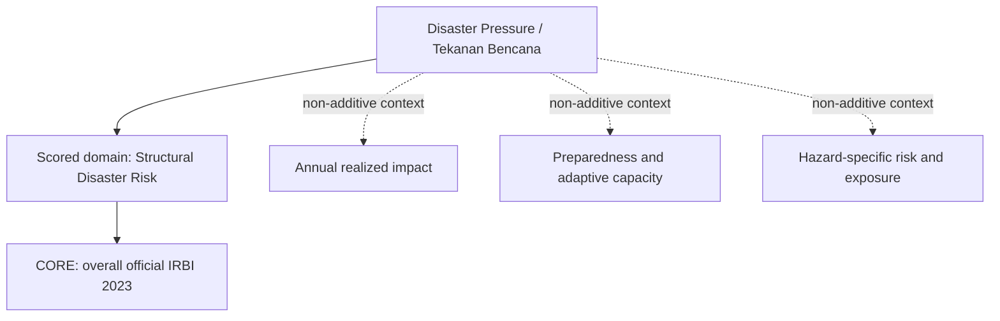

# CIVX Resilience data and methodology audit — Jawa Barat 2023

**Access date:** 29 October 2026. **Cohort:** all 27 Jawa Barat kabupaten/kota, comprising 18 kabupaten and nine kota with distinct BPS identifiers. **Status:** research and next-methodology recommendation only.

**Decision:** recommend **Disaster Pressure / Tekanan Bencana**, not a general resilience-capacity score. Retain the official overall IRBI 2023 index as the **single smallest defensible CORE**. It measures modeled residual disaster risk, combining hazard, vulnerability/exposure-related inputs and capacity. Preserve annual disaster impacts and capacity evidence as non-additive context. Do not force three scored subdimensions or expand indicator count to match available datasets.

No frontend, production indicator, score, scorer, methodology configuration, weight, current release, recommendation feature or Public Health decision changes. No production scoring cutover is authorized by this audit. Public Health disease-context evidence was neither revisited nor expanded.

## A. Construct definition

CIVX measures **relative civic pressure**, not regional worth, government performance, a causal explanation or a forecast. For this domain the defensible measured construct is **relative modeled structural disaster pressure on people, assets and regional systems, after the official risk model accounts for susceptibility and disaster-management capacity**. This is narrower than regional resilience, which also includes continuity, adaptation and recovery across many kinds of shocks.

| Concept | Literal meaning | Not equivalent to |
| --- | --- | --- |
| Hazard | Physical possibility, probability or intensity of a damaging phenomenon. | Actual events, total damage, or institutional weakness. |
| Exposure | People/assets located where a hazard can affect them. | All residents, general population density, or vulnerability itself. |
| Vulnerability | Susceptibility of exposed people/assets/systems to damage. | Hazard probability, actual victims, or a capacity index. |
| Realized impact | Harm, loss or disruption observed during a specified period. | Structural long-run risk or unique annual persons unless the register proves uniqueness. |
| Response/adaptive capacity | Ability to prepare, respond, adapt and recover. | Absence of events, raw resource counts, or an inverse of hazard. |

### Naming and direction decision

Choose **Disaster Pressure**, with the explanatory subtitle **modeled disaster risk**, over “Resilience Capacity with direction inverted.” Higher risk means greater potential pressure. Higher natural capacity means better preparedness; the audit records that direction without inversion. A capacity-only score would omit physical hazard and exposure. A high-risk region may have strong capacity but intrinsically severe hazards. A low-risk region need not have strong capacity. Thus risk is not simply inverse resilience.

“Disaster & Resilience Pressure” is a possible legacy bridge but still implies measured adaptation/recovery beyond the evidence. Bare “Resilience” overclaims breadth and makes direction confusing. This is a proposed next-methodology name, **not a change to the current UI or release**.

### Admission rules

Every CORE candidate must pass all fourteen gates: official source; 2023 reference vintage; all 27 regions; comparable definition; comparable unit; compatible administrative geography; clear relationship to the stated resilience/pressure construct; clear natural direction; no unresolved missing values; sufficient regional variation; no severe unnecessary redundancy; defensible denominator for a rate; not primarily a reporting-intensity artifact; and no added component already embedded in another selected composite. “2023 vintage” does not mean every model input was freshly observed in 2023: older input baselines must remain explicit.

No missing-as-zero, year replacement, interpolation, clipping, direction inversion, score, normalization or final weight is produced. Official source weights reported below describe BNPB's existing index, not new CIVX weights.

### Boundaries

Keep general pollution/air quality for Environment. Do not add poverty/unemployment as extra resilience vulnerability inputs. Do not duplicate Basic Services facilities, water, sanitation, housing or insurance. Do not move disease burden into Resilience. Some concepts already enter the official risk model implicitly; document that limitation rather than pretending domain independence or adding explicit duplicates.

## B. Current indicator audit — KEEP, narrowly defined

The current identifier is `disaster_risk`, represented by **Indeks Risiko Bencana (IRBI)**. It is the sole current Resilience indicator. This audit independently reacquired both the original BNPB publication and its official HTML table. Every 2023 value in both originals matches the existing production raw transcription: **27/27, zero differences**. Existing implementation is not the reason for admission; the official construct, comparable cohort and smallest-set analysis are.

| Field | Verified evidence |
| --- | --- |
| Publisher | Badan Nasional Penanggulangan Bencana (BNPB). |
| Publication | *Indeks Risiko Bencana Indonesia Tahun 2023*, Volume 02, Nomor 02, January 2024. |
| Exact table | “Tabel nilai indeks risiko Provinsi Jawa Barat dari Tahun 2015 sampai dengan Tahun 2023,” printed/PDF page 101; **2023 column only**. |
| Official original | [IRBI 2023 PDF](https://inarisk.bnpb.go.id/pdf/BUKU%20IRBI%202023.pdf). |
| Inspectable table | [Official HTML page 101](https://inarisk.bnpb.go.id/IRBI-2023/files/basic-html/page101.html). |
| Geography | 27 administrative kabupaten/kota; kabupaten and kota sharing a name remain distinct. No police/BPBD service-area substitution. Effective 2023 spatial baseline certification is not asserted. |
| Unit/type | Published composite index points, not percentage, hazard probability, people, events or per-capita rate. |
| Natural direction | Higher = more modeled disaster risk / pressure. |
| Period | Official 2023 index vintage; hazard and vulnerability held to IRBI 2013 baseline, from provincial KRB 2011. |
| Capacity input | Government disaster-management capacity through IKD's 71 indicators. Only 419 kabupaten/kota nationally assessed IKD in 2023; do not infer Jabar's assessment freshness from the annual index label. |
| Coverage/missingness | 27 numeric values; zero missing; 27 unique values; seven official high-risk and twenty medium-risk classifications. |
| Quality | No impossible/negative values, zero values, ties or 1.5-IQR outliers. All observed extremes retained unchanged. |
| Current decision | **KEEP; proposed next-model CORE**, labelled modeled Disaster Pressure. **REVIEW interpretation and input freshness**, not automatic removal of valid published values. |
| Prohibited conversions | Do not divide index points by population, call it a loss rate, infer affected persons, or invert it into measured capacity. |

### What the composite already contains

[Page 16](https://inarisk.bnpb.go.id/IRBI-2023/files/basic-html/page16.html) gives the conceptual relationship `Risk = Hazard × Vulnerability / Capacity`; the rendered PDF equation was inspected. [Page 17](https://inarisk.bnpb.go.id/IRBI-2023/files/basic-html/page17.html) reports component influences of **40% hazard, 30% vulnerability, 30% capacity**, fixed older hazard/vulnerability baselines, and the IKD update process. These statements are **not a sufficient recipe to reconstruct all published index points**, nor a new CIVX linear formula. Pages 20–22 describe classified hazard-specific parameters, weighting and regional aggregation; retain BNPB's published output rather than reverse-engineering an alternative score.

[Page 20](https://inarisk.bnpb.go.id/IRBI-2023/files/basic-html/page20.html) lists hazard, exposed persons, potential monetary losses, environmental damage and regional-government capacity. [Page 21](https://inarisk.bnpb.go.id/IRBI-2023/files/basic-html/page21.html) places exposed-person/loss/environment parameters within vulnerability. **Exposure is embedded, not a separately named fourth weighted block.** Capacity covers regulation, institutions, early warning, education/training, mitigation and preparedness; [executive summary page 6](https://inarisk.bnpb.go.id/IRBI-2023/files/basic-html/page6.html) also identifies response and recovery capacity. Consequently an overall IRBI plus hazard-specific IRBI, vulnerability/exposure or IKD would count model content twice even if Pearson correlation were small.

IRBI is not a fresh 2023 map of all hazards, a forecast of that year's impacts, or an independent annual loss observation. The annual index remains admissible for this narrow **official modeled-risk** construct because the common vintage and older baselines are disclosed. Those baselines prevent claims about freshly measured exposure or capacity and constrain temporal comparisons.

## C. Candidate register

The [full 22-column candidate register](../data/processed/resilience-audit-2023-candidate-register.csv) is the field-complete register for **every collected panel and investigated alternative**: indicator, concept, official publisher/URL/table, year, coverage, unit, raw/derived/composite status, numerator, denominator, formula, natural direction, reporting-bias risk, variation, redundancy, recommendation and reason. The raw JSON additionally retains exact source rows, access date, caveats and failed attempts. Missing fields are explicitly not established, not inferred.

Inventory: **111 evidence artifacts; 95 source/diagnostic panels; 2,565 expected regional records; 2,424 numeric cells; 141 explicit missing cells; 82 numerically complete panels; 47 investigations without an admitted 2023 district panel.** Of the numeric cells, **214 have unresolved BNPB-library heading/edition interpretation**; those are not validated 2023 observations. Panel count includes hazard variants, source editions, zeros, a supporting population denominator and a rejected duplicate, not 95 proposed indicators. Only one is CORE. The register includes **142 panel/investigation rows**, not 142 independently measured constructs.

Evidence files:

- [Construct, fourteen gates and protected file fingerprints](../data/raw/resilience-audit-2023/protocol.json).
- [Current IRBI re-audit](../data/raw/resilience-audit-2023/current-risk.json).
- [Hazard, exposure and vulnerability](../data/raw/resilience-audit-2023/hazard-exposure.json).
- [Realized impact and denominator evidence](../data/raw/resilience-audit-2023/realized-impact.json).
- [Adaptive capacity and preparedness](../data/raw/resilience-audit-2023/adaptive-capacity.json).
- [Processed observations and source locators](../data/processed/resilience-audit-2023-observations.json).
- [Statistics, admission findings, correlations and source fingerprints](../data/processed/resilience-audit-2023-statistics.json).

### C.1 Collected source/diagnostic panels

All rows below carry the source's **2023 label/vintage**, not a guarantee of fresh underlying observations. `n` counts numeric cells; `ambiguous` distinguishes unresolved source interpretations. A raw impact's `higher_worse` means **more literal reported harm**, not weaker resilience, worse government or a valid size-comparable score. `not_scored` preserves the absence of a defensible resilience-performance direction. Exact numerator, denominator, formula and source-definition fields are in the linked CSV and raw row receipts; **no derived rate was created**.

| Candidate ID / literal indicator | Concept; unit; type | Source | Coverage and variation | Natural direction; reporting bias | Redundancy; recommendation and reason |
| --- | --- | --- | --- | --- | --- |
| `irbi_overall_2023` — Official overall disaster-risk index (IRBI) | structural_risk; index points; composite_index | Badan Nasional Penanggulangan Bencana; [Indeks Risiko Bencana Indonesia Tahun 2023 (IRBI), Volume 02 Nomor 02, Januari 2024](https://inarisk.bnpb.go.id/pdf/BUKU%20IRBI%202023.pdf); Tabel nilai indeks risiko Provinsi Jawa Barat dari Tahun 2015 sampai dengan Tahun 2023; printed/PDF 101 | n=27/27; missing=0; ambiguous=0; 27 unique; min–max 63.49–185.14; SD 28.898 | higher_worse; Not primarily annual event-report count; depends on older model inputs, risk modelling, capacity assessment and annual assessment/revision coverage. | Contains H/V/C; exposure enters vulnerability. Do not add its hazard-specific risk scores, IKD or vulnerability/exposure components as extra independent CORE. Socioeconomic/service conceptual links remain implicit and must be disclosed, not duplicated with extra resilience proxies. **CORE** — KEEP, narrowly labelled modeled Disaster Pressure; complete official2023 residual-risk composite, no extra nested components. Older baselines and assessment freshness constrain interpretation, not hidden new2023 hazards. |
| `irbi_2023_flood_risk` — Indeks risiko bencana Banjir 2023 | structural_risk; published hazard-specific risk index points; composite_index | BNPB; [IRBI Indeks Risiko Bencana Indonesia Tahun 2023](https://inarisk.bnpb.go.id/pdf/BUKU%20IRBI%202023.pdf); Indeks Risiko Banjir Tahun 2023, pp.210–221 | n=22/27; missing=5; ambiguous=0; 22 unique; min–max 8–28.67; SD 5.239 | higher_worse; Model/baseline and district capacity-assessment coverage; not event-reporting frequency. District-specific fresh 2023 IKD assessment not established. | Hazard-specific component/alternative to overall IRBI, with repeated H/V/capacity structure; additive use beside overall IRBI double counts unless nonredundancy proven. **CONTEXT ONLY** — Useful hazard-risk decomposition, not an independent CORE indicator while overall IRBI remains. Availability alone does not establish independent civic pressure. |
| `irbi_2023_earthquake_risk` — Indeks risiko bencana Gempabumi 2023 | structural_risk; published hazard-specific risk index points; composite_index | BNPB; [IRBI Indeks Risiko Bencana Indonesia Tahun 2023](https://inarisk.bnpb.go.id/pdf/BUKU%20IRBI%202023.pdf); Indeks Risiko Gempabumi Tahun 2023, pp.224–239 | n=27/27; missing=0; ambiguous=0; 27 unique; min–max 5.31–16.1; SD 2.744 | higher_worse; Model/baseline and district capacity-assessment coverage; not event-reporting frequency. District-specific fresh 2023 IKD assessment not established. | Hazard-specific component/alternative to overall IRBI, with repeated H/V/capacity structure; additive use beside overall IRBI double counts unless nonredundancy proven. **CONTEXT ONLY** — Useful hazard-risk decomposition, not an independent CORE indicator while overall IRBI remains. Availability alone does not establish independent civic pressure. |
| `irbi_2023_tsunami_risk` — Indeks risiko bencana Tsunami 2023 | structural_risk; published hazard-specific risk index points; composite_index | BNPB; [IRBI Indeks Risiko Bencana Indonesia Tahun 2023](https://inarisk.bnpb.go.id/pdf/BUKU%20IRBI%202023.pdf); Indeks Risiko Tsunami Tahun 2023, pp.242–249 | n=6/27; missing=21; ambiguous=0; 6 unique; min–max 2.43–16.43; SD 4.304 | higher_worse; Model/baseline and district capacity-assessment coverage; not event-reporting frequency. District-specific fresh 2023 IKD assessment not established. | Hazard-specific component/alternative to overall IRBI, with repeated H/V/capacity structure; additive use beside overall IRBI double counts unless nonredundancy proven. **CONTEXT ONLY** — Useful hazard-risk decomposition, not an independent CORE indicator while overall IRBI remains. Availability alone does not establish independent civic pressure. |
| `irbi_2023_volcanic_eruption_risk` — Indeks risiko bencana Letusan Gunungapi 2023 | structural_risk; published hazard-specific risk index points; composite_index | BNPB; [IRBI Indeks Risiko Bencana Indonesia Tahun 2023](https://inarisk.bnpb.go.id/pdf/BUKU%20IRBI%202023.pdf); Indeks Risiko Letusan Gunungapi Tahun 2023, pp.252–255 | n=11/27; missing=16; ambiguous=0; 11 unique; min–max 3.09–10.96; SD 2.447 | higher_worse; Model/baseline and district capacity-assessment coverage; not event-reporting frequency. District-specific fresh 2023 IKD assessment not established. | Hazard-specific component/alternative to overall IRBI, with repeated H/V/capacity structure; additive use beside overall IRBI double counts unless nonredundancy proven. **CONTEXT ONLY** — Useful hazard-risk decomposition, not an independent CORE indicator while overall IRBI remains. Availability alone does not establish independent civic pressure. |
| `irbi_2023_forest_land_fire_risk` — Indeks risiko bencana Kebakaran Hutan dan Lahan 2023 | structural_risk; published hazard-specific risk index points; composite_index | BNPB; [IRBI Indeks Risiko Bencana Indonesia Tahun 2023](https://inarisk.bnpb.go.id/pdf/BUKU%20IRBI%202023.pdf); Indeks Risiko Kebakaran Hutan dan Lahan Tahun 2023, pp.258–273 | n=27/27; missing=0; ambiguous=0; 27 unique; min–max 9.44–28.67; SD 4.724 | higher_worse; Model/baseline and district capacity-assessment coverage; not event-reporting frequency. District-specific fresh 2023 IKD assessment not established. | Hazard-specific component/alternative to overall IRBI, with repeated H/V/capacity structure; additive use beside overall IRBI double counts unless nonredundancy proven. **CONTEXT ONLY** — Useful hazard-risk decomposition, not an independent CORE indicator while overall IRBI remains. Availability alone does not establish independent civic pressure. |
| `irbi_2023_landslide_risk` — Indeks risiko bencana Tanah Longsor 2023 | structural_risk; published hazard-specific risk index points; composite_index | BNPB; [IRBI Indeks Risiko Bencana Indonesia Tahun 2023](https://inarisk.bnpb.go.id/pdf/BUKU%20IRBI%202023.pdf); Indeks Risiko Tanah Longsor Tahun 2023, pp.276–291 | n=27/27; missing=0; ambiguous=0; 27 unique; min–max 4.72–16.68; SD 3.832 | higher_worse; Model/baseline and district capacity-assessment coverage; not event-reporting frequency. District-specific fresh 2023 IKD assessment not established. | Hazard-specific component/alternative to overall IRBI, with repeated H/V/capacity structure; additive use beside overall IRBI double counts unless nonredundancy proven. **CONTEXT ONLY** — Useful hazard-risk decomposition, not an independent CORE indicator while overall IRBI remains. Availability alone does not establish independent civic pressure. |
| `irbi_2023_extreme_waves_abrasion_risk` — Indeks risiko bencana Gelombang Ekstrim dan Abrasi 2023 | structural_risk; published hazard-specific risk index points; composite_index | BNPB; [IRBI Indeks Risiko Bencana Indonesia Tahun 2023](https://inarisk.bnpb.go.id/pdf/BUKU%20IRBI%202023.pdf); Indeks Risiko Gelombang Ekstrim dan Abrasi Tahun 2023, pp.294–303 | n=11/27; missing=16; ambiguous=0; 11 unique; min–max 10.74–28.67; SD 5.194 | higher_worse; Model/baseline and district capacity-assessment coverage; not event-reporting frequency. District-specific fresh 2023 IKD assessment not established. | Hazard-specific component/alternative to overall IRBI, with repeated H/V/capacity structure; additive use beside overall IRBI double counts unless nonredundancy proven. **CONTEXT ONLY** — Useful hazard-risk decomposition, not an independent CORE indicator while overall IRBI remains. Availability alone does not establish independent civic pressure. |
| `irbi_2023_drought_risk` — Indeks risiko bencana Kekeringan 2023 | structural_risk; published hazard-specific risk index points; composite_index | BNPB; [IRBI Indeks Risiko Bencana Indonesia Tahun 2023](https://inarisk.bnpb.go.id/pdf/BUKU%20IRBI%202023.pdf); Indeks Risiko Kekeringan Tahun 2023, pp.306–321 | n=27/27; missing=0; ambiguous=0; 26 unique; min–max 9.44–26.83; SD 3.658 | higher_worse; Model/baseline and district capacity-assessment coverage; not event-reporting frequency. District-specific fresh 2023 IKD assessment not established. | Hazard-specific component/alternative to overall IRBI, with repeated H/V/capacity structure; additive use beside overall IRBI double counts unless nonredundancy proven. **CONTEXT ONLY** — Useful hazard-risk decomposition, not an independent CORE indicator while overall IRBI remains. Availability alone does not establish independent civic pressure. |
| `irbi_2023_extreme_weather_risk` — Indeks risiko bencana Cuaca Ekstrim 2023 | structural_risk; published hazard-specific risk index points; composite_index | BNPB; [IRBI Indeks Risiko Bencana Indonesia Tahun 2023](https://inarisk.bnpb.go.id/pdf/BUKU%20IRBI%202023.pdf); Indeks Risiko Cuaca Ekstrim Tahun 2023, pp.324–339 | n=27/27; missing=0; ambiguous=0; 27 unique; min–max 6.41–16.24; SD 2.425 | higher_worse; Model/baseline and district capacity-assessment coverage; not event-reporting frequency. District-specific fresh 2023 IKD assessment not established. | Hazard-specific component/alternative to overall IRBI, with repeated H/V/capacity structure; additive use beside overall IRBI double counts unless nonredundancy proven. **CONTEXT ONLY** — Useful hazard-risk decomposition, not an independent CORE indicator while overall IRBI remains. Availability alone does not establish independent civic pressure. |
| `impact_bpbd_18727_abrasi` — Jumlah Kejadian Bencana Berdasarkan Jenis Bencana di Jawa Barat — ABRASI | realized_impact; KEJADIAN; raw_count | BADAN PENANGGULANGAN BENCANA DAERAH; [Jumlah Kejadian Bencana Berdasarkan Jenis Bencana di Jawa Barat](https://galura.jabarprov.go.id/api/bigdata/jumlah-kejadian-bencana-berdasarkan-jenis-bencana-di-jawa-barat?per_page=10000&where=%7B%22tahun%22%3A2023%7D); jumlah_kejadian | n=27/27; missing=0; ambiguous=0; 1 unique; min–max 0–0; SD 0 | not_scored; [INFERENCE] Administrative reports can vary with local detection, reporting coverage, event classification, cut-off dates and later revisions. No audited reporting-completeness adjustment was acquired. | May overlap other impact categories and alternative-source reports; do not add to IRBI or aggregate aliases without evidence. **CONTEXT ONLY** — Reported annual impacts are valuable context but do not establish comparable resilience performance or unique resident risk. |
| `impact_bpbd_18727_angin_puting_beliung` — Jumlah Kejadian Bencana Berdasarkan Jenis Bencana di Jawa Barat — ANGIN PUTING BELIUNG | realized_impact; KEJADIAN; raw_count | BADAN PENANGGULANGAN BENCANA DAERAH; [Jumlah Kejadian Bencana Berdasarkan Jenis Bencana di Jawa Barat](https://galura.jabarprov.go.id/api/bigdata/jumlah-kejadian-bencana-berdasarkan-jenis-bencana-di-jawa-barat?per_page=10000&where=%7B%22tahun%22%3A2023%7D); jumlah_kejadian | n=27/27; missing=0; ambiguous=0; 16 unique; min–max 1–191; SD 36.187 | not_scored; [INFERENCE] Administrative reports can vary with local detection, reporting coverage, event classification, cut-off dates and later revisions. No audited reporting-completeness adjustment was acquired. | May overlap other impact categories and alternative-source reports; do not add to IRBI or aggregate aliases without evidence. **CONTEXT ONLY** — Reported annual impacts are valuable context but do not establish comparable resilience performance or unique resident risk. |
| `impact_bpbd_18727_banjir` — Jumlah Kejadian Bencana Berdasarkan Jenis Bencana di Jawa Barat — BANJIR | realized_impact; KEJADIAN; raw_count | BADAN PENANGGULANGAN BENCANA DAERAH; [Jumlah Kejadian Bencana Berdasarkan Jenis Bencana di Jawa Barat](https://galura.jabarprov.go.id/api/bigdata/jumlah-kejadian-bencana-berdasarkan-jenis-bencana-di-jawa-barat?per_page=10000&where=%7B%22tahun%22%3A2023%7D); jumlah_kejadian | n=27/27; missing=0; ambiguous=0; 15 unique; min–max 0–29; SD 6.342 | not_scored; [INFERENCE] Administrative reports can vary with local detection, reporting coverage, event classification, cut-off dates and later revisions. No audited reporting-completeness adjustment was acquired. | May overlap other impact categories and alternative-source reports; do not add to IRBI or aggregate aliases without evidence. **CONTEXT ONLY** — Reported annual impacts are valuable context but do not establish comparable resilience performance or unique resident risk. |
| `impact_bpbd_18727_gempa_bumi` — Jumlah Kejadian Bencana Berdasarkan Jenis Bencana di Jawa Barat — GEMPA BUMI | realized_impact; KEJADIAN; raw_count | BADAN PENANGGULANGAN BENCANA DAERAH; [Jumlah Kejadian Bencana Berdasarkan Jenis Bencana di Jawa Barat](https://galura.jabarprov.go.id/api/bigdata/jumlah-kejadian-bencana-berdasarkan-jenis-bencana-di-jawa-barat?per_page=10000&where=%7B%22tahun%22%3A2023%7D); jumlah_kejadian | n=27/27; missing=0; ambiguous=0; 7 unique; min–max 0–8; SD 2.328 | not_scored; [INFERENCE] Administrative reports can vary with local detection, reporting coverage, event classification, cut-off dates and later revisions. No audited reporting-completeness adjustment was acquired. | May overlap other impact categories and alternative-source reports; do not add to IRBI or aggregate aliases without evidence. **CONTEXT ONLY** — Reported annual impacts are valuable context but do not establish comparable resilience performance or unique resident risk. |
| `impact_bpbd_18727_kebakaran_hutan` — Jumlah Kejadian Bencana Berdasarkan Jenis Bencana di Jawa Barat — KEBAKARAN HUTAN | realized_impact; KEJADIAN; raw_count | BADAN PENANGGULANGAN BENCANA DAERAH; [Jumlah Kejadian Bencana Berdasarkan Jenis Bencana di Jawa Barat](https://galura.jabarprov.go.id/api/bigdata/jumlah-kejadian-bencana-berdasarkan-jenis-bencana-di-jawa-barat?per_page=10000&where=%7B%22tahun%22%3A2023%7D); jumlah_kejadian | n=27/27; missing=0; ambiguous=0; 22 unique; min–max 0–138; SD 32.848 | not_scored; [INFERENCE] Administrative reports can vary with local detection, reporting coverage, event classification, cut-off dates and later revisions. No audited reporting-completeness adjustment was acquired. | May overlap other impact categories and alternative-source reports; do not add to IRBI or aggregate aliases without evidence. **CONTEXT ONLY** — Reported annual impacts are valuable context but do not establish comparable resilience performance or unique resident risk. |
| `impact_bpbd_18727_kekeringan` — Jumlah Kejadian Bencana Berdasarkan Jenis Bencana di Jawa Barat — KEKERINGAN | realized_impact; KEJADIAN; raw_count | BADAN PENANGGULANGAN BENCANA DAERAH; [Jumlah Kejadian Bencana Berdasarkan Jenis Bencana di Jawa Barat](https://galura.jabarprov.go.id/api/bigdata/jumlah-kejadian-bencana-berdasarkan-jenis-bencana-di-jawa-barat?per_page=10000&where=%7B%22tahun%22%3A2023%7D); jumlah_kejadian | n=27/27; missing=0; ambiguous=0; 3 unique; min–max 0–2; SD 0.272 | not_scored; [INFERENCE] Administrative reports can vary with local detection, reporting coverage, event classification, cut-off dates and later revisions. No audited reporting-completeness adjustment was acquired. | May overlap other impact categories and alternative-source reports; do not add to IRBI or aggregate aliases without evidence. **CONTEXT ONLY** — Reported annual impacts are valuable context but do not establish comparable resilience performance or unique resident risk. |
| `impact_bpbd_18727_tanah_longsor` — Jumlah Kejadian Bencana Berdasarkan Jenis Bencana di Jawa Barat — TANAH LONGSOR | realized_impact; KEJADIAN; raw_count | BADAN PENANGGULANGAN BENCANA DAERAH; [Jumlah Kejadian Bencana Berdasarkan Jenis Bencana di Jawa Barat](https://galura.jabarprov.go.id/api/bigdata/jumlah-kejadian-bencana-berdasarkan-jenis-bencana-di-jawa-barat?per_page=10000&where=%7B%22tahun%22%3A2023%7D); jumlah_kejadian | n=27/27; missing=0; ambiguous=0; 20 unique; min–max 0–109; SD 22.875 | not_scored; [INFERENCE] Administrative reports can vary with local detection, reporting coverage, event classification, cut-off dates and later revisions. No audited reporting-completeness adjustment was acquired. | May overlap other impact categories and alternative-source reports; do not add to IRBI or aggregate aliases without evidence. **CONTEXT ONLY** — Reported annual impacts are valuable context but do not establish comparable resilience performance or unique resident risk. |
| `impact_bpbd_18727_tsunami` — Jumlah Kejadian Bencana Berdasarkan Jenis Bencana di Jawa Barat — TSUNAMI | realized_impact; KEJADIAN; raw_count | BADAN PENANGGULANGAN BENCANA DAERAH; [Jumlah Kejadian Bencana Berdasarkan Jenis Bencana di Jawa Barat](https://galura.jabarprov.go.id/api/bigdata/jumlah-kejadian-bencana-berdasarkan-jenis-bencana-di-jawa-barat?per_page=10000&where=%7B%22tahun%22%3A2023%7D); jumlah_kejadian | n=27/27; missing=0; ambiguous=0; 1 unique; min–max 0–0; SD 0 | not_scored; [INFERENCE] Administrative reports can vary with local detection, reporting coverage, event classification, cut-off dates and later revisions. No audited reporting-completeness adjustment was acquired. | May overlap other impact categories and alternative-source reports; do not add to IRBI or aggregate aliases without evidence. **CONTEXT ONLY** — Reported annual impacts are valuable context but do not establish comparable resilience performance or unique resident risk. |
| `impact_bpbd_17946_hilang` — Jumlah Korban Jiwa Akibat Bencana Berdasarkan Kondisi di Jawa Barat — HILANG | realized_impact; JIWA; raw_count | BADAN PENANGGULANGAN BENCANA DAERAH; [Jumlah Korban Jiwa Akibat Bencana Berdasarkan Kondisi di Jawa Barat](https://galura.jabarprov.go.id/api/bigdata/jumlah-korban-jiwa-akibat-bencana-berdasarkan-kondisi-di-jawa-barat?per_page=10000&where=%7B%22tahun%22%3A2023%7D); jumlah_korban | n=27/27; missing=0; ambiguous=0; 2 unique; min–max 0–1; SD 0.189 | higher_worse; [INFERENCE] Administrative reports can vary with local detection, reporting coverage, event classification, cut-off dates and later revisions. No audited reporting-completeness adjustment was acquired. | May overlap other impact categories and alternative-source reports; do not add to IRBI or aggregate aliases without evidence. **CONTEXT ONLY** — Reported annual impacts are valuable context but do not establish comparable resilience performance or unique resident risk. |
| `impact_bpbd_17946_luka_luka` — Jumlah Korban Jiwa Akibat Bencana Berdasarkan Kondisi di Jawa Barat — LUKA-LUKA | realized_impact; JIWA; raw_count | BADAN PENANGGULANGAN BENCANA DAERAH; [Jumlah Korban Jiwa Akibat Bencana Berdasarkan Kondisi di Jawa Barat](https://galura.jabarprov.go.id/api/bigdata/jumlah-korban-jiwa-akibat-bencana-berdasarkan-kondisi-di-jawa-barat?per_page=10000&where=%7B%22tahun%22%3A2023%7D); jumlah_korban | n=27/27; missing=0; ambiguous=0; 13 unique; min–max 0–20; SD 5.997 | higher_worse; [INFERENCE] Administrative reports can vary with local detection, reporting coverage, event classification, cut-off dates and later revisions. No audited reporting-completeness adjustment was acquired. | May overlap other impact categories and alternative-source reports; do not add to IRBI or aggregate aliases without evidence. **CONTEXT ONLY** — Reported annual impacts are valuable context but do not establish comparable resilience performance or unique resident risk. |
| `impact_bpbd_17946_menderita` — Jumlah Korban Jiwa Akibat Bencana Berdasarkan Kondisi di Jawa Barat — MENDERITA | realized_impact; JIWA; raw_count | BADAN PENANGGULANGAN BENCANA DAERAH; [Jumlah Korban Jiwa Akibat Bencana Berdasarkan Kondisi di Jawa Barat](https://galura.jabarprov.go.id/api/bigdata/jumlah-korban-jiwa-akibat-bencana-berdasarkan-kondisi-di-jawa-barat?per_page=10000&where=%7B%22tahun%22%3A2023%7D); jumlah_korban | n=27/27; missing=0; ambiguous=0; 27 unique; min–max 84–1,832,455; SD 347,037.497 | higher_worse; [INFERENCE] Administrative reports can vary with local detection, reporting coverage, event classification, cut-off dates and later revisions. No audited reporting-completeness adjustment was acquired. | May overlap other impact categories and alternative-source reports; do not add to IRBI or aggregate aliases without evidence. **CONTEXT ONLY** — Reported annual impacts are valuable context but do not establish comparable resilience performance or unique resident risk. |
| `impact_bpbd_17946_mengungsi` — Jumlah Korban Jiwa Akibat Bencana Berdasarkan Kondisi di Jawa Barat — MENGUNGSI | realized_impact; JIWA; raw_count | BADAN PENANGGULANGAN BENCANA DAERAH; [Jumlah Korban Jiwa Akibat Bencana Berdasarkan Kondisi di Jawa Barat](https://galura.jabarprov.go.id/api/bigdata/jumlah-korban-jiwa-akibat-bencana-berdasarkan-kondisi-di-jawa-barat?per_page=10000&where=%7B%22tahun%22%3A2023%7D); jumlah_korban | n=27/27; missing=0; ambiguous=0; 18 unique; min–max 0–1,476; SD 333.578 | higher_worse; [INFERENCE] Administrative reports can vary with local detection, reporting coverage, event classification, cut-off dates and later revisions. No audited reporting-completeness adjustment was acquired. | May overlap other impact categories and alternative-source reports; do not add to IRBI or aggregate aliases without evidence. **CONTEXT ONLY** — Reported annual impacts are valuable context but do not establish comparable resilience performance or unique resident risk. |
| `impact_bpbd_17946_meninggal_dunia` — Jumlah Korban Jiwa Akibat Bencana Berdasarkan Kondisi di Jawa Barat — MENINGGAL DUNIA | realized_impact; JIWA; raw_count | BADAN PENANGGULANGAN BENCANA DAERAH; [Jumlah Korban Jiwa Akibat Bencana Berdasarkan Kondisi di Jawa Barat](https://galura.jabarprov.go.id/api/bigdata/jumlah-korban-jiwa-akibat-bencana-berdasarkan-kondisi-di-jawa-barat?per_page=10000&where=%7B%22tahun%22%3A2023%7D); jumlah_korban | n=27/27; missing=0; ambiguous=0; 7 unique; min–max 0–9; SD 2.201 | higher_worse; [INFERENCE] Administrative reports can vary with local detection, reporting coverage, event classification, cut-off dates and later revisions. No audited reporting-completeness adjustment was acquired. | May overlap other impact categories and alternative-source reports; do not add to IRBI or aggregate aliases without evidence. **CONTEXT ONLY** — Reported annual impacts are valuable context but do not establish comparable resilience performance or unique resident risk. |
| `impact_bpbd_17607_hancur` — Jumlah Kerusakan Rumah/Tempat Tinggal Akibat Bencana Berdasarkan Kondisi di Jawa Barat — HANCUR | realized_impact; UNIT; raw_count | BADAN PENANGGULANGAN BENCANA DAERAH; [Jumlah Kerusakan Rumah/Tempat Tinggal Akibat Bencana Berdasarkan Kondisi di Jawa Barat](https://galura.jabarprov.go.id/api/bigdata/jumlah-kerusakan-rumahtempat-tinggal-akibat-bencana-berdasarkan-kondisi-di-jawa-barat?per_page=10000&where=%7B%22tahun%22%3A2023%7D); jumlah_kerusakan | n=27/27; missing=0; ambiguous=0; 2 unique; min–max 0–58; SD 10.953 | higher_worse; [INFERENCE] Administrative reports can vary with local detection, reporting coverage, event classification, cut-off dates and later revisions. No audited reporting-completeness adjustment was acquired. | May overlap other impact categories and alternative-source reports; do not add to IRBI or aggregate aliases without evidence. **CONTEXT ONLY** — Reported annual impacts are valuable context but do not establish comparable resilience performance or unique resident risk. |
| `impact_bpbd_17607_rusak_berat` — Jumlah Kerusakan Rumah/Tempat Tinggal Akibat Bencana Berdasarkan Kondisi di Jawa Barat — RUSAK BERAT | realized_impact; UNIT; raw_count | BADAN PENANGGULANGAN BENCANA DAERAH; [Jumlah Kerusakan Rumah/Tempat Tinggal Akibat Bencana Berdasarkan Kondisi di Jawa Barat](https://galura.jabarprov.go.id/api/bigdata/jumlah-kerusakan-rumahtempat-tinggal-akibat-bencana-berdasarkan-kondisi-di-jawa-barat?per_page=10000&where=%7B%22tahun%22%3A2023%7D); jumlah_kerusakan | n=27/27; missing=0; ambiguous=0; 22 unique; min–max 0–228; SD 60.016 | higher_worse; [INFERENCE] Administrative reports can vary with local detection, reporting coverage, event classification, cut-off dates and later revisions. No audited reporting-completeness adjustment was acquired. | May overlap other impact categories and alternative-source reports; do not add to IRBI or aggregate aliases without evidence. **CONTEXT ONLY** — Reported annual impacts are valuable context but do not establish comparable resilience performance or unique resident risk. |
| `impact_bpbd_17607_rusak_ringan` — Jumlah Kerusakan Rumah/Tempat Tinggal Akibat Bencana Berdasarkan Kondisi di Jawa Barat — RUSAK RINGAN | realized_impact; UNIT; raw_count | BADAN PENANGGULANGAN BENCANA DAERAH; [Jumlah Kerusakan Rumah/Tempat Tinggal Akibat Bencana Berdasarkan Kondisi di Jawa Barat](https://galura.jabarprov.go.id/api/bigdata/jumlah-kerusakan-rumahtempat-tinggal-akibat-bencana-berdasarkan-kondisi-di-jawa-barat?per_page=10000&where=%7B%22tahun%22%3A2023%7D); jumlah_kerusakan | n=27/27; missing=0; ambiguous=0; 27 unique; min–max 0–2,712; SD 530.681 | higher_worse; [INFERENCE] Administrative reports can vary with local detection, reporting coverage, event classification, cut-off dates and later revisions. No audited reporting-completeness adjustment was acquired. | May overlap other impact categories and alternative-source reports; do not add to IRBI or aggregate aliases without evidence. **CONTEXT ONLY** — Reported annual impacts are valuable context but do not establish comparable resilience performance or unique resident risk. |
| `impact_bpbd_17607_rusak_sedang` — Jumlah Kerusakan Rumah/Tempat Tinggal Akibat Bencana Berdasarkan Kondisi di Jawa Barat — RUSAK SEDANG | realized_impact; UNIT; raw_count | BADAN PENANGGULANGAN BENCANA DAERAH; [Jumlah Kerusakan Rumah/Tempat Tinggal Akibat Bencana Berdasarkan Kondisi di Jawa Barat](https://galura.jabarprov.go.id/api/bigdata/jumlah-kerusakan-rumahtempat-tinggal-akibat-bencana-berdasarkan-kondisi-di-jawa-barat?per_page=10000&where=%7B%22tahun%22%3A2023%7D); jumlah_kerusakan | n=27/27; missing=0; ambiguous=0; 23 unique; min–max 0–974; SD 182.733 | higher_worse; [INFERENCE] Administrative reports can vary with local detection, reporting coverage, event classification, cut-off dates and later revisions. No audited reporting-completeness adjustment was acquired. | May overlap other impact categories and alternative-source reports; do not add to IRBI or aggregate aliases without evidence. **CONTEXT ONLY** — Reported annual impacts are valuable context but do not establish comparable resilience performance or unique resident risk. |
| `impact_bpbd_17607_terancam` — Jumlah Kerusakan Rumah/Tempat Tinggal Akibat Bencana Berdasarkan Kondisi di Jawa Barat — TERANCAM | realized_impact; UNIT; raw_count | BADAN PENANGGULANGAN BENCANA DAERAH; [Jumlah Kerusakan Rumah/Tempat Tinggal Akibat Bencana Berdasarkan Kondisi di Jawa Barat](https://galura.jabarprov.go.id/api/bigdata/jumlah-kerusakan-rumahtempat-tinggal-akibat-bencana-berdasarkan-kondisi-di-jawa-barat?per_page=10000&where=%7B%22tahun%22%3A2023%7D); jumlah_kerusakan | n=27/27; missing=0; ambiguous=0; 18 unique; min–max 0–706; SD 153.874 | higher_worse; [INFERENCE] Administrative reports can vary with local detection, reporting coverage, event classification, cut-off dates and later revisions. No audited reporting-completeness adjustment was acquired. | May overlap other impact categories and alternative-source reports; do not add to IRBI or aggregate aliases without evidence. **CONTEXT ONLY** — Reported annual impacts are valuable context but do not establish comparable resilience performance or unique resident risk. |
| `impact_bpbd_17607_terendam_tertimbun` — Jumlah Kerusakan Rumah/Tempat Tinggal Akibat Bencana Berdasarkan Kondisi di Jawa Barat — TERENDAM/TERTIMBUN | realized_impact; UNIT; raw_count | BADAN PENANGGULANGAN BENCANA DAERAH; [Jumlah Kerusakan Rumah/Tempat Tinggal Akibat Bencana Berdasarkan Kondisi di Jawa Barat](https://galura.jabarprov.go.id/api/bigdata/jumlah-kerusakan-rumahtempat-tinggal-akibat-bencana-berdasarkan-kondisi-di-jawa-barat?per_page=10000&where=%7B%22tahun%22%3A2023%7D); jumlah_kerusakan | n=27/27; missing=0; ambiguous=0; 24 unique; min–max 0–43,418; SD 8,524.191 | higher_worse; [INFERENCE] Administrative reports can vary with local detection, reporting coverage, event classification, cut-off dates and later revisions. No audited reporting-completeness adjustment was acquired. | May overlap other impact categories and alternative-source reports; do not add to IRBI or aggregate aliases without evidence. **CONTEXT ONLY** — Reported annual impacts are valuable context but do not establish comparable resilience performance or unique resident risk. |
| `impact_bpbd_17610` — Jumlah Taksiran Kerugian Dampak Bencana Berdasarkan Kabupaten/Kota di Jawa Barat | realized_impact; RUPIAH; raw_count | BADAN PENANGGULANGAN BENCANA DAERAH; [Jumlah Taksiran Kerugian Dampak Bencana Berdasarkan Kabupaten/Kota di Jawa Barat](https://galura.jabarprov.go.id/api/bigdata/jumlah-taksiran-kerugian-dampak-bencana-berdasarkan-kabupatenkota-di-jawa-barat?per_page=10000&where=%7B%22tahun%22%3A2023%7D); jumlah_taksiran_kerugian | n=27/27; missing=0; ambiguous=0; 27 unique; min–max 699,840,000–339,301,440,000; SD 64,046,960,750.147 | higher_worse; [INFERENCE] Administrative reports can vary with local detection, reporting coverage, event classification, cut-off dates and later revisions. No audited reporting-completeness adjustment was acquired. | May overlap other impact categories and alternative-source reports; do not add to IRBI or aggregate aliases without evidence. **CONTEXT ONLY** — Reported annual impacts are valuable context but do not establish comparable resilience performance or unique resident risk. |
| `impact_bpbd_17600` — Jumlah Kejadian Bencana Banjir Berdasarkan Kabupaten/Kota di Jawa Barat | realized_impact; KEJADIAN; raw_count | BADAN PENANGGULANGAN BENCANA DAERAH; [Jumlah Kejadian Bencana Banjir Berdasarkan Kabupaten/Kota di Jawa Barat](https://galura.jabarprov.go.id/api/bigdata/jumlah-kejadian-bencana-banjir-berdasarkan-kabupatenkota-di-jawa-barat?per_page=10000&where=%7B%22tahun%22%3A2023%7D); jumlah_banjir | n=27/27; missing=0; ambiguous=0; 15 unique; min–max 0–29; SD 6.342 | not_scored; [INFERENCE] Administrative reports can vary with local detection, reporting coverage, event classification, cut-off dates and later revisions. No audited reporting-completeness adjustment was acquired. | May overlap other impact categories and alternative-source reports; do not add to IRBI or aggregate aliases without evidence. **CONTEXT ONLY** — Reported annual impacts are valuable context but do not establish comparable resilience performance or unique resident risk. |
| `impact_bpbd_17599` — Jumlah Kejadian Bencana Cuaca  Ekstrem Berdasarkan Kabupaten/Kota di Jawa Barat | realized_impact; KEJADIAN; raw_count | BADAN PENANGGULANGAN BENCANA DAERAH; [Jumlah Kejadian Bencana Cuaca  Ekstrem Berdasarkan Kabupaten/Kota di Jawa Barat](https://galura.jabarprov.go.id/api/bigdata/jumlah-kejadian-bencana-cuaca--ekstrem-berdasarkan-kabupatenkota-di-jawa-barat?per_page=10000&where=%7B%22tahun%22%3A2023%7D); jumlah_cuaca_ekstrem | n=27/27; missing=0; ambiguous=0; 16 unique; min–max 1–191; SD 36.187 | not_scored; [INFERENCE] Administrative reports can vary with local detection, reporting coverage, event classification, cut-off dates and later revisions. No audited reporting-completeness adjustment was acquired. | May overlap other impact categories and alternative-source reports; do not add to IRBI or aggregate aliases without evidence. **CONTEXT ONLY** — Reported annual impacts are valuable context but do not establish comparable resilience performance or unique resident risk. |
| `impact_bpbd_17602` — Jumlah Kejadian Bencana Gempa Bumi Berdasarkan Kabupaten/Kota di Jawa Barat | realized_impact; KEJADIAN; raw_count | BADAN PENANGGULANGAN BENCANA DAERAH; [Jumlah Kejadian Bencana Gempa Bumi Berdasarkan Kabupaten/Kota di Jawa Barat](https://galura.jabarprov.go.id/api/bigdata/jumlah-kejadian-bencana-gempa-bumi-berdasarkan-kabupatenkota-di-jawa-barat?per_page=10000&where=%7B%22tahun%22%3A2023%7D); jumlah_gempa_bumi | n=27/27; missing=0; ambiguous=0; 7 unique; min–max 0–8; SD 2.328 | not_scored; [INFERENCE] Administrative reports can vary with local detection, reporting coverage, event classification, cut-off dates and later revisions. No audited reporting-completeness adjustment was acquired. | May overlap other impact categories and alternative-source reports; do not add to IRBI or aggregate aliases without evidence. **CONTEXT ONLY** — Reported annual impacts are valuable context but do not establish comparable resilience performance or unique resident risk. |
| `impact_bpbd_17603` — Jumlah Kejadian Bencana Kebakaran Bangunan Berdasarkan Kabupaten/Kota di Jawa Barat | realized_impact; KEJADIAN; raw_count | BADAN PENANGGULANGAN BENCANA DAERAH; [Jumlah Kejadian Bencana Kebakaran Bangunan Berdasarkan Kabupaten/Kota di Jawa Barat](https://galura.jabarprov.go.id/api/bigdata/jumlah-kejadian-bencana-kebakaran-bangunan-berdasarkan-kabupatenkota-di-jawa-barat?per_page=10000&where=%7B%22tahun%22%3A2023%7D); jumlah_kebakaran_bangunan | n=27/27; missing=0; ambiguous=0; 18 unique; min–max 0–104; SD 28.41 | not_scored; [INFERENCE] Administrative reports can vary with local detection, reporting coverage, event classification, cut-off dates and later revisions. No audited reporting-completeness adjustment was acquired. | May overlap other impact categories and alternative-source reports; do not add to IRBI or aggregate aliases without evidence. **CONTEXT ONLY** — Reported annual impacts are valuable context but do not establish comparable resilience performance or unique resident risk. |
| `impact_bpbd_17604` — Jumlah Kejadian Bencana Kebakaran Bangunan Berdasarkan Kabupaten/Kota di Jawa Barat | realized_impact; KEJADIAN; raw_count | BADAN PENANGGULANGAN BENCANA DAERAH; [Jumlah Kejadian Bencana Kebakaran Bangunan Berdasarkan Kabupaten/Kota di Jawa Barat](https://galura.jabarprov.go.id/api/bigdata/jumlah-kejadian-bencana-kebakaran-bangunan-berdasarkan-kabupatenkota-di-jawa-barat-2?per_page=10000&where=%7B%22tahun%22%3A2023%7D); jumlah_kebakaran_bangunan | n=27/27; missing=0; ambiguous=0; 18 unique; min–max 0–104; SD 28.41 | not_scored; [INFERENCE] Administrative reports can vary with local detection, reporting coverage, event classification, cut-off dates and later revisions. No audited reporting-completeness adjustment was acquired. | May overlap other impact categories and alternative-source reports; do not add to IRBI or aggregate aliases without evidence. **REJECTED** — Duplicate-source candidate: same2023 panel as17603, not an independent measure. |
| `impact_bpbd_17605` — Jumlah Kejadian Bencana Kebakaran Lahan Berdasarkan Kabupaten/Kota di Jawa Barat | realized_impact; KEJADIAN; raw_count | BADAN PENANGGULANGAN BENCANA DAERAH; [Jumlah Kejadian Bencana Kebakaran Lahan Berdasarkan Kabupaten/Kota di Jawa Barat](https://galura.jabarprov.go.id/api/bigdata/jumlah-kejadian-bencana-kebakaran-lahan-berdasarkan-kabupatenkota-di-jawa-barat?per_page=10000&where=%7B%22tahun%22%3A2023%7D); jumlah_kebakaran_lahan | n=27/27; missing=0; ambiguous=0; 3 unique; min–max 0–2; SD 0.272 | not_scored; [INFERENCE] Administrative reports can vary with local detection, reporting coverage, event classification, cut-off dates and later revisions. No audited reporting-completeness adjustment was acquired. | May overlap other impact categories and alternative-source reports; do not add to IRBI or aggregate aliases without evidence. **CONTEXT ONLY** — Reported annual impacts are valuable context but do not establish comparable resilience performance or unique resident risk. |
| `impact_bpbd_17606` — Jumlah Kejadian Bencana Tanah Longsor Berdasarkan Kabupaten/Kota di Jawa Barat | realized_impact; KEJADIAN; raw_count | BADAN PENANGGULANGAN BENCANA DAERAH; [Jumlah Kejadian Bencana Tanah Longsor Berdasarkan Kabupaten/Kota di Jawa Barat](https://galura.jabarprov.go.id/api/bigdata/jumlah-kejadian-bencana-tanah-longsor-berdasarkan-kabupatenkota-di-jawa-barat?per_page=10000&where=%7B%22tahun%22%3A2023%7D); jumlah_tanah_longsor | n=27/27; missing=0; ambiguous=0; 20 unique; min–max 0–109; SD 22.869 | not_scored; [INFERENCE] Administrative reports can vary with local detection, reporting coverage, event classification, cut-off dates and later revisions. No audited reporting-completeness adjustment was acquired. | May overlap other impact categories and alternative-source reports; do not add to IRBI or aggregate aliases without evidence. **CONTEXT ONLY** — Reported annual impacts are valuable context but do not establish comparable resilience performance or unique resident risk. |
| `impact_bps_events_gempa_bumi` — BPS/BNPB reported2023 events — gempa_bumi | realized_impact; KEJADIAN; raw_count | BPS Provinsi Jawa Barat; originating BNPB; [Provinsi Jawa Barat Dalam Angka2024 — table4.5.6](https://jabar.bps.go.id/id/publication/2024/02/28/35ffe2d35104b39feb577e8f/provinsi-jawa-barat-dalam-angka-2024.html); 4.5.6; gempa_bumi | n=27/27; missing=0; ambiguous=0; 5 unique; min–max 0–6; SD 1.281 | not_scored; [INFERENCE] Administrative reports can vary with local detection, reporting coverage, event classification, cut-off dates and later revisions. No audited reporting-completeness adjustment was acquired. | May overlap other impact categories and alternative-source reports; do not add to IRBI or aggregate aliases without evidence. **CONTEXT ONLY** — Reported annual impacts are valuable context but do not establish comparable resilience performance or unique resident risk. |
| `impact_bps_events_tsunami` — BPS/BNPB reported2023 events — tsunami | realized_impact; KEJADIAN; raw_count | BPS Provinsi Jawa Barat; originating BNPB; [Provinsi Jawa Barat Dalam Angka2024 — table4.5.6](https://jabar.bps.go.id/id/publication/2024/02/28/35ffe2d35104b39feb577e8f/provinsi-jawa-barat-dalam-angka-2024.html); 4.5.6; tsunami | n=27/27; missing=0; ambiguous=0; 1 unique; min–max 0–0; SD 0 | not_scored; [INFERENCE] Administrative reports can vary with local detection, reporting coverage, event classification, cut-off dates and later revisions. No audited reporting-completeness adjustment was acquired. | May overlap other impact categories and alternative-source reports; do not add to IRBI or aggregate aliases without evidence. **CONTEXT ONLY** — Reported annual impacts are valuable context but do not establish comparable resilience performance or unique resident risk. |
| `impact_bps_events_gempa_bumi_dan_tsunami` — BPS/BNPB reported2023 events — gempa_bumi_dan_tsunami | realized_impact; KEJADIAN; raw_count | BPS Provinsi Jawa Barat; originating BNPB; [Provinsi Jawa Barat Dalam Angka2024 — table4.5.6](https://jabar.bps.go.id/id/publication/2024/02/28/35ffe2d35104b39feb577e8f/provinsi-jawa-barat-dalam-angka-2024.html); 4.5.6; gempa_bumi_dan_tsunami | n=27/27; missing=0; ambiguous=0; 1 unique; min–max 0–0; SD 0 | not_scored; [INFERENCE] Administrative reports can vary with local detection, reporting coverage, event classification, cut-off dates and later revisions. No audited reporting-completeness adjustment was acquired. | May overlap other impact categories and alternative-source reports; do not add to IRBI or aggregate aliases without evidence. **CONTEXT ONLY** — Reported annual impacts are valuable context but do not establish comparable resilience performance or unique resident risk. |
| `impact_bps_events_letusan_gunung_api` — BPS/BNPB reported2023 events — letusan_gunung_api | realized_impact; KEJADIAN; raw_count | BPS Provinsi Jawa Barat; originating BNPB; [Provinsi Jawa Barat Dalam Angka2024 — table4.5.6](https://jabar.bps.go.id/id/publication/2024/02/28/35ffe2d35104b39feb577e8f/provinsi-jawa-barat-dalam-angka-2024.html); 4.5.6; letusan_gunung_api | n=27/27; missing=0; ambiguous=0; 1 unique; min–max 0–0; SD 0 | not_scored; [INFERENCE] Administrative reports can vary with local detection, reporting coverage, event classification, cut-off dates and later revisions. No audited reporting-completeness adjustment was acquired. | May overlap other impact categories and alternative-source reports; do not add to IRBI or aggregate aliases without evidence. **CONTEXT ONLY** — Reported annual impacts are valuable context but do not establish comparable resilience performance or unique resident risk. |
| `impact_bps_events_tanah_longsor` — BPS/BNPB reported2023 events — tanah_longsor | realized_impact; KEJADIAN; raw_count | BPS Provinsi Jawa Barat; originating BNPB; [Provinsi Jawa Barat Dalam Angka2024 — table4.5.6](https://jabar.bps.go.id/id/publication/2024/02/28/35ffe2d35104b39feb577e8f/provinsi-jawa-barat-dalam-angka-2024.html); 4.5.6; tanah_longsor | n=27/27; missing=0; ambiguous=0; 13 unique; min–max 0–67; SD 12.886 | not_scored; [INFERENCE] Administrative reports can vary with local detection, reporting coverage, event classification, cut-off dates and later revisions. No audited reporting-completeness adjustment was acquired. | May overlap other impact categories and alternative-source reports; do not add to IRBI or aggregate aliases without evidence. **CONTEXT ONLY** — Reported annual impacts are valuable context but do not establish comparable resilience performance or unique resident risk. |
| `impact_bps_events_banjir` — BPS/BNPB reported2023 events — banjir | realized_impact; KEJADIAN; raw_count | BPS Provinsi Jawa Barat; originating BNPB; [Provinsi Jawa Barat Dalam Angka2024 — table4.5.6](https://jabar.bps.go.id/id/publication/2024/02/28/35ffe2d35104b39feb577e8f/provinsi-jawa-barat-dalam-angka-2024.html); 4.5.6; banjir | n=27/27; missing=0; ambiguous=0; 10 unique; min–max 0–24; SD 5.124 | not_scored; [INFERENCE] Administrative reports can vary with local detection, reporting coverage, event classification, cut-off dates and later revisions. No audited reporting-completeness adjustment was acquired. | May overlap other impact categories and alternative-source reports; do not add to IRBI or aggregate aliases without evidence. **CONTEXT ONLY** — Reported annual impacts are valuable context but do not establish comparable resilience performance or unique resident risk. |
| `impact_bps_events_kekeringan` — BPS/BNPB reported2023 events — kekeringan | realized_impact; KEJADIAN; raw_count | BPS Provinsi Jawa Barat; originating BNPB; [Provinsi Jawa Barat Dalam Angka2024 — table4.5.6](https://jabar.bps.go.id/id/publication/2024/02/28/35ffe2d35104b39feb577e8f/provinsi-jawa-barat-dalam-angka-2024.html); 4.5.6; kekeringan | n=27/27; missing=0; ambiguous=0; 6 unique; min–max 0–18; SD 3.46 | not_scored; [INFERENCE] Administrative reports can vary with local detection, reporting coverage, event classification, cut-off dates and later revisions. No audited reporting-completeness adjustment was acquired. | May overlap other impact categories and alternative-source reports; do not add to IRBI or aggregate aliases without evidence. **CONTEXT ONLY** — Reported annual impacts are valuable context but do not establish comparable resilience performance or unique resident risk. |
| `impact_bps_events_kebakaran_hutan_dan_lahan` — BPS/BNPB reported2023 events — kebakaran_hutan_dan_lahan | realized_impact; KEJADIAN; raw_count | BPS Provinsi Jawa Barat; originating BNPB; [Provinsi Jawa Barat Dalam Angka2024 — table4.5.6](https://jabar.bps.go.id/id/publication/2024/02/28/35ffe2d35104b39feb577e8f/provinsi-jawa-barat-dalam-angka-2024.html); 4.5.6; kebakaran_hutan_dan_lahan | n=27/27; missing=0; ambiguous=0; 11 unique; min–max 0–36; SD 8.624 | not_scored; [INFERENCE] Administrative reports can vary with local detection, reporting coverage, event classification, cut-off dates and later revisions. No audited reporting-completeness adjustment was acquired. | May overlap other impact categories and alternative-source reports; do not add to IRBI or aggregate aliases without evidence. **CONTEXT ONLY** — Reported annual impacts are valuable context but do not establish comparable resilience performance or unique resident risk. |
| `impact_bps_events_cuaca_ekstrem` — BPS/BNPB reported2023 events — cuaca_ekstrem | realized_impact; KEJADIAN; raw_count | BPS Provinsi Jawa Barat; originating BNPB; [Provinsi Jawa Barat Dalam Angka2024 — table4.5.6](https://jabar.bps.go.id/id/publication/2024/02/28/35ffe2d35104b39feb577e8f/provinsi-jawa-barat-dalam-angka-2024.html); 4.5.6; cuaca_ekstrem | n=27/27; missing=0; ambiguous=0; 14 unique; min–max 0–145; SD 27.024 | not_scored; [INFERENCE] Administrative reports can vary with local detection, reporting coverage, event classification, cut-off dates and later revisions. No audited reporting-completeness adjustment was acquired. | May overlap other impact categories and alternative-source reports; do not add to IRBI or aggregate aliases without evidence. **CONTEXT ONLY** — Reported annual impacts are valuable context but do not establish comparable resilience performance or unique resident risk. |
| `impact_bps_events_gelombang_pasang_abrasi` — BPS/BNPB reported2023 events — gelombang_pasang_abrasi | realized_impact; KEJADIAN; raw_count | BPS Provinsi Jawa Barat; originating BNPB; [Provinsi Jawa Barat Dalam Angka2024 — table4.5.6](https://jabar.bps.go.id/id/publication/2024/02/28/35ffe2d35104b39feb577e8f/provinsi-jawa-barat-dalam-angka-2024.html); 4.5.6; gelombang_pasang_abrasi | n=27/27; missing=0; ambiguous=0; 1 unique; min–max 0–0; SD 0 | not_scored; [INFERENCE] Administrative reports can vary with local detection, reporting coverage, event classification, cut-off dates and later revisions. No audited reporting-completeness adjustment was acquired. | May overlap other impact categories and alternative-source reports; do not add to IRBI or aggregate aliases without evidence. **CONTEXT ONLY** — Reported annual impacts are valuable context but do not establish comparable resilience performance or unique resident risk. |
| `impact_bps_gempa_bumi_meninggal_dan_hilang` — BPS/BNPB2023 gempa_bumi — meninggal_dan_hilang | realized_impact; JIWA; raw_count | BPS Provinsi Jawa Barat; originating BNPB; [Provinsi Jawa Barat Dalam Angka2024 — table4.5.7](https://jabar.bps.go.id/id/publication/2024/02/28/35ffe2d35104b39feb577e8f/provinsi-jawa-barat-dalam-angka-2024.html); 4.5.7; gempa_bumi; meninggal_dan_hilang | n=27/27; missing=0; ambiguous=0; 1 unique; min–max 0–0; SD 0 | higher_worse; [INFERENCE] Administrative reports can vary with local detection, reporting coverage, event classification, cut-off dates and later revisions. No audited reporting-completeness adjustment was acquired. | May overlap other impact categories and alternative-source reports; do not add to IRBI or aggregate aliases without evidence. **CONTEXT ONLY** — Reported annual impacts are valuable context but do not establish comparable resilience performance or unique resident risk. |
| `impact_bps_gempa_bumi_luka_luka` — BPS/BNPB2023 gempa_bumi — luka_luka | realized_impact; JIWA; raw_count | BPS Provinsi Jawa Barat; originating BNPB; [Provinsi Jawa Barat Dalam Angka2024 — table4.5.7](https://jabar.bps.go.id/id/publication/2024/02/28/35ffe2d35104b39feb577e8f/provinsi-jawa-barat-dalam-angka-2024.html); 4.5.7; gempa_bumi; luka_luka | n=27/27; missing=0; ambiguous=0; 4 unique; min–max 0–18; SD 3.446 | higher_worse; [INFERENCE] Administrative reports can vary with local detection, reporting coverage, event classification, cut-off dates and later revisions. No audited reporting-completeness adjustment was acquired. | May overlap other impact categories and alternative-source reports; do not add to IRBI or aggregate aliases without evidence. **CONTEXT ONLY** — Reported annual impacts are valuable context but do not establish comparable resilience performance or unique resident risk. |
| `impact_bps_gempa_bumi_terdampak_dan_mengungsi` — BPS/BNPB2023 gempa_bumi — terdampak_dan_mengungsi | realized_impact; JIWA; raw_count | BPS Provinsi Jawa Barat; originating BNPB; [Provinsi Jawa Barat Dalam Angka2024 — table4.5.7](https://jabar.bps.go.id/id/publication/2024/02/28/35ffe2d35104b39feb577e8f/provinsi-jawa-barat-dalam-angka-2024.html); 4.5.7; gempa_bumi; terdampak_dan_mengungsi | n=27/27; missing=0; ambiguous=0; 9 unique; min–max 0–7,173; SD 1,564.22 | higher_worse; [INFERENCE] Administrative reports can vary with local detection, reporting coverage, event classification, cut-off dates and later revisions. No audited reporting-completeness adjustment was acquired. | May overlap other impact categories and alternative-source reports; do not add to IRBI or aggregate aliases without evidence. **CONTEXT ONLY** — Reported annual impacts are valuable context but do not establish comparable resilience performance or unique resident risk. |
| `impact_bps_tsunami_meninggal_dan_hilang` — BPS/BNPB2023 tsunami — meninggal_dan_hilang | realized_impact; JIWA; raw_count | BPS Provinsi Jawa Barat; originating BNPB; [Provinsi Jawa Barat Dalam Angka2024 — table4.5.7](https://jabar.bps.go.id/id/publication/2024/02/28/35ffe2d35104b39feb577e8f/provinsi-jawa-barat-dalam-angka-2024.html); 4.5.7; tsunami; meninggal_dan_hilang | n=27/27; missing=0; ambiguous=0; 1 unique; min–max 0–0; SD 0 | higher_worse; [INFERENCE] Administrative reports can vary with local detection, reporting coverage, event classification, cut-off dates and later revisions. No audited reporting-completeness adjustment was acquired. | May overlap other impact categories and alternative-source reports; do not add to IRBI or aggregate aliases without evidence. **CONTEXT ONLY** — Reported annual impacts are valuable context but do not establish comparable resilience performance or unique resident risk. |
| `impact_bps_tsunami_luka_luka` — BPS/BNPB2023 tsunami — luka_luka | realized_impact; JIWA; raw_count | BPS Provinsi Jawa Barat; originating BNPB; [Provinsi Jawa Barat Dalam Angka2024 — table4.5.7](https://jabar.bps.go.id/id/publication/2024/02/28/35ffe2d35104b39feb577e8f/provinsi-jawa-barat-dalam-angka-2024.html); 4.5.7; tsunami; luka_luka | n=27/27; missing=0; ambiguous=0; 1 unique; min–max 0–0; SD 0 | higher_worse; [INFERENCE] Administrative reports can vary with local detection, reporting coverage, event classification, cut-off dates and later revisions. No audited reporting-completeness adjustment was acquired. | May overlap other impact categories and alternative-source reports; do not add to IRBI or aggregate aliases without evidence. **CONTEXT ONLY** — Reported annual impacts are valuable context but do not establish comparable resilience performance or unique resident risk. |
| `impact_bps_tsunami_terdampak_dan_mengungsi` — BPS/BNPB2023 tsunami — terdampak_dan_mengungsi | realized_impact; JIWA; raw_count | BPS Provinsi Jawa Barat; originating BNPB; [Provinsi Jawa Barat Dalam Angka2024 — table4.5.7](https://jabar.bps.go.id/id/publication/2024/02/28/35ffe2d35104b39feb577e8f/provinsi-jawa-barat-dalam-angka-2024.html); 4.5.7; tsunami; terdampak_dan_mengungsi | n=27/27; missing=0; ambiguous=0; 1 unique; min–max 0–0; SD 0 | higher_worse; [INFERENCE] Administrative reports can vary with local detection, reporting coverage, event classification, cut-off dates and later revisions. No audited reporting-completeness adjustment was acquired. | May overlap other impact categories and alternative-source reports; do not add to IRBI or aggregate aliases without evidence. **CONTEXT ONLY** — Reported annual impacts are valuable context but do not establish comparable resilience performance or unique resident risk. |
| `impact_bps_gempa_bumi_dan_tsunami_meninggal_dan_hilang` — BPS/BNPB2023 gempa_bumi_dan_tsunami — meninggal_dan_hilang | realized_impact; JIWA; raw_count | BPS Provinsi Jawa Barat; originating BNPB; [Provinsi Jawa Barat Dalam Angka2024 — table4.5.7](https://jabar.bps.go.id/id/publication/2024/02/28/35ffe2d35104b39feb577e8f/provinsi-jawa-barat-dalam-angka-2024.html); 4.5.7; gempa_bumi_dan_tsunami; meninggal_dan_hilang | n=27/27; missing=0; ambiguous=0; 1 unique; min–max 0–0; SD 0 | higher_worse; [INFERENCE] Administrative reports can vary with local detection, reporting coverage, event classification, cut-off dates and later revisions. No audited reporting-completeness adjustment was acquired. | May overlap other impact categories and alternative-source reports; do not add to IRBI or aggregate aliases without evidence. **CONTEXT ONLY** — Reported annual impacts are valuable context but do not establish comparable resilience performance or unique resident risk. |
| `impact_bps_gempa_bumi_dan_tsunami_luka_luka` — BPS/BNPB2023 gempa_bumi_dan_tsunami — luka_luka | realized_impact; JIWA; raw_count | BPS Provinsi Jawa Barat; originating BNPB; [Provinsi Jawa Barat Dalam Angka2024 — table4.5.7](https://jabar.bps.go.id/id/publication/2024/02/28/35ffe2d35104b39feb577e8f/provinsi-jawa-barat-dalam-angka-2024.html); 4.5.7; gempa_bumi_dan_tsunami; luka_luka | n=27/27; missing=0; ambiguous=0; 1 unique; min–max 0–0; SD 0 | higher_worse; [INFERENCE] Administrative reports can vary with local detection, reporting coverage, event classification, cut-off dates and later revisions. No audited reporting-completeness adjustment was acquired. | May overlap other impact categories and alternative-source reports; do not add to IRBI or aggregate aliases without evidence. **CONTEXT ONLY** — Reported annual impacts are valuable context but do not establish comparable resilience performance or unique resident risk. |
| `impact_bps_gempa_bumi_dan_tsunami_terdampak_dan_mengungsi` — BPS/BNPB2023 gempa_bumi_dan_tsunami — terdampak_dan_mengungsi | realized_impact; JIWA; raw_count | BPS Provinsi Jawa Barat; originating BNPB; [Provinsi Jawa Barat Dalam Angka2024 — table4.5.7](https://jabar.bps.go.id/id/publication/2024/02/28/35ffe2d35104b39feb577e8f/provinsi-jawa-barat-dalam-angka-2024.html); 4.5.7; gempa_bumi_dan_tsunami; terdampak_dan_mengungsi | n=27/27; missing=0; ambiguous=0; 1 unique; min–max 0–0; SD 0 | higher_worse; [INFERENCE] Administrative reports can vary with local detection, reporting coverage, event classification, cut-off dates and later revisions. No audited reporting-completeness adjustment was acquired. | May overlap other impact categories and alternative-source reports; do not add to IRBI or aggregate aliases without evidence. **CONTEXT ONLY** — Reported annual impacts are valuable context but do not establish comparable resilience performance or unique resident risk. |
| `impact_bps_letusan_gunung_api_meninggal_dan_hilang` — BPS/BNPB2023 letusan_gunung_api — meninggal_dan_hilang | realized_impact; JIWA; raw_count | BPS Provinsi Jawa Barat; originating BNPB; [Provinsi Jawa Barat Dalam Angka2024 — table4.5.7](https://jabar.bps.go.id/id/publication/2024/02/28/35ffe2d35104b39feb577e8f/provinsi-jawa-barat-dalam-angka-2024.html); 4.5.7; letusan_gunung_api; meninggal_dan_hilang | n=27/27; missing=0; ambiguous=0; 1 unique; min–max 0–0; SD 0 | higher_worse; [INFERENCE] Administrative reports can vary with local detection, reporting coverage, event classification, cut-off dates and later revisions. No audited reporting-completeness adjustment was acquired. | May overlap other impact categories and alternative-source reports; do not add to IRBI or aggregate aliases without evidence. **CONTEXT ONLY** — Reported annual impacts are valuable context but do not establish comparable resilience performance or unique resident risk. |
| `impact_bps_letusan_gunung_api_luka_luka` — BPS/BNPB2023 letusan_gunung_api — luka_luka | realized_impact; JIWA; raw_count | BPS Provinsi Jawa Barat; originating BNPB; [Provinsi Jawa Barat Dalam Angka2024 — table4.5.7](https://jabar.bps.go.id/id/publication/2024/02/28/35ffe2d35104b39feb577e8f/provinsi-jawa-barat-dalam-angka-2024.html); 4.5.7; letusan_gunung_api; luka_luka | n=27/27; missing=0; ambiguous=0; 1 unique; min–max 0–0; SD 0 | higher_worse; [INFERENCE] Administrative reports can vary with local detection, reporting coverage, event classification, cut-off dates and later revisions. No audited reporting-completeness adjustment was acquired. | May overlap other impact categories and alternative-source reports; do not add to IRBI or aggregate aliases without evidence. **CONTEXT ONLY** — Reported annual impacts are valuable context but do not establish comparable resilience performance or unique resident risk. |
| `impact_bps_letusan_gunung_api_terdampak_dan_mengungsi` — BPS/BNPB2023 letusan_gunung_api — terdampak_dan_mengungsi | realized_impact; JIWA; raw_count | BPS Provinsi Jawa Barat; originating BNPB; [Provinsi Jawa Barat Dalam Angka2024 — table4.5.7](https://jabar.bps.go.id/id/publication/2024/02/28/35ffe2d35104b39feb577e8f/provinsi-jawa-barat-dalam-angka-2024.html); 4.5.7; letusan_gunung_api; terdampak_dan_mengungsi | n=27/27; missing=0; ambiguous=0; 1 unique; min–max 0–0; SD 0 | higher_worse; [INFERENCE] Administrative reports can vary with local detection, reporting coverage, event classification, cut-off dates and later revisions. No audited reporting-completeness adjustment was acquired. | May overlap other impact categories and alternative-source reports; do not add to IRBI or aggregate aliases without evidence. **CONTEXT ONLY** — Reported annual impacts are valuable context but do not establish comparable resilience performance or unique resident risk. |
| `impact_bps_tanah_longsor_meninggal_dan_hilang` — BPS/BNPB2023 tanah_longsor — meninggal_dan_hilang | realized_impact; JIWA; raw_count | BPS Provinsi Jawa Barat; originating BNPB; [Provinsi Jawa Barat Dalam Angka2024 — table4.5.7](https://jabar.bps.go.id/id/publication/2024/02/28/35ffe2d35104b39feb577e8f/provinsi-jawa-barat-dalam-angka-2024.html); 4.5.7; tanah_longsor; meninggal_dan_hilang | n=27/27; missing=0; ambiguous=0; 6 unique; min–max 0–7; SD 1.608 | higher_worse; [INFERENCE] Administrative reports can vary with local detection, reporting coverage, event classification, cut-off dates and later revisions. No audited reporting-completeness adjustment was acquired. | May overlap other impact categories and alternative-source reports; do not add to IRBI or aggregate aliases without evidence. **CONTEXT ONLY** — Reported annual impacts are valuable context but do not establish comparable resilience performance or unique resident risk. |
| `impact_bps_tanah_longsor_luka_luka` — BPS/BNPB2023 tanah_longsor — luka_luka | realized_impact; JIWA; raw_count | BPS Provinsi Jawa Barat; originating BNPB; [Provinsi Jawa Barat Dalam Angka2024 — table4.5.7](https://jabar.bps.go.id/id/publication/2024/02/28/35ffe2d35104b39feb577e8f/provinsi-jawa-barat-dalam-angka-2024.html); 4.5.7; tanah_longsor; luka_luka | n=27/27; missing=0; ambiguous=0; 7 unique; min–max 0–13; SD 3.057 | higher_worse; [INFERENCE] Administrative reports can vary with local detection, reporting coverage, event classification, cut-off dates and later revisions. No audited reporting-completeness adjustment was acquired. | May overlap other impact categories and alternative-source reports; do not add to IRBI or aggregate aliases without evidence. **CONTEXT ONLY** — Reported annual impacts are valuable context but do not establish comparable resilience performance or unique resident risk. |
| `impact_bps_tanah_longsor_terdampak_dan_mengungsi` — BPS/BNPB2023 tanah_longsor — terdampak_dan_mengungsi | realized_impact; JIWA; raw_count | BPS Provinsi Jawa Barat; originating BNPB; [Provinsi Jawa Barat Dalam Angka2024 — table4.5.7](https://jabar.bps.go.id/id/publication/2024/02/28/35ffe2d35104b39feb577e8f/provinsi-jawa-barat-dalam-angka-2024.html); 4.5.7; tanah_longsor; terdampak_dan_mengungsi | n=27/27; missing=0; ambiguous=0; 19 unique; min–max 0–2,875; SD 541.25 | higher_worse; [INFERENCE] Administrative reports can vary with local detection, reporting coverage, event classification, cut-off dates and later revisions. No audited reporting-completeness adjustment was acquired. | May overlap other impact categories and alternative-source reports; do not add to IRBI or aggregate aliases without evidence. **CONTEXT ONLY** — Reported annual impacts are valuable context but do not establish comparable resilience performance or unique resident risk. |
| `impact_bps_banjir_meninggal_dan_hilang` — BPS/BNPB2023 banjir — meninggal_dan_hilang | realized_impact; JIWA; raw_count | BPS Provinsi Jawa Barat; originating BNPB; [Provinsi Jawa Barat Dalam Angka2024 — table4.5.7](https://jabar.bps.go.id/id/publication/2024/02/28/35ffe2d35104b39feb577e8f/provinsi-jawa-barat-dalam-angka-2024.html); 4.5.7; banjir; meninggal_dan_hilang | n=27/27; missing=0; ambiguous=0; 3 unique; min–max 0–2; SD 0.448 | higher_worse; [INFERENCE] Administrative reports can vary with local detection, reporting coverage, event classification, cut-off dates and later revisions. No audited reporting-completeness adjustment was acquired. | May overlap other impact categories and alternative-source reports; do not add to IRBI or aggregate aliases without evidence. **CONTEXT ONLY** — Reported annual impacts are valuable context but do not establish comparable resilience performance or unique resident risk. |
| `impact_bps_banjir_luka_luka` — BPS/BNPB2023 banjir — luka_luka | realized_impact; JIWA; raw_count | BPS Provinsi Jawa Barat; originating BNPB; [Provinsi Jawa Barat Dalam Angka2024 — table4.5.7](https://jabar.bps.go.id/id/publication/2024/02/28/35ffe2d35104b39feb577e8f/provinsi-jawa-barat-dalam-angka-2024.html); 4.5.7; banjir; luka_luka | n=27/27; missing=0; ambiguous=0; 2 unique; min–max 0–14; SD 2.644 | higher_worse; [INFERENCE] Administrative reports can vary with local detection, reporting coverage, event classification, cut-off dates and later revisions. No audited reporting-completeness adjustment was acquired. | May overlap other impact categories and alternative-source reports; do not add to IRBI or aggregate aliases without evidence. **CONTEXT ONLY** — Reported annual impacts are valuable context but do not establish comparable resilience performance or unique resident risk. |
| `impact_bps_banjir_terdampak_dan_mengungsi` — BPS/BNPB2023 banjir — terdampak_dan_mengungsi | realized_impact; JIWA; raw_count | BPS Provinsi Jawa Barat; originating BNPB; [Provinsi Jawa Barat Dalam Angka2024 — table4.5.7](https://jabar.bps.go.id/id/publication/2024/02/28/35ffe2d35104b39feb577e8f/provinsi-jawa-barat-dalam-angka-2024.html); 4.5.7; banjir; terdampak_dan_mengungsi | n=27/27; missing=0; ambiguous=0; 24 unique; min–max 0–241,784; SD 46,434.016 | higher_worse; [INFERENCE] Administrative reports can vary with local detection, reporting coverage, event classification, cut-off dates and later revisions. No audited reporting-completeness adjustment was acquired. | May overlap other impact categories and alternative-source reports; do not add to IRBI or aggregate aliases without evidence. **CONTEXT ONLY** — Reported annual impacts are valuable context but do not establish comparable resilience performance or unique resident risk. |
| `impact_bps_kekeringan_meninggal_dan_hilang` — BPS/BNPB2023 kekeringan — meninggal_dan_hilang | realized_impact; JIWA; raw_count | BPS Provinsi Jawa Barat; originating BNPB; [Provinsi Jawa Barat Dalam Angka2024 — table4.5.7](https://jabar.bps.go.id/id/publication/2024/02/28/35ffe2d35104b39feb577e8f/provinsi-jawa-barat-dalam-angka-2024.html); 4.5.7; kekeringan; meninggal_dan_hilang | n=27/27; missing=0; ambiguous=0; 1 unique; min–max 0–0; SD 0 | higher_worse; [INFERENCE] Administrative reports can vary with local detection, reporting coverage, event classification, cut-off dates and later revisions. No audited reporting-completeness adjustment was acquired. | May overlap other impact categories and alternative-source reports; do not add to IRBI or aggregate aliases without evidence. **CONTEXT ONLY** — Reported annual impacts are valuable context but do not establish comparable resilience performance or unique resident risk. |
| `impact_bps_kekeringan_luka_luka` — BPS/BNPB2023 kekeringan — luka_luka | realized_impact; JIWA; raw_count | BPS Provinsi Jawa Barat; originating BNPB; [Provinsi Jawa Barat Dalam Angka2024 — table4.5.7](https://jabar.bps.go.id/id/publication/2024/02/28/35ffe2d35104b39feb577e8f/provinsi-jawa-barat-dalam-angka-2024.html); 4.5.7; kekeringan; luka_luka | n=27/27; missing=0; ambiguous=0; 1 unique; min–max 0–0; SD 0 | higher_worse; [INFERENCE] Administrative reports can vary with local detection, reporting coverage, event classification, cut-off dates and later revisions. No audited reporting-completeness adjustment was acquired. | May overlap other impact categories and alternative-source reports; do not add to IRBI or aggregate aliases without evidence. **CONTEXT ONLY** — Reported annual impacts are valuable context but do not establish comparable resilience performance or unique resident risk. |
| `impact_bps_kekeringan_terdampak_dan_mengungsi` — BPS/BNPB2023 kekeringan — terdampak_dan_mengungsi | realized_impact; JIWA; raw_count | BPS Provinsi Jawa Barat; originating BNPB; [Provinsi Jawa Barat Dalam Angka2024 — table4.5.7](https://jabar.bps.go.id/id/publication/2024/02/28/35ffe2d35104b39feb577e8f/provinsi-jawa-barat-dalam-angka-2024.html); 4.5.7; kekeringan; terdampak_dan_mengungsi | n=27/27; missing=0; ambiguous=0; 23 unique; min–max 0–551,333; SD 132,748.389 | higher_worse; [INFERENCE] Administrative reports can vary with local detection, reporting coverage, event classification, cut-off dates and later revisions. No audited reporting-completeness adjustment was acquired. | May overlap other impact categories and alternative-source reports; do not add to IRBI or aggregate aliases without evidence. **CONTEXT ONLY** — Reported annual impacts are valuable context but do not establish comparable resilience performance or unique resident risk. |
| `impact_bps_kebakaran_hutan_dan_lahan_meninggal_dan_hilang` — BPS/BNPB2023 kebakaran_hutan_dan_lahan — meninggal_dan_hilang | realized_impact; JIWA; raw_count | BPS Provinsi Jawa Barat; originating BNPB; [Provinsi Jawa Barat Dalam Angka2024 — table4.5.7](https://jabar.bps.go.id/id/publication/2024/02/28/35ffe2d35104b39feb577e8f/provinsi-jawa-barat-dalam-angka-2024.html); 4.5.7; kebakaran_hutan_dan_lahan; meninggal_dan_hilang | n=27/27; missing=0; ambiguous=0; 2 unique; min–max 0–1; SD 0.189 | higher_worse; [INFERENCE] Administrative reports can vary with local detection, reporting coverage, event classification, cut-off dates and later revisions. No audited reporting-completeness adjustment was acquired. | May overlap other impact categories and alternative-source reports; do not add to IRBI or aggregate aliases without evidence. **CONTEXT ONLY** — Reported annual impacts are valuable context but do not establish comparable resilience performance or unique resident risk. |
| `impact_bps_kebakaran_hutan_dan_lahan_luka_luka` — BPS/BNPB2023 kebakaran_hutan_dan_lahan — luka_luka | realized_impact; JIWA; raw_count | BPS Provinsi Jawa Barat; originating BNPB; [Provinsi Jawa Barat Dalam Angka2024 — table4.5.7](https://jabar.bps.go.id/id/publication/2024/02/28/35ffe2d35104b39feb577e8f/provinsi-jawa-barat-dalam-angka-2024.html); 4.5.7; kebakaran_hutan_dan_lahan; luka_luka | n=27/27; missing=0; ambiguous=0; 1 unique; min–max 0–0; SD 0 | higher_worse; [INFERENCE] Administrative reports can vary with local detection, reporting coverage, event classification, cut-off dates and later revisions. No audited reporting-completeness adjustment was acquired. | May overlap other impact categories and alternative-source reports; do not add to IRBI or aggregate aliases without evidence. **CONTEXT ONLY** — Reported annual impacts are valuable context but do not establish comparable resilience performance or unique resident risk. |
| `impact_bps_kebakaran_hutan_dan_lahan_terdampak_dan_mengungsi` — BPS/BNPB2023 kebakaran_hutan_dan_lahan — terdampak_dan_mengungsi | realized_impact; JIWA; raw_count | BPS Provinsi Jawa Barat; originating BNPB; [Provinsi Jawa Barat Dalam Angka2024 — table4.5.7](https://jabar.bps.go.id/id/publication/2024/02/28/35ffe2d35104b39feb577e8f/provinsi-jawa-barat-dalam-angka-2024.html); 4.5.7; kebakaran_hutan_dan_lahan; terdampak_dan_mengungsi | n=27/27; missing=0; ambiguous=0; 2 unique; min–max 0–7,500; SD 1,416.394 | higher_worse; [INFERENCE] Administrative reports can vary with local detection, reporting coverage, event classification, cut-off dates and later revisions. No audited reporting-completeness adjustment was acquired. | May overlap other impact categories and alternative-source reports; do not add to IRBI or aggregate aliases without evidence. **CONTEXT ONLY** — Reported annual impacts are valuable context but do not establish comparable resilience performance or unique resident risk. |
| `impact_bps_cuaca_ekstrem_meninggal_dan_hilang` — BPS/BNPB2023 cuaca_ekstrem — meninggal_dan_hilang | realized_impact; JIWA; raw_count | BPS Provinsi Jawa Barat; originating BNPB; [Provinsi Jawa Barat Dalam Angka2024 — table4.5.7](https://jabar.bps.go.id/id/publication/2024/02/28/35ffe2d35104b39feb577e8f/provinsi-jawa-barat-dalam-angka-2024.html); 4.5.7; cuaca_ekstrem; meninggal_dan_hilang | n=27/27; missing=0; ambiguous=0; 3 unique; min–max 0–4; SD 0.786 | higher_worse; [INFERENCE] Administrative reports can vary with local detection, reporting coverage, event classification, cut-off dates and later revisions. No audited reporting-completeness adjustment was acquired. | May overlap other impact categories and alternative-source reports; do not add to IRBI or aggregate aliases without evidence. **CONTEXT ONLY** — Reported annual impacts are valuable context but do not establish comparable resilience performance or unique resident risk. |
| `impact_bps_cuaca_ekstrem_luka_luka` — BPS/BNPB2023 cuaca_ekstrem — luka_luka | realized_impact; JIWA; raw_count | BPS Provinsi Jawa Barat; originating BNPB; [Provinsi Jawa Barat Dalam Angka2024 — table4.5.7](https://jabar.bps.go.id/id/publication/2024/02/28/35ffe2d35104b39feb577e8f/provinsi-jawa-barat-dalam-angka-2024.html); 4.5.7; cuaca_ekstrem; luka_luka | n=27/27; missing=0; ambiguous=0; 7 unique; min–max 0–7; SD 2.174 | higher_worse; [INFERENCE] Administrative reports can vary with local detection, reporting coverage, event classification, cut-off dates and later revisions. No audited reporting-completeness adjustment was acquired. | May overlap other impact categories and alternative-source reports; do not add to IRBI or aggregate aliases without evidence. **CONTEXT ONLY** — Reported annual impacts are valuable context but do not establish comparable resilience performance or unique resident risk. |
| `impact_bps_cuaca_ekstrem_terdampak_dan_mengungsi` — BPS/BNPB2023 cuaca_ekstrem — terdampak_dan_mengungsi | realized_impact; JIWA; raw_count | BPS Provinsi Jawa Barat; originating BNPB; [Provinsi Jawa Barat Dalam Angka2024 — table4.5.7](https://jabar.bps.go.id/id/publication/2024/02/28/35ffe2d35104b39feb577e8f/provinsi-jawa-barat-dalam-angka-2024.html); 4.5.7; cuaca_ekstrem; terdampak_dan_mengungsi | n=27/27; missing=0; ambiguous=0; 25 unique; min–max 0–11,127; SD 2,105.644 | higher_worse; [INFERENCE] Administrative reports can vary with local detection, reporting coverage, event classification, cut-off dates and later revisions. No audited reporting-completeness adjustment was acquired. | May overlap other impact categories and alternative-source reports; do not add to IRBI or aggregate aliases without evidence. **CONTEXT ONLY** — Reported annual impacts are valuable context but do not establish comparable resilience performance or unique resident risk. |
| `impact_bps_gelombang_pasang_abrasi_meninggal_dan_hilang` — BPS/BNPB2023 gelombang_pasang_abrasi — meninggal_dan_hilang | realized_impact; JIWA; raw_count | BPS Provinsi Jawa Barat; originating BNPB; [Provinsi Jawa Barat Dalam Angka2024 — table4.5.7](https://jabar.bps.go.id/id/publication/2024/02/28/35ffe2d35104b39feb577e8f/provinsi-jawa-barat-dalam-angka-2024.html); 4.5.7; gelombang_pasang_abrasi; meninggal_dan_hilang | n=27/27; missing=0; ambiguous=0; 1 unique; min–max 0–0; SD 0 | higher_worse; [INFERENCE] Administrative reports can vary with local detection, reporting coverage, event classification, cut-off dates and later revisions. No audited reporting-completeness adjustment was acquired. | May overlap other impact categories and alternative-source reports; do not add to IRBI or aggregate aliases without evidence. **CONTEXT ONLY** — Reported annual impacts are valuable context but do not establish comparable resilience performance or unique resident risk. |
| `impact_bps_gelombang_pasang_abrasi_luka_luka` — BPS/BNPB2023 gelombang_pasang_abrasi — luka_luka | realized_impact; JIWA; raw_count | BPS Provinsi Jawa Barat; originating BNPB; [Provinsi Jawa Barat Dalam Angka2024 — table4.5.7](https://jabar.bps.go.id/id/publication/2024/02/28/35ffe2d35104b39feb577e8f/provinsi-jawa-barat-dalam-angka-2024.html); 4.5.7; gelombang_pasang_abrasi; luka_luka | n=27/27; missing=0; ambiguous=0; 1 unique; min–max 0–0; SD 0 | higher_worse; [INFERENCE] Administrative reports can vary with local detection, reporting coverage, event classification, cut-off dates and later revisions. No audited reporting-completeness adjustment was acquired. | May overlap other impact categories and alternative-source reports; do not add to IRBI or aggregate aliases without evidence. **CONTEXT ONLY** — Reported annual impacts are valuable context but do not establish comparable resilience performance or unique resident risk. |
| `impact_bps_gelombang_pasang_abrasi_terdampak_dan_mengungsi` — BPS/BNPB2023 gelombang_pasang_abrasi — terdampak_dan_mengungsi | realized_impact; JIWA; raw_count | BPS Provinsi Jawa Barat; originating BNPB; [Provinsi Jawa Barat Dalam Angka2024 — table4.5.7](https://jabar.bps.go.id/id/publication/2024/02/28/35ffe2d35104b39feb577e8f/provinsi-jawa-barat-dalam-angka-2024.html); 4.5.7; gelombang_pasang_abrasi; terdampak_dan_mengungsi | n=27/27; missing=0; ambiguous=0; 1 unique; min–max 0–0; SD 0 | higher_worse; [INFERENCE] Administrative reports can vary with local detection, reporting coverage, event classification, cut-off dates and later revisions. No audited reporting-completeness adjustment was acquired. | May overlap other impact categories and alternative-source reports; do not add to IRBI or aggregate aliases without evidence. **CONTEXT ONLY** — Reported annual impacts are valuable context but do not establish comparable resilience performance or unique resident risk. |
| `impact_bps_homes_rusak_berat` — BPS/BNPB2023 damaged houses — rusak_berat | realized_impact; UNIT; raw_count | BPS Provinsi Jawa Barat; originating BNPB; [Provinsi Jawa Barat Dalam Angka2024 — table4.5.8](https://jabar.bps.go.id/id/publication/2024/02/28/35ffe2d35104b39feb577e8f/provinsi-jawa-barat-dalam-angka-2024.html); 4.5.8;2023; rusak_berat | n=27/27; missing=0; ambiguous=0; 23 unique; min–max 0–219; SD 47.801 | higher_worse; [INFERENCE] Administrative reports can vary with local detection, reporting coverage, event classification, cut-off dates and later revisions. No audited reporting-completeness adjustment was acquired. | May overlap other impact categories and alternative-source reports; do not add to IRBI or aggregate aliases without evidence. **CONTEXT ONLY** — Reported annual impacts are valuable context but do not establish comparable resilience performance or unique resident risk. |
| `impact_bps_homes_rusak_sedang` — BPS/BNPB2023 damaged houses — rusak_sedang | realized_impact; UNIT; raw_count | BPS Provinsi Jawa Barat; originating BNPB; [Provinsi Jawa Barat Dalam Angka2024 — table4.5.8](https://jabar.bps.go.id/id/publication/2024/02/28/35ffe2d35104b39feb577e8f/provinsi-jawa-barat-dalam-angka-2024.html); 4.5.8;2023; rusak_sedang | n=27/27; missing=0; ambiguous=0; 23 unique; min–max 0–974; SD 187.333 | higher_worse; [INFERENCE] Administrative reports can vary with local detection, reporting coverage, event classification, cut-off dates and later revisions. No audited reporting-completeness adjustment was acquired. | May overlap other impact categories and alternative-source reports; do not add to IRBI or aggregate aliases without evidence. **CONTEXT ONLY** — Reported annual impacts are valuable context but do not establish comparable resilience performance or unique resident risk. |
| `impact_bps_homes_rusak_ringan` — BPS/BNPB2023 damaged houses — rusak_ringan | realized_impact; UNIT; raw_count | BPS Provinsi Jawa Barat; originating BNPB; [Provinsi Jawa Barat Dalam Angka2024 — table4.5.8](https://jabar.bps.go.id/id/publication/2024/02/28/35ffe2d35104b39feb577e8f/provinsi-jawa-barat-dalam-angka-2024.html); 4.5.8;2023; rusak_ringan | n=27/27; missing=0; ambiguous=0; 27 unique; min–max 0–2,712; SD 536.95 | higher_worse; [INFERENCE] Administrative reports can vary with local detection, reporting coverage, event classification, cut-off dates and later revisions. No audited reporting-completeness adjustment was acquired. | May overlap other impact categories and alternative-source reports; do not add to IRBI or aggregate aliases without evidence. **CONTEXT ONLY** — Reported annual impacts are valuable context but do not establish comparable resilience performance or unique resident risk. |
| `impact_bps_homes_terendam` — BPS/BNPB2023 damaged houses — terendam | realized_impact; UNIT; raw_count | BPS Provinsi Jawa Barat; originating BNPB; [Provinsi Jawa Barat Dalam Angka2024 — table4.5.8](https://jabar.bps.go.id/id/publication/2024/02/28/35ffe2d35104b39feb577e8f/provinsi-jawa-barat-dalam-angka-2024.html); 4.5.8;2023; terendam | n=27/27; missing=0; ambiguous=0; 24 unique; min–max 0–43,418; SD 8,525.219 | higher_worse; [INFERENCE] Administrative reports can vary with local detection, reporting coverage, event classification, cut-off dates and later revisions. No audited reporting-completeness adjustment was acquired. | May overlap other impact categories and alternative-source reports; do not add to IRBI or aggregate aliases without evidence. **CONTEXT ONLY** — Reported annual impacts are valuable context but do not establish comparable resilience performance or unique resident risk. |
| `impact_bnpb_library_events` — BNPB library2023 district appendix — events | realized_impact; KEJADIAN; raw_count | BNPB Pusat Data Informasi dan Komunikasi Kebencanaan; [Data Bencana Indonesia2023 — district appendix (inconsistent table heading retained)](https://perpustakaan.bnpb.go.id/inlislite/uploaded_files/temporary/DigitalCollection/MzEzY2E4MzA4M2IzZjc1MDFlYTlhYTA3Nzc3ZTRiMDI2MTk0ZGIxOA==.pdf); PDF95–96; first district appendix; source heading L4 flood; events | n=27/27; missing=0; ambiguous=27; 25 unique; min–max 1–263; SD 49.512 | not_scored; [INFERENCE] Administrative reports can vary with local detection, reporting coverage, event classification, cut-off dates and later revisions. No audited reporting-completeness adjustment was acquired. | May overlap other impact categories and alternative-source reports; do not add to IRBI or aggregate aliases without evidence. **CONTEXT ONLY** — Retained official numeric evidence, but conflicting table labels/editions and incomplete category definitions preclude scoring. |
| `impact_bnpb_library_fatalities_and_missing` — BNPB library2023 district appendix — fatalities_and_missing | realized_impact; JIWA; raw_count | BNPB Pusat Data Informasi dan Komunikasi Kebencanaan; [Data Bencana Indonesia2023 — district appendix (inconsistent table heading retained)](https://perpustakaan.bnpb.go.id/inlislite/uploaded_files/temporary/DigitalCollection/MzEzY2E4MzA4M2IzZjc1MDFlYTlhYTA3Nzc3ZTRiMDI2MTk0ZGIxOA==.pdf); PDF95–96; first district appendix; source heading L4 flood; fatalities_and_missing | n=15/27; missing=12; ambiguous=15; 5 unique; min–max 1–7; SD 1.781 | not_scored; [INFERENCE] Administrative reports can vary with local detection, reporting coverage, event classification, cut-off dates and later revisions. No audited reporting-completeness adjustment was acquired. | May overlap other impact categories and alternative-source reports; do not add to IRBI or aggregate aliases without evidence. **CONTEXT ONLY** — Retained official numeric evidence, but conflicting table labels/editions and incomplete category definitions preclude scoring. |
| `impact_bnpb_library_injuries` — BNPB library2023 district appendix — injuries | realized_impact; JIWA; raw_count | BNPB Pusat Data Informasi dan Komunikasi Kebencanaan; [Data Bencana Indonesia2023 — district appendix (inconsistent table heading retained)](https://perpustakaan.bnpb.go.id/inlislite/uploaded_files/temporary/DigitalCollection/MzEzY2E4MzA4M2IzZjc1MDFlYTlhYTA3Nzc3ZTRiMDI2MTk0ZGIxOA==.pdf); PDF95–96; first district appendix; source heading L4 flood; injuries | n=15/27; missing=12; ambiguous=15; 10 unique; min–max 1–19; SD 6.215 | not_scored; [INFERENCE] Administrative reports can vary with local detection, reporting coverage, event classification, cut-off dates and later revisions. No audited reporting-completeness adjustment was acquired. | May overlap other impact categories and alternative-source reports; do not add to IRBI or aggregate aliases without evidence. **CONTEXT ONLY** — Retained official numeric evidence, but conflicting table labels/editions and incomplete category definitions preclude scoring. |
| `impact_bnpb_library_affected_and_evacuated` — BNPB library2023 district appendix — affected_and_evacuated | realized_impact; JIWA; raw_count | BNPB Pusat Data Informasi dan Komunikasi Kebencanaan; [Data Bencana Indonesia2023 — district appendix (inconsistent table heading retained)](https://perpustakaan.bnpb.go.id/inlislite/uploaded_files/temporary/DigitalCollection/MzEzY2E4MzA4M2IzZjc1MDFlYTlhYTA3Nzc3ZTRiMDI2MTk0ZGIxOA==.pdf); PDF95–96; first district appendix; source heading L4 flood; affected_and_evacuated | n=27/27; missing=0; ambiguous=27; 27 unique; min–max 5–576,553; SD 148,238.22 | not_scored; [INFERENCE] Administrative reports can vary with local detection, reporting coverage, event classification, cut-off dates and later revisions. No audited reporting-completeness adjustment was acquired. | May overlap other impact categories and alternative-source reports; do not add to IRBI or aggregate aliases without evidence. **CONTEXT ONLY** — Retained official numeric evidence, but conflicting table labels/editions and incomplete category definitions preclude scoring. |
| `impact_bnpb_library_houses_severe` — BNPB library2023 district appendix — houses_severe | realized_impact; UNIT; raw_count | BNPB Pusat Data Informasi dan Komunikasi Kebencanaan; [Data Bencana Indonesia2023 — district appendix (inconsistent table heading retained)](https://perpustakaan.bnpb.go.id/inlislite/uploaded_files/temporary/DigitalCollection/MzEzY2E4MzA4M2IzZjc1MDFlYTlhYTA3Nzc3ZTRiMDI2MTk0ZGIxOA==.pdf); PDF95–96; first district appendix; source heading L4 flood; houses_severe | n=22/27; missing=5; ambiguous=22; 16 unique; min–max 1–186; SD 44.97 | not_scored; [INFERENCE] Administrative reports can vary with local detection, reporting coverage, event classification, cut-off dates and later revisions. No audited reporting-completeness adjustment was acquired. | May overlap other impact categories and alternative-source reports; do not add to IRBI or aggregate aliases without evidence. **CONTEXT ONLY** — Retained official numeric evidence, but conflicting table labels/editions and incomplete category definitions preclude scoring. |
| `impact_bnpb_library_houses_moderate` — BNPB library2023 district appendix — houses_moderate | realized_impact; UNIT; raw_count | BNPB Pusat Data Informasi dan Komunikasi Kebencanaan; [Data Bencana Indonesia2023 — district appendix (inconsistent table heading retained)](https://perpustakaan.bnpb.go.id/inlislite/uploaded_files/temporary/DigitalCollection/MzEzY2E4MzA4M2IzZjc1MDFlYTlhYTA3Nzc3ZTRiMDI2MTk0ZGIxOA==.pdf); PDF95–96; first district appendix; source heading L4 flood; houses_moderate | n=23/27; missing=4; ambiguous=23; 20 unique; min–max 3–872; SD 180.328 | not_scored; [INFERENCE] Administrative reports can vary with local detection, reporting coverage, event classification, cut-off dates and later revisions. No audited reporting-completeness adjustment was acquired. | May overlap other impact categories and alternative-source reports; do not add to IRBI or aggregate aliases without evidence. **CONTEXT ONLY** — Retained official numeric evidence, but conflicting table labels/editions and incomplete category definitions preclude scoring. |
| `impact_bnpb_library_houses_light` — BNPB library2023 district appendix — houses_light | realized_impact; UNIT; raw_count | BNPB Pusat Data Informasi dan Komunikasi Kebencanaan; [Data Bencana Indonesia2023 — district appendix (inconsistent table heading retained)](https://perpustakaan.bnpb.go.id/inlislite/uploaded_files/temporary/DigitalCollection/MzEzY2E4MzA4M2IzZjc1MDFlYTlhYTA3Nzc3ZTRiMDI2MTk0ZGIxOA==.pdf); PDF95–96; first district appendix; source heading L4 flood; houses_light | n=24/27; missing=3; ambiguous=24; 23 unique; min–max 1–2,604; SD 552.061 | not_scored; [INFERENCE] Administrative reports can vary with local detection, reporting coverage, event classification, cut-off dates and later revisions. No audited reporting-completeness adjustment was acquired. | May overlap other impact categories and alternative-source reports; do not add to IRBI or aggregate aliases without evidence. **CONTEXT ONLY** — Retained official numeric evidence, but conflicting table labels/editions and incomplete category definitions preclude scoring. |
| `impact_bnpb_library_houses_submerged` — BNPB library2023 district appendix — houses_submerged | realized_impact; UNIT; raw_count | BNPB Pusat Data Informasi dan Komunikasi Kebencanaan; [Data Bencana Indonesia2023 — district appendix (inconsistent table heading retained)](https://perpustakaan.bnpb.go.id/inlislite/uploaded_files/temporary/DigitalCollection/MzEzY2E4MzA4M2IzZjc1MDFlYTlhYTA3Nzc3ZTRiMDI2MTk0ZGIxOA==.pdf); PDF95–96; first district appendix; source heading L4 flood; houses_submerged | n=23/27; missing=4; ambiguous=23; 22 unique; min–max 22–56,787; SD 11,756.527 | not_scored; [INFERENCE] Administrative reports can vary with local detection, reporting coverage, event classification, cut-off dates and later revisions. No audited reporting-completeness adjustment was acquired. | May overlap other impact categories and alternative-source reports; do not add to IRBI or aggregate aliases without evidence. **CONTEXT ONLY** — Retained official numeric evidence, but conflicting table labels/editions and incomplete category definitions preclude scoring. |
| `impact_bnpb_library_education_facilities` — BNPB library2023 district appendix — education_facilities | realized_impact; UNIT; raw_count | BNPB Pusat Data Informasi dan Komunikasi Kebencanaan; [Data Bencana Indonesia2023 — district appendix (inconsistent table heading retained)](https://perpustakaan.bnpb.go.id/inlislite/uploaded_files/temporary/DigitalCollection/MzEzY2E4MzA4M2IzZjc1MDFlYTlhYTA3Nzc3ZTRiMDI2MTk0ZGIxOA==.pdf); PDF95–96; first district appendix; source heading L4 flood; education_facilities | n=15/27; missing=12; ambiguous=15; 13 unique; min–max 1–33; SD 10.243 | not_scored; [INFERENCE] Administrative reports can vary with local detection, reporting coverage, event classification, cut-off dates and later revisions. No audited reporting-completeness adjustment was acquired. | May overlap other impact categories and alternative-source reports; do not add to IRBI or aggregate aliases without evidence. **CONTEXT ONLY** — Retained official numeric evidence, but conflicting table labels/editions and incomplete category definitions preclude scoring. |
| `impact_bnpb_library_religious_facilities` — BNPB library2023 district appendix — religious_facilities | realized_impact; UNIT; raw_count | BNPB Pusat Data Informasi dan Komunikasi Kebencanaan; [Data Bencana Indonesia2023 — district appendix (inconsistent table heading retained)](https://perpustakaan.bnpb.go.id/inlislite/uploaded_files/temporary/DigitalCollection/MzEzY2E4MzA4M2IzZjc1MDFlYTlhYTA3Nzc3ZTRiMDI2MTk0ZGIxOA==.pdf); PDF95–96; first district appendix; source heading L4 flood; religious_facilities | n=18/27; missing=9; ambiguous=18; 11 unique; min–max 1–62; SD 14.013 | not_scored; [INFERENCE] Administrative reports can vary with local detection, reporting coverage, event classification, cut-off dates and later revisions. No audited reporting-completeness adjustment was acquired. | May overlap other impact categories and alternative-source reports; do not add to IRBI or aggregate aliases without evidence. **CONTEXT ONLY** — Retained official numeric evidence, but conflicting table labels/editions and incomplete category definitions preclude scoring. |
| `impact_bnpb_library_health_facilities` — BNPB library2023 district appendix — health_facilities | realized_impact; UNIT; raw_count | BNPB Pusat Data Informasi dan Komunikasi Kebencanaan; [Data Bencana Indonesia2023 — district appendix (inconsistent table heading retained)](https://perpustakaan.bnpb.go.id/inlislite/uploaded_files/temporary/DigitalCollection/MzEzY2E4MzA4M2IzZjc1MDFlYTlhYTA3Nzc3ZTRiMDI2MTk0ZGIxOA==.pdf); PDF95–96; first district appendix; source heading L4 flood; health_facilities | n=5/27; missing=22; ambiguous=5; 2 unique; min–max 1–14; SD 5.2 | not_scored; [INFERENCE] Administrative reports can vary with local detection, reporting coverage, event classification, cut-off dates and later revisions. No audited reporting-completeness adjustment was acquired. | May overlap other impact categories and alternative-source reports; do not add to IRBI or aggregate aliases without evidence. **CONTEXT ONLY** — Retained official numeric evidence, but conflicting table labels/editions and incomplete category definitions preclude scoring. |
| `impact_supporting_population_2023` — Official2023 projected population, both sexes | supporting_denominator; JIWA; supporting_count | BPS Provinsi Jawa Barat; [Provinsi Jawa Barat Dalam Angka2024 — table3.1.3 population2023](https://jabar.bps.go.id/id/publication/2024/02/28/35ffe2d35104b39feb577e8f/provinsi-jawa-barat-dalam-angka-2024.html); table3.1.3 printed117/PDF193, total column4 | n=27/27; missing=0; ambiguous=0; 27 unique; min–max 207,510–5,627,021; SD 1,193,405.538 | not_scored; [INFERENCE] Administrative reports can vary with local detection, reporting coverage, event classification, cut-off dates and later revisions. No audited reporting-completeness adjustment was acquired. | May overlap other impact categories and alternative-source reports; do not add to IRBI or aggregate aliases without evidence. **CONTEXT ONLY** — Supporting denominator provenance only, not an additional resilience indicator. |
| `ikd_2023` — Indeks Ketahanan Daerah (IKD), 2023 | adaptive_capacity; index points, 0–1; composite_index | BNPB; Galura Data Jawa Barat; [Indeks Ketahanan Daerah Berdasarkan Kabupaten/Kota di Jawa Barat](https://galura.jabarprov.go.id/api/bigdata/indeks-ketahanan-daerah-berdasarkan-kabupatenkota-di-jawa-barat?per_page=10000&where=%7B%22tahun%22%3A2023%7D); od_20483_indeks_ketahanan_daerah_berdasarkan_kabupatenkota_v3 | n=27/27; missing=0; ambiguous=0; 22 unique; min–max 0.41–0.77; SD 0.095 | higher_better; Documentation and assessment participation can affect IKD; acquired panel does not contain assessor, completion date, 71 item responses or evidence-verification status. | Directly embedded in IRBI capacity component; adding IKD to retained IRBI double-counts capacity. **CONTEXT ONLY** — Official complete 27-region published capacity index, but already enters IRBI. Retain descriptive capacity context, not additive CORE. |
| `tagana_registered_personnel_2023` — Registered Taruna Siaga Bencana (TAGANA), 2023 | adaptive_capacity; persons; raw_count | Dinas Sosial; Galura Data Jawa Barat; [Jumlah Taruna Siaga Bencana (TAGANA) Berdasarkan Kabupaten/Kota di Jawa Barat](https://galura.jabarprov.go.id/api/bigdata/jumlah-taruna-siaga-bencana-tagana-berdasarkan-kabupatenkota-di-jawa-barat?per_page=10000&where=%7B%22tahun%22%3A2023%7D); jumlah_taruna_siaga_bencana_tagana_berdasarkan_kabupa | n=27/27; missing=0; ambiguous=0; 26 unique; min–max 17–103; SD 20.385 | higher_better; Administrative registration may differ from currently trained, deployed, equipped or operational personnel; counts reflect exposure, need and jurisdiction scale. | Personnel and training are conceptually nested in IRBI/IKD capacity. No independence proof; raw resource counts cannot serve as additional preparedness score. **CONTEXT ONLY** — Comparable headcounts exist, but counts are resources rather than preparedness coverage; no at-risk cohort denominator or operational validation. |

### C.2 Investigated alternatives, unavailable panels and rejected interpretations

These are separate from the collected numeric series. Historical structural baselines can be **context at their actual year**, never a substituted 2023 observation. “CONTEXT ONLY” for an unacquired operational candidate means a useful documentary concept, not an admitted district numeric panel. Access failure does not prove nonexistence. Exact attempted endpoints/statuses and available factual receipts remain in each investigation's `attempts` and `gaps`.

| Candidate ID / intended indicator | Concept; publisher / source | Actual year; coverage; unit | Natural direction; reporting bias | Variation / redundancy | Classification and exact reason |
| --- | --- | --- | --- | --- | --- |
| `risk-krb-flood` — KRB Banjir: hazard-zone area, exposed population/vulnerable groups, potential assets and vulnerability | exposure; BNPB; [official source](https://inarisk.bnpb.go.id/pdf/Jawa%20Barat/Dokumen%20KRB%20Prov.%20Jawa%20Barat_final%20draft.pdf) | 2021; Jawa Barat district tables; hazard-dependent applicability; not a 2023 observed panel; ha; persons; modeled rupiah loss; vulnerability class | higher_worse; Baseline/model/vintage and source completeness must be checked; no annual event-reporting equivalence assumed. | not established; Exposure and vulnerability are modeled inputs to risk; related but newer KRB baseline than IRBI2013. Do not sum across overlapping hazards/groups. | **CONTEXT ONLY** — Official structural baseline exists but cannot be relabeled as 2023; no 2023 series fabricated. |
| `risk-krb-landslide` — KRB Tanah longsor: hazard-zone area, exposed population/vulnerable groups, potential assets and vulnerability | exposure; BNPB; [official source](https://inarisk.bnpb.go.id/pdf/Jawa%20Barat/Dokumen%20KRB%20Prov.%20Jawa%20Barat_final%20draft.pdf) | 2021; Jawa Barat district tables; hazard-dependent applicability; not a 2023 observed panel; ha; persons; modeled rupiah loss; vulnerability class | higher_worse; Baseline/model/vintage and source completeness must be checked; no annual event-reporting equivalence assumed. | not established; Exposure and vulnerability are modeled inputs to risk; related but newer KRB baseline than IRBI2013. Do not sum across overlapping hazards/groups. | **CONTEXT ONLY** — Official structural baseline exists but cannot be relabeled as 2023; no 2023 series fabricated. |
| `risk-krb-earthquake` — KRB Gempabumi: hazard-zone area, exposed population/vulnerable groups, potential assets and vulnerability | exposure; BNPB; [official source](https://inarisk.bnpb.go.id/pdf/Jawa%20Barat/Dokumen%20KRB%20Prov.%20Jawa%20Barat_final%20draft.pdf) | 2021; Jawa Barat district tables; hazard-dependent applicability; not a 2023 observed panel; ha; persons; modeled rupiah loss; vulnerability class | higher_worse; Baseline/model/vintage and source completeness must be checked; no annual event-reporting equivalence assumed. | not established; Exposure and vulnerability are modeled inputs to risk; related but newer KRB baseline than IRBI2013. Do not sum across overlapping hazards/groups. | **CONTEXT ONLY** — Official structural baseline exists but cannot be relabeled as 2023; no 2023 series fabricated. |
| `risk-krb-drought` — KRB Kekeringan: hazard-zone area, exposed population/vulnerable groups, potential assets and vulnerability | exposure; BNPB; [official source](https://inarisk.bnpb.go.id/pdf/Jawa%20Barat/Dokumen%20KRB%20Prov.%20Jawa%20Barat_final%20draft.pdf) | 2021; Jawa Barat district tables; hazard-dependent applicability; not a 2023 observed panel; ha; persons; modeled rupiah loss; vulnerability class | higher_worse; Baseline/model/vintage and source completeness must be checked; no annual event-reporting equivalence assumed. | not established; Exposure and vulnerability are modeled inputs to risk; related but newer KRB baseline than IRBI2013. Do not sum across overlapping hazards/groups. | **CONTEXT ONLY** — Official structural baseline exists but cannot be relabeled as 2023; no 2023 series fabricated. |
| `risk-krb-extreme_weather` — KRB Cuaca ekstrim: hazard-zone area, exposed population/vulnerable groups, potential assets and vulnerability | exposure; BNPB; [official source](https://inarisk.bnpb.go.id/pdf/Jawa%20Barat/Dokumen%20KRB%20Prov.%20Jawa%20Barat_final%20draft.pdf) | 2021; Jawa Barat district tables; hazard-dependent applicability; not a 2023 observed panel; ha; persons; modeled rupiah loss; vulnerability class | higher_worse; Baseline/model/vintage and source completeness must be checked; no annual event-reporting equivalence assumed. | not established; Exposure and vulnerability are modeled inputs to risk; related but newer KRB baseline than IRBI2013. Do not sum across overlapping hazards/groups. | **CONTEXT ONLY** — Official structural baseline exists but cannot be relabeled as 2023; no 2023 series fabricated. |
| `risk-krb-forest_land_fire` — KRB Kebakaran hutan dan lahan: hazard-zone area, exposed population/vulnerable groups, potential assets and vulnerability | vulnerability; BNPB; [official source](https://inarisk.bnpb.go.id/pdf/Jawa%20Barat/Dokumen%20KRB%20Prov.%20Jawa%20Barat_final%20draft.pdf) | 2021; Jawa Barat district tables; hazard-dependent applicability; not a 2023 observed panel; ha; persons; modeled rupiah loss; vulnerability class | higher_worse; Baseline/model/vintage and source completeness must be checked; no annual event-reporting equivalence assumed. | not established; Exposure and vulnerability are modeled inputs to risk; related but newer KRB baseline than IRBI2013. Do not sum across overlapping hazards/groups. | **CONTEXT ONLY** — Official structural baseline exists but cannot be relabeled as 2023; no 2023 series fabricated. |
| `risk-krb-flash_flood` — KRB Banjir bandang: hazard-zone area, exposed population/vulnerable groups, potential assets and vulnerability | exposure; BNPB; [official source](https://inarisk.bnpb.go.id/pdf/Jawa%20Barat/Dokumen%20KRB%20Prov.%20Jawa%20Barat_final%20draft.pdf) | 2021; Jawa Barat district tables; hazard-dependent applicability; not a 2023 observed panel; ha; persons; modeled rupiah loss; vulnerability class | higher_worse; Baseline/model/vintage and source completeness must be checked; no annual event-reporting equivalence assumed. | not established; Exposure and vulnerability are modeled inputs to risk; related but newer KRB baseline than IRBI2013. Do not sum across overlapping hazards/groups. | **CONTEXT ONLY** — Official structural baseline exists but cannot be relabeled as 2023; no 2023 series fabricated. |
| `risk-krb-extreme_waves_abrasion` — KRB Gelombang ekstrim dan abrasi: hazard-zone area, exposed population/vulnerable groups, potential assets and vulnerability | exposure; BNPB; [official source](https://inarisk.bnpb.go.id/pdf/Jawa%20Barat/Dokumen%20KRB%20Prov.%20Jawa%20Barat_final%20draft.pdf) | 2021; Jawa Barat district tables; hazard-dependent applicability; not a 2023 observed panel; ha; persons; modeled rupiah loss; vulnerability class | higher_worse; Baseline/model/vintage and source completeness must be checked; no annual event-reporting equivalence assumed. | not established; Exposure and vulnerability are modeled inputs to risk; related but newer KRB baseline than IRBI2013. Do not sum across overlapping hazards/groups. | **CONTEXT ONLY** — Official structural baseline exists but cannot be relabeled as 2023; no 2023 series fabricated. |
| `risk-krb-tsunami` — KRB Tsunami: hazard-zone area, exposed population/vulnerable groups, potential assets and vulnerability | exposure; BNPB; [official source](https://inarisk.bnpb.go.id/pdf/Jawa%20Barat/Dokumen%20KRB%20Prov.%20Jawa%20Barat_final%20draft.pdf) | 2021; Jawa Barat district tables; hazard-dependent applicability; not a 2023 observed panel; ha; persons; modeled rupiah loss; vulnerability class | higher_worse; Baseline/model/vintage and source completeness must be checked; no annual event-reporting equivalence assumed. | not established; Exposure and vulnerability are modeled inputs to risk; related but newer KRB baseline than IRBI2013. Do not sum across overlapping hazards/groups. | **CONTEXT ONLY** — Official structural baseline exists but cannot be relabeled as 2023; no 2023 series fabricated. |
| `risk-krb-liquefaction` — KRB Likuefaksi: hazard-zone area, exposed population/vulnerable groups, potential assets and vulnerability | exposure; BNPB; [official source](https://inarisk.bnpb.go.id/pdf/Jawa%20Barat/Dokumen%20KRB%20Prov.%20Jawa%20Barat_final%20draft.pdf) | 2021; Jawa Barat district tables; hazard-dependent applicability; not a 2023 observed panel; ha; persons; modeled rupiah loss; vulnerability class | higher_worse; Baseline/model/vintage and source completeness must be checked; no annual event-reporting equivalence assumed. | not established; Exposure and vulnerability are modeled inputs to risk; related but newer KRB baseline than IRBI2013. Do not sum across overlapping hazards/groups. | **CONTEXT ONLY** — Official structural baseline exists but cannot be relabeled as 2023; no 2023 series fabricated. |
| `risk-krb-volcanic_eruption` — KRB Letusan gunungapi: hazard-zone area, exposed population/vulnerable groups, potential assets and vulnerability | exposure; BNPB; [official source](https://inarisk.bnpb.go.id/pdf/Jawa%20Barat/Dokumen%20KRB%20Prov.%20Jawa%20Barat_final%20draft.pdf) | 2021; Jawa Barat district tables; hazard-dependent applicability; not a 2023 observed panel; ha; persons; modeled rupiah loss; vulnerability class | higher_worse; Baseline/model/vintage and source completeness must be checked; no annual event-reporting equivalence assumed. | not established; Exposure and vulnerability are modeled inputs to risk; related but newer KRB baseline than IRBI2013. Do not sum across overlapping hazards/groups. | **CONTEXT ONLY** — Official structural baseline exists but cannot be relabeled as 2023; no 2023 series fabricated. |
| `risk-krb-technological_failure` — KRB Kegagalan teknologi: hazard-zone area, exposed population/vulnerable groups, potential assets and vulnerability | exposure; BNPB; [official source](https://inarisk.bnpb.go.id/pdf/Jawa%20Barat/Dokumen%20KRB%20Prov.%20Jawa%20Barat_final%20draft.pdf) | 2021; Jawa Barat district tables; hazard-dependent applicability; not a 2023 observed panel; ha; persons; modeled rupiah loss; vulnerability class | higher_worse; Baseline/model/vintage and source completeness must be checked; no annual event-reporting equivalence assumed. | not established; Exposure and vulnerability are modeled inputs to risk; related but newer KRB baseline than IRBI2013. Do not sum across overlapping hazards/groups. | **CONTEXT ONLY** — Official structural baseline exists but cannot be relabeled as 2023; no 2023 series fabricated. |
| `risk-hazard-only-interpretation` — Interpret hazard-specific IRBI score as pure physical hazard | hazard; BNPB; [official source](https://inarisk.bnpb.go.id/pdf/BUKU%20IRBI%202023.pdf) | 2023; 27-region cohort retained separately for each hazard; not all hazards publish every district; index points | higher_worse; Baseline/model/vintage and source completeness must be checked; no annual event-reporting equivalence assumed. | not established; Hazard-specific residual risk nests H/V/C and overlaps overall IRBI. | **REJECTED** — Hazard risk indices are not pure hazard intensity, annual disaster occurrence, or exposed-person counts. |
| `risk-live-exposed-population` — InaRISK live hazard-zone exposed people and vulnerable populations | exposure; BNPB; [official source](https://inarisk.bnpb.go.id/apiv4/kajian-summary/banjir/32?kajian=bahaya) | not established; Province32 response, not a retained 27-region 2023 panel; persons / undocumented field variants | higher_worse; Baseline/model/vintage and source completeness must be checked; no annual event-reporting equivalence assumed. | not established; Potentially nested risk input; overlapping live exposed-person fields must not be combined. | **REJECTED** — Live response has no explicit reference year or matching field-definition metadata; cannot establish 2023 panel. |
| `risk-live-exposed-assets` — InaRISK live exposed buildings, homes, schools, settlements and critical assets | exposure; BNPB; [official source](https://inarisk.bnpb.go.id/apiv4/get-infra-risk/32/banjir) | not established; Province32 live responses only; no comparable dated 2023 district panel; buildings/assets; modeled rupiah; hectares; family field with unconfirmed definition | higher_worse; Baseline/model/vintage and source completeness must be checked; no annual event-reporting equivalence assumed. | not established; Risk-input exposure; cannot add potential losses, family counts and people without duplication. | **REJECTED** — Undated live exposure cannot substitute for a 2023 panel; infrastructure zeros are not established observed absence. |
| `risk-live-hazard-ranking` — InaRISK live flood residual-risk ranking | structural_risk; BNPB; [official source](https://inarisk.bnpb.go.id/apiv4/home-risk-panel/banjir/32?level=provinsi) | not established; Top10 Jawa Barat districts only; index points | higher_worse; Baseline/model/vintage and source completeness must be checked; no annual event-reporting equivalence assumed. | not established; Alternative/nested IRBI-type score; not independent structural pressure. | **REJECTED** — Top10 truncated and undated; differs from published 2023 panel. Use dated IRBI2023 transcription instead. |
| `risk-jabar-portals` — Open Data Jabar / Galura / BPBD hazard-zone population/assets and vulnerability alternatives | exposure; Pemerintah Provinsi Jawa Barat; BPBD Jawa Barat; [official source](https://galura.jabarprov.go.id/) | not established; Target27 Jawa Barat districts; no 2023 hazard-zone panel acquired from these portals; persons; assets; hazard-zone ha or persons/ha; none acquired | higher_worse; Baseline/model/vintage and source completeness must be checked; no annual event-reporting equivalence assumed. | not established; Do not duplicate IRBI or use generic social indicators to fill hazard-zone gaps. | **REJECTED** — Access failure and indexed catalog results did not establish a comparable2023 exposure/vulnerability panel; no nonexistence claim. |
| `risk-jabar-province-index` — Open Data Jabar provincial risk index as district exposure alternative | structural_risk; Open Data Jabar / BNPB; [official source](https://opendata.jabarprov.go.id/id/dataset/indeks-risiko-bencana-berdasarkan-provinsi-di-indonesia) | 2023; Provinces, not27 Jawa Barat districts; index points | higher_worse; Baseline/model/vintage and source completeness must be checked; no annual event-reporting equivalence assumed. | not established; Overall IRBI alternative, same construct; no independent district information. | **REJECTED** — Wrong geography and same composite risk construct; not a district exposure panel. |
| `risk-annual-event-counts-as-hazard` — Annual flood/landslide/fire event counts as structural hazard or exposure | hazard; BPBD Jawa Barat / Open Data Jabar / BPS; [official source](https://opendata.jabarprov.go.id/en/dataset/jumlah-kejadian-bencana-banjir-berdasarkan-kabupatenkota-di-jawa-barat) | 2023; District event datasets are realized occurrence candidates; separate impact audit owns acquisition; events | ambiguous; Baseline/model/vintage and source completeness must be checked; no annual event-reporting equivalence assumed. | not established; Overlaps realized impact/event slice; does not replace structural exposure. | **REJECTED** — Events are realized annual occurrences with reporting effects, not modeled physical hazard potential or prospective exposure. |
| `risk-bps-disaster-analysis` — BPS Analisis Isu Terkini2023 as hazard exposure alternative | exposure; BPS Provinsi Jawa Barat; [official source](https://jabar.bps.go.id/id/publication/2023/12/29/15ab66323be88aa3089905ca/analisis-isu-terkini-provinsi-jawa-barat-2023.html) | 2023; Landing-page abstract suggests disaster analysis; acquired linked PDF instead demographic analysis; No hazard-zone unit acquired | not_scored; Baseline/model/vintage and source completeness must be checked; no annual event-reporting equivalence assumed. | not established; No independent exposure measure established; reject generic district demography. | **REJECTED** — Publisher landing-page description and acquired PDF contents conflict. Cannot use description as proof of a hazard-zone panel. |
| `risk-bps-podes-zone-settlements` — BPS Podes settlement/riverbank/topographic exposure alternatives | exposure; BPS Provinsi Jawa Barat; [official source](https://jabar.bps.go.id/id/publication/2024/12/27/1f6b4fbd4df3649dad58ac22/statistik-potensi-desa-provinsi-jawa-barat-2024.html) | 2024; BPS confirms district-aggregated Podes2024 results, not2023; related Podes2021 publication also linked; villages; settlement/environment categories, not person exposure | ambiguous; Baseline/model/vintage and source completeness must be checked; no annual event-reporting equivalence assumed. | not established; Village topography or river adjacency alone not equivalent to calibrated hazard-zone exposure. | **REJECTED** — Identified editions and topographic alternatives have wrong observation vintage or unproven hazard-zone definition. |
| `impact_unavailable_17608` — Jumlah Kerusakan Sarana Lain Akibat Bencana Berdasarkan Jenis Sarana di Jawa Barat | realized_impact; BADAN PENANGGULANGAN BENCANA DAERAH; [official source](https://galura.jabarprov.go.id/id/dataset/jumlah-kerusakan-sarana-lain-akibat-bencana-berdasarkan-jenis-sarana-di-jawa-barat) | 2023; No usable2023 district panel; Unit | not_scored; [INFERENCE] Administrative reports can vary with local detection, reporting coverage, event classification, cut-off dates and later revisions. No audited reporting-completeness adjustment was acquired. | not established; May overlap retained impact reports or pre-existing socioeconomic/basic-service constructs; no additional score. | **REJECTED** — Official metadata excludes2023; wrong-year data cannot be substituted. |
| `impact_unavailable_34248` — Jumlah Pemerlu Pelayanan Kesejahteraan Sosial (PPKS) yang diberikan layanan oleh Lembaga Kesejahteraan Sosial (LKS) Korban Bencana Berdasarkan Kabupaten/Kota di Jawa Barat | adaptive_capacity; DINAS SOSIAL; [official source](https://galura.jabarprov.go.id/id/dataset/jumlah-pemerlu-pelayanan-kesejahteraan-sosial-ppks-yang-diberikan-layanan-oleh-lembaga-kesejahteraan-sosial-lks-korban-bencana-berdasarkan-kabupatenkota-di-jawa-barat) | 2023; No usable2023 district panel; Jumlah | not_scored; [INFERENCE] Administrative reports can vary with local detection, reporting coverage, event classification, cut-off dates and later revisions. No audited reporting-completeness adjustment was acquired. | not established; May overlap retained impact reports or pre-existing socioeconomic/basic-service constructs; no additional score. | **REJECTED** — Official metadata excludes2023; wrong-year data cannot be substituted. |
| `impact_unavailable_34313` — Jumlah Korban Bencana yang Menerima Bantuan Penanganan Bencana Berdasarkan Jenis Fasilitas  | adaptive_capacity; DINAS SOSIAL; [official source](https://galura.jabarprov.go.id/id/dataset/jumlah-korban-bencana-yang-menerima-bantuan-penanganan-bencana-berdasarkan-jenis-fasilitas-) | 2023; No usable2023 district panel; Numerik | not_scored; [INFERENCE] Administrative reports can vary with local detection, reporting coverage, event classification, cut-off dates and later revisions. No audited reporting-completeness adjustment was acquired. | not established; May overlap retained impact reports or pre-existing socioeconomic/basic-service constructs; no additional score. | **REJECTED** — Official metadata excludes2023; wrong-year data cannot be substituted. |
| `impact_reject_resident_affected_rate` — Annual share of residents affected or displaced | realized_impact; BPBD Jawa Barat; BNPB; BPS; [official source](https://jabar.bps.go.id/id/publication/2024/02/28/35ffe2d35104b39feb577e8f/provinsi-jawa-barat-dalam-angka-2024.html) | 2023; 27-region numerator and population panels exist, but estimands do not match; percent of residents | higher_worse; [INFERENCE] Administrative reports can vary with local detection, reporting coverage, event classification, cut-off dates and later revisions. No audited reporting-completeness adjustment was acquired. | not established; May overlap retained impact reports or pre-existing socioeconomic/basic-service constructs; no additional score. | **REJECTED** — Numerator is not established as unique annual residents; overlap and repeated events make population division misleading. |
| `impact_reject_casualty_resident_rates` — Disaster fatality, missing or injury rate per100,000 residents | realized_impact; BPBD Jawa Barat; BNPB; BPS; [official source](https://jabar.bps.go.id/id/publication/2024/02/28/35ffe2d35104b39feb577e8f/provinsi-jawa-barat-dalam-angka-2024.html) | 2023; 27-region count panels; comparable resident numerator unestablished; persons per100,000 residents | higher_worse; [INFERENCE] Administrative reports can vary with local detection, reporting coverage, event classification, cut-off dates and later revisions. No audited reporting-completeness adjustment was acquired. | not established; May overlap retained impact reports or pre-existing socioeconomic/basic-service constructs; no additional score. | **REJECTED** — A plausible population rate still requires resident attribution and consistent casualty/event registration, absent here. |
| `impact_reject_home_damage_rate` — Share of dwellings damaged or still unrepaired | realized_impact; BPBD Jawa Barat; BNPB; [official source](https://galura.jabarprov.go.id/api/bigdata/jumlah-kerusakan-rumahtempat-tinggal-akibat-bencana-berdasarkan-kondisi-di-jawa-barat?per_page=10000&where=%7B%22tahun%22%3A2023%7D) | 2023; 27-region annual damage counts; no matched dwelling-stock denominator; percent of dwellings | higher_worse; [INFERENCE] Administrative reports can vary with local detection, reporting coverage, event classification, cut-off dates and later revisions. No audited reporting-completeness adjustment was acquired. | not established; May overlap retained impact reports or pre-existing socioeconomic/basic-service constructs; no additional score. | **REJECTED** — Annual event damage flows cannot identify year-end unrepaired stocks or unique damaged addresses. Population is not a dwelling-stock denominator. |
| `impact_reject_economic_loss_rate` — Comparable economic-loss intensity | realized_impact; BPBD Jawa Barat; [official source](https://galura.jabarprov.go.id/api/bigdata/jumlah-taksiran-kerugian-dampak-bencana-berdasarkan-kabupatenkota-di-jawa-barat?per_page=10000&where=%7B%22tahun%22%3A2023%7D) | 2023; 27-region nominal loss estimate panel; rupiah per resident or percent GDP | higher_worse; [INFERENCE] Administrative reports can vary with local detection, reporting coverage, event classification, cut-off dates and later revisions. No audited reporting-completeness adjustment was acquired. | not established; May overlap retained impact reports or pre-existing socioeconomic/basic-service constructs; no additional score. | **REJECTED** — No harmonized loss valuation/scope; population division or GDP normalization would not resolve numerator definition. |
| `impact_reject_event_performance_score` — Annual event count as resilience-performance score | realized_impact; BNPB; BPBD Jawa Barat; [official source](https://galura.jabarprov.go.id/api/bigdata/jumlah-kejadian-bencana-berdasarkan-jenis-bencana-di-jawa-barat?per_page=10000&where=%7B%22tahun%22%3A2023%7D) | 2023; 27 districts ×8 BPBD event categories plus BNPB/BPS comparison; events | not_scored; [INFERENCE] Administrative reports can vary with local detection, reporting coverage, event classification, cut-off dates and later revisions. No audited reporting-completeness adjustment was acquired. | not established; May overlap retained impact reports or pre-existing socioeconomic/basic-service constructs; no additional score. | **REJECTED** — Event frequency is realized hazard/reporting context, not automatic evidence of weak resilience. No CORE promotion. |
| `impact_public_facilities_comparability` — Damaged public education, religious and health facilities | realized_impact; BNPB; BPBD Jawa Barat; [official source](https://perpustakaan.bnpb.go.id/inlislite/uploaded_files/temporary/DigitalCollection/MzEzY2E4MzA4M2IzZjc1MDFlYTlhYTA3Nzc3ZTRiMDI2MTk0ZGIxOA==.pdf) | 2023; 27 source district rows retained from library edition, plus final provincial summary only; UNIT | higher_worse; [INFERENCE] Administrative reports can vary with local detection, reporting coverage, event classification, cut-off dates and later revisions. No audited reporting-completeness adjustment was acquired. | not established; May overlap retained impact reports or pre-existing socioeconomic/basic-service constructs; no additional score. | **CONTEXT ONLY** — Public-facility impact is conceptually relevant but district source heading/edition conflict remains unreconciled. |
| `impact_bnpb_catalog_access` — BNPB2023 downloadable event-level/resource catalog | realized_impact; BNPB; [official source](https://data.bnpb.go.id/dataset/jumlah-kejadian-dan-dampak-bencana-tahun-2023) | 2023; Intended national resource; local district subset not acquired via this endpoint; event records | not_scored; [INFERENCE] Administrative reports can vary with local detection, reporting coverage, event classification, cut-off dates and later revisions. No audited reporting-completeness adjustment was acquired. | not established; May overlap retained impact reports or pre-existing socioeconomic/basic-service constructs; no additional score. | **REJECTED** — Catalog/resource endpoints returned403; official PDFs and BPBD APIs provide retained alternate evidence, not event linkage. |
| `capacity-investigation-34314` — Jumlah Anggaran Penyaluran Logistik Penanganan Bencana Sumber Dana APBD Berdasarkan Kabupaten/Kota di Jawa Barat | adaptive_capacity; Dinas Sosial / Galura Data Jawa Barat; [official source](https://galura.jabarprov.go.id/api/bigdata/jumlah-anggaran-penyaluran-logistik-penanganan-bencana-sumber-dana-apbd-berdasarkan-kabupatenkota-di-jawa-barat?per_page=10000&where=%7B%22tahun%22%3A2023%7D) | 2023; No 2023 records returned; rupiah | higher_better; Administrative outputs, assessment documentation and service reporting do not by themselves establish operational readiness or last-mile coverage. | not established; Potentially nested in IRBI capacity; independence not demonstrated. | **CONTEXT ONLY** — Wrong year, province-only coverage, or insufficient operational denominator; not admissible 27-region 2023 preparedness CORE. |
| `capacity-investigation-34315` — Jumlah Anggaran Penyaluran Logistik Penanganan Bencana Sumber Dana APBN Berdasarkan Kabupaten/Kota di Jawa Barat | adaptive_capacity; Dinas Sosial / Galura Data Jawa Barat; [official source](https://galura.jabarprov.go.id/api/bigdata/jumlah-anggaran-penyaluran-logistik-penanganan-bencana-sumber-dana-apbn-berdasarkan-kabupatenkota-di-jawa-barat?per_page=10000&where=%7B%22tahun%22%3A2023%7D) | 2023; No 2023 records returned; rupiah | higher_better; Administrative outputs, assessment documentation and service reporting do not by themselves establish operational readiness or last-mile coverage. | not established; Potentially nested in IRBI capacity; independence not demonstrated. | **CONTEXT ONLY** — Wrong year, province-only coverage, or insufficient operational denominator; not admissible 27-region 2023 preparedness CORE. |
| `capacity-investigation-34470` — Indeks Penanganan Bencana | adaptive_capacity; Dinas Sosial / Galura Data Jawa Barat; [official source](https://galura.jabarprov.go.id/api/bigdata/indeks-penanganan-bencana?per_page=10000&where=%7B%22tahun%22%3A2023%7D) | 2023; No 2023 records returned; index points | higher_better; Administrative outputs, assessment documentation and service reporting do not by themselves establish operational readiness or last-mile coverage. | not established; Potentially nested in IRBI capacity; independence not demonstrated. | **CONTEXT ONLY** — Wrong year, province-only coverage, or insufficient operational denominator; not admissible 27-region 2023 preparedness CORE. |
| `capacity-investigation-34690` — Persentase Layanan Pendampingan dan/atau Penanganan Keadaan Darurat Bencana | adaptive_capacity; BPBD Jawa Barat / Galura Data; [official source](https://galura.jabarprov.go.id/api/bigdata/persentase-layanan-pendampingan-danatau-penanganan-keadaan-darurat-bencana?per_page=10000&where=%7B%22tahun%22%3A2023%7D) | 2023; Province only; no district geography in returned records; persen | higher_better; Administrative outputs, assessment documentation and service reporting do not by themselves establish operational readiness or last-mile coverage. | not established; Potentially nested in IRBI capacity; independence not demonstrated. | **CONTEXT ONLY** — Wrong year, province-only coverage, or insufficient operational denominator; not admissible 27-region 2023 preparedness CORE. |
| `capacity-investigation-34691` — Persentase Korban Bencana yang terpenuhi Logistik dan Peralatan pada saat keadaan Darurat Bencana | adaptive_capacity; BPBD Jawa Barat / Galura Data; [official source](https://galura.jabarprov.go.id/api/bigdata/persentase-korban-bencana-yang-terpenuhi-logistik-dan-peralatan-pada-saat-keadaan-darurat-bencana?per_page=10000&where=%7B%22tahun%22%3A2023%7D) | 2023; Province only; no district geography in returned records; persen | higher_better; Administrative outputs, assessment documentation and service reporting do not by themselves establish operational readiness or last-mile coverage. | not established; Potentially nested in IRBI capacity; independence not demonstrated. | **CONTEXT ONLY** — Wrong year, province-only coverage, or insufficient operational denominator; not admissible 27-region 2023 preparedness CORE. |
| `capacity-investigation-34693` — Nilai Pengembangan Sistem Pemulihan Bencana | adaptive_capacity; BPBD Jawa Barat / Galura Data; [official source](https://galura.jabarprov.go.id/api/bigdata/nilai-pengembangan-sistem-pemulihan-bencana?per_page=10000&where=%7B%22tahun%22%3A2023%7D) | 2023; Province only; no district geography in returned records; index points | higher_better; Administrative outputs, assessment documentation and service reporting do not by themselves establish operational readiness or last-mile coverage. | not established; Potentially nested in IRBI capacity; independence not demonstrated. | **CONTEXT ONLY** — Wrong year, province-only coverage, or insufficient operational denominator; not admissible 27-region 2023 preparedness CORE. |
| `capacity-investigation-34686` — Nilai Penangan Tematik Kawasan Rawan Bencana Provinsi Jawa Barat | adaptive_capacity; BPBD Jawa Barat / Galura Data; [official source](https://galura.jabarprov.go.id/api/bigdata/nilai-penangan-tematik-kawasan-rawan-bencana-provinsi-jawa-barat?per_page=10000&where=%7B%22tahun%22%3A2023%7D) | 2023; Province only; no district geography in returned records; index points | higher_better; Administrative outputs, assessment documentation and service reporting do not by themselves establish operational readiness or last-mile coverage. | not established; Potentially nested in IRBI capacity; independence not demonstrated. | **CONTEXT ONLY** — Wrong year, province-only coverage, or insufficient operational denominator; not admissible 27-region 2023 preparedness CORE. |
| `capacity-investigation-19636` — Jumlah Aparatur Sipil Negara (ASN) Badan Penanggulangan Bencana Daerah (BPBD) Berdasarkan Jabatan Fungsional di Lingkungan Pemerintah Provinsi Jawa Barat | adaptive_capacity; Badan Kepegawaian Daerah / Galura Data Jawa Barat; [official source](https://galura.jabarprov.go.id/api/bigdata/jumlah-aparatur-sipil-negara-asn-badan-penanggulangan-bencana-daerah-bpbd-berdasarkan-jabatan-fungsional-di-lingkungan-pemerintah-provinsi-jawa-barat?per_page=10000&where=%7B%22tahun%22%3A2023%7D) | 2023; Province only; no district geography in returned records; persons by functional post | higher_better; Administrative outputs, assessment documentation and service reporting do not by themselves establish operational readiness or last-mile coverage. | not established; Potentially nested in IRBI capacity; independence not demonstrated. | **CONTEXT ONLY** — Wrong year, province-only coverage, or insufficient operational denominator; not admissible 27-region 2023 preparedness CORE. |
| `capacity-investigation-19669` — Status Ketersediaan Fasilitas Mitigasi Bencana Alam Berupa Perlengkapan Keselamatan Berdasarkan Desa/Kelurahan di Jawa Barat | adaptive_capacity; Dinas Pemberdayaan Masyarakat dan Desa / Galura Data; [official source](https://galura.jabarprov.go.id/api/bigdata/status-ketersediaan-fasilitas-mitigasi-bencana-alam-berupa-perlengkapan-keselamatan-berdasarkan-desakelurahan-di-jawa-barat?per_page=10000&where=%7B%22tahun%22%3A2023%7D) | 2023; No 2023 records returned; facility availability status | higher_better; Administrative outputs, assessment documentation and service reporting do not by themselves establish operational readiness or last-mile coverage. | not established; Potentially nested in IRBI capacity; independence not demonstrated. | **CONTEXT ONLY** — Wrong year, province-only coverage, or insufficient operational denominator; not admissible 27-region 2023 preparedness CORE. |
| `capacity-destana-eligible-coverage` — Desa/Kelurahan Tangguh Bencana coverage | adaptive_capacity; BPBD / BNPB / official provincial data providers, as identified by each source; [official source](https://file.jabarprov.go.id/live/media/docs/archives/1721201147-27.-Informasi-Laporan-Akuntabilitas-dan-Kinerja-Tahunan-Pemerintah-Daerah-Tahun-2023.pdf) | 2023; Province output only; no 27-region numerator and eligible cohort; villages; potential percent only with valid denominator | higher_better; Administrative outputs, assessment documentation and service reporting do not by themselves establish operational readiness or last-mile coverage. | not established; Potentially nested in IRBI capacity; independence not demonstrated. | **CONTEXT ONLY** — Provincial formation count is useful program context, not preparedness coverage. |
| `capacity-ews-coverage` — Early-warning coverage and operability | adaptive_capacity; BPBD / BNPB / official provincial data providers, as identified by each source; [official source](https://file.jabarprov.go.id/live/media/docs/archives/1721201147-27.-Informasi-Laporan-Akuntabilitas-dan-Kinerja-Tahunan-Pemerintah-Daerah-Tahun-2023.pdf) | 2023; Province1 system reported; no district operational coverage panel; eligible exposed people/villages covered, percent | higher_better; Administrative outputs, assessment documentation and service reporting do not by themselves establish operational readiness or last-mile coverage. | not established; Potentially nested in IRBI capacity; independence not demonstrated. | **CONTEXT ONLY** — No comparable2023 all27 functional early-warning coverage acquired. |
| `capacity-evacuation-coverage` — Safe evacuation infrastructure access and readiness | adaptive_capacity; BPBD / BNPB / official provincial data providers, as identified by each source; [official source](https://inarisk.bnpb.go.id/pdf/Jawa%20Barat/Dokumen%20KRB%20Prov.%20Jawa%20Barat_final%20draft.pdf) | 2023; No all27 2023 eligible-population access panel; percent exposed population with accessible operational evacuation route/shelter | higher_better; Administrative outputs, assessment documentation and service reporting do not by themselves establish operational readiness or last-mile coverage. | not established; Potentially nested in IRBI capacity; independence not demonstrated. | **CONTEXT ONLY** — No comparable2023 all27 evacuation coverage acquired. |
| `capacity-preparedness-index` — Community preparedness indices / BPS alternatives | adaptive_capacity; BPBD / BNPB / official provincial data providers, as identified by each source; [official source](https://inarisk.bnpb.go.id/pdf/Jawa%20Barat/Dokumen%20KRB%20Prov.%20Jawa%20Barat_final%20draft.pdf) | 2023; No27-region2023 independently comparable preparedness index acquired; index points | higher_better; Administrative outputs, assessment documentation and service reporting do not by themselves establish operational readiness or last-mile coverage. | not established; Potentially nested in IRBI capacity; independence not demonstrated. | **CONTEXT ONLY** — Use published IKD as context, not unsupported proxy or wrong-year community index. |
| `capacity-ikd-assessment-completeness` — IKD2023 assessment completeness and carried-forward risk | adaptive_capacity; BPBD / BNPB / official provincial data providers, as identified by each source; [official source](https://inarisk.bnpb.go.id/IRBI-2023/files/basic-html/page17.html) | 2023; 27 official numeric rows; map supports2023 assessments; no named completion roster or item verification; index points | higher_better; Administrative outputs, assessment documentation and service reporting do not by themselves establish operational readiness or last-mile coverage. | Published2023 values differ across districts; three equal their2022 rounded value. No claim of non-assessment follows.; Potentially nested in IRBI capacity; independence not demonstrated. | **CONTEXT ONLY** — Trustworthy official published panel exists; operational outcomes and all item-level verification are not independently established. |
| `capacity-inverted-additive-scoring-rejected` — Rejected interpretations: inverse IKD or additive capacity beside IRBI | adaptive_capacity; BPBD / BNPB / official provincial data providers, as identified by each source; [official source](https://inarisk.bnpb.go.id/IRBI-2023/files/basic-html/page21.html) | 2023; All27 but scoring interpretation invalid; index points | higher_better; Administrative outputs, assessment documentation and service reporting do not by themselves establish operational readiness or last-mile coverage. | not established; Potentially nested in IRBI capacity; independence not demonstrated. | **REJECTED** — Do not invert capacity to manufacture pressure and do not add embedded capacity to IRBI. |
| `capacity-source-access-alternatives` — Official portal access failures and successful alternatives | adaptive_capacity; BPBD / BNPB / official provincial data providers, as identified by each source; [official source](https://bpbd.jabarprov.go.id/) | not established; Access investigation, not observations; None | higher_better; Administrative outputs, assessment documentation and service reporting do not by themselves establish operational readiness or last-mile coverage. | not established; Potentially nested in IRBI capacity; independence not demonstrated. | **CONTEXT ONLY** — Official API and institutional document alternatives provide evidence despite access failures. |

### C.3 Source findings that determine admission

**Hazard and exposure.** Nine hazard-specific IRBI panels were inspected: flood, earthquake, tsunami, volcanic eruption, forest/land fire, landslide, extreme waves/abrasion, drought and extreme weather. Earthquake, landslide, drought, extreme weather and forest/land fire each contain 27 values. Flood has 22, tsunami six, volcanic eruption eleven, and waves/abrasion eleven. Source omission versus non-applicability is not resolved; absent rows remain null, not inferred zero. Different hazards have different score intervals and cannot be summed as if common-unit independent risk observations. All remain context because they are pieces of the overall risk composite.

The official [Jawa Barat KRB 2022–2026 planning document](https://inarisk.bnpb.go.id/pdf/Jawa%20Barat/Dokumen%20KRB%20Prov.%20Jawa%20Barat_final%20draft.pdf) contains hazard-zone area, exposed people/vulnerable groups and potential assets, including flash flood, liquefaction and technological-failure investigations. The inspected analyses date **2021**, not 2023; a 2022–2026 plan title is not an observation date. Live InaRISK exposure/infrastructure endpoints lack established 2023 vintage and matching field definitions. The live top-ten risk response is truncated and undated. General population density or topography is not population density in a hazard zone. No fresh comparable 2023 exposure/vulnerability panel was admitted.

**Impact.** BPBD/Galura supplies eight event-type, five casualty-condition, six housing-condition and one nominal-loss panel, plus seven single-event source variants. The `17604` panel duplicates `17603` and is explicitly rejected as an additional measure; preserved bytes are evidence, not two independent observations. BPS yearbook tables **4.5.6–4.5.8** retain ten event, thirty hazard-specific casualty and four housing panels. BNPB's library edition contributes eleven numerically transcribed but **ambiguous** district columns; its flood heading behaves like a multi-hazard summary, and 2022/2023 labels conflict. Do not use that edition to repair or validate another source. Nine of its eleven columns retain missing dashes; even its two complete numeric columns are excluded from correlation/admission because meaning remains unresolved. The final compressed BNPB edition supplies inspected provincial summary evidence, not a comparable replacement district panel. District public-facility damage therefore remains qualified context, not validated all-27 CORE.

**Concrete source conflicts.** Kabupaten Bogor floods: **BPBD 29 versus BPS/BNPB 24**. Bogor earthquakes: BPS three versus BNPB-library appendix four. Bogor severely damaged houses: BPBD/BPS 219 versus library 186. The final BNPB provincial severe/moderate/light/submerged house totals are **664 / 1,851 / 6,997 / 116,174**, versus BPS **938 / 2,372 / 7,685 / 91,212**. No cause or authoritative reconciliation was established. Different cutoffs/revisions are possible, not proven; preserve each edition. No regional or category totals are manufactured to bridge the conflict.

BPBD publishes **MENDERITA** and **MENGUNGSI** separately; BPS/BNPB uses combined **terdampak dan mengungsi**. A `JIWA` unit does not establish unique annual residents, disjoint categories or repeated person-event accounting. No categories/hazards are summed. Housing damage is annual reported impact, not verified unique addresses or an unrepaired year-end stock. Nominal monetary loss lacks a harmonized scope/valuation basis. Exact official 2023 population is available and retained as supporting evidence, but the audit derives **no rate**, because numerator validity fails first.

**Source symbols, not imputation.** The original BPS PDF's page 73 legend was rendered and visually inspected: `…` means unavailable; `–` means **Tidak ada atau nol / Null or zero**; `0` means negligible. BPS published event-table dashes can therefore encode zero in this audit, with original symbols and the source legend retained. Here “null” is the publisher's English rendering of *nil*, not an instruction to replace a missing database value. No absent regional row becomes zero. BNPB-library dashes have no established zero legend and remain null. This audit does not rewrite any previous audit or production symbol treatment.

**Capacity.** Official [Galura/BNPB IKD](https://galura.jabarprov.go.id/api/datasets/indeks-ketahanan-daerah-berdasarkan-kabupatenkota-di-jawa-barat), dataset **20483**, contains 27 numeric 2023 district values. Natural direction is higher = better capacity. The [IRBI 2023 assessment-year map](https://inarisk.bnpb.go.id/IRBI-2023/files/basic-html/page15.html) supplies additional support: **[INFERENCE]** Jabar's mapped polygons appear in the 2023 assessment color. This visual inference is not a district-named completion roster, an assessor record or verification of all 71 supporting items. The credible published panel is useful capacity context but already enters IRBI, so it cannot be an extra independent CORE.

[Galura/Dinas Sosial TAGANA](https://galura.jabarprov.go.id/api/datasets/jumlah-taruna-siaga-bencana-tagana-berdasarkan-kabupatenkota-di-jawa-barat), dataset **15586**, provides 27 personnel counts. Headcounts do not prove active availability, skills, response time or eligible-risk coverage. Province-only BPBD staffing, emergency-service percentages, recovery/system scores and Destana outputs cannot be allocated across districts. Mitigation-facility metadata claims 2019–2023, but the live API exposes 2024 only; the empty filtered 2023 response and unfiltered 2024 sample are retained. No substitute year was used. Comparable 2023 operational early-warning reach, evacuation access, at-risk-village Destana coverage, recovery time or shock-specific social protection were not established.

## D. Recommended CORE

**One indicator: official overall IRBI 2023 (`irbi_overall_2023`).** Use its published composite points unchanged as the source observation. Admission is for **modeled structural Disaster Pressure**, not a broad claim to have measured all forms of resilience. This recommendation creates no new production observation or scoring behavior.

Retain the official composite rather than adding several correlated or nested fragments. A capacity-led alternative would require replacing, not stacking beside, IRBI and explicitly narrowing the construct. That alternative is not selected: physical hazard/exposure remain relevant civic pressure, and a resource count or incomplete preparedness panel is not an adequate substitute.

## E. CONTEXT ONLY — interpretation rules

- **Hazard-specific risk indices:** explain the regional hazard mix and possible priorities. They are generally components/alternatives to overall risk, not independent additions. A hazard-specific *risk* score is not a pure *hazard* score.
- **Annual reported events:** show what was recorded in 2023. Area, hazard mix, reporting, episode definitions, event splitting and event severity affect counts. More recorded events is not proven worse resilience. Even events per resident would not repair those mechanisms.
- **Reported fatalities, injuries, affected/displaced persons and damage:** preserve actual definitions, zero symbols, denominators and source editions. Larger raw counts are not size-comparable pressure. A single extreme year cannot replace a structural-risk signal.
- **Capacity evidence:** show its natural **higher = better** direction. Institutional assessments are not operational recovery observations. Administrative resource or village-program counts do not prove coverage, readiness or effective response.
- **Exposure/vulnerability:** retain only at its actual source baseline and hazard scope. Do not label a fixed older baseline as freshly observed 2023 exposure.

Context is not a scored subdimension, an imputed zero, or authorization to add a UI feature. A candidate rejected as a scoring interpretation can still support a carefully labelled source note; the register distinguishes rejection from admitted comparable context.

## F. REJECTED — scoring interpretations

Reject raw event counts as a CORE performance or resilience indicator. Reject raw victims, displaced residents, damaged houses, facility damage and losses as directly comparable scoring inputs. Reject unvalidated rates derived only to make those counts look comparable. Reject wrong-year substitutes, incomplete/inaccessible panels as 2023 inputs, and general density as hazard-zone exposure. Reject overlapping composite stacks and resource/village counts presented as demonstrated preparedness coverage. The complete candidate-specific decisions and acquisition results appear in section C and the CSV; rejection does not assert that an official dataset does not exist elsewhere.

### Conditions for a future impact rate — not derived automatically here

A possible person-impact measure is `comparable affected-person numerator / same-year resident population × 100000`. Before admission, establish whether the numerator means unique residents, person-events, affected-and-displaced combined, registrations or a revised cumulative stock. Confirm residence/event geography, reporting window, event coverage and deduplication across events/categories. A trustworthy population denominator cannot repair an ambiguous numerator. Record numerator source/year, denominator source/year, exact multiplier, source uncertainty and any residence exclusions. Do not combine BNPB, BPBD and BPS snapshots to fill cells.

A housing-damage rate normally needs **comparable damaged dwellings / compatible housing-stock or exposed-dwelling denominator**, with severity and repeat-damage rules. Residents are not a housing-stock denominator. Fatalities may be presented as event-period burden with a validated person denominator, but event rarity, exposure and registration completeness still prevent interpreting one year's ratio as a stable measure of resilience. Monetary loss additionally needs consistent valuation, damage/loss scope and price base. None of these transformations is an automatic CORE admission.

### Structural risk versus realized impact

Keep **structural risk in CORE** and **2023 realized impact outside scoring**. A high-risk region can have no major event in 2023; that does not erase structural risk. An unusual severe event remains a genuine impact observation but should not automatically dominate a long-run pressure score. A validated multi-year impact design could be a separate future study, not an unapproved expansion or an excuse to substitute years in this audit.

## G. Statistical findings

### Method and limits

Use the full canonical regional cohort, published precision, no population weighting and no value clipping. SD is **population SD**, dividing by the observed regional count. Quartiles use linear interpolation at `(n−1) × p` (R7). IQR flags use `Q1 − 1.5 × IQR` and `Q3 + 1.5 × IQR`; a flag does not imply error. Partial panels' descriptives apply only to observed cells and do not represent an imputed 27-region distribution.

CV is `100 × population SD / mean` only for positive-mean ratio-scale counts/quantities. It is **not interpreted for IRBI, hazard-specific class-weighted indices or IKD**, whose zero/scale is not a defensible ratio-scale origin. All-zero series have undefined CV, not zero relative dispersion. Regional SD and CV are not source standard errors or model confidence intervals. Two-decimal input precision does not imply statistical certainty or exact ranks.

### All retained panels — numeric diagnostics, not automatic admission

The table includes partial and source-ambiguous panels to make quality limits visible. `amb` means numeric cells with unresolved source meaning. Complete source-specific missingness reasons, tied values, zero-region lists, bounds and outlier-region lists remain in the statistics JSON. Units are those in section C; SD and IQR retain the row's unit, while CV is percent.

| Series | n | Missing | amb | Unique | Min | Max | Mean | Median | Population SD | CV % | Q1 | Q3 | IQR | Zeros | IQR flags |
| --- | ---: | ---: | ---: | ---: | ---: | ---: | ---: | ---: | ---: | ---: | ---: | ---: | ---: | ---: | ---: |
| `irbi_overall_2023` | 27 | 0 | 0 | 27 | 63.49 | 185.14 | 123.16 | 120.84 | 28.898 | — | 108.285 | 143.995 | 35.71 | 0 | 0 |
| `irbi_2023_flood_risk` | 22 | 5 | 0 | 22 | 8 | 28.67 | 18.585 | 18.84 | 5.239 | — | 17.015 | 22.587 | 5.572 | 0 | 1 |
| `irbi_2023_earthquake_risk` | 27 | 0 | 0 | 27 | 5.31 | 16.1 | 11.179 | 11.46 | 2.744 | — | 9.46 | 13.205 | 3.745 | 0 | 0 |
| `irbi_2023_tsunami_risk` | 6 | 21 | 0 | 6 | 2.43 | 16.43 | 11.17 | 12.08 | 4.304 | — | 10.91 | 13.13 | 2.22 | 0 | 1 |
| `irbi_2023_volcanic_eruption_risk` | 11 | 16 | 0 | 11 | 3.09 | 10.96 | 6.848 | 7.57 | 2.447 | — | 4.36 | 8.36 | 4 | 0 | 0 |
| `irbi_2023_forest_land_fire_risk` | 27 | 0 | 0 | 27 | 9.44 | 28.67 | 19.313 | 19.11 | 4.724 | — | 17.005 | 22.995 | 5.99 | 0 | 0 |
| `irbi_2023_landslide_risk` | 27 | 0 | 0 | 27 | 4.72 | 16.68 | 11.043 | 11.42 | 3.832 | — | 7.315 | 13.78 | 6.465 | 0 | 0 |
| `irbi_2023_extreme_waves_abrasion_risk` | 11 | 16 | 0 | 11 | 10.74 | 28.67 | 18.341 | 17.71 | 5.194 | — | 14.89 | 21.135 | 6.245 | 0 | 0 |
| `irbi_2023_drought_risk` | 27 | 0 | 0 | 26 | 9.44 | 26.83 | 15.573 | 15.43 | 3.658 | — | 13.66 | 17.005 | 3.345 | 0 | 2 |
| `irbi_2023_extreme_weather_risk` | 27 | 0 | 0 | 27 | 6.41 | 16.24 | 10.567 | 10.4 | 2.425 | — | 8.67 | 12.415 | 3.745 | 0 | 0 |
| `impact_bpbd_18727_abrasi` | 27 | 0 | 0 | 1 | 0 | 0 | 0 | 0 | 0 | — | 0 | 0 | 0 | 27 | 0 |
| `impact_bpbd_18727_angin_puting_beliung` | 27 | 0 | 0 | 16 | 1 | 191 | 23.111 | 12 | 36.187 | 156.579 | 9 | 22.5 | 13.5 | 0 | 3 |
| `impact_bpbd_18727_banjir` | 27 | 0 | 0 | 15 | 0 | 29 | 6.926 | 5 | 6.342 | 91.564 | 3 | 9 | 6 | 1 | 2 |
| `impact_bpbd_18727_gempa_bumi` | 27 | 0 | 0 | 7 | 0 | 8 | 1.37 | 0 | 2.328 | 169.862 | 0 | 1 | 1 | 15 | 5 |
| `impact_bpbd_18727_kebakaran_hutan` | 27 | 0 | 0 | 22 | 0 | 138 | 26.296 | 15 | 32.848 | 124.917 | 3.5 | 29 | 25.5 | 3 | 3 |
| `impact_bpbd_18727_kekeringan` | 27 | 0 | 0 | 3 | 0 | 2 | 1 | 1 | 0.272 | 27.217 | 1 | 1 | 0 | 1 | 2 |
| `impact_bpbd_18727_tanah_longsor` | 27 | 0 | 0 | 20 | 0 | 109 | 17.222 | 8 | 22.875 | 132.825 | 4 | 23 | 19 | 1 | 2 |
| `impact_bpbd_18727_tsunami` | 27 | 0 | 0 | 1 | 0 | 0 | 0 | 0 | 0 | — | 0 | 0 | 0 | 27 | 0 |
| `impact_bpbd_17946_hilang` | 27 | 0 | 0 | 2 | 0 | 1 | 0.037 | 0 | 0.189 | 509.902 | 0 | 0 | 0 | 26 | 1 |
| `impact_bpbd_17946_luka_luka` | 27 | 0 | 0 | 13 | 0 | 20 | 4.741 | 3 | 5.997 | 126.509 | 0 | 6 | 6 | 9 | 3 |
| `impact_bpbd_17946_menderita` | 27 | 0 | 0 | 27 | 84 | 1,832,455 | 122,778.444 | 23,710 | 347,037.497 | 282.653 | 9,875.5 | 56,372.5 | 46,497 | 0 | 4 |
| `impact_bpbd_17946_mengungsi` | 27 | 0 | 0 | 18 | 0 | 1,476 | 185.333 | 21 | 333.578 | 179.988 | 1.5 | 222 | 220.5 | 7 | 3 |
| `impact_bpbd_17946_meninggal_dunia` | 27 | 0 | 0 | 7 | 0 | 9 | 1.519 | 1 | 2.201 | 144.912 | 0 | 2 | 2 | 12 | 2 |
| `impact_bpbd_17607_hancur` | 27 | 0 | 0 | 2 | 0 | 58 | 2.148 | 0 | 10.953 | 509.902 | 0 | 0 | 0 | 26 | 1 |
| `impact_bpbd_17607_rusak_berat` | 27 | 0 | 0 | 22 | 0 | 228 | 41 | 14 | 60.016 | 146.381 | 3.5 | 51 | 47.5 | 2 | 2 |
| `impact_bpbd_17607_rusak_ringan` | 27 | 0 | 0 | 27 | 0 | 2,712 | 269.889 | 78 | 530.681 | 196.63 | 24 | 265.5 | 241.5 | 1 | 2 |
| `impact_bpbd_17607_rusak_sedang` | 27 | 0 | 0 | 23 | 0 | 974 | 79.037 | 30 | 182.733 | 231.199 | 9.5 | 77.5 | 68 | 1 | 2 |
| `impact_bpbd_17607_terancam` | 27 | 0 | 0 | 18 | 0 | 706 | 64.333 | 4 | 153.874 | 239.182 | 0 | 39 | 39 | 10 | 4 |
| `impact_bpbd_17607_terendam_tertimbun` | 27 | 0 | 0 | 24 | 0 | 43,418 | 3,380.889 | 346 | 8,524.191 | 252.129 | 95 | 1,833.5 | 1,738.5 | 2 | 4 |
| `impact_bpbd_17610` | 27 | 0 | 0 | 27 | 699,840,000 | 339,301,440,000 | 30,128,254,690.667 | 10,551,870,648 | 64,046,960,750.147 | 212.581 | 2,386,440,000 | 27,175,500,000 | 24,789,060,000 | 0 | 2 |
| `impact_bpbd_17600` | 27 | 0 | 0 | 15 | 0 | 29 | 6.926 | 5 | 6.342 | 91.564 | 3 | 9 | 6 | 1 | 2 |
| `impact_bpbd_17599` | 27 | 0 | 0 | 16 | 1 | 191 | 23.111 | 12 | 36.187 | 156.579 | 9 | 22.5 | 13.5 | 0 | 3 |
| `impact_bpbd_17602` | 27 | 0 | 0 | 7 | 0 | 8 | 1.37 | 0 | 2.328 | 169.862 | 0 | 1 | 1 | 15 | 5 |
| `impact_bpbd_17603` | 27 | 0 | 0 | 18 | 0 | 104 | 19.37 | 8 | 28.41 | 146.667 | 2.5 | 21.5 | 19 | 3 | 3 |
| `impact_bpbd_17604` | 27 | 0 | 0 | 18 | 0 | 104 | 19.37 | 8 | 28.41 | 146.667 | 2.5 | 21.5 | 19 | 3 | 3 |
| `impact_bpbd_17605` | 27 | 0 | 0 | 3 | 0 | 2 | 1 | 1 | 0.272 | 27.217 | 1 | 1 | 0 | 1 | 2 |
| `impact_bpbd_17606` | 27 | 0 | 0 | 20 | 0 | 109 | 17.259 | 8 | 22.869 | 132.505 | 4 | 23 | 19 | 1 | 2 |
| `impact_bps_events_gempa_bumi` | 27 | 0 | 0 | 5 | 0 | 6 | 0.63 | 0 | 1.281 | 203.431 | 0 | 1 | 1 | 18 | 2 |
| `impact_bps_events_tsunami` | 27 | 0 | 0 | 1 | 0 | 0 | 0 | 0 | 0 | — | 0 | 0 | 0 | 27 | 0 |
| `impact_bps_events_gempa_bumi_dan_tsunami` | 27 | 0 | 0 | 1 | 0 | 0 | 0 | 0 | 0 | — | 0 | 0 | 0 | 27 | 0 |
| `impact_bps_events_letusan_gunung_api` | 27 | 0 | 0 | 1 | 0 | 0 | 0 | 0 | 0 | — | 0 | 0 | 0 | 27 | 0 |
| `impact_bps_events_tanah_longsor` | 27 | 0 | 0 | 13 | 0 | 67 | 6.852 | 2 | 12.886 | 188.068 | 0.5 | 8 | 7.5 | 7 | 1 |
| `impact_bps_events_banjir` | 27 | 0 | 0 | 10 | 0 | 24 | 3.963 | 2 | 5.124 | 129.303 | 1 | 4 | 3 | 4 | 3 |
| `impact_bps_events_kekeringan` | 27 | 0 | 0 | 6 | 0 | 18 | 2.259 | 1 | 3.46 | 153.136 | 1 | 3 | 2 | 5 | 1 |
| `impact_bps_events_kebakaran_hutan_dan_lahan` | 27 | 0 | 0 | 11 | 0 | 36 | 5.63 | 2 | 8.624 | 153.198 | 0 | 7.5 | 7.5 | 9 | 2 |
| `impact_bps_events_cuaca_ekstrem` | 27 | 0 | 0 | 14 | 0 | 145 | 12.074 | 5 | 27.024 | 223.818 | 2.5 | 8 | 5.5 | 3 | 4 |
| `impact_bps_events_gelombang_pasang_abrasi` | 27 | 0 | 0 | 1 | 0 | 0 | 0 | 0 | 0 | — | 0 | 0 | 0 | 27 | 0 |
| `impact_bps_gempa_bumi_meninggal_dan_hilang` | 27 | 0 | 0 | 1 | 0 | 0 | 0 | 0 | 0 | — | 0 | 0 | 0 | 27 | 0 |
| `impact_bps_gempa_bumi_luka_luka` | 27 | 0 | 0 | 4 | 0 | 18 | 0.889 | 0 | 3.446 | 387.702 | 0 | 0 | 0 | 23 | 4 |
| `impact_bps_gempa_bumi_terdampak_dan_mengungsi` | 27 | 0 | 0 | 9 | 0 | 7,173 | 551.704 | 0 | 1,564.22 | 283.525 | 0 | 6.5 | 6.5 | 18 | 6 |
| `impact_bps_tsunami_meninggal_dan_hilang` | 27 | 0 | 0 | 1 | 0 | 0 | 0 | 0 | 0 | — | 0 | 0 | 0 | 27 | 0 |
| `impact_bps_tsunami_luka_luka` | 27 | 0 | 0 | 1 | 0 | 0 | 0 | 0 | 0 | — | 0 | 0 | 0 | 27 | 0 |
| `impact_bps_tsunami_terdampak_dan_mengungsi` | 27 | 0 | 0 | 1 | 0 | 0 | 0 | 0 | 0 | — | 0 | 0 | 0 | 27 | 0 |
| `impact_bps_gempa_bumi_dan_tsunami_meninggal_dan_hilang` | 27 | 0 | 0 | 1 | 0 | 0 | 0 | 0 | 0 | — | 0 | 0 | 0 | 27 | 0 |
| `impact_bps_gempa_bumi_dan_tsunami_luka_luka` | 27 | 0 | 0 | 1 | 0 | 0 | 0 | 0 | 0 | — | 0 | 0 | 0 | 27 | 0 |
| `impact_bps_gempa_bumi_dan_tsunami_terdampak_dan_mengungsi` | 27 | 0 | 0 | 1 | 0 | 0 | 0 | 0 | 0 | — | 0 | 0 | 0 | 27 | 0 |
| `impact_bps_letusan_gunung_api_meninggal_dan_hilang` | 27 | 0 | 0 | 1 | 0 | 0 | 0 | 0 | 0 | — | 0 | 0 | 0 | 27 | 0 |
| `impact_bps_letusan_gunung_api_luka_luka` | 27 | 0 | 0 | 1 | 0 | 0 | 0 | 0 | 0 | — | 0 | 0 | 0 | 27 | 0 |
| `impact_bps_letusan_gunung_api_terdampak_dan_mengungsi` | 27 | 0 | 0 | 1 | 0 | 0 | 0 | 0 | 0 | — | 0 | 0 | 0 | 27 | 0 |
| `impact_bps_tanah_longsor_meninggal_dan_hilang` | 27 | 0 | 0 | 6 | 0 | 7 | 0.926 | 0 | 1.608 | 173.712 | 0 | 1.5 | 1.5 | 17 | 2 |
| `impact_bps_tanah_longsor_luka_luka` | 27 | 0 | 0 | 7 | 0 | 13 | 1.37 | 0 | 3.057 | 223.067 | 0 | 0.5 | 0.5 | 20 | 6 |
| `impact_bps_tanah_longsor_terdampak_dan_mengungsi` | 27 | 0 | 0 | 19 | 0 | 2,875 | 218.593 | 44 | 541.25 | 247.607 | 0 | 189 | 189 | 8 | 2 |
| `impact_bps_banjir_meninggal_dan_hilang` | 27 | 0 | 0 | 3 | 0 | 2 | 0.148 | 0 | 0.448 | 302.076 | 0 | 0 | 0 | 24 | 3 |
| `impact_bps_banjir_luka_luka` | 27 | 0 | 0 | 2 | 0 | 14 | 0.519 | 0 | 2.644 | 509.902 | 0 | 0 | 0 | 26 | 1 |
| `impact_bps_banjir_terdampak_dan_mengungsi` | 27 | 0 | 0 | 24 | 0 | 241,784 | 17,687.37 | 1,485 | 46,434.016 | 262.526 | 189 | 12,570 | 12,381 | 4 | 4 |
| `impact_bps_kekeringan_meninggal_dan_hilang` | 27 | 0 | 0 | 1 | 0 | 0 | 0 | 0 | 0 | — | 0 | 0 | 0 | 27 | 0 |
| `impact_bps_kekeringan_luka_luka` | 27 | 0 | 0 | 1 | 0 | 0 | 0 | 0 | 0 | — | 0 | 0 | 0 | 27 | 0 |
| `impact_bps_kekeringan_terdampak_dan_mengungsi` | 27 | 0 | 0 | 23 | 0 | 551,333 | 70,200.593 | 17,808 | 132,748.389 | 189.099 | 4,510 | 36,934 | 32,424 | 5 | 6 |
| `impact_bps_kebakaran_hutan_dan_lahan_meninggal_dan_hilang` | 27 | 0 | 0 | 2 | 0 | 1 | 0.037 | 0 | 0.189 | 509.902 | 0 | 0 | 0 | 26 | 1 |
| `impact_bps_kebakaran_hutan_dan_lahan_luka_luka` | 27 | 0 | 0 | 1 | 0 | 0 | 0 | 0 | 0 | — | 0 | 0 | 0 | 27 | 0 |
| `impact_bps_kebakaran_hutan_dan_lahan_terdampak_dan_mengungsi` | 27 | 0 | 0 | 2 | 0 | 7,500 | 277.778 | 0 | 1,416.394 | 509.902 | 0 | 0 | 0 | 26 | 1 |
| `impact_bps_cuaca_ekstrem_meninggal_dan_hilang` | 27 | 0 | 0 | 3 | 0 | 4 | 0.222 | 0 | 0.786 | 353.553 | 0 | 0 | 0 | 24 | 3 |
| `impact_bps_cuaca_ekstrem_luka_luka` | 27 | 0 | 0 | 7 | 0 | 7 | 1.296 | 0 | 2.174 | 167.722 | 0 | 2 | 2 | 17 | 3 |
| `impact_bps_cuaca_ekstrem_terdampak_dan_mengungsi` | 27 | 0 | 0 | 25 | 0 | 11,127 | 736.926 | 115 | 2,105.644 | 285.734 | 22.5 | 537 | 514.5 | 3 | 3 |
| `impact_bps_gelombang_pasang_abrasi_meninggal_dan_hilang` | 27 | 0 | 0 | 1 | 0 | 0 | 0 | 0 | 0 | — | 0 | 0 | 0 | 27 | 0 |
| `impact_bps_gelombang_pasang_abrasi_luka_luka` | 27 | 0 | 0 | 1 | 0 | 0 | 0 | 0 | 0 | — | 0 | 0 | 0 | 27 | 0 |
| `impact_bps_gelombang_pasang_abrasi_terdampak_dan_mengungsi` | 27 | 0 | 0 | 1 | 0 | 0 | 0 | 0 | 0 | — | 0 | 0 | 0 | 27 | 0 |
| `impact_bps_homes_rusak_berat` | 27 | 0 | 0 | 23 | 0 | 219 | 34.741 | 14 | 47.801 | 137.593 | 3.5 | 50.5 | 47 | 2 | 1 |
| `impact_bps_homes_rusak_sedang` | 27 | 0 | 0 | 23 | 0 | 974 | 87.852 | 30 | 187.333 | 213.237 | 9.5 | 89 | 79.5 | 1 | 3 |
| `impact_bps_homes_rusak_ringan` | 27 | 0 | 0 | 27 | 0 | 2,712 | 284.63 | 78 | 536.95 | 188.649 | 24 | 265.5 | 241.5 | 1 | 3 |
| `impact_bps_homes_terendam` | 27 | 0 | 0 | 24 | 0 | 43,418 | 3,378.222 | 346 | 8,525.219 | 252.358 | 59 | 1,833.5 | 1,774.5 | 2 | 4 |
| `impact_bnpb_library_events` | 27 | 0 | 27 | 25 | 1 | 263 | 31.444 | 18 | 49.512 | — | 6.5 | 33 | 26.5 | 0 | 2 |
| `impact_bnpb_library_fatalities_and_missing` | 15 | 12 | 15 | 5 | 1 | 7 | 2.4 | 2 | 1.781 | — | 1 | 2.5 | 1.5 | 0 | 3 |
| `impact_bnpb_library_injuries` | 15 | 12 | 15 | 10 | 1 | 19 | 7.333 | 4 | 6.215 | — | 2 | 13 | 11 | 0 | 0 |
| `impact_bnpb_library_affected_and_evacuated` | 27 | 0 | 27 | 27 | 5 | 576,553 | 89,672.963 | 24,735 | 148,238.22 | — | 9,090.5 | 76,025.5 | 66,935 | 0 | 5 |
| `impact_bnpb_library_houses_severe` | 22 | 5 | 22 | 16 | 1 | 186 | 30.182 | 12.5 | 44.97 | — | 3 | 32.75 | 29.75 | 0 | 2 |
| `impact_bnpb_library_houses_moderate` | 23 | 4 | 23 | 20 | 3 | 872 | 80.478 | 23 | 180.328 | — | 7.5 | 50 | 42.5 | 0 | 4 |
| `impact_bnpb_library_houses_light` | 24 | 3 | 24 | 23 | 1 | 2,604 | 291.542 | 56.5 | 552.061 | — | 27.5 | 267.25 | 239.75 | 0 | 3 |
| `impact_bnpb_library_houses_submerged` | 23 | 4 | 23 | 22 | 22 | 56,787 | 5,051.043 | 621 | 11,756.527 | — | 53.5 | 4,051 | 3,997.5 | 0 | 5 |
| `impact_bnpb_library_education_facilities` | 15 | 12 | 15 | 13 | 1 | 33 | 10.867 | 8 | 10.243 | — | 3 | 16 | 13 | 0 | 0 |
| `impact_bnpb_library_religious_facilities` | 18 | 9 | 18 | 11 | 1 | 62 | 9.556 | 4 | 14.013 | — | 2.25 | 11.25 | 9 | 0 | 1 |
| `impact_bnpb_library_health_facilities` | 5 | 22 | 5 | 2 | 1 | 14 | 3.6 | 1 | 5.2 | — | 1 | 1 | 0 | 0 | 1 |
| `impact_supporting_population_2023` | 27 | 0 | 0 | 27 | 207,510 | 5,627,021 | 1,846,678.889 | 1,859,636 | 1,193,405.538 | — | 1,053,893.5 | 2,542,072 | 1,488,178.5 | 0 | 1 |
| `ikd_2023` | 27 | 0 | 0 | 22 | 0.41 | 0.77 | 0.576 | 0.56 | 0.095 | — | 0.505 | 0.645 | 0.14 | 0 | 0 |
| `tagana_registered_personnel_2023` | 27 | 0 | 0 | 26 | 17 | 103 | 55.852 | 55 | 20.385 | 36.498 | 42.5 | 64 | 21.5 | 0 | 1 |

### Interpretation and quality flags

- **Overall IRBI:** 27 distinct values, zero missing, minimum **63.49 (Kota Bogor)**, maximum **185.14 (Kabupaten Cianjur)**, mean **123.160**, median **120.840**, population SD **28.898**, Q1 **108.285**, Q3 **143.995**, IQR **35.710**. No IQR outlier, observed zero, tie or impossible value. Neither the minimum nor the maximum is deleted. CV is not interpreted for this composite.
- **IKD:** 27/27, 22 distinct values, **0.41–0.77**, mean **0.576**, median **0.560**, population SD **0.095**, Q1 **0.505**, Q3 **0.645**, IQR **0.140**. No IQR outlier or ceiling/floor saturation in the observed panel. Repeated two-decimal scores are not proof of duplicate assessments or carry-forward. Capacity is not inverted.
- **TAGANA:** 27/27, 26 unique counts, **17–103**; Subang's **103** is an IQR flag, not a source error or proof of better response. Counts need a defensible risk/service workload denominator before interpreting coverage.
- **Annual harm extremes remain unchanged:** BPBD `MENDERITA` reaches **1,832,455 in Kabupaten Bandung**, versus median **23,710**; it is an extreme reported-impact count, not demonstrated unique residents. Bogor's **Rp339,301,440,000** loss estimate, Garut's **nine** registered fatalities and Sukabumi's **228** severely damaged houses are retained with their definitions and source limits. No clipping, winsorization or automatic deletion occurs.
- **Floor/low variation:** 22 panels are constant, including all-zero rare-event/casualty categories. The diagnostic flags 28 panels for at most two unique values or very small meaningful CV. There are **1,028 zero-valued cells** across retained panels, including source-defined BPS dashes; these do not establish hazard absence, universal preparedness or zero unreported harm. There are **168 IQR-flagged cells**; many arise from zero-heavy annual event/impact distributions, not necessarily data errors.
- **Missingness:** 58 missing hazard-specific cells and 83 BNPB-library cells total **141**. All remain null. Library source-label/edition conflicts additionally mark **214 numeric cells ambiguous**. Numeric completeness is not conceptual validity. No source value violates its stated numeric bounds; consistent source units do not resolve differences in numerator definitions or edition cutoffs.

### Correlation and redundancy

Complete, unambiguous panels produce **3,081 pairwise diagnostics** over 79 series. **1,596 pairs have defined Pearson and Spearman values**; **1,485 remain undefined** because at least one panel is constant. Undefined is not zero correlation. Partial hazard panels, all eleven source-ambiguous BNPB-library columns, and the supporting population denominator are excluded. No pairwise deletion or imputation is used. Spearman uses average ranks for ties. The statistics JSON preserves every included pair and each exclusion reason.

There are **112 possible-redundancy flags** where absolute Pearson or Spearman is at least 0.85. These include overlapping source variants, common region size/reporting effects and rare categories with the same one-region pattern. Flags are not an automatic removal rule. Cross-construct risk/capacity/annual-impact correlations are descriptive ecological context, not validation, causation or permission to add a new indicator.

| Pair | Pearson | Spearman | Interpretation |
| --- | ---: | ---: | --- |
| Overall IRBI / earthquake risk | -0.007957 | -0.083028 | Near-zero correlation does not remove composite nesting. |
| Overall IRBI / landslide risk | 0.461254 | 0.434066 | Moderate association does not create independent content. |
| Overall IRBI / IKD | -0.288856 | -0.183957 | Capacity is embedded even without a high correlation; do not infer capacity effects. |
| BPBD / BPS flood events | 0.942474 | 0.855330 | High association coexists with concrete conflicting cells; not two independent measures. |
| BPBD missing persons / destroyed houses | 1.000000 | 1.000000 | One-region sparse patterns give perfect correlation despite different literal concepts. |

**Conceptual redundancy takes precedence over a correlation threshold.** No complete structural-risk pair needs to cross 0.85 for overall IRBI plus its own hazard/capacity ingredients to double count. Conversely, a perfect correlation between sparse harm categories does not prove they measure the same construct. Only the single overall index is proposed CORE, so no additional within-CORE pair needs selection or an assigned weight.

## H. Proposed hierarchy — no weights



This is **one admitted scored subdimension**, not three equal branches. IRBI already accounts for capacity and susceptibility: do not repeat those as independently scored children. Unavailable/unadmitted capacity or impact measures receive no zero, no placeholder and no redistributed implicit weight. If a future methodology chooses a separate capacity construct, replace/decompose the composite under an approved model rather than silently add another layer.

## I. Provenance and reproducibility

**Publisher and title are source-specific below; observation year, exact table, units and formula are also retained in every series and CSV row. Access date for this audit is 29 October 2026.** Primary evidence uses BNPB/InaRISK, BPBD and Dinas Sosial through the official Galura portal, and BPS. A search result or live portal total is not a district observation.

| Publisher / exact dataset | Exact table / locator | Official source | Period / unit |
| --- | --- | --- | --- |
| Badan Nasional Penanggulangan Bencana — Indeks Risiko Bencana Indonesia Tahun 2023 (IRBI), Volume 02 Nomor 02, Januari 2024 | Tabel nilai indeks risiko Provinsi Jawa Barat dari Tahun 2015 sampai dengan Tahun 2023; printed/PDF 101 | [official URL](https://inarisk.bnpb.go.id/pdf/BUKU%20IRBI%202023.pdf) | Official 2023 index vintage; hazard/vulnerability baseline IRBI 2013 from KRB 2011; capacity assessed through IKD 71 indicators. Annual assessment freshness must be checked separately.; index points |
| BNPB — IRBI Indeks Risiko Bencana Indonesia Tahun 2023 | Indeks Risiko Banjir Tahun 2023, pp.210–221 | [official URL](https://inarisk.bnpb.go.id/pdf/BUKU%20IRBI%202023.pdf) | Label 2023; hazard and vulnerability IRBI2013/KRB2011 baseline, capacity updated via IKD2023 where assessed; published hazard-specific risk index points |
| BNPB — IRBI Indeks Risiko Bencana Indonesia Tahun 2023 | Indeks Risiko Gempabumi Tahun 2023, pp.224–239 | [official URL](https://inarisk.bnpb.go.id/pdf/BUKU%20IRBI%202023.pdf) | Label 2023; hazard and vulnerability IRBI2013/KRB2011 baseline, capacity updated via IKD2023 where assessed; published hazard-specific risk index points |
| BNPB — IRBI Indeks Risiko Bencana Indonesia Tahun 2023 | Indeks Risiko Tsunami Tahun 2023, pp.242–249 | [official URL](https://inarisk.bnpb.go.id/pdf/BUKU%20IRBI%202023.pdf) | Label 2023; hazard and vulnerability IRBI2013/KRB2011 baseline, capacity updated via IKD2023 where assessed; published hazard-specific risk index points |
| BNPB — IRBI Indeks Risiko Bencana Indonesia Tahun 2023 | Indeks Risiko Letusan Gunungapi Tahun 2023, pp.252–255 | [official URL](https://inarisk.bnpb.go.id/pdf/BUKU%20IRBI%202023.pdf) | Label 2023; hazard and vulnerability IRBI2013/KRB2011 baseline, capacity updated via IKD2023 where assessed; published hazard-specific risk index points |
| BNPB — IRBI Indeks Risiko Bencana Indonesia Tahun 2023 | Indeks Risiko Kebakaran Hutan dan Lahan Tahun 2023, pp.258–273 | [official URL](https://inarisk.bnpb.go.id/pdf/BUKU%20IRBI%202023.pdf) | Label 2023; hazard and vulnerability IRBI2013/KRB2011 baseline, capacity updated via IKD2023 where assessed; published hazard-specific risk index points |
| BNPB — IRBI Indeks Risiko Bencana Indonesia Tahun 2023 | Indeks Risiko Tanah Longsor Tahun 2023, pp.276–291 | [official URL](https://inarisk.bnpb.go.id/pdf/BUKU%20IRBI%202023.pdf) | Label 2023; hazard and vulnerability IRBI2013/KRB2011 baseline, capacity updated via IKD2023 where assessed; published hazard-specific risk index points |
| BNPB — IRBI Indeks Risiko Bencana Indonesia Tahun 2023 | Indeks Risiko Gelombang Ekstrim dan Abrasi Tahun 2023, pp.294–303 | [official URL](https://inarisk.bnpb.go.id/pdf/BUKU%20IRBI%202023.pdf) | Label 2023; hazard and vulnerability IRBI2013/KRB2011 baseline, capacity updated via IKD2023 where assessed; published hazard-specific risk index points |
| BNPB — IRBI Indeks Risiko Bencana Indonesia Tahun 2023 | Indeks Risiko Kekeringan Tahun 2023, pp.306–321 | [official URL](https://inarisk.bnpb.go.id/pdf/BUKU%20IRBI%202023.pdf) | Label 2023; hazard and vulnerability IRBI2013/KRB2011 baseline, capacity updated via IKD2023 where assessed; published hazard-specific risk index points |
| BNPB — IRBI Indeks Risiko Bencana Indonesia Tahun 2023 | Indeks Risiko Cuaca Ekstrim Tahun 2023, pp.324–339 | [official URL](https://inarisk.bnpb.go.id/pdf/BUKU%20IRBI%202023.pdf) | Label 2023; hazard and vulnerability IRBI2013/KRB2011 baseline, capacity updated via IKD2023 where assessed; published hazard-specific risk index points |
| BADAN PENANGGULANGAN BENCANA DAERAH — Jumlah Kejadian Bencana Berdasarkan Jenis Bencana di Jawa Barat | jumlah_kejadian | [official URL](https://galura.jabarprov.go.id/api/bigdata/jumlah-kejadian-bencana-berdasarkan-jenis-bencana-di-jawa-barat?per_page=10000&where=%7B%22tahun%22%3A2023%7D) | 2023; KEJADIAN |
| BADAN PENANGGULANGAN BENCANA DAERAH — Jumlah Korban Jiwa Akibat Bencana Berdasarkan Kondisi di Jawa Barat | jumlah_korban | [official URL](https://galura.jabarprov.go.id/api/bigdata/jumlah-korban-jiwa-akibat-bencana-berdasarkan-kondisi-di-jawa-barat?per_page=10000&where=%7B%22tahun%22%3A2023%7D) | 2023; JIWA |
| BADAN PENANGGULANGAN BENCANA DAERAH — Jumlah Kerusakan Rumah/Tempat Tinggal Akibat Bencana Berdasarkan Kondisi di Jawa Barat | jumlah_kerusakan | [official URL](https://galura.jabarprov.go.id/api/bigdata/jumlah-kerusakan-rumahtempat-tinggal-akibat-bencana-berdasarkan-kondisi-di-jawa-barat?per_page=10000&where=%7B%22tahun%22%3A2023%7D) | 2023; UNIT |
| BADAN PENANGGULANGAN BENCANA DAERAH — Jumlah Taksiran Kerugian Dampak Bencana Berdasarkan Kabupaten/Kota di Jawa Barat | jumlah_taksiran_kerugian | [official URL](https://galura.jabarprov.go.id/api/bigdata/jumlah-taksiran-kerugian-dampak-bencana-berdasarkan-kabupatenkota-di-jawa-barat?per_page=10000&where=%7B%22tahun%22%3A2023%7D) | 2023; RUPIAH |
| BADAN PENANGGULANGAN BENCANA DAERAH — Jumlah Kejadian Bencana Banjir Berdasarkan Kabupaten/Kota di Jawa Barat | jumlah_banjir | [official URL](https://galura.jabarprov.go.id/api/bigdata/jumlah-kejadian-bencana-banjir-berdasarkan-kabupatenkota-di-jawa-barat?per_page=10000&where=%7B%22tahun%22%3A2023%7D) | 2023; KEJADIAN |
| BADAN PENANGGULANGAN BENCANA DAERAH — Jumlah Kejadian Bencana Cuaca  Ekstrem Berdasarkan Kabupaten/Kota di Jawa Barat | jumlah_cuaca_ekstrem | [official URL](https://galura.jabarprov.go.id/api/bigdata/jumlah-kejadian-bencana-cuaca--ekstrem-berdasarkan-kabupatenkota-di-jawa-barat?per_page=10000&where=%7B%22tahun%22%3A2023%7D) | 2023; KEJADIAN |
| BADAN PENANGGULANGAN BENCANA DAERAH — Jumlah Kejadian Bencana Gempa Bumi Berdasarkan Kabupaten/Kota di Jawa Barat | jumlah_gempa_bumi | [official URL](https://galura.jabarprov.go.id/api/bigdata/jumlah-kejadian-bencana-gempa-bumi-berdasarkan-kabupatenkota-di-jawa-barat?per_page=10000&where=%7B%22tahun%22%3A2023%7D) | 2023; KEJADIAN |
| BADAN PENANGGULANGAN BENCANA DAERAH — Jumlah Kejadian Bencana Kebakaran Bangunan Berdasarkan Kabupaten/Kota di Jawa Barat | jumlah_kebakaran_bangunan | [official URL](https://galura.jabarprov.go.id/api/bigdata/jumlah-kejadian-bencana-kebakaran-bangunan-berdasarkan-kabupatenkota-di-jawa-barat?per_page=10000&where=%7B%22tahun%22%3A2023%7D) | 2023; KEJADIAN |
| BADAN PENANGGULANGAN BENCANA DAERAH — Jumlah Kejadian Bencana Kebakaran Bangunan Berdasarkan Kabupaten/Kota di Jawa Barat | jumlah_kebakaran_bangunan | [official URL](https://galura.jabarprov.go.id/api/bigdata/jumlah-kejadian-bencana-kebakaran-bangunan-berdasarkan-kabupatenkota-di-jawa-barat-2?per_page=10000&where=%7B%22tahun%22%3A2023%7D) | 2023; KEJADIAN |
| BADAN PENANGGULANGAN BENCANA DAERAH — Jumlah Kejadian Bencana Kebakaran Lahan Berdasarkan Kabupaten/Kota di Jawa Barat | jumlah_kebakaran_lahan | [official URL](https://galura.jabarprov.go.id/api/bigdata/jumlah-kejadian-bencana-kebakaran-lahan-berdasarkan-kabupatenkota-di-jawa-barat?per_page=10000&where=%7B%22tahun%22%3A2023%7D) | 2023; KEJADIAN |
| BADAN PENANGGULANGAN BENCANA DAERAH — Jumlah Kejadian Bencana Tanah Longsor Berdasarkan Kabupaten/Kota di Jawa Barat | jumlah_tanah_longsor | [official URL](https://galura.jabarprov.go.id/api/bigdata/jumlah-kejadian-bencana-tanah-longsor-berdasarkan-kabupatenkota-di-jawa-barat?per_page=10000&where=%7B%22tahun%22%3A2023%7D) | 2023; KEJADIAN |
| BPS Provinsi Jawa Barat; originating BNPB — Provinsi Jawa Barat Dalam Angka2024 — table4.5.6 | 4.5.6; gempa_bumi | [official URL](https://jabar.bps.go.id/id/publication/2024/02/28/35ffe2d35104b39feb577e8f/provinsi-jawa-barat-dalam-angka-2024.html) | 2023; KEJADIAN |
| BPS Provinsi Jawa Barat; originating BNPB — Provinsi Jawa Barat Dalam Angka2024 — table4.5.6 | 4.5.6; tsunami | [official URL](https://jabar.bps.go.id/id/publication/2024/02/28/35ffe2d35104b39feb577e8f/provinsi-jawa-barat-dalam-angka-2024.html) | 2023; KEJADIAN |
| BPS Provinsi Jawa Barat; originating BNPB — Provinsi Jawa Barat Dalam Angka2024 — table4.5.6 | 4.5.6; gempa_bumi_dan_tsunami | [official URL](https://jabar.bps.go.id/id/publication/2024/02/28/35ffe2d35104b39feb577e8f/provinsi-jawa-barat-dalam-angka-2024.html) | 2023; KEJADIAN |
| BPS Provinsi Jawa Barat; originating BNPB — Provinsi Jawa Barat Dalam Angka2024 — table4.5.6 | 4.5.6; letusan_gunung_api | [official URL](https://jabar.bps.go.id/id/publication/2024/02/28/35ffe2d35104b39feb577e8f/provinsi-jawa-barat-dalam-angka-2024.html) | 2023; KEJADIAN |
| BPS Provinsi Jawa Barat; originating BNPB — Provinsi Jawa Barat Dalam Angka2024 — table4.5.6 | 4.5.6; tanah_longsor | [official URL](https://jabar.bps.go.id/id/publication/2024/02/28/35ffe2d35104b39feb577e8f/provinsi-jawa-barat-dalam-angka-2024.html) | 2023; KEJADIAN |
| BPS Provinsi Jawa Barat; originating BNPB — Provinsi Jawa Barat Dalam Angka2024 — table4.5.6 | 4.5.6; banjir | [official URL](https://jabar.bps.go.id/id/publication/2024/02/28/35ffe2d35104b39feb577e8f/provinsi-jawa-barat-dalam-angka-2024.html) | 2023; KEJADIAN |
| BPS Provinsi Jawa Barat; originating BNPB — Provinsi Jawa Barat Dalam Angka2024 — table4.5.6 | 4.5.6; kekeringan | [official URL](https://jabar.bps.go.id/id/publication/2024/02/28/35ffe2d35104b39feb577e8f/provinsi-jawa-barat-dalam-angka-2024.html) | 2023; KEJADIAN |
| BPS Provinsi Jawa Barat; originating BNPB — Provinsi Jawa Barat Dalam Angka2024 — table4.5.6 | 4.5.6; kebakaran_hutan_dan_lahan | [official URL](https://jabar.bps.go.id/id/publication/2024/02/28/35ffe2d35104b39feb577e8f/provinsi-jawa-barat-dalam-angka-2024.html) | 2023; KEJADIAN |
| BPS Provinsi Jawa Barat; originating BNPB — Provinsi Jawa Barat Dalam Angka2024 — table4.5.6 | 4.5.6; cuaca_ekstrem | [official URL](https://jabar.bps.go.id/id/publication/2024/02/28/35ffe2d35104b39feb577e8f/provinsi-jawa-barat-dalam-angka-2024.html) | 2023; KEJADIAN |
| BPS Provinsi Jawa Barat; originating BNPB — Provinsi Jawa Barat Dalam Angka2024 — table4.5.6 | 4.5.6; gelombang_pasang_abrasi | [official URL](https://jabar.bps.go.id/id/publication/2024/02/28/35ffe2d35104b39feb577e8f/provinsi-jawa-barat-dalam-angka-2024.html) | 2023; KEJADIAN |
| BPS Provinsi Jawa Barat; originating BNPB — Provinsi Jawa Barat Dalam Angka2024 — table4.5.7 | 4.5.7; gempa_bumi; meninggal_dan_hilang | [official URL](https://jabar.bps.go.id/id/publication/2024/02/28/35ffe2d35104b39feb577e8f/provinsi-jawa-barat-dalam-angka-2024.html) | 2023; JIWA |
| BPS Provinsi Jawa Barat; originating BNPB — Provinsi Jawa Barat Dalam Angka2024 — table4.5.7 | 4.5.7; gempa_bumi; luka_luka | [official URL](https://jabar.bps.go.id/id/publication/2024/02/28/35ffe2d35104b39feb577e8f/provinsi-jawa-barat-dalam-angka-2024.html) | 2023; JIWA |
| BPS Provinsi Jawa Barat; originating BNPB — Provinsi Jawa Barat Dalam Angka2024 — table4.5.7 | 4.5.7; gempa_bumi; terdampak_dan_mengungsi | [official URL](https://jabar.bps.go.id/id/publication/2024/02/28/35ffe2d35104b39feb577e8f/provinsi-jawa-barat-dalam-angka-2024.html) | 2023; JIWA |
| BPS Provinsi Jawa Barat; originating BNPB — Provinsi Jawa Barat Dalam Angka2024 — table4.5.7 | 4.5.7; tsunami; meninggal_dan_hilang | [official URL](https://jabar.bps.go.id/id/publication/2024/02/28/35ffe2d35104b39feb577e8f/provinsi-jawa-barat-dalam-angka-2024.html) | 2023; JIWA |
| BPS Provinsi Jawa Barat; originating BNPB — Provinsi Jawa Barat Dalam Angka2024 — table4.5.7 | 4.5.7; tsunami; luka_luka | [official URL](https://jabar.bps.go.id/id/publication/2024/02/28/35ffe2d35104b39feb577e8f/provinsi-jawa-barat-dalam-angka-2024.html) | 2023; JIWA |
| BPS Provinsi Jawa Barat; originating BNPB — Provinsi Jawa Barat Dalam Angka2024 — table4.5.7 | 4.5.7; tsunami; terdampak_dan_mengungsi | [official URL](https://jabar.bps.go.id/id/publication/2024/02/28/35ffe2d35104b39feb577e8f/provinsi-jawa-barat-dalam-angka-2024.html) | 2023; JIWA |
| BPS Provinsi Jawa Barat; originating BNPB — Provinsi Jawa Barat Dalam Angka2024 — table4.5.7 | 4.5.7; gempa_bumi_dan_tsunami; meninggal_dan_hilang | [official URL](https://jabar.bps.go.id/id/publication/2024/02/28/35ffe2d35104b39feb577e8f/provinsi-jawa-barat-dalam-angka-2024.html) | 2023; JIWA |
| BPS Provinsi Jawa Barat; originating BNPB — Provinsi Jawa Barat Dalam Angka2024 — table4.5.7 | 4.5.7; gempa_bumi_dan_tsunami; luka_luka | [official URL](https://jabar.bps.go.id/id/publication/2024/02/28/35ffe2d35104b39feb577e8f/provinsi-jawa-barat-dalam-angka-2024.html) | 2023; JIWA |
| BPS Provinsi Jawa Barat; originating BNPB — Provinsi Jawa Barat Dalam Angka2024 — table4.5.7 | 4.5.7; gempa_bumi_dan_tsunami; terdampak_dan_mengungsi | [official URL](https://jabar.bps.go.id/id/publication/2024/02/28/35ffe2d35104b39feb577e8f/provinsi-jawa-barat-dalam-angka-2024.html) | 2023; JIWA |
| BPS Provinsi Jawa Barat; originating BNPB — Provinsi Jawa Barat Dalam Angka2024 — table4.5.7 | 4.5.7; letusan_gunung_api; meninggal_dan_hilang | [official URL](https://jabar.bps.go.id/id/publication/2024/02/28/35ffe2d35104b39feb577e8f/provinsi-jawa-barat-dalam-angka-2024.html) | 2023; JIWA |
| BPS Provinsi Jawa Barat; originating BNPB — Provinsi Jawa Barat Dalam Angka2024 — table4.5.7 | 4.5.7; letusan_gunung_api; luka_luka | [official URL](https://jabar.bps.go.id/id/publication/2024/02/28/35ffe2d35104b39feb577e8f/provinsi-jawa-barat-dalam-angka-2024.html) | 2023; JIWA |
| BPS Provinsi Jawa Barat; originating BNPB — Provinsi Jawa Barat Dalam Angka2024 — table4.5.7 | 4.5.7; letusan_gunung_api; terdampak_dan_mengungsi | [official URL](https://jabar.bps.go.id/id/publication/2024/02/28/35ffe2d35104b39feb577e8f/provinsi-jawa-barat-dalam-angka-2024.html) | 2023; JIWA |
| BPS Provinsi Jawa Barat; originating BNPB — Provinsi Jawa Barat Dalam Angka2024 — table4.5.7 | 4.5.7; tanah_longsor; meninggal_dan_hilang | [official URL](https://jabar.bps.go.id/id/publication/2024/02/28/35ffe2d35104b39feb577e8f/provinsi-jawa-barat-dalam-angka-2024.html) | 2023; JIWA |
| BPS Provinsi Jawa Barat; originating BNPB — Provinsi Jawa Barat Dalam Angka2024 — table4.5.7 | 4.5.7; tanah_longsor; luka_luka | [official URL](https://jabar.bps.go.id/id/publication/2024/02/28/35ffe2d35104b39feb577e8f/provinsi-jawa-barat-dalam-angka-2024.html) | 2023; JIWA |
| BPS Provinsi Jawa Barat; originating BNPB — Provinsi Jawa Barat Dalam Angka2024 — table4.5.7 | 4.5.7; tanah_longsor; terdampak_dan_mengungsi | [official URL](https://jabar.bps.go.id/id/publication/2024/02/28/35ffe2d35104b39feb577e8f/provinsi-jawa-barat-dalam-angka-2024.html) | 2023; JIWA |
| BPS Provinsi Jawa Barat; originating BNPB — Provinsi Jawa Barat Dalam Angka2024 — table4.5.7 | 4.5.7; banjir; meninggal_dan_hilang | [official URL](https://jabar.bps.go.id/id/publication/2024/02/28/35ffe2d35104b39feb577e8f/provinsi-jawa-barat-dalam-angka-2024.html) | 2023; JIWA |
| BPS Provinsi Jawa Barat; originating BNPB — Provinsi Jawa Barat Dalam Angka2024 — table4.5.7 | 4.5.7; banjir; luka_luka | [official URL](https://jabar.bps.go.id/id/publication/2024/02/28/35ffe2d35104b39feb577e8f/provinsi-jawa-barat-dalam-angka-2024.html) | 2023; JIWA |
| BPS Provinsi Jawa Barat; originating BNPB — Provinsi Jawa Barat Dalam Angka2024 — table4.5.7 | 4.5.7; banjir; terdampak_dan_mengungsi | [official URL](https://jabar.bps.go.id/id/publication/2024/02/28/35ffe2d35104b39feb577e8f/provinsi-jawa-barat-dalam-angka-2024.html) | 2023; JIWA |
| BPS Provinsi Jawa Barat; originating BNPB — Provinsi Jawa Barat Dalam Angka2024 — table4.5.7 | 4.5.7; kekeringan; meninggal_dan_hilang | [official URL](https://jabar.bps.go.id/id/publication/2024/02/28/35ffe2d35104b39feb577e8f/provinsi-jawa-barat-dalam-angka-2024.html) | 2023; JIWA |
| BPS Provinsi Jawa Barat; originating BNPB — Provinsi Jawa Barat Dalam Angka2024 — table4.5.7 | 4.5.7; kekeringan; luka_luka | [official URL](https://jabar.bps.go.id/id/publication/2024/02/28/35ffe2d35104b39feb577e8f/provinsi-jawa-barat-dalam-angka-2024.html) | 2023; JIWA |
| BPS Provinsi Jawa Barat; originating BNPB — Provinsi Jawa Barat Dalam Angka2024 — table4.5.7 | 4.5.7; kekeringan; terdampak_dan_mengungsi | [official URL](https://jabar.bps.go.id/id/publication/2024/02/28/35ffe2d35104b39feb577e8f/provinsi-jawa-barat-dalam-angka-2024.html) | 2023; JIWA |
| BPS Provinsi Jawa Barat; originating BNPB — Provinsi Jawa Barat Dalam Angka2024 — table4.5.7 | 4.5.7; kebakaran_hutan_dan_lahan; meninggal_dan_hilang | [official URL](https://jabar.bps.go.id/id/publication/2024/02/28/35ffe2d35104b39feb577e8f/provinsi-jawa-barat-dalam-angka-2024.html) | 2023; JIWA |
| BPS Provinsi Jawa Barat; originating BNPB — Provinsi Jawa Barat Dalam Angka2024 — table4.5.7 | 4.5.7; kebakaran_hutan_dan_lahan; luka_luka | [official URL](https://jabar.bps.go.id/id/publication/2024/02/28/35ffe2d35104b39feb577e8f/provinsi-jawa-barat-dalam-angka-2024.html) | 2023; JIWA |
| BPS Provinsi Jawa Barat; originating BNPB — Provinsi Jawa Barat Dalam Angka2024 — table4.5.7 | 4.5.7; kebakaran_hutan_dan_lahan; terdampak_dan_mengungsi | [official URL](https://jabar.bps.go.id/id/publication/2024/02/28/35ffe2d35104b39feb577e8f/provinsi-jawa-barat-dalam-angka-2024.html) | 2023; JIWA |
| BPS Provinsi Jawa Barat; originating BNPB — Provinsi Jawa Barat Dalam Angka2024 — table4.5.7 | 4.5.7; cuaca_ekstrem; meninggal_dan_hilang | [official URL](https://jabar.bps.go.id/id/publication/2024/02/28/35ffe2d35104b39feb577e8f/provinsi-jawa-barat-dalam-angka-2024.html) | 2023; JIWA |
| BPS Provinsi Jawa Barat; originating BNPB — Provinsi Jawa Barat Dalam Angka2024 — table4.5.7 | 4.5.7; cuaca_ekstrem; luka_luka | [official URL](https://jabar.bps.go.id/id/publication/2024/02/28/35ffe2d35104b39feb577e8f/provinsi-jawa-barat-dalam-angka-2024.html) | 2023; JIWA |
| BPS Provinsi Jawa Barat; originating BNPB — Provinsi Jawa Barat Dalam Angka2024 — table4.5.7 | 4.5.7; cuaca_ekstrem; terdampak_dan_mengungsi | [official URL](https://jabar.bps.go.id/id/publication/2024/02/28/35ffe2d35104b39feb577e8f/provinsi-jawa-barat-dalam-angka-2024.html) | 2023; JIWA |
| BPS Provinsi Jawa Barat; originating BNPB — Provinsi Jawa Barat Dalam Angka2024 — table4.5.7 | 4.5.7; gelombang_pasang_abrasi; meninggal_dan_hilang | [official URL](https://jabar.bps.go.id/id/publication/2024/02/28/35ffe2d35104b39feb577e8f/provinsi-jawa-barat-dalam-angka-2024.html) | 2023; JIWA |
| BPS Provinsi Jawa Barat; originating BNPB — Provinsi Jawa Barat Dalam Angka2024 — table4.5.7 | 4.5.7; gelombang_pasang_abrasi; luka_luka | [official URL](https://jabar.bps.go.id/id/publication/2024/02/28/35ffe2d35104b39feb577e8f/provinsi-jawa-barat-dalam-angka-2024.html) | 2023; JIWA |
| BPS Provinsi Jawa Barat; originating BNPB — Provinsi Jawa Barat Dalam Angka2024 — table4.5.7 | 4.5.7; gelombang_pasang_abrasi; terdampak_dan_mengungsi | [official URL](https://jabar.bps.go.id/id/publication/2024/02/28/35ffe2d35104b39feb577e8f/provinsi-jawa-barat-dalam-angka-2024.html) | 2023; JIWA |
| BPS Provinsi Jawa Barat; originating BNPB — Provinsi Jawa Barat Dalam Angka2024 — table4.5.8 | 4.5.8;2023; rusak_berat | [official URL](https://jabar.bps.go.id/id/publication/2024/02/28/35ffe2d35104b39feb577e8f/provinsi-jawa-barat-dalam-angka-2024.html) | 2023; UNIT |
| BPS Provinsi Jawa Barat; originating BNPB — Provinsi Jawa Barat Dalam Angka2024 — table4.5.8 | 4.5.8;2023; rusak_sedang | [official URL](https://jabar.bps.go.id/id/publication/2024/02/28/35ffe2d35104b39feb577e8f/provinsi-jawa-barat-dalam-angka-2024.html) | 2023; UNIT |
| BPS Provinsi Jawa Barat; originating BNPB — Provinsi Jawa Barat Dalam Angka2024 — table4.5.8 | 4.5.8;2023; rusak_ringan | [official URL](https://jabar.bps.go.id/id/publication/2024/02/28/35ffe2d35104b39feb577e8f/provinsi-jawa-barat-dalam-angka-2024.html) | 2023; UNIT |
| BPS Provinsi Jawa Barat; originating BNPB — Provinsi Jawa Barat Dalam Angka2024 — table4.5.8 | 4.5.8;2023; terendam | [official URL](https://jabar.bps.go.id/id/publication/2024/02/28/35ffe2d35104b39feb577e8f/provinsi-jawa-barat-dalam-angka-2024.html) | 2023; UNIT |
| BNPB Pusat Data Informasi dan Komunikasi Kebencanaan — Data Bencana Indonesia2023 — district appendix (inconsistent table heading retained) | PDF95–96; first district appendix; source heading L4 flood; events | [official URL](https://perpustakaan.bnpb.go.id/inlislite/uploaded_files/temporary/DigitalCollection/MzEzY2E4MzA4M2IzZjc1MDFlYTlhYTA3Nzc3ZTRiMDI2MTk0ZGIxOA==.pdf) | 2023; KEJADIAN |
| BNPB Pusat Data Informasi dan Komunikasi Kebencanaan — Data Bencana Indonesia2023 — district appendix (inconsistent table heading retained) | PDF95–96; first district appendix; source heading L4 flood; fatalities_and_missing | [official URL](https://perpustakaan.bnpb.go.id/inlislite/uploaded_files/temporary/DigitalCollection/MzEzY2E4MzA4M2IzZjc1MDFlYTlhYTA3Nzc3ZTRiMDI2MTk0ZGIxOA==.pdf) | 2023; JIWA |
| BNPB Pusat Data Informasi dan Komunikasi Kebencanaan — Data Bencana Indonesia2023 — district appendix (inconsistent table heading retained) | PDF95–96; first district appendix; source heading L4 flood; injuries | [official URL](https://perpustakaan.bnpb.go.id/inlislite/uploaded_files/temporary/DigitalCollection/MzEzY2E4MzA4M2IzZjc1MDFlYTlhYTA3Nzc3ZTRiMDI2MTk0ZGIxOA==.pdf) | 2023; JIWA |
| BNPB Pusat Data Informasi dan Komunikasi Kebencanaan — Data Bencana Indonesia2023 — district appendix (inconsistent table heading retained) | PDF95–96; first district appendix; source heading L4 flood; affected_and_evacuated | [official URL](https://perpustakaan.bnpb.go.id/inlislite/uploaded_files/temporary/DigitalCollection/MzEzY2E4MzA4M2IzZjc1MDFlYTlhYTA3Nzc3ZTRiMDI2MTk0ZGIxOA==.pdf) | 2023; JIWA |
| BNPB Pusat Data Informasi dan Komunikasi Kebencanaan — Data Bencana Indonesia2023 — district appendix (inconsistent table heading retained) | PDF95–96; first district appendix; source heading L4 flood; houses_severe | [official URL](https://perpustakaan.bnpb.go.id/inlislite/uploaded_files/temporary/DigitalCollection/MzEzY2E4MzA4M2IzZjc1MDFlYTlhYTA3Nzc3ZTRiMDI2MTk0ZGIxOA==.pdf) | 2023; UNIT |
| BNPB Pusat Data Informasi dan Komunikasi Kebencanaan — Data Bencana Indonesia2023 — district appendix (inconsistent table heading retained) | PDF95–96; first district appendix; source heading L4 flood; houses_moderate | [official URL](https://perpustakaan.bnpb.go.id/inlislite/uploaded_files/temporary/DigitalCollection/MzEzY2E4MzA4M2IzZjc1MDFlYTlhYTA3Nzc3ZTRiMDI2MTk0ZGIxOA==.pdf) | 2023; UNIT |
| BNPB Pusat Data Informasi dan Komunikasi Kebencanaan — Data Bencana Indonesia2023 — district appendix (inconsistent table heading retained) | PDF95–96; first district appendix; source heading L4 flood; houses_light | [official URL](https://perpustakaan.bnpb.go.id/inlislite/uploaded_files/temporary/DigitalCollection/MzEzY2E4MzA4M2IzZjc1MDFlYTlhYTA3Nzc3ZTRiMDI2MTk0ZGIxOA==.pdf) | 2023; UNIT |
| BNPB Pusat Data Informasi dan Komunikasi Kebencanaan — Data Bencana Indonesia2023 — district appendix (inconsistent table heading retained) | PDF95–96; first district appendix; source heading L4 flood; houses_submerged | [official URL](https://perpustakaan.bnpb.go.id/inlislite/uploaded_files/temporary/DigitalCollection/MzEzY2E4MzA4M2IzZjc1MDFlYTlhYTA3Nzc3ZTRiMDI2MTk0ZGIxOA==.pdf) | 2023; UNIT |
| BNPB Pusat Data Informasi dan Komunikasi Kebencanaan — Data Bencana Indonesia2023 — district appendix (inconsistent table heading retained) | PDF95–96; first district appendix; source heading L4 flood; education_facilities | [official URL](https://perpustakaan.bnpb.go.id/inlislite/uploaded_files/temporary/DigitalCollection/MzEzY2E4MzA4M2IzZjc1MDFlYTlhYTA3Nzc3ZTRiMDI2MTk0ZGIxOA==.pdf) | 2023; UNIT |
| BNPB Pusat Data Informasi dan Komunikasi Kebencanaan — Data Bencana Indonesia2023 — district appendix (inconsistent table heading retained) | PDF95–96; first district appendix; source heading L4 flood; religious_facilities | [official URL](https://perpustakaan.bnpb.go.id/inlislite/uploaded_files/temporary/DigitalCollection/MzEzY2E4MzA4M2IzZjc1MDFlYTlhYTA3Nzc3ZTRiMDI2MTk0ZGIxOA==.pdf) | 2023; UNIT |
| BNPB Pusat Data Informasi dan Komunikasi Kebencanaan — Data Bencana Indonesia2023 — district appendix (inconsistent table heading retained) | PDF95–96; first district appendix; source heading L4 flood; health_facilities | [official URL](https://perpustakaan.bnpb.go.id/inlislite/uploaded_files/temporary/DigitalCollection/MzEzY2E4MzA4M2IzZjc1MDFlYTlhYTA3Nzc3ZTRiMDI2MTk0ZGIxOA==.pdf) | 2023; UNIT |
| BPS Provinsi Jawa Barat — Provinsi Jawa Barat Dalam Angka2024 — table3.1.3 population2023 | table3.1.3 printed117/PDF193, total column4 | [official URL](https://jabar.bps.go.id/id/publication/2024/02/28/35ffe2d35104b39feb577e8f/provinsi-jawa-barat-dalam-angka-2024.html) | 2023; JIWA |
| BNPB; Galura Data Jawa Barat — Indeks Ketahanan Daerah Berdasarkan Kabupaten/Kota di Jawa Barat | od_20483_indeks_ketahanan_daerah_berdasarkan_kabupatenkota_v3 | [official URL](https://galura.jabarprov.go.id/api/bigdata/indeks-ketahanan-daerah-berdasarkan-kabupatenkota-di-jawa-barat?per_page=10000&where=%7B%22tahun%22%3A2023%7D) | 2023; index points, 0–1 |
| Dinas Sosial; Galura Data Jawa Barat — Jumlah Taruna Siaga Bencana (TAGANA) Berdasarkan Kabupaten/Kota di Jawa Barat | jumlah_taruna_siaga_bencana_tagana_berdasarkan_kabupa | [official URL](https://galura.jabarprov.go.id/api/bigdata/jumlah-taruna-siaga-bencana-tagana-berdasarkan-kabupatenkota-di-jawa-barat?per_page=10000&where=%7B%22tahun%22%3A2023%7D) | 2023; persons |

Additional searched-source provenance, including the KRB planning document's actual 2021 analysis date, current undated InaRISK APIs, province-only preparedness/recovery records, wrong-year logistics/facility data, and BPS landing-page/PDF mismatch, is in section C.2 and each raw investigation. Each carries actual year/coverage, exact attempted URLs and failure status; no inferred district observations were made.

### Artifact representation and traceability

- Original **IRBI PDF:** 97,147,315 bytes; SHA256 `a3d00a7af58f9fd2e14d51be60fe174c829effa5612a54ce4cc662a113455279`. The original was reacquired outside the repository; its hash matches the production source manifest. Page 101 was checked independently against the official HTML and all current values. An additional **185 hazard-specific numeric rows** were independently checked in the original PDF.
- Original **BPS Jawa Barat yearbook 2024:** 11,915,084 bytes; SHA256 `500e82ecd02b081be83d884add8408fccc8fb1d57665f5b3e62a17ebc9f55f81`. Retained factual transcriptions identify printed/PDF tables; the symbol legend was read from a rendered original page, not incorrectly paired text-extraction columns.
- Each of **111 retained artifacts** has publisher, exact URL, access date, representation, UTF-8 byte length and SHA256. API/HTML responses are retained as acquired where permissible. Restricted PDFs are not committed or redistributed; their hashes, sizes and locators plus attributed factual numeric transcriptions are retained instead. A transcription's hash is **not falsely presented as the PDF's hash**.
- Processed records link candidate → canonical BPS region → actual source record/field → retained raw artifact → original publication/API URL and table. Nulls retain original symbol/status/reason. Distinct source editions and categories are never silently merged.
- No rate was derived. The retained BPS 2023 SP2020-based population, table **3.1.3, printed 117 / PDF 193, total column 4**, is supporting evidence, not permission to calculate a victim or damage rate. The exact rejected formulas/denominator requirements remain in the register. No index is divided by that population.
- The audit records natural directions only. No inversion, min–max normalization, CIVX score, final weight or confidence number is produced. BNPB's published internal weights are source metadata, not a methodology cutover.

Run the isolated research pipeline:

```bash
node scripts/analyze-resilience-audit-2023.mjs
node scripts/analyze-resilience-audit-2023.mjs --check
```

The first command writes only the three `data/processed/resilience-audit-2023-*` outputs. The second byte-checks deterministic output, artifact hashes, canonical cohorts and protected file fingerprints. Neither command invokes a production builder/scorer or downloads/replaces a release. Existing repository conventions were reused; no npm or Python dependency was added.

## J. Evidence gaps and release boundaries

- Fresh, coherent **2023 hazard/exposure/vulnerability surfaces** with the same official boundaries and definitions for all 27 were not established merely by a 2023 composite label. Published index vintages and source input years remain distinct.
- Public district-level **IKD assessment dates, 71-item evidence sheets, verification and operational response/recovery validation** remain more limited than a published 27-value index. A map's assessment-year shading is supporting evidence, not a district-named validation roster.
- Annual impact reporting needs consistent event taxonomy, deduplication, unique-person or explicit person-event definitions, displacement stocks/flows, residence geography and reconciled source snapshots.
- Damage-rate admission needs compatible housing stock or hazard-exposed dwellings and repeat/severity rules. Consistent economic loss valuation and price bases were not established for a comparable CORE panel.
- Early-warning and evacuation readiness need **operational coverage of the relevant at-risk population**, not device counts or facilities merely listed. Resource and village-program denominators must reflect eligible/at-risk places and maintained capability.
- Shock-specific infrastructure continuity, recovery time, social-protection reach during shocks and community adaptation were not established as comparable 2023 outcomes for this cohort. Generic roads, insurance, poverty and facilities cannot stand in for these constructs.
- Model uncertainty, baseline age, capacity self-report/verification mechanisms, small-event reporting and rare-event instability remain limitations. Descriptive regional SD/CV does not quantify source uncertainty.
- Publication/reuse rights, independently reviewed joint methodology, certified effective geographic compatibility and release approval remain governance gates. A public government URL is not by itself unrestricted redistribution permission.

These are **evidence gaps**, not unfinished production work or permission to fabricate coverage. Failed access proves only that this audit could not acquire the specified source at the recorded endpoint. It does not prove no official dataset exists elsewhere. Candidate-specific attempts are preserved in the raw investigations.

### Cross-dimension overlap that remains

IRBI's susceptibility and asset/capacity model can overlap conceptually with socioeconomic and service conditions already audited elsewhere. This audit does not claim statistical or causal independence. Retaining one official residual-risk composite is justified by its otherwise unmeasured physical-hazard/exposure construct and common official method; it avoids adding more explicit duplicates and does not purport to isolate each component's contribution. The published index cannot be safely decomposed from its final points. Joint-model sensitivity and expert review must address that **implicit overlap** before any later release; no final weights are assigned here.

## K. Explicit answers to the twelve required questions

1. **Is the current disaster-risk indicator sufficient by itself?** For narrowly defined modeled **Disaster Pressure**, yes: it is the smallest defensible current CORE. For comprehensive regional resilience, no; continuity, adaptation and observed recovery remain unmeasured.
2. **Should it remain CORE?** **Yes, KEEP**, with its composite nature, older baselines and capacity-assessment caveats explicit. Do not change its production use in this research task.
3. **Is Resilience the correct dimension name?** Not for the evidence's breadth and direction. Recommend **Disaster Pressure / Tekanan Bencana**, explained as modeled disaster risk. Leave the current label untouched.
4. **Should CIVX measure resilience capacity or disaster pressure?** Choose **disaster pressure** for this relative-pressure model. Capacity is naturally positive and already moderates IRBI; do not silently invert it or equate risk with inverse capacity.
5. **Are annual disaster-event counts suitable for scoring?** **No, not as audited.** Event definitions, severity, area/exposure and reporting intensity confound their interpretation. A count or per-capita conversion alone does not establish worse resilience.
6. **Are affected-person/damaged-house metrics suitable after normalization?** **Not automatically, and not admitted here.** First validate numerator uniqueness/episodes, comparable reporting and the proper resident or dwelling/exposure denominator. CIVX min–max normalization cannot repair invalid measurement.
7. **Is there trustworthy 2023 adaptive-capacity data for all 27 regions?** **Yes, a published official 27-region 2023 IKD panel is available**, as a disaster-management institutional assessment. That is not independently verified operational response/recovery performance or a public 71-item district evidence pack. The annual index label alone does not prove every assessment date. IKD remains context beside IRBI because it is already an input; see the capacity-source findings and map/assessment caveats above.
8. **Does the official disaster-risk index already contain vulnerability/capacity?** **Yes.** BNPB identifies hazard, vulnerability and capacity; exposed persons/assets/loss/environmental parameters are embedded within vulnerability rather than a fourth independent weight block.
9. **Which candidates would create double counting?** Overall IRBI plus its hazard-specific risk scores, IKD, vulnerability/exposure components or separate EWS/preparedness proxies repeats embedded content. Adding poverty, basic-service facilities/insurance or other audited domain inputs again as resilience proxies also repeats concepts. Similarity remains a concern even below the correlation flag threshold.
10. **What is the smallest defensible CORE set?** **One: the published overall IRBI 2023 index**, retained unchanged and interpreted only as modeled Disaster Pressure.
11. **Which useful data should remain contextual?** Hazard-specific risk/exposure at its true vintage, annual reported events and impacts with source limits, official IKD and validated preparedness/resource program records. Wrong-year/inaccessible evidence is a documented gap, not silently admitted context with invented 2023 values.
12. **What is the recommended hierarchy?** **Disaster Pressure → Structural Disaster Risk → overall IRBI 2023** as the single scored domain. Annual Realized Impact and Adaptive Capacity remain non-additive contextual domains; no forced three-part scored hierarchy, weights or missing-domain zeros.

## L. Verification performed

- Ran the actual Node research pipeline and observed the complete outputs, not just source syntax or a mocked interface.
- Independently recomputed all **95** panels' counts, missingness, uniqueness, extrema, means, medians, population SD, meaningful CV, quartiles, IQR and outlier sets with Python's standard-library `statistics` implementation.
- Independently recomputed all **3,081** Pearson/Spearman pair diagnostics, including undefined constant pairs and the 0.85 flag rule. Checked explicit exclusion of ambiguous source definitions.
- Checked **783 numeric API rows** directly against retained response records and canonical district/year/unit fields, including explicit `POIN` → index-points and `ORANG` → persons aliases. The smoke's initial literal-string unit comparison failed on those documented aliases; the corrected semantic comparison passed without changing source data.
- Checked **27 overall IRBI values** and **185 hazard-specific values** directly against the independently reacquired original PDF; all 27 overall values also match official HTML and production transcription. Visually inspected the risk equation and BPS symbol legend.
- Checked all **111 artifact hashes/sizes**, all **142 CSV register IDs**, single-CORE decision, and **92 protected existing file fingerprints**. Source data, release, production policy/scorers, frontend and Public Health files remain unchanged.
- Passed deterministic `node scripts/analyze-resilience-audit-2023.mjs --check`, with the final script and all three processed outputs synchronized.
- Passed `npm run lint` with zero warnings and zero errors. An initial unused metadata binding was removed; no warning suppression was added.
- Passed `npm run build`, including TypeScript and **37 generated pages**. No production data builder or scoring cutover was run.
- Checked sections A–L, all twelve numbered answers, all eight local artifact links, and the required research-only ending. Removed temporary extraction/image smoke artifacts.
- No browser/UI smoke was needed: no frontend surface changed. No permanent test or dependency was added; numerical/source smoke was an ephemeral investigation, not production test wiring.

RESEARCH
+
DATA AUDIT
+
STATISTICAL ANALYSIS
+
METHODOLOGY RECOMMENDATION
+
DOCUMENTATION
